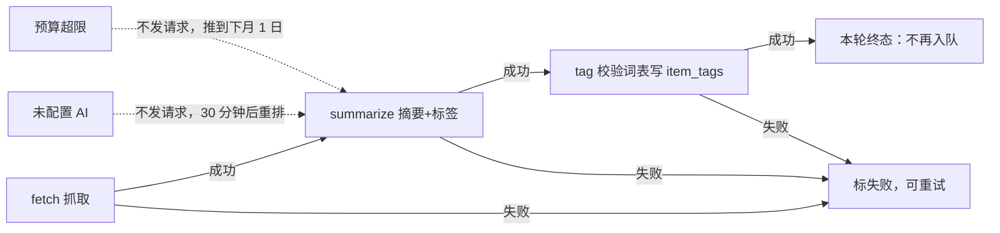

# 个人知识库 · AI 层（摘要 + 标签）增量 PRD

| 项 | 内容 |
|---|---|
| 版本 | v1.0（增量，接 PRD v0.2 与施工 R5 之后） |
| 日期 | 2026-11-27 |
| 状态 | 待评审（评审人是用户本人，非技术背景） |
| 本轮范围 | 只做流水线里的 `summarize` 与 `tag` 两步，以及「让这两步真的会被触发」 |
| 不在本轮 | 图片 OCR（`ocr`）、搜索索引（`index`）、ASR 接入 worker、语义搜索 |
| 关联文档 | `docs/prd/2026-11-25-PRD-v0.2.md`（总需求）、`docs/tech/2026-11-26-技术方案.md` §6.4 状态机 / §7.4 AI 层定义、`AGENTS.md`（长期规则） |
| 工程基线 | 交付物 R1–R5 已真机跑通：抓取 → 入库 → worker 自动处理 |
| 原始需求复述 | 用户要求：「存进去的东西，AI 自动给我一段摘要和几个标签，以后我凭模糊记忆也能找回来。」本轮把这句话里**摘要与标签**这一段落成可执行、可验收的需求 |

---

## 0. 结论先行（先看这一页，共 12 条）

1. **本轮真正的阻塞点不是「写一个调用大模型的函数」，而是流水线断了。** `kb/store/items.py` 的 `create_item` 只入队 `fetch` 一步；全项目没有任何业务代码调用 `kb/store/jobs.py:35` 的 `enqueue`。也就是说 `fetch` 跑完之后，没有任何代码把 `summarize` 放进任务表（`jobs` 表）。**即使把摘要函数写得完美，它也永远不会被执行。** 这是本轮 P0 的第一条（AI-07）。

2. **摘要与标签必须是同一次调用。** 方案 §7.4 已定死：一次请求返回 `{"summary": ..., "tags": [...]}`。分两次调用会把成本翻倍、把失败面翻倍，还会让摘要与标签的口径互相矛盾。

3. **标签必须从词表里挑，而词表现在是空的。** `tags` 表有结构（两级、`is_preset` 字段），但迁移里只灌了 8 个内容类型（`item_kinds`），**一个标签都没预置**。词表为空时「只从词表挑」这条需求无处落地，所以本轮必须先预置 8 个一级标签（AI-03）。

4. **本轮绝对不能让 `ocr` 与 `index` 进入队列。** 这两个步骤目前没有实现，worker 领到未实现的步骤会调用 `mark_failed`（`kb/worker/loop.py:94`），而 `mark_failed` 会累加 `attempts`，第 3 次就把任务标成 `failed`。后果是：**每一条图片内容、每一条内容都会在界面上显示「处理失败」**，哪怕摘要已经成功。本轮只入队 `summarize` 与 `tag`。

5. **纯文字条目会被现有代码误判为失败。** `kb/worker/loop.py` 在 `SUPPORTED_STEPS` 判断之后、分步骤执行之前，有一段「取不到 URL 就调 `apply_extract(ok=False, error="无链接可抓")` 并标完成」的逻辑。纯文字条目（`url` 为空）入库时入队的就是 `summarize`，一旦这个分支被支持，它就会先撞上「无链接可抓」。本轮必须把 URL 检查收归 `fetch` 步骤专用（AI-11）。

6. **抖音条目本轮只能凭标题出摘要，这是事实，不是缺陷。** R5 只抓元数据不下载媒体，ASR 已实现但没接进 worker（需要媒体落盘）。所以视频类条目 `content_text` 为空。本轮的处理是：正文为空则摘要基于标题，并在条目上记一条 `summaryBasis='title'`，界面照实说明「据标题生成」，**不假装这是读完全文的摘要**（AI-08）。

7. **AI 的「置信度」不写常数。** `item_tags.confidence` 允许为空。设计文档里预设筛子「没归好类的」包含「AI 置信度低于阈值」这条条件。若本轮给所有 AI 标签写死一个 0.8，而阈值取 0.7，这个筛子永远筛不出东西，等于把一条界面功能悄悄做废。本轮写 `NULL`，筛子只用「标签数 = 0」判断。

8. **预算超限不是「报错」，是「排队等下月」。** 方案 §7.4 要求超限后停止调用且条目仍入库。本轮把「停止」落成一个具体动作：任务保持 `pending`、`run_after` 推到下月 1 日 00:05、`attempts` 不增加。这样额度恢复后**自动补跑**，用户不必手动重试，也不会出现「这个月的 200 条全废了」。

9. **标签词表**初始由谁提供**这个缺口必须写死**：现在没有任何来源。`0003_seed.sql` 只插了 8 个 `item_kinds`，`tags` 表是空表。所以 AI-03（预置 8 个一级标签）不是「顺手加的数据」，它是 AI-02 的前置条件——词表为空时「只能从词表挑」在功能上等价于「AI 永不打标签」。供给链与「谁写什么」在 §2.4 已逐环节定死，不留「以后再补」。

10. **项目没有把 HTTP 客户端列进依赖，这是真机上会炸的一处。** `pyproject.toml` 的 `dependencies` 只有 `pg8000`/`starlette`/`uvicorn`/`bcrypt`/`parsehub`；`httpx` 在本机存在（0.28.1）但 `Required-by` 是 `f2` 与 `parsehub`，是**传递依赖**。换干净机器或 `parsehub` 升级后 `import httpx` 就可能失败。方案 §3.2 已把 `httpx` 定为复用项，本轮必须把它写进 `dependencies`（AI-12），并把网络失败的每一类反应写进验收（§6.3b 的 B21–B29）——超时、5xx、429、401、代理变量、响应非 JSON、响应过大，逐条给确定行为。

11. **用户要求「额度用到 80% 就提前提醒」，但本项目现在没有前端。** 仓内只有 `demo/index.html` 原型（`AGENTS.md` 第四节明确：原型不是产品代码、数据写死、不可作为实现基础）。所以这条落成 **API 能返回的状态**：记账时写 `budgetWarned` 标记（AI-14），新增 `GET /api/ai/usage` 返回七个定死字段（AI-15）。**本轮不做任何前端展示**，也不往 `demo/` 加假数据。80% 与 100% 是两件事：80% 是预警（继续调用），100% 是停止（AI-05 拦请求）。

12. **配置进 AI 层只有一条路：worker 从 `settings` 读出、拼成 `AiConfig` 传进去。** AI 层不读 `settings`（架构规则已禁 `kb/ai` import `kb.store`）、不读环境变量。定这一条是为了不让架构师两难，也让 AI 层能脱离数据库单测（§5.7、E6、E7）。

---

## 1. 术语表（非技术读者先看这张表）

| 术语 | 一句人话 |
|---|---|
| AI 层 | 代码里专门负责「把一段文字送去大模型、再把结果拿回来」的那一层，它不碰数据库 |
| 摘要 | 一段不超过 100 字的中文概括，用来在列表里替代正文 |
| 标签 | 一个短词（如「AI相关」），用来把内容归堆。本产品只允许两级：父标签 › 子标签 |
| 词表 | 允许 AI 挑选的标签清单。AI 只能从里面挑，不能自己发明新词 |
| 任务队列 / `jobs` 表 | 一张待办清单：每行写「哪条内容、要做哪一步、做了几次、什么时候可以开始做」 |
| 步骤（step） | 队列里的工序名，共五个：`fetch`（抓取）、`ocr`（读图）、`summarize`（出摘要+标签）、`tag`（校验词表后挂标签）、`index`（写搜索索引） |
| 入队 | 往待办清单里插一行，意思是「这件事等着做」 |
| worker | 一个一直跑着的后台程序，不停从待办清单里领活、干完、标完成 |
| 状态机 | 一条内容从「刚存进来」到「全部处理完」要固定经过的那几步，以及每步做完该接哪一步 |
| `attempts`（尝试次数） | 同一个任务失败过几次。满 3 次就判死，不再重试 |
| 退避 | 失败后不立刻重试，而是等 1 分钟、再等 2 分钟，避免把上游服务打爆 |
| 幂等 | 同一件事重复做多次，结果与做一次相同（不会产生两条摘要、两套标签） |
| `settings` 表 | 一张键值配置表，存的是「一个名字 → 一个值」，例如预算上限、AI 接口地址 |
| `props` 字段 | `items` 表里一个可放任意键值对的字段（数据库里叫 jsonb），用来存不属于固定列的长尾属性 |
| 降级 | 主路径不可用时退到一个「能接受但不完整」的结果，而不是直接报错 |
| 预算闸门 | 在发请求之前先看本月已花多少钱，超过上限就不发 |
| ASR | 语音转文字（把视频里的说话声变成可搜索的文本） |
| OCR | 图片文字识别（把截图里的字读出来） |
| 端到端 | 从「用户点保存」到「界面上看到摘要」整条链路，中间不打桩、不手工干预 |
| 空正文 | `items.content_text` 为空或只有空白字符。抖音视频条目在媒体下载轮次之前就是这种状态 |
| 依赖 / `dependencies` | 这个项目自己要用到的第三方代码包清单。清单里没写、但被别的包捎带装上的叫**传递依赖**，随时可能因为别人升级而消失 |
| 超时（连接 / 读 / 总） | 「连接超时」= 连不上对方服务器最多等多久；「读超时」= 连上了但对方不回数据最多等多久；「总超时」= 一次请求从头到尾的上限 |
| 代理变量（`HTTP_PROXY` 等） | 系统里的一类环境设置，用来让网络请求绕道一台中转服务器。容器里若残留这种设置，请求会走到一个不存在的地址然后卡死超时 |
| 状态码 429 / 5xx / 401 | 服务器回的三个数字：429 = 你请求太快了，稍后再来；5xx = 服务器自己出错；401/403 = 你的密钥不对或没权限 |
| `Retry-After` | 服务器在 429 响应里附的一个数字，意思是「过这么多秒再来」，比我们自己猜的等待时间准 |

---

## 2. 产品目标

### 2.1 这一层解决什么问题

**问题**：库里存的东西，标题常常不足以让人回忆起来。抖音的分享文案是「7.68 复制打开抖音，看看【某某】的作品」，公众号标题是一句悬念，图片干脆没有标题。用户三个月后凭模糊记忆找一条内容时，**只有标题这一个可读字段**。

**AI 层要做的事**：把「一段人类语言（标题、正文、字幕）」压成两样东西——一句能读懂的概括，几个能归堆的词——让它在列表页可读、在搜索里可命中、在筛选里可点击。

### 2.2 三个目标（互不重叠）

| 目标 | 含义 | 怎么算达成 |
|---|---|---|
| G1 可读 | 列表与详情页不再是一片标题墙，每条都能一眼看懂讲了什么 | 处理完成的条目中，`items.summary` 非空的比例 ≥ 90%；空的那 10% 是「正文标题都空」这类客观无内容可摘要的情况 |
| G2 可找 | 摘要与标签进入检索字段，凭印象里的说法能搜到 | 摘要与标签写入后，能通过这两个字段命中该条目（本轮只保证字段已写库，检索层由 M6 轮次接入） |
| G3 不失控 | 花出去的钱有上限，出错有痕迹，不制造垃圾标签 | 月度花费不超过 `settings('ai_budget_cny')`；`tags` 表行数不因 AI 而增长；每条失败都有可读原因 |

### 2.3 本轮必须承认的五条事实

1. **抖音条目正文为空，只有标题。** 摘要在这些条目上只能基于标题（AI-08 的 `summaryBasis='title'`）。ASR 已跑通但没接进 worker，因为媒体下载轮次（R8 之后）还没做。
2. **`kb/ai/` 目录还不存在。** 架构规则 `layer_rules.toml` 已经预留了它：`kb/ai/` 不许 import `kb.store`。也就是说 AI 层**只接收文本、只返回文本**，"把结果写进数据库"这件事由 worker 调 store 完成。
3. **模型与接口地址由配置决定，不写死在代码里。** 方案 §7.4 定的是 OpenAI 兼容接口，换供应商只改 `settings` 里几个值。
4. **标签词表现在没有来源。** `kb/store/migrations/0003_seed.sql` 只插了 8 个内容类型（`item_kinds`），`tags` 表一行都没有。这不是「以后补一下」的小事：AI-02 要求「只能从词表挑」，词表为空时这条需求在功能上等价于「AI 永不打标签」。所以 AI-03（预置 8 个一级标签）是 AI-02 的**前置条件，不是附带项**。词表供给链见 §2.4。
5. **项目没有把 HTTP 客户端列进依赖。** `pyproject.toml` 的 `dependencies` 只有 `pg8000` / `starlette` / `uvicorn` / `bcrypt` / `parsehub`。`httpx` 在本机虚拟环境里存在（版本 0.28.1），但它是被 `parsehub` 与 `f2` 传递装进来的，**不是本项目声明的依赖**：换一台干净机器装本项目，`import httpx` 是否成功取决于 `parsehub` 的传递依赖有没有变。AI 层要发 HTTP 请求，这件事必须先定下来（见 §5.5），否则真机上会出现「本机能跑、平板报 ImportError」。

### 2.4 标签词表的供给链（缺口写清，不留假设）

| 环节 | 谁提供 | 现状 | 本轮要不要动 |
|---|---|---|---|
| 初始词表 | 迁移种子数据 | **空表**，一行没有 | 要（AI-03：插 8 个一级标签，`is_preset=true`） |
| 用户新增 | 界面「建标签」 | 端点 `POST /api/tags` 在方案 §8.1 已定，本项目 R1–R5 未实现 | 不要（本轮不做界面，用户在 psql 或后续轮次建） |
| AI 写入词表 | 任何人 | **禁止**，AI 只能读词表 | 不要（AI-02 的硬约束，F4 用例守这条） |
| 词表发给模型的形式 | AI 层自己拼 prompt | 不存在 | 要：只发一级与二级标签的 `name`，按「父 › 子」拼接，去重后按 `id` 升序，最长 200 个（超出只发前 200，避免 prompt 无限膨胀） |

**结论**：词表初始由迁移种子数据提供（AI-03），用户后续自己增删；AI 对词表**只读**。若用户把 8 个预置标签全删了，AI 就只出摘要不打标签（F1 用例覆盖），这是设计上接受的结果，不是故障。

---

## 3. 用户故事

| ID | 故事 | 通过标准 |
|---|---|---|
| US-1 | 作为使用者，我三天前刷到一条抖音，只记得「讲怎么用 AI 写周报的那个」，我想把它找回来，**不记得作者也不记得标题里的字** | 这条视频入库后 60 秒内出摘要，摘要里出现「周报」「AI」这类关键词；我在搜索框打「周报」能命中它 |
| US-2 | 作为使用者，我存了一篇很长的公众号文章，我不想现在读，我想先知道它到底讲什么 | 列表页每条下面显示一行 ≤100 字的摘要，我不点进去就知道要不要读 |
| US-3 | 作为使用者，我懒得自己建分类，但我希望内容能被自动归堆，而且**别给我造出 200 个近义标签** | 一条内容最多 3 个标签，全部来自我自己建的标签清单；`tags` 表行数不因 AI 增加 |
| US-4 | 作为使用者，我这个月 AI 花超了，我不想某天收到一张意外账单 | 到上限后停止调用，内容照常存进来；界面上能看出「本月额度已用完，摘要等下月自动补」 |
| US-5 | 作为使用者，我没配过 AI（或者换电脑后配置丢了），我还是想把东西存进来 | 未配置时内容照常入库、不报错、不发请求；我配好之后，之前攒的条目在 30 分钟内自动补上摘要 |
| US-6 | 作为使用者，AI 给我打错标签了，我要能一键撤掉所有 AI 标签，自己加的不能被动 | 清除后 `origin='ai'` 的行全部消失，`origin='user'` 的行一条不动 |

---

## 4. 需求池

### 4.1 编号说明（读表之前先看）

本轮需求用 `AI-` 前缀单独编号，**不改** PRD v0.2 的 M 编号，避免两份文档对同一编号给出不同口径。与旧编号的对应关系在 §4.5。

> ⚠️ **机器检查的已知缺口**：`python -m tools.doc_checks` 的「P0 覆盖」检查只识别 `M数字-数字` 形式的编号，因此本文件的 `AI-` 需求不进那项检查。这不是绕过——每条的方案落点在 §4.6 逐条写明；要让机器也核一遍，需要在 `docs/tech` 的映射表补 `AI-` 对照行，而那需要改 `docs/tech`，不在本轮授权范围。验收方式：人工核对 §4.6 表格与方案原文。

### 4.2 P0（本轮必须全部完成，缺一条整轮不算交付）

| ID | 需求 | 优先级 | 追溯 |
|---|---|---|---|
| AI-01 | 摘要 + 标签**在一次模型调用里同时产出**，返回一个 JSON 对象：`{"summary": 字符串, "tags": 字符串数组}`。摘要不超过 100 字，标签 1–3 个（可为空数组） | P0 | 方案 §7.4、M3-02、M3-03 |
| AI-02 | 标签**只能从词表里挑**。落库前做二次校验：词表外的名称直接丢弃、不报错；超过 3 个只取前 3 个；重复去重；归一化按「去首尾空白 + 转小写」比对；非字符串元素丢弃 | P0 | 方案 §7.4 `validate_tags`、M3-04 |
| AI-03 | 预置 8 个一级标签（`is_preset=true`，用户可改可删）：AI相关、工作赚钱、学点东西、生活过日子、健康、好看的东西、好玩放松、先存着以后用 | P0 | 设计文档「积木 3」、M5-01 |
| AI-04 | **未配置 AI 时的降级**：`ai_base_url` / `ai_api_key` / `ai_model` 三键缺任一，视为未配置。此时不发任何网络请求，任务保持 `pending`，把 `run_after` 推到 30 分钟后重排，`attempts` 不增加；条目照常入库 | P0 | 方案 §7.4「未配置则只存不解析」 |
| AI-05 | **月度预算上限**：调用前读 `settings('ai_budget_cny')` 与当月累计花费；若「已花 + 本次预估」≥ 上限，则不调用，任务保持 `pending`、`run_after` 推到下月 1 日 00:05（本地时区）、`attempts` 不增加。该键未设置时按 20 元执行 | P0 | 方案 §7.4 |
| AI-06 | **用量记账**：每次成功调用后把结果累加进 `settings('ai_usage_YYYY_MM')`，字段为 `{calls, promptTokens, completionTokens, cny}`，`cny` 保留 4 位小数。月份按本地时区取自然月 | P0 | 方案 §7.4、M9-07 |
| AI-07 | **状态机断点修复**：`fetch` 步骤**成功**后入队 `summarize`。`fetch` 失败时**不入队**（没有内容可摘要）。"成功"的判据是 `ExtractOutcome.ok` 为真 | P0 | 方案 §6.4、M9-05 |
| AI-08 | **输入选择与空内容处理**：`content_text` 去空白后 ≥40 字走正文；否则若标题非空走标题（若正文还有 1–39 字则一并给模型，并注明正文很短）；两者都空则**不调用**，`items.summary` 保持 NULL，`props.summarySkipped='no_text'`，任务标 `done`。每次成功都写 `props.summaryBasis`（`content` 或 `title`） | P0 | 方案 §7.4「抖音退化为标题扩展」 |
| AI-09 | **`summarize` → `tag` 的交接**：`summarize` 成功后把模型返回的原始标签名数组写入 `items.props.aiTags`，然后入队 `tag`；`tag` 步骤读 `props.aiTags`，校验词表后写 `item_tags`（`origin='ai'`、`confidence` 为 NULL），成功后入队……**不入队**（见 AI-10） | P0 | 方案 §6.4、§7.4 |
| AI-10 | **本轮不把 `ocr` 与 `index` 放进队列**：`fetch` 成功时只入队 `summarize`；`tag` 成功后不入队 `index`。理由与风险见 §5.3。等对应轮次实现了这两个步骤再打开入队 | P0 | 方案 §6.4（部分延后） |
| AI-11 | **纯文字条目（`url` 为空）必须能走通 `summarize`**：现有「取不到 URL 就按无链接可抓处理」的分支只能作用于 `fetch` 步骤，不得拦掉 `summarize` | P0 | 本轮新发现，见 §5.4 |
| AI-12 | **HTTP 客户端必须显式声明依赖**：把 `httpx` 写进 `pyproject.toml` 的 `dependencies`（与技术方案 §3.2 选型一致），不靠 `parsehub` 的传递依赖。超时：连接 5 秒 / 读 10 秒 / 总 20 秒。应用级重试**不做**在客户端内，统一由 `jobs.attempts` 管，否则界面上「重试了几次」与数据库不一致 | P0 | 本轮查明，见 §5.5 |
| AI-13 | **摘要质量的四条可判定指标**：① `len(summary) ≥ 10`；② `len(summary) ≤ 100`；③ 摘要 ≠ 标题（去空白比较）；④ 处理完成条目中 `summary` 非空比例 ≥ 90%。不满足 ①②③ 的输出按非法处理 | P0 | 本轮设计，见 §5.6 |
| AI-14 | **80% 预算提醒**：当月累计 `cny` 首次 ≥ `ai_budget_cny × 0.8` 时，在同一次记账写入里给 `settings('ai_usage_YYYY_MM')` 加上 `budgetWarned: true`。这个标记**当月只写一次**，之后继续调用不改它、不重写时间戳。跨月天然重置（换了 `ai_usage_2026_12` 这个新键）。阈值 0.8 与预算默认值 20 元共同意味着 16 元 | P0 | **用户 2026-11-27 拍板（Q2）**，见 §5.8 |
| AI-15 | **用量查询端点**：新增 `GET /api/ai/usage`（有鉴权），返回 §5.8 定死的七个字段（`month`/`budgetCny`/`spentCny`/`usedRatio`/`budgetWarned`/`budgetExhausted`/`calls`）。**本轮只做到 API 返回状态，不做任何前端展示**（项目当前无真实前端，`demo/` 是原型不可用作实现基础） | P0 | **用户 2026-11-27 拍板（Q2）**，见 §5.8 |

### 4.3 P1（本轮不做，下一批第一顺位）

| ID | 需求 | 优先级 | 追溯 |
|---|---|---|---|
| AI-16 | 手动重跑：详情页提供「重新生成摘要」，对 `failed` 或 `summarySkipped` 的条目重新入队 `summarize` | P1 | M2-10 |
| AI-17 | 详情页在摘要下方显示来源标记：`content` 显示「据正文」，`title` 显示「据标题（无正文）」 | P1 | 本轮设计 |
| AI-18 | 历史条目批量补摘要：对 `summary IS NULL` 且 `deleted_at IS NULL` 的条目一次性入队 | P1 | 本轮设计 |
| AI-19 | 词表为空时在界面上提示「先建几个标签，AI 才能自动归堆」，而不是静默只出摘要 | P1 | 本轮设计 |
| AI-20 | 一键清除全部 AI 标签（只删 `origin='ai'`），并对这些条目写 `props.aiTagsCleared=true`，避免下次重跑又贴回来。**同时提供单条删除**（前端轮次实现，后端已有的 `DELETE /api/items/{id}/tags/{tag_id}` 足够，不需新增端点） | P1 | M5-11、**用户 2026-11-27 拍板（Q7）** |
| AI-21 | 内容变化后摘要刷新：`fetch` 重跑成功会再次入队 `summarize`（天然覆盖）。需保证重跑时 `origin='ai'` 的标签整体替换、`origin='user'` 的保留 | P1 | 本轮设计 |

### 4.4 P2（以后）

| ID | 需求 | 优先级 | 追溯 |
|---|---|---|---|
| AI-22 | 视频章节化摘要，带时间戳 | P2 | M3-06 |
| AI-23 | 图片视觉通道（`ocr` 步骤：图中文字 + 一句话描述） | P2 | M3-05、方案 §7.4 视觉模型 |
| AI-24 | 语义搜索（记得意思、不记得词） | P2 | M6-06 |
| AI-25 | 跨内容自动关联（「你可能也存过」） | P2 | M3-07 |
| AI-26 | 摘要语气/长度可配 | P2 | 本轮设计 |

### 4.5 与 PRD v0.2 的追溯表

| M 编号 | 对应需求 | 原优先级 | 本轮条目 |
|---|---|---|---|
| M3-02 | AI 生成摘要，≤100 字 | P0 | AI-01、AI-08、AI-13 |
| M3-03 | AI 打 1–3 个主题标签 | P0 | AI-01、AI-02 |
| M3-04 | AI 只能从词表挑，不能自创 | P0 | AI-02、AI-03 |
| M9-05 | 后台任务队列，失败重试 3 次，状态可见 | P0 | AI-07、AI-11、AI-12 |
| M9-07 | AI 用量与花费可见 | P2 | AI-06、AI-14、AI-15（本轮全部提到 P0：预算闸门依赖记账，用户又要求 80% 提前提醒） |
| M3-05 | 图片一次出 OCR + 描述 | P0 | 不在本轮，见 AI-23 |
| M3-06 | 视频章节化摘要 | P2 | AI-22 |
| M3-07 | 跨内容自动关联 | P2 | AI-25 |
| M5-11 | 标签治理：支持一次性撤销全部 AI 标签 | P1 | AI-20 |
| M6-06 | 语义搜索 | P1 | AI-24 |

### 4.6 每条 P0 的方案落点（人工核对用）

| 需求 | 方案原文位置 | 原文给了什么 | 本轮补了什么 |
|---|---|---|---|
| AI-01 | §7.4 Prompt 骨架 | Prompt 模板、JSON 形状、摘要 ≤100 字、标签 1–3 个 | 非法输出的处理路径（§6.3 B1–B5） |
| AI-02 | §7.4 `validate_tags()` | 词表外丢弃、最多 3 个 | 去重、类型过滤、大小写归一、同名多父的处理 |
| AI-03 | 设计文档「积木 3」 | 8 个预设一级标签的名字 | 落到 `tags` 表并标 `is_preset=true` |
| AI-04 | §7.4 视觉模型一行的括注「未配置则只存不解析」 | 降级的方向 | 降级的具体行为：不发请求、`run_after` +30 分钟、`attempts` 不变 |
| AI-05 | §7.4 月度上限 | 键名 `ai_budget_cny`、超限停止 | 超限后任务去哪（推到下月）、默认值 20 元、预估口径 |
| AI-06 | §7.4 用量记录 | 键名 `ai_usage_YYYY_MM`、累加四个量 | 缺 `usage` 时的估算口径、金额保留位数 |
| AI-07 | §6.4 状态机第一行 | `fetch` 成功后插入 `summarize` | 失败时不入队这条边界；以及「现在没有任何代码调用 enqueue」这个事实（§5.1） |
| AI-08 | §7.4 与 §4.11 | 输入取「标题 + 正文前 3000 字」；抖音退化为标题扩展 | 40 字阈值、`summaryBasis` 字段、两者都空时的不调用分支 |
| AI-09 | §6.4 `summarize`→`tag` | 两步分开、`tag` 校验词表 | 两步之间标签名存哪（`props.aiTags`）——方案没写 |
| AI-10 | §6.4 第三、五行 | `index` 步与「取最后一个完成的」逻辑 | 本轮不入队的原因与恢复方式（§5.3） |
| AI-11 | 无 | —— | 本轮读代码发现（§5.4） |

### 4.7 明确不做（本轮）

| 不做 | 原因 |
|---|---|
| 让 AI 自创新标签 | 放开两周就会出现「AI」「人工智能」「ai工具」并存（设计文档已有结论），违背「不能变成整理工具」这条反目标 |
| AI 自动建二级标签树 | 两级结构留给用户自己建。让模型猜层级，误差无法回收 |
| 用 AI 生成正文、续写、改写 | 本产品只负责存与找，不负责写（`AGENTS.md` 第三节） |
| 对话式问答（"我存过的关于定价的内容总结一下"） | 属 M6 之后的检索能力，且需要一个能读全库的问答链，本轮不碰 |
| 自动评分、自动归档、自动删除 | 评分是用户的判断，不是模型的判断 |
| 把摘要写进 `content_text` | 会让「正文」与「摘要」两个字段互相污染，检索权重也失去意义（方案 §6.7 把两者分成独立字段） |
| 本地大模型 / 离线推理 | 平板内存实测：900 MB 以上模型会打挂整个服务（R5 交接包第二节第 4 条）。文本模型走远端接口 |
| 向量嵌入与相似度检索 | 属 AI-22，需要额外的嵌入模型与向量索引，本轮不引入 |

---

## 5. 本轮流水线的实际形态

### 5.1 现状与断点

方案 §6.4 定义的状态机是五步串起来：

```text
fetch → summarize（出摘要 + 标签，同一次调用）→ tag（校验词表写 item_tags）→ index
```

代码现状（2026-11-27 实测核对）：

| 环节 | 现状 | 证据 |
|---|---|---|
| 入库入队 | 只入队 `fetch`（纯文字入队 `summarize`） | `kb/api/items.py:93`、`:103` |
| worker 支持的步骤 | 只有 `fetch` | `kb/worker/loop.py:27` `SUPPORTED_STEPS = ("fetch",)` |
| `enqueue` 的业务调用方 | **零** | 全仓 `grep enqueue` 只命中定义与测试 |
| `fetch` 成功后 | 标 `done`，然后结束 | `kb/worker/loop.py:119-121` |
| `summarize` / `tag` / `index` / `ocr` | 领到就 `mark_failed("尚未实现")`，`attempts` 累加 | `kb/worker/loop.py:91-97` |

**结论：断点有两处，性质不同，两处都要修。**

| 断点 | 内容 | 谁的活 |
|---|---|---|
| 断点一（主干断） | 链接条目 `fetch` 成功后，没有任何代码入队 `summarize`。全项目 `enqueue` 零业务调用方 | AI-07 |
| 断点二（纯文字路线断） | 纯文字条目入库时**本来就入队 `summarize`**（`kb/api/items.py:103`），但 worker 会在两处把它拦掉：① 现状下 `summarize` 不在 `SUPPORTED_STEPS`，命中 `loop.py:91` 判「尚未实现」；② 把 `summarize` 加进 `SUPPORTED_STEPS` 之后，会落到 `loop.py:99` 取 URL，纯文字 `url` 为空，命中 `loop.py:100-106` 写成「无链接可抓」并标 `done` | AI-11 |

**这两处不能合并成一处**：只修断点一，链接条目能出摘要，但纯文字条目永远没有摘要且状态显示「已完成」（谎报）；只修断点二，纯文字能出摘要，但链接条目永远不进 `summarize`。两处相互独立，落地顺序见 §9（先修断点二的分流，再接断点一的入队）。

断点二容易被误判成「不用改」，因为 `items.py:103` 确实已经入队了 `summarize`——**入队了不等于能执行**。`loop.py` 的执行顺序是「判步骤是否支持（91 行）→ 取 URL 判空（99 行）→ 执行」，URL 判空在分派之前，对所有已支持的步骤一视同仁。

### 5.2 本轮实现后的状态机



| 步骤 | 谁创建 | 本轮是否实现 | 成功后插入什么 | 失败后 |
|---|---|---|---|---|
| `fetch` | `POST /api/items`（链接条目） | 已有 | **`summarize`**（本轮新增，AI-07） | 不入队、不消耗后续步骤；`attempts+1`，3 次后 `failed` |
| `summarize` | `fetch` 成功时；纯文字条目入库时（已有） | **本轮实现** | `tag` | `attempts+1`，退避 1/2 分钟，3 次后 `failed` |
| `tag` | `summarize` 成功时 | **本轮实现** | 无（见 §5.3） | 同上 |
| `ocr` | 不入队 | 否 | —— | —— |
| `index` | 不入队 | 否 | —— | —— |

**每次 `summarize` 成功都顺带记账（AI-06）并检查 80% 线（AI-14）**，这一动作不产生新步骤、不改变状态机，只是写 `settings`。

### 5.3 为什么本轮不让 `index` 进队列

方案 §6.4 把 `index` 定为终态，作用是「入库后立刻可搜」。本轮不让它进队列，原因是**它没实现，而入队会产生可见的错误状态**：

1. 未实现的步骤会被 `mark_failed` 处理，`attempts` 累加到 3 后变 `failed`。
2. `derive_status`（`kb/store/items.py:164`）在「无待办、无运行、有失败」时返回 `failed`。
3. 结果：**每一条内容都会在列表上显示「处理失败」**，而摘要其实已经成功写入。

这是「宁可少一个功能，不可谎报一个状态」的直接应用。恢复条件：Meilisearch 接入那一轮实现 `index` 后，`tag` 成功后入队 `index`，同时按方案 §6.4 补「取最后一个完成的」逻辑（`index` 领到先查同条目有没有未完成的 `summarize`/`ocr`/`tag`）。

**代价（写清，不藏）**：本轮结束后，新存的内容在搜索里搜不到，需要等 `index` 轮次跑一次全量重建。这期间检索只有数据库层面的能力，Meilisearch 索引是旧的。用户可感知的影响：搜不到最近存的东西。这条写进 §8 待确认问题第 6 条。

### 5.4 纯文字条目会撞上的分支

`kb/worker/loop.py` 当前顺序是：领任务 → 判断步骤是否支持 → **取 URL，取不到就按「无链接可抓」处理并标完成** → 执行抓取。

纯文字条目入库时入队的是 `summarize`（`kb/api/items.py:103`），`url` 为空。一旦 `summarize` 被加入 `SUPPORTED_STEPS`，它会先撞上「取不到 URL」这一段，被写成 `apply_extract(ok=False, error="无链接可抓（纯文字条目）")` 并标 `done`。

后果：**纯文字条目永远没有摘要，且状态显示为已完成**——又是谎报。

要求：URL 检查只对 `fetch` 步骤生效。分步骤执行必须在 URL 检查之前分流。

### 5.5 AI 调用怎么发出去（依赖没声明，必须定）

现状核查（2026-11-27）：

| 项 | 事实 |
|---|---|
| `pyproject.toml` 的 `dependencies` | `pg8000` / `starlette` / `uvicorn` / `bcrypt` / `parsehub` —— **没有 HTTP 客户端** |
| 仓内已有的网络调用 | 只有 `kb/api/health.py:44` 用标准库 `urllib.request` 探 Meilisearch |
| `httpx` 在本机虚拟环境 | 存在，0.28.1，但 `pip show httpx` 的 `Required-by` 是 `f2` 与 `parsehub`——**靠 `parsehub` 传递装上的** |
| 技术方案 §3.2 对 HTTP 客户端的选型 | `encode/httpx`，结论「复用」，「异步 + HTTP/2，替代自写重试与连接池」 |

**判断**：AI 层发请求用 `httpx`，与技术方案 §3.2 已定选型一致。但 `httpx` 现在没有写进 `pyproject.toml` 的 `dependencies`，这必须补上——否则平板容器里 `parsehub` 一升级、传递依赖一变，`import httpx` 就可能失败，表现为 worker 起不来。

**不许的做法**：不许依赖「我这台机器上恰好装上了」。这是本项目已经踩过的坑型：R5 的 `pytest-asyncio` 就是本地恰好装了、CI 干净环境没装，导致 11 个异步测试全挂（`pyproject.toml:22` 的注释记着这件事）。

**超时与重试的分层**（两层，各管各的，不互相替代）：

| 层 | 管什么 | 配置 |
|---|---|---|
| `httpx` 客户端 | 连接超时 5 秒、读超时 10 秒、总超时 20 秒 | 代码内常量，写在一处 |
| `jobs` 状态机 | 失败后重试与退避，满 3 次判死 | 已有 `mark_failed`（退避 1/2 分钟）+ `MAX_ATTEMPTS` |

**不在 `httpx` 层做应用级重试**：那会与 `jobs` 的 `attempts` 计数打架——一次任务在客户端内偷偷重试 2 次，数据库只记 1 次 `attempts`，界面上「重试了几次」就是错的。

**代理与环境变量**：平板走 Tailscale 直连，AI 接口是公网域名。`httpx` 默认信任 `HTTP_PROXY`/`HTTPS_PROXY`/`ALL_PROXY` 环境变量；容器里若残留代理变量会导致请求走到不存在的代理而超时。实现时显式传 `trust_env=False`，或至少保证容器内无代理变量——两种做法都要有一条用例守住（B21）。

### 5.6 摘要「质量」怎么变成可判定的东西

用户要求「把测试和检查作为工作核心」，而「摘要质量好」本身无法机器判定。所以本轮把质量拆成**三条能判定的硬指标**（对应 AI-13），质量的主观部分留给用户自己评价，不进验收：

| 判据 | 阈值 | 为什么它能代替「质量」 |
|---|---|---|
| 非空 | `len(summary) ≥ 10` | 挡住空串、挡住 `null`、挡住「无」这类敷衍输出 |
| 上限 | `len(summary) ≤ 100` | 列表页一行能放下；超长说明模型没听指令 |
| 不等于标题 | 摘要 ≠ 标题（去空白后比较） | 把标题抄一遍是最常见的一类「假摘要」，界面上会显示两行一样的字 |

三条之外，另有一条**覆盖率**指标用于判断整批效果：处理完成的条目里 `summary` 非空的比例 ≥ 90%（G1）。这个数可以写成一条 SQL 断言，也能在真机上人工看。

**不做的质量评估**：不引入 ROUGE / G-Eval / 人工标注对照。理由写进 §7 复用调研那一行——个人库没有参考摘要，为评估再花钱调用模型不值得。

### 5.7 配置怎么进 AI 层（定死一种，不留两难）

**结论：worker 从 `store.settings` 读出配置，作为参数传进 AI 层。AI 层不读 `settings`、不读环境变量、不知道数据库存在。**

三种做法都想过，淘汰两种：

| 做法 | 判 | 理由 |
|---|---|---|
| AI 层自己读 `store.settings` | 淘汰 | 直接违反 `layer_rules.toml` 的 `[[import_deny]] path_prefix = "kb/ai/" modules = ["kb.store"]`，`python -m tools.eng_checks --arch` 会拦。而且 AI 层就无法脱离数据库单测 |
| AI 层自己读环境变量 | 淘汰 | 配置存在 `settings` 表里（方案 §7.4 定的），不是环境变量。两处配置源必然漂移：改了表里的值、环境变量没改，AI 层用的是旧值，且没有任何地方报错 |
| **worker 读出后当参数传进去** | **采用** | 配置只有一个权威源（`settings` 表）；AI 层变成纯函数（输入：配置 + 文本 + 词表；输出：摘要 + 标签名），可以完全脱离数据库测试 |

**调用形状**（签名示意，不是实现）：

```python
# kb/ai/client.py —— 不认识数据库，只认识传进来的配置对象
@dataclass(frozen=True)
class AiConfig:
    base_url: str
    api_key: str
    model: str
    price_cny_per_1k: float
    timeout_connect: float = 5.0
    timeout_read: float = 10.0
    timeout_total: float = 20.0
```

**职责切分**（这三行是给架构师的边界，越界就会破坏一种能力）：

| 谁 | 负责 | 不负责 |
|---|---|---|
| worker | 读 `settings` 拼出 `AiConfig`、判预算、记账、写库 | 不拼 prompt、不解析模型响应 |
| `kb/ai/` | 拼 prompt、发请求、解析与校验 JSON、按四条判据判质量 | 不读库、不读环境变量、不做重试决策 |
| `store` | 写 `items.summary`、写 `item_tags`、写 `settings` 用量 | 不知道 AI 存在 |

**未配置的判定发生在 worker**：三键缺任一 → worker 直接走「推迟 30 分钟」分支，**不构造 `AiConfig`、不进 AI 层**。所以 AI 层永远拿到一份完整配置，不需要在内部写「配置可能为空」的分支——这能让 AI 层的测试少一半组合。

### 5.8 用量与提醒怎么被看见（本轮没有前端，落在 API）

**事实：本项目现在没有真正的前端。** 仓内只有 `demo/index.html` 原型（`AGENTS.md` 第四节：原型不是产品代码，数据写死、无后端、不可作为实现基础）。真正的界面轮次在 R5 之后还没开始。

所以「额度用到 80% 提醒」这条**本轮只做到「API 能返回这个状态」，不做任何前端展示**。前端展示留给界面轮次，本轮不碰、也不在 `demo/` 里加假数据。

**落点选择**：新增 `GET /api/ai/usage`，不复用 `GET /api/health`。理由：

| 方案 | 判 | 理由 |
|---|---|---|
| 塞进 `GET /api/health` | 淘汰 | health 是**无鉴权**的端点（方案 §8.1 第 28 行「鉴权：无」），把「本月花了多少钱」暴露给未登录请求属于信息泄露；且 health 被外部探活高频调用，每次都读 `settings` 是浪费 |
| 新增 `GET /api/ai/usage`（**有鉴权**） | **采用** | 语义单一、可独立演进；鉴权与其它业务端点一致；前端轮次直接接这个接口即可，不需要再改后端 |

**返回字段**（字段名定死，前端轮次照此对接）：

```json
{
  "month": "2026-11",
  "budgetCny": 20.0,
  "spentCny": 15.99,
  "usedRatio": 0.7995,
  "budgetWarned": false,
  "budgetExhausted": false,
  "calls": 2663
}
```

| 字段 | 取值 | 说明 |
|---|---|---|
| `month` | `YYYY-MM` | 本地时区的自然月，与 `settings['ai_usage_YYYY_MM']` 的键一致 |
| `budgetCny` | 数字 | 读 `settings['ai_budget_cny']`；未设时返回 20.0（与 AI-05 的默认值一致，不返回 null） |
| `spentCny` | 数字，4 位小数 | 当月累计；无记录时返回 0.0 |
| `usedRatio` | 0–1 的数字 | `spentCny / budgetCny`；`budgetCny` 为 0 时返回 1.0（不返回 Infinity / null） |
| `budgetWarned` | 布尔 | 当月累计**曾经**跨过 80% 即为 true，本字段一旦为 true 当月不再变回 false |
| `budgetExhausted` | 布尔 | `spentCny >= budgetCny` |
| `calls` | 整数 | 当月调用次数；无记录时返回 0 |

**`budgetWarned` 的写入位置**：写进 `settings['ai_usage_YYYY_MM']` 这个 jsonb 里，作为一个键（`"budgetWarned": true`），**不新增 `settings` 行**。理由：用量与「是否已提醒」是同一个月的同一件事，分成两行会出现「用量写了、提醒标记没写」的半更新状态，而它们本来就该一起写。

**`budgetWarnedAt`（只在内部存，不对外返回）**：置 true 的同时写一个 ISO 时间戳。它唯一的用途是让 D10 能断言「提醒时间戳没被反复重写」——`settings.updated_at` 每次累加用量都会变，单独看它区分不出「重复写了提醒」。但要配合 D10 ③ 一起断：只断时间戳冻结，会漏掉「整行根本没更新、测试假通过」。

**jsonb 形状**（`settings['ai_usage_YYYY_MM']` 的完整内容）：

```json
{
  "calls": 2663,
  "promptTokens": 3195600,
  "completionTokens": 399450,
  "cny": 16.01,
  "budgetWarned": true,
  "budgetWarnedAt": "2026-11-27T14:32:08+08:00"
}
```

前四个键由 AI-06 负责累加；后两个键由 AI-14 负责，**已存在则不再覆盖**。`budgetWarned`/`budgetWarnedAt` 不出现在 `GET /api/ai/usage` 的响应里（响应只给布尔 `budgetWarned`，时间戳对前端无用）。

---

## 6. 验收标准（可机器验证）

### 6.1 通用约定

| 项 | 约定 |
|---|---|
| 断言对象 | 数据库行（`items` / `jobs` / `item_tags` / `tags` / `settings`）与「模型接口被调用了几次」。**不打桩断言日志文本**——日志会改，行不会 |
| 模型接口的打桩方式 | 用可注入的假客户端替换真实 HTTP 调用，记录每次调用的「第几次、入了什么、返回什么」 |
| 配置怎么进来 | **worker 从 `settings` 读出、拼成 `AiConfig` 传进 AI 层**（§5.7 已定死这一种）。AI 层不读 `settings`、不读环境变量、不直连 `pg8000`（`layer_rules.toml` 已禁 `kb/ai` import `kb.store`）。验收方式：`kb/ai/` 下任文件 `grep -c "import os\|os.environ\|getenv"` 为 0；单测里构造 AI 层对象时**不需要数据库连接** |
| 时间相关的断言 | 「推到下月 1 日 00:05」断言 `run_after` 的日期 = 下月 1 日且时分 ≤ 00:10；「30 分钟后」断言 `run_after ≥ now + 29 分钟` |
| 长度口径 | 一律按 Unicode 字符数（Python `len`），含标点，不含首尾空白 |
| 每条用例的位置 | `tests/test_ai_summarize.py`（调用与解析）、`tests/test_ai_tag.py`（词表校验）、`tests/test_worker_ai_steps.py`（状态机与降级组装）。本轮不写代码，此处只约定落点 |

### 6.2 正常链路

| 编号 | 给定 | 期望（可直接断言） |
|---|---|---|
| A1 | 一条 `content_text` 1200 字的纯文字条目 | 一次模型调用；`items.summary` 非空且长度在 10–100 之间；`props.summaryBasis='content'` |
| A2 | 同上，模型返回 2 个合法标签 | `item_tags` 中该条目的 `origin='ai'` 行数为 2，`confidence` 全为 NULL |
| A3 | 同上 | `jobs` 中该条目的 `summarize` 与 `tag` 均为 `done`，`attempts` 为 0 |
| A4 | 抖音视频条目，`content_text` 为空、`title='7.68 复制打开抖音，看看【张三】的作品'` | 一次调用；`props.summaryBasis='title'`；`items.summary` 非空；`items.content_text` 仍为空（未被写入） |
| A5 | 模型返回空标签数组 | `item_tags` 该条目 `origin='ai'` 行数为 0；`tag` 任务仍为 `done`；`jobs.error` 为空 |

### 6.3 异常与边界（本轮重点）

| 编号 | 给定 | 期望（可直接断言） |
|---|---|---|
| B1 | 模型返回非法 JSON：`{"summary": "半截` | **不写库**：`items.summary` 保持 NULL；`jobs.attempts=1`、`state='pending'`、`run_after ≥ now+1 分钟`；`jobs.error` 非空 |
| B2 | 连续 3 次非法 JSON | `jobs.state='failed'`、`attempts=3`；`jobs.error` 含响应原文前 200 字；`items.summary` 仍为 NULL；该条目聚合状态为 `failed` |
| B3 | JSON 合法但 `summary` 为 `null` / 空串 / 数字 | 与 B1 同路径（不写库、消耗一次尝试）。**不得**把 `null` 当摘要写入 |
| B4 | 模型返回 180 字的摘要 | 落库后 `len(items.summary) ≤ 100`，且末尾是句末标点（`。！？…`）之一；截断位置取 100 字以内最后一个句末标点，找不到句末标点才硬截 100 字并补 `…` |
| B5 | 模型返回 8 字的摘要 | 视为非法输出，与 B1 同路径（长度下限 10 字） |
| B6 | 模型返回 `tags=["穿搭","词表里没有的","好物"]` | `item_tags` 只写「穿搭」「好物」两行；`jobs.error` 为空；`job.state='done'`（词表外标签**丢弃不报错**） |
| B7 | 模型返回 5 个全部合法的标签 | 只写前 3 个；`item_tags` 该条目 `origin='ai'` 行数 = 3 |
| B8 | 模型返回 `tags=["AI相关","AI相关","ai相关"]` | 去重后写 1 行 |
| B9 | 模型返回 `tags=["AI相关 ", " ai相关"]`（空白与大小写差异） | 归一化后匹配到同一个 `tag_id`，写 1 行 |
| B10 | 模型返回 `tags=[1, null, "", "健康"]` | 丢弃前三个，只写「健康」；不抛异常 |
| B11 | `tags` 字段缺失或不是数组 | 视为非法输出，与 B1 同路径 |
| B12 | 连接超时（10 秒无响应）或接口返回 500 | `attempts+1`，`state='pending'`，`run_after ≥ now+1 分钟`。**超时与 5xx 消耗一次尝试**（它们是真实失败，不消耗就会无限重试） |
| B13 | 连接超时连续 3 次 | `state='failed'`；`items.summary` 为 NULL |
| B14 | 12 月 1 日 00:00 之后的首次调用，服务端返回 429 | 按 B12 处理（消耗尝试）；`jobs.error` 含状态码 |
| B15 | `content_text` 为空、`title` 为空 | **零次模型调用**；`items.summary` 保持 NULL；`props.summarySkipped='no_text'`；`job.state='done'`、`attempts=0` |
| B16 | `content_text` 为空、`title` 非空、`summaryBasis='title'`，模型返回的摘要与标题逐字相同 | 不写 `items.summary`（保持 NULL）；`props.summarySkipped='title_only'`；`job.state='done'`、`attempts=0`（重复标题当摘要会让人在界面上看到两行一样的字） |
| B17 | `content_text` 有 5000 字 | 送入模型的文本只含正文前 3000 字：断言第 3001 字之后才出现的标记串不在请求文本里；标题必须出现 |
| B18 | `content_text` 只有 12 字、`title` 非空 | 一次调用；`props.summaryBasis='title'`；请求文本同时含标题与这 12 字 |
| B19 | 同一条目先跑成功一次，再手工加了 1 个 `origin='user'` 标签，然后重跑 `summarize`+`tag` | 重跑后 `origin='user'` 那行仍在；`origin='ai'` 行被整体替换（行数 = 本次合法标签数，不累加） |
| B20 | 同一条目连续两次入队 `summarize` | `jobs` 中该条目 `step='summarize'` 且状态为 `pending`/`running` 的行数 = 1（部分唯一索引 `jobs_pending_uniq` 生效） |

### 6.3b 网络失败专项（§5.5 的直接验收，真机最容易出问题的地方）

这一组用例不依赖真实外网：把 HTTP 传输层替成一个「按剧本返回」的假传输，断言的是**状态机反应**，不是网络本身。

| 编号 | 给定 | 期望（可直接断言） |
|---|---|---|
| B21 | 容器内存在 `HTTPS_PROXY=http://127.0.0.1:9`（不存在的代理） | 请求**直连成功**（说明实现显式 `trust_env=False`）。若改走「保证容器无代理变量」路线，则此用例改为断言启动时检测到代理变量就写一条 `settings` 告警键——两条路线都必须有可断言的产物 |
| B22 | 连接阶段就失败（DNS 解析不到域名） | `attempts+1`、`state='pending'`、`run_after ≥ now+3 分钟`（连接类失败退避更久，避免每 1 分钟打一次 DNS）；`jobs.error` 含 `ConnectError` 或解析失败字样 |
| B23 | 读超时（服务端接受连接但 10 秒不回数据） | `attempts+1`、`state='pending'`；`jobs.error` 含 `Timeout`；**断言单次调用总耗时 ≤ 25 秒**（连接 5 + 读 10 + 余量），不实现超时会让 worker 卡死一整条 |
| B24 | 服务端返回 500，连 3 次 | 第 3 次后 `state='failed'`、`attempts=3`；`items.summary` 为 NULL；该条目聚合状态 `failed`（可被 M2-10 的重试入口捡起） |
| B25 | 服务端返回 429 且 `Retry-After: 60` | `attempts+1`、`state='pending'`；`run_after ≥ now+60 秒`（有 `Retry-After` 就按它退避，不按 2^n 分钟） |
| B26 | 服务端返回 401 / 403（密钥错或过期） | `state='failed'` **在第一次就判死**，不重试 3 次；`jobs.error` 含状态码与「检查 api_key」字样。密钥错重试 3 次只是白等 3 分钟，且用户看不到真正原因 |
| B27 | 干净环境（未装 `httpx`） | `import kb.ai` 失败时 worker 启动阶段就报一条明确错误并退出，**不是**在领到第一条任务时才崩；错误文案须含包名与「pip install httpx」 |
| B28 | 响应体是 HTML（网关错误页），不是 JSON | 按 B1 处理（解析失败、消耗尝试）；`jobs.error` 含响应 `Content-Type` 或前 200 字 |
| B29 | 响应体超过 256 KB | 截断读取到 256 KB 即停止，按解析失败处理；**不把整个响应读进内存**（平板内存预算紧，单条响应无上限是隐患） |

### 6.4 状态机断点（AI-07 / AI-10 / AI-11）

| 编号 | 给定 | 期望（可直接断言） |
|---|---|---|
| C1 | 一个链接条目，`fetch` 成功 | 60 秒内 `jobs` 出现 `step='summarize'`；端到端跑完后 `items.summary` 非空 |
| C2 | 一个链接条目，`fetch` 失败 | `jobs` 中**不存在** `step='summarize'` 的行（没有内容可摘要） |
| C3 | 一个纯文字条目（`url` 为空） | `summarize` 成功，`items.summary` 非空；`props` 里**没有** `fetchError`；不出现「无链接可抓」这条 error。**这是 AI-11 的守门用例**：`summarize` 加进 `SUPPORTED_STEPS` 之后，若不把 URL 判空收归 `fetch` 专用，这条必定失败（命中 `loop.py:100-106`，`apply_extract(ok=False)` + `mark_done`） |
| C4 | 任意条目（含图片类）走完整流程 | `jobs` 中 `step IN ('ocr','index')` 的行数 = 0 |
| C5 | 端到端：`POST /api/items` 存一条纯文字 | 30 秒内（不干预）`items.summary` 非空；`GET /api/items/{id}` 返回的 `status` 为 `done` |
| C6 | `fetch` 成功两次（重跑抓取） | `summarize` 被重新执行一次（摘要随正文更新），`jobs` 中 `summarize` 的 `done` 行数为 2 或 `pending+running` 行数仍为 1 |
| C7 | 两阶段回归（C3 的加强版，防「只修一半」） | 同时给一条链接条目与一条纯文字条目，跑完整流程：**两条都有摘要**。这条断言的是「两个断点都修好了」——只修 AI-07 则纯文字条目无摘要；只修 AI-11 则链接条目无摘要。任一单修都过不了 C7 |
| C8 | 纯文字条目的 `kind` | 全部流程结束后仍是 `kind='text'`，且 `url` 仍为 NULL（AI-11 的修复不得顺手改写入库数据） |

### 6.5 预算与记账（AI-05 / AI-06）

| 编号 | 给定 | 期望（可直接断言） |
|---|---|---|
| D1 | 一次成功调用，响应带 `usage.prompt_tokens=1200`、`usage.completion_tokens=150` | `settings['ai_usage_YYYY_MM']` 的 `calls` +1、`promptTokens` +1200、`completionTokens` +150；`cny` 增加且小数位 ≤ 4 |
| D2 | 响应不带 `usage` | 按「字符数 × 1.0」估算 token 数记账（保守偏高，宁可提前停）；金额同样累加 |
| D3 | `ai_budget_cny=1`、单价 0.002 元/千 token、当月累计 `cny=0.999` | **零次 HTTP 请求**（假客户端调用次数为 0）；`jobs.attempts` 不变；`jobs.state='pending'`；`run_after` 为下月 1 日 00:00–00:10 |
| D4 | 同上，但把时间推进到下月 1 日 00:06 | 任务被领取，调用成功，摘要写入 |
| D5 | `ai_budget_cny` 未设置 | 按 20 元上限执行（断言：累计 `cny=19.99` 时不发请求） |
| D6 | 调用前预算充足，调用后超限 | 这一次照常完成（不中断在途请求）；下一次调用被 D3 拦住 |
| D7 | 当月无任何调用 | `settings['ai_usage_YYYY_MM']` 不存在，读取时按 0 处理，不报错 |

### 6.5b 80% 提醒与用量端点（AI-14 / AI-15，用户 2026-11-27 拍板）

阈值口径：`ai_budget_cny = 20` 时，80% 线是 16.00 元。比较用「跨过」而非「等于」，因为累计金额是浮点累加，几乎不会精确落在 16.0000。

| 编号 | 给定 | 期望（可直接断言） |
|---|---|---|
| D8 | 当月累计 `cny = 15.99`（未跨 80%） | `settings['ai_usage_YYYY_MM']` 中**不存在** `budgetWarned` 键（既不 false 也不 true，是键本身不存在）；`GET /api/ai/usage` 返回 `budgetWarned: false` |
| D9 | 在上述状态下再成功调用一次，累计跨过 16.00（如变为 16.01） | 同一次写入后 `settings['ai_usage_YYYY_MM']` 的 `budgetWarned` 为 `true`；`GET /api/ai/usage` 返回 `budgetWarned: true` |
| D10 | 跨过 16.00 后继续成功调用 10 次 | 三条一起断言：① `settings['ai_usage_YYYY_MM']` 里 `budgetWarned` 仍为 `true`；② `budgetWarnedAt` **逐字不变**（抓住「每次都重写提醒时间戳」）；③ **`spentCny` 单调递增且 `updated_at` 有变**（抓住「settings 根本没写、测试假通过」）。②与③必须同时断言：只断②会漏掉「整行没更新」，只断③会漏掉「提醒被反复重写」 |
| D10a | 关于「只写一次」的可验证边界（写清，避免实现者去加无意义的计数器） | 「重复写入同一个 `budgetWarned: true`」在最终状态上**不可观测**，且功能上等价于只写一次（幂等）。因此本轮**不要求**断言写入次数、也不许为实现该断言而往 `settings` 里加写入计数器。真正要保证的可观测行为只有两条：`budgetWarnedAt` 冻结（D10 ②）、跨月重置（D12）。若将来真的接了推送通道，「不重复打扰」届时以推送次数为准，不以写库次数为准 |
| D10b | D10 ③ 的时间戳精度 | `settings.updated_at` 用 `now()`，取的是该语句的 `transaction_timestamp`。`kb/store/` 用的是 `pg8000.native`，它不做事务管理（`pg8000/native.py` 与 `pg8000/core.py` 里 `begin`/`commit`/`rollback`/`autocommit` 均无出现，`CoreConnection.__init__` 也不接受 `autocommit` 参数，实测 pg8000 1.31.6），因此每条语句各自取时间戳。两次写入若落在同一微秒会得到相同值，故③的断言写成：`updated_at` 序列**非递减**，且**至少有一次严格大于首次值**（不写成「每次都必须严格递增」，那会在同微秒偶发失败） |
| D11 | 一次调用让累计从 15.99 直接跳到 20.5（跨 80% 且超 100%） | `budgetWarned = true` 且 `budgetExhausted = true` 同时成立；下一次调用被 AI-05 拦住（零请求），`budgetWarned` 不变 |
| D12 | 进入下月（`ai_usage_2026_12` 这个新键首次产生） | `budgetWarned` 在新的月份键里**不存在**；`GET /api/ai/usage` 的 `month` 变为 `2026-12` 且 `budgetWarned: false`、`spentCny: 0.0`。旧月份键里的 `budgetWarned` 保持 `true` 不被清除（历史可查） |
| D13 | `ai_budget_cny` 未设置 | 端点返回 `budgetCny: 20.0`（不是 null）；80% 线按 16.00 算 |
| D14 | 当月无任何调用记录 | `GET /api/ai/usage` 返回 `spentCny: 0.0`、`usedRatio: 0.0`、`calls: 0`、`budgetWarned: false`、`budgetExhausted: false`；**没有 500，没有 null** |
| D15 | 未登录请求 `GET /api/ai/usage` | 返回 401（与其他业务端点一致）。**不得**返回用量数据，也不得返回 200 空对象 |
| D16 | `ai_budget_cny` 被设成 0 | 端点返回 `budgetCny: 0.0`、`usedRatio: 1.0`（不是 `Infinity` 也不是 null）；所有调用被 AI-05 拦住（零请求），`budgetExhausted: true` |
| D17 | `usedRatio` 精度 | 预算 20、花费 15.99 → `usedRatio` 在 `0.7994–0.7996` 之间（即保留到小数点后 4 位，允许浮点误差）。**不得**返回 0.79 或 0.8 这类粗粒度值，否则「是否已到 80%」在前端会算错 |
| D18 | 端点响应字段完整性 | 七个字段 `month`/`budgetCny`/`spentCny`/`usedRatio`/`budgetWarned`/`budgetExhausted`/`calls` **全部存在**，类型分别为 str/float/float/float/bool/bool/int。缺任一字段即失败（前端轮次按这七个字段对接，少一个就得改前端） |

### 6.6 未配置降级（AI-04）

| 编号 | 给定 | 期望（可直接断言） |
|---|---|---|
| E1 | `ai_api_key` 缺失 | **零次 HTTP 请求**；`jobs.state='pending'`、`attempts=0`、`run_after ≥ now+29 分钟`；`items` 行照常存在且 `summary` 为 NULL |
| E2 | 三键全缺 | 同 E1；不抛异常，worker 继续处理下一条 |
| E3 | 未配置时有 5 条待摘要 | 5 条各产生 1 个 `pending` 的 `summarize` 任务，`attempts` 全为 0；**没有任何任务变 `failed`** |
| E4 | 之后补上三键配置，等 30 分钟 | 任务被领取并成功；`items.summary` 非空 |
| E5 | `ai_base_url` 配了但写成不可达地址 | 按 B12 处理（这是配置错误，不是未配置）；3 次后 `failed`，`jobs.error` 含地址 |
| E6 | `kb/ai/` 下任文件（架构边界，§5.7） | `grep -c "os.environ\|getenv\|import os" kb/ai/*.py` 全为 0；`python -m tools.eng_checks --arch` 通过；构造 AI 层对象时不需要数据库连接（单测不建 `conn` fixture 也能跑） |
| E7 | worker 未配置时构造配置 | worker 侧在「三键缺任一」时**不调用 AI 层任何函数**（用假客户端断言调用次数为 0）；即未配置的判断发生在 worker，不在 AI 层内部 |

### 6.7 词表与标签（AI-02 / AI-03）

| 编号 | 给定 | 期望（可直接断言） |
|---|---|---|
| F1 | `tags` 表为空（词表为空） | 仍出摘要；`tags` 表行数不变；`item_tags` 该条目 AI 行数为 0；`tag` 任务 `done`，`jobs.error` 为空 |
| F2 | 词表含父「AI相关」与子「skill和插件」；模型返回「skill和插件」 | 写入的 `tag_id` = 子标签的 id（不是父标签） |
| F3 | 词表里「AI相关」与另一父标签下也有「ai相关」 | 取 `id` 较小者；`props` 记 `aiTagAmbiguous=true`（同名多父时不静默丢一半） |
| F4 | 任意一次 AI 打标签 | `tags` 表前后行数相同（**AI 不得建标签**） |
| F5 | 写入的 `item_tags` 行 | `origin='ai'`、`confidence IS NULL`（不写编造的置信度） |
| F6 | 迁移跑两次 | 预置的 8 个标签行数仍为 8（`on conflict do nothing`），`is_preset=true` |

### 6.8 不越界

| 编号 | 给定 | 期望（可直接断言） |
|---|---|---|
| G1 | 任意一次 `summarize` | `items.content_text` 逐字不变（摘要不得污染正文） |
| G2 | 任意一次 `summarize` | `items.kind` 不变 |
| G3 | 任意一次 `summarize` | `items.ocr_text` 不被写入 |
| G4 | `kb/ai/` 下的任何文件 | `python -m tools.eng_checks --arch` 通过：`kb/ai` 不 import `kb.store`，不出现写库 SQL 字面量 |
| G5 | 全轮交付 | `python -m pytest -q` 全绿；**覆盖率不低于 82%**（本轮基线实测 82.13%，用例 327 passed / 26 skipped / 3 deselected）。阈值 55% 是底线不是目标：从 82% 掉到 60% 仍会「通过」，等于本轮新增代码基本没测。新代码落点 `kb/ai/` 与 worker 两个分支，各自行覆盖率 ≥ 85% |
| G6 | `pyproject.toml` | `dependencies` 内含 `httpx`（AI-12）。断言方式：解析 `pyproject.toml` 的 `[project].dependencies`，不止断言 `import httpx` 成功——本机靠传递依赖就能 import，这条只有查清单才拦得住 |
| G7 | 全轮交付 | `python -m tools.doc_checks --all` 通过；`python -m tools.eng_checks --arch` 通过 |
| G8 | 覆盖率口径 | `pytest` 的 `--cov` 只统计 `kb/`（`[tool.coverage.run] source = ["kb"]`）。断言新文件 `kb/ai/*.py` 出现在 `--cov-report=term-missing` 表里——没出现在表里说明根本没被统计，覆盖率再高也与它无关 |

---

## 7. 复用调研

| 组件 | 候选 | 星数 | 许可 | 结论 | 运行环境 | 理由 |
|---|---|---|---|---|---|---|
| 摘要+标签合并的 prompt 设计 | Karakeep（原 Hoarder） | - | - | 参考 | 不适用（只借 prompt 结构） | 取其「一次调用返回 JSON，同时给 summary 与 tags」的出参结构，与方案 §7.4 一致；弃其「模型可自行创建新标签并落库」的做法，那与本项目「只能从词表挑」的硬约束冲突 |
| 预算闸门（月度额度超限拒绝调用） | open-webui/open-webui | - | - | 参考 | 不适用（只借流程，不装它） | 取其「先查当月已用、再决定发不发请求」的闸门位置；弃其多用户配额表与角色体系，单人自用只需 `settings` 里两个数字 |
| JSON 输出的强制约束 | OpenAI 兼容接口的 `response_format={"type":"json_object"}` | - | - | 复用 | 云托管（远端模型接口，按 token 付费：本项目按 0.002 元/千 token 估算，月上限 20 元） | 检索过「靠 prompt 保证 JSON」与「接口层强制 JSON」两种做法，后者能把格式错误率降到接近零，且多数国内兼容端点支持；仍保留解析失败的重试路径，因为不是所有端点都真的实现了这个参数 |
| token 计量 | openai/tiktoken | - | - | 不采用 | 纯 Python，但分词表只覆盖 OpenAI 自家模型 | 检索过 tiktoken 与国内模型的 tokenizer 差异：接的是兼容端点而非 OpenAI 官方模型，tiktoken 的分词表与实际计费口径对不上，算出来的数会稳定偏低；改用「字符数 × 1.0」保守估算，宁可提前停 |
| 词表校验规则 | 方案 §7.4 的 `validate_tags()` | - | - | 复用 | proot（平板容器内 Python 3.13） | 取其「词表外丢弃不报错、最多取 3 个」两条规则，这两条已是实测口径；弃其原实现里缺的去重、类型过滤、大小写归一，模型返回数字或重复项时原实现会写出重复行 |
| 摘要质量评估 | G-Eval / ROUGE 一类评估框架 | - | - | 自写 | 不适用（评估脚本在本机跑） | 检索过 LLM 摘要的自动评估方案，它们需要人工标注的参考摘要或额外多次调用打分，个人库没有标注数据也不该为评估再花钱；改用四条机器判据：非空、≤100 字、不等于标题、整批非空率 ≥90% |
| 中文摘要长度截断 | 方案 §7.4 的「不超过 100 字」 | - | - | 复用 | proot（纯算术，无依赖） | 取其 100 字这个上限值（列表页一行能放下）；弃其只有约束没有兜底，模型超长时必须补一条「按句末标点截断」的规则，否则界面会被一条 300 字的摘要撑开 |
| ASR 文本作为摘要输入 | k2-fsa/sherpa-onnx（本项目 `kb/asr/` 已接） | - | - | 复用 | proot aarch64（已装 2.0.3，int8 模型 229 MB，真机 RTF 0.024） | 取其分段解码产出的纯文本当作摘要输入，音频链路已验证可用；弃其在本轮直连媒体下载，因为 worker 还没有媒体落盘能力（R5 明确只抓元数据），所以本轮视频条目只从 `content_text` 取文本，取不到就走标题 |
| AI 调用的 HTTP 客户端 | encode/httpx | - | - | 复用 | 纯Python（本机 0.28.1；平板容器内同样有 wheel，免费无付费依赖） | 技术方案 §3.2 已把它定为复用项，本轮沿用不另选：取其连接/读/总三级超时与 `trust_env` 开关（能挡住容器里残留代理变量导致的假超时）；弃其应用级重试，那会与 `jobs.attempts` 各记一套、界面重试次数对不上 |
| 标签词表的初始内容 | 设计文档「积木 3」的 8 个预设标签 | - | - | 复用 | 不适用（只是 8 个字符串放进迁移 SQL） | 取其 8 个一级标签名（AI相关/工作赚钱/学点东西/生活过日子/健康/好看的东西/好玩放松/先存着以后用）；弃其只写在设计文档里没落库，`tags` 表当前为空会导致「只从词表挑」这条需求无处落地 |
| 预置标签的迁移写法 | 本项目 `0003_seed.sql` 的 `on conflict do nothing` | - | - | 复用 | proot（迁移器已在平板真库跑通） | 取其「重复执行不报错」的写法，迁移会被跑两次（启动检查 + 手工补跑），不加这个子句第二次就主键冲突；弃其只插 `item_kinds` 不插 `tags`，本轮把标签种子补进同一文件 |
| 用量查询端点形状 | 本项目 `GET /api/health` 的字段风格 | - | - | 参考 | 不适用（只借响应风格，不复用端点） | 取其「扁平的布尔 + 数值字段、无嵌套对象」的响应风格，与本项目所有端点一致、前端好接；弃其无鉴权与高频探活用法——用量属敏感信息，必须走鉴权端点，且不该被外部每分钟拉一次 |
| 80% 预警阈值 | open-webui/open-webui 的配额预警 | - | - | 参考 | 不适用（只借阈值思路） | 取其「额度未用完但接近上限就告警」的两级设计（预警 ≠ 停止），这正是用户「提前提醒」的诉求；弃其按用户/角色分表存配额，单人自用只需在本月用量 jsonb 里加一个布尔 + 一个时间戳 |
| 用量累加的原子写法 | 本项目 `kb/store/settings.py` 的 `on conflict do update` | - | - | 复用 | proot（已在 R2 真库跑通） | 取其「一条 upsert 语句完成写入」的写法，累加与置预警标记必须同一次写入，否则会出现「金额加了、标记没加」的半更新；弃其 `set_value` 整值覆盖语义——累加需要读-改-写，直接覆盖会丢掉并发写入的用量 |

---

## 8. 待确认问题（含用户已拍板的 5 项）

**已拍板（2026-11-27，用户决定，不再询问）**：

| 编号 | 问题 | 用户决定 | 落成需求 |
|---|---|---|---|
| Q1 | 每月 AI 花销上限 | **20 元/月** | AI-05 |
| Q2 | 额度怎么知道 | **用到 80% 就提前提醒** | **AI-14（记账侧标记）+ AI-15（查询端点）** |
| Q3 | 摘要长度 | 未回答 → 按默认 | AI-13（100 字上限） |
| Q5 | 标签词表 | **照设计文档那 8 个** | AI-03 |
| Q7 | 标签清理 | **单条删除 + 全局清空都做** | AI-20 |

**仍未回答（按默认取法执行）**：

| 编号 | 问题 | 影响 | 我的默认取法（不回答就按这个执行） |
|---|---|---|---|
| Q4 | 抖音这类只有标题的条目，摘要只能「照标题扩写」，信息量有限。要不要在这种条目上直接显示「据标题生成」的小标记？ | 不标的话，你会以为模型读过内容，产生不信任 | **用户已决定：做**。对应 AI-17，本轮列 P1（用户未要求提到 P0，界面轮次实现） |
| Q6 | 本轮不接搜索索引，意味着**新存的内容在搜索里搜不到，要等索引轮次跑一次重建**。能接受这个中间状态吗？ | 直接影响「存完马上搜」这个日常动作 | 默认接受（因为未实现的步骤入队会让每条内容都显示「处理失败」，比搜不到更糟） |
| Q8 | AI 接口有时会返回「服务繁忙，稍后再试」。当它因为你没交费或密钥失效而拒绝时（一次就明确失败），你希望**立刻停下并在界面上写明原因**，还是像网络抖动那样重试 3 次？ | 前者你能马上知道「该充值了」；后者会白等 3 分钟才提示，且提示词含糊 | 默认立刻停 + 写明「检查 API 密钥/余额」（B26 用例）。网络抖动仍按 3 次重试 |

### 8.0 Q2 提醒机制的两个边界（用户决定后新增，需写清否则实现会歪）

| 边界 | 取值 | 为什么必须定 |
|---|---|---|
| 提醒频率 | **每月一次**。跨过 80% 的那一刻写 `budgetWarned=true`，之后不再写、不重复推 | 「用到 80% 就提醒」若实现成「每次调用都提醒」，一个月 3000 条就是 3000 次提醒，等于没有提醒 |
| 提醒内容载体 | **只写状态，不推送**。本产品没有推送通道（没有前端、没有 App 内通知），用户看的是 `GET /api/ai/usage` 返回的 `budgetWarned` | 要求「推送」会引出一条本轮不该做的能力（推送服务、消息通道），超出 AI 层范围 |
| 与「超限」的区别 | 80% 是**预警**（还能继续调用），100% 是**停止**（AI-05 拦请求） | 两者阈值不同、动作不同，合并会导致「到 80% 就停止调用」，与用户「提前提醒」的原意相反 |

### 8.1 需要方案侧对齐（不由用户拍板）

| 项 | 本文取值 | 为什么需要对齐 |
|---|---|---|
| 配置键名 | `ai_base_url` / `ai_api_key` / `ai_model` | 方案 §7.4 只写「由配置决定」，没给键名。三个键名一旦定下，界面与 worker 都要认它 |
| 预算键名 | `ai_budget_cny`、`ai_usage_YYYY_MM` | 方案已给名，本文字段名（`calls`/`promptTokens`/`completionTokens`/`cny`）是新增，需回写方案 |
| 单价键名 | `ai_price_cny_per_1k`，默认 0.002 | 方案未提单价来源，但预算判断必须有它 |
| `summarize`→`tag` 的交接字段 | `items.props.aiTags` | 方案 §6.4 把两步分开，却没说标签名在哪存。写 `jobs.error` 是滥用，写临时表要多一次迁移 |
| 推迟而不计次数的操作 | 需要 store 层提供「推迟到某时刻、`attempts` 不变」的能力 | 现有 `mark_failed` 会累加 `attempts`，用它做降级会在 3 次后把任务判死，与本轮 AI-04 / AI-05 冲突 |
| `httpx` 进 `dependencies` | 需在 `pyproject.toml` 加 `httpx>=0.28` | 方案 §3.2 已把 `httpx` 定为「复用」，但依赖清单里没有它。这是方案与工程实现的偏差，回写方案的同时必须改依赖清单（AI-12） |
| 超时数值 | 连接 5 秒 / 读 10 秒 / 总 20 秒 | 方案未给超时口径。数值来自平板内存与 worker 单线程的约束：单条卡住 20 秒是上限，再长会拖住整条队列 |
| `tags` 种子数据归属 | 加进 `0003_seed.sql`（不新建 `0004`） | 迁移按编号顺序跑且 DDL 全部 `if not exists`。新开一个文件也能跑，但「种子数据」集中在一处更好核对；若方案侧偏好新文件，需同步 `README.md` 的编号说明 |
| 401/403 是否立即判死 | 立即 `failed`，不重试 3 次（AI-12、B26） | 方案 §6.4 的统一规则是「满 3 次 failed」。密钥错属于不可自愈错误，套用统一规则会让用户白等 3 分钟且看不到真因。这是一处**故意偏离**方案默认退避，需方案侧确认 |

---

## 9. 实现顺序（后一条依赖前一条，不可并行跳步）

1. **AI-03 预置标签**：没有词表，AI-02 无处验收。
2. **AI-12 `httpx` 进 `dependencies`**：先声明依赖再写调用代码。顺序反了会出现「本机绿、平板 ImportError」，返工的是整块 AI 层。
3. **store 层补两个能力**：`enqueue` 被业务调用（AI-07）、「推迟不计次数」（AI-04/05 依赖）。
4. **AI-11 分流修好**：先把 URL 检查收归 `fetch`。**这一步做完 C3/C8 就要能过**——但此时链接条目仍无摘要，因为断点一还没修，这是预期的。
5. **AI-01/02/08/09/13 的 `kb/ai/` 实现**：纯函数——输入 `AiConfig` + 文本 + 词表，输出摘要与标签名数组，不碰数据库、不读环境变量（§5.7）。四条质量判据（AI-13）在这一层判，因为它不需要数据库。
6. **worker 接两个分支**：`summarize` 与 `tag`；并在 worker 侧完成配置读取与「未配置 → 推迟 30 分钟」（AI-04、E7）。
7. **AI-07 断点一**：`fetch` 成功后入队 `summarize`。**这里做完 C7 才可能全绿**（两个断点都修好）。
8. **AI-05/06 预算与记账**：接在能跑通真实调用之后，否则预算判断没有可信输入。
9. **AI-14/15 提醒与端点**：80% 标记依赖 AI-06 的累计值，必须在其后。
10. **网络失败专项复跑**：§6.3b 的 B21–B29 全绿，尤其 B27（干净环境少包）要在一个全新虚拟环境里跑一次。
11. **端到端复跑**：C5 + C7，平板真机一条真实抖音链接 + 一条纯文字 + 一条触发 80% 的调用序列。

> 每一步的验收用例在 §6 已列全。**不按「先写全部代码再一起测」推进**：第 3 步做完就要能看到 `fetch` 后面多出一条 `summarize` 任务（C1 的前半段），否则后面全是盲写。
>
> **第 4 步与第 7 步的顺序不能换**：先修分流（AI-11）再接入队（AI-07）。反过来先接入队，纯文字条目会立刻开始显示「无链接可抓」——错误状态一旦进了库，后面排查时看到的是脏数据而不是定位到这一步没做。