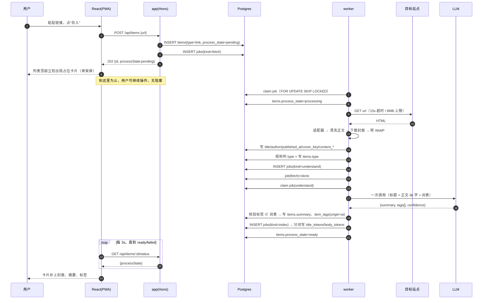
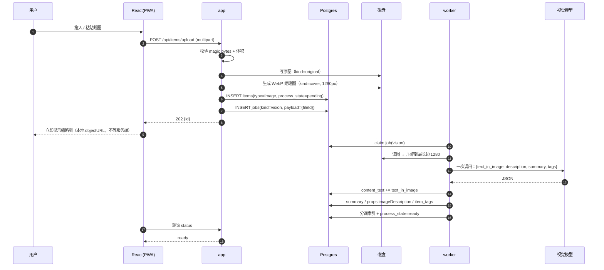
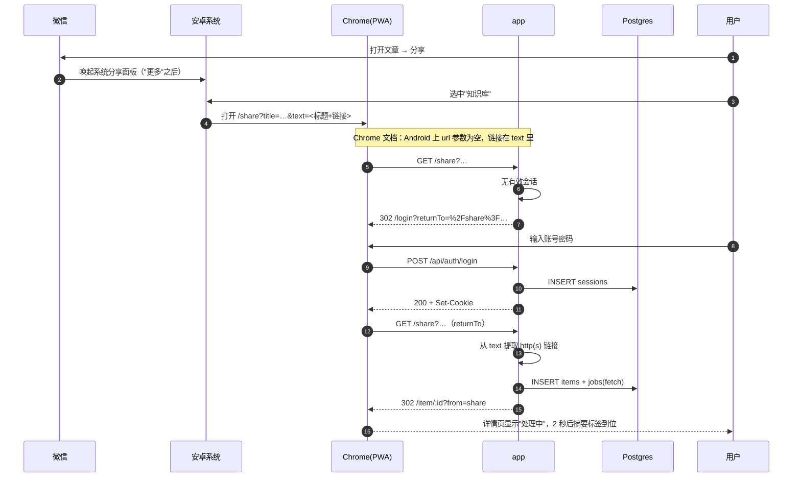

# 个人知识库 · 技术方案

| 项 | 内容 |
|---|---|
| 版本 | v1.8（第十三节为修订区，覆盖前文冲突处；先读它） |
| 日期 | 2026-11-25（v1.8 修订于 2026-11-26） |
| 状态 | 待评审 |
| 上游 | `docs/prd/2026-11-25-PRD-v0.2.md`（93 条需求）、`docs/specs/2026-11-25-知识库设计.md`（信息架构）、`AGENTS.md`（硬约束） |
| 本文范围 | 只回答"怎么做"。需求是什么、界面长什么样，不在本文重复 |
| 实现边界 | 首版只做 MVP（PRD 第 8 节 M0–M2）；本文为 P1/P2 功能预留接口与表，不实现 |

### 变更记录

| 版本 | 变更 |
|---|---|
| v1.0 | A–J 全节：7 条 ADR、中文检索、抓取层（含实测）、AI 编排、11 张表、接口契约、鉴权、3 条时序、M0–M3 任务、风险清单 |
| **v1.1** | 按四条偏差修订：①手机端出 APK、不注册域名；②语言按场景择优，不再限定 TS；③允许复用成熟体系与托管服务；④工具链（技能/插件/MCP）纳入选型。修订集中在第十三节，被覆盖的旧结论逐条标注 |
| **v1.2** | 三条待确认问题定案：Windows 出 exe（Tauri）、服务器境外自购由我配置、自签证书方案确认；补充 JS/TS 模版的启用时机与合并方式（13.9） |
| **v1.3** | 成本重估：新增 13.10 五条路径（本机 / Oracle 免费层 / 本机+Tailscale / 年付低价 VPS / 香港轻量），推荐"先零成本、按数据决定"；S1 的付费方案降级为备选；标明电费口径与官方数据来源 |
| **v1.4** | 新增约束：宿舍 23:30–06:00 断电。T0 降为开发机、T5 平板纳入评估（Termux 有 postgresql 18.7 包）；备份与清理时间前移到 22:30/22:40；推荐顺序改为 T1 → T5 → T3 → T0 → T4 |
| **v1.5** | 平板确认为拯救者 Y900 13（8GB+6GB/256GB），够格当 T5；新增 13.11 Oracle 开通清单（主区域、形态、规格、公钥）、空闲回收官方口径与三条缓解、验收标准与四个风险 |
| **v1.6** | 澄清"账单国家 / 主区域 / 可用域"三个概念，说明账单国家与服务器位置无关；修正规格为 2 OCPU / 6 GB（原表误写 12 GB，与空闲回收的缓解方案冲突）；补主区域自测命令，删除未经实测的延迟断言 |
| **v1.7** | 用户确认日常开着 VPN 智能分流：主区域自测命令前加"先关代理"的硬提醒（附本次无效测量证据 0.0006–0.0009s）；给出 <120ms 的判断阈值（不纠结区域差异）；新增注册前必须关 VPN 的风险项 |
| **v1.8** | 评估"买美区实体卡 + 填美国地址"：引用官方 FAQ 两条原文，结论为不建议（新增 13.11.1）；卡的要求写进参数表（实体 Visa/MC，拒收虚拟/单次/预付）；替代路径三条 |


---

## 零、一页结论

**一句话**：一台最低配云主机跑「模块化单体」，前端 React SPA + PWA，后端 Hono 单进程 + 独立 worker 进程，Postgres 存元数据、本地磁盘存媒体、每日备份到对象存储；中文检索用「应用层分词 + Postgres tsvector」，数据过 2 万条再换 Meilisearch。

### 0.1 选型速览

| 层 | 决定 | 一句话理由 | 详见 |
|---|---|---|---|
| 客户端 | Android APK（Capacitor + Kotlin 分享桥）+ Windows exe（Tauri）+ 浏览器 | 要软件包、要系统分享可靠；一份界面三个壳 | 13.2 / 13.9 |
| 部署 | 单台境外轻量云 + Docker Compose，IP 直连 + 自签证书 | 不注册域名；国内节点用 IP 提供 443 同样要备案 | ADR-01 / 13.3 |
| 前端 | React 19 + Vite + TS + Tailwind（Web 与 APK 共用） | 无 SEO 需求，首屏是登录后数据，SSR 换不来收益 | ADR-02 |
| 后端 | Python 3.12 + FastAPI，单进程，worker 独立进程 | 抓取、分词、语音、模型 SDK 的第一梯队都在 Python | ADR-03 / 13.4 |
| 数据库 | Postgres 16（同机容器；托管可换） | 自托管可装扩展，迁移路径宽 | ADR-04 |
| 媒体存储 | 本地磁盘 + 每日备份到 R2/B2（R2 直存亦可） | 单用户量级不需要跨公网读图 | ADR-05 |
| AI | 文本与视觉分开配，统一 OpenAI 兼容协议 | 摘要标签用便宜文本模型，图片用视觉模型 | ADR-06 |
| 抓取 | httpx + 站点适配器 + trafilatura，Playwright 兜底 | 静态页占多数，浏览器只处理 SPA | ADR-07 |
| 检索 | jieba 分词 + tsvector(simple) + 二字词 LIKE 兜底 | 几千条够用，接口可整体替换 | 第四节 |

### 0.2 四个未验证假设的当前结论

| # | 假设 | 结论 | 证据等级 |
|---|---|---|---|
| 1 | 安卓 Chrome 的 Web Share Target 能收到微信分享 | **已绕开**：APK 用原生 Intent，不依赖 Web Share Target（机制仍供网页端备用） | 安卓 Intent 机制 ✅ / 微信面板 ⚠️ 无需再验 |
| 2 | 微信公众号正文能抓 | **能抓**，4/4 样本成功（含 2026-11 两篇） | 实测 ✅ |
| 3 | B站/抖音封面与字幕接口稳定 | **B站封面时长可用、字幕未登录不可得；抖音未取得样本** | 实测 ✅/⚠️ |
| 4 | 两级标签在界面上显得乱 | **未验证**，原型侧栏只渲染了父级，两级树从未真正出现过 | 代码事实 + ⚠️ |

### 0.3 MVP 做什么、不做什么

做：粘链接存、传图存、自动判类型、AI 摘要与标签、卡片网格 / 时间轴 / 日期视图、中文关键词搜索、筛选、详情、APK 安装与系统分享接收、导出。

不做（本文只留接口）：浏览器插件、整页快照、视频字幕、语义搜索、随机漫游之外的回顾机制、桌面 exe、全库问答。

---

## 一、约束即设计前提

以下每条来自 `AGENTS.md` 与 PRD 非功能需求，直接决定技术选择，不是背景介绍。

| # | 约束（原文要点） | 对方案的具体限制 | 违背它会被否决的设计 |
|---|---|---|---|
| C1 | 单人、无协作、无权限体系 | 不做多租户，不建 `users` 表，不做 RBAC；鉴权只到"是不是本人" | 引入 workspace/org、行级权限 |
| C2 | 没有 Mac、没有 iPhone | 所有产物必须能在 Windows 开发、Linux 部署；不引入 Xcode/Gradle 链路 | 原生 App、iOS 专属能力 |
| C3 | 非技术用户，出问题要能靠 AI 修 | 组件数越少越好；禁止自建搜索引擎/消息队列/缓存；日志要能直接看懂 | 引入 Kafka、Redis 集群、K8s |
| C4 | 成本几元到几十元/月 | 单机、无托管数据库、无 CDN；AI 调用有月度硬上限 | 托管 Postgres + 独立搜索服务 + 商用抓取 API |
| C5 | 手机入口必须是安卓系统分享 | PWA + `share_target`，不打包 APK | 只做网页、让用户复制链接 |
| C6 | 质量优先于速度，但交互永不阻塞 | 抓取与 AI 全异步；保存接口只写一行 + 一个任务 | 同步抓取、同步摘要 |
| C7 | 不引入需要长期运维的自建服务 | 中间件只允许 Postgres；队列用表实现 | Redis/BullMQ、RabbitMQ、Elasticsearch |
| C8 | 单一语言 TypeScript | 抓取、后端、前端、脚本全 TS | Python 抓取服务、Go 网关 |
| C9 | 不做离线，云端为权威源 | 不做 CRDT、不做本地全量缓存；冲突后写覆盖 | 本地优先同步引擎 |
| C10 | `demo/` 是原型，不可复用 | 只借鉴布局参数与交互，不 import 任何 demo 代码 | 把 demo 的 40 条假数据当初始数据 |
| C11 | 文档禁用推测性措辞（清单见 AGENTS.md 第五节） | 本文所有外部事实标来源或 ⚠️，所有数值标口径 | 无来源的接口能力描述 |

**由 C1–C11 直接推出的三条硬边界**：

1. 不允许出现第二个常驻服务（除 app、worker、postgres、caddy 四个容器）。
2. 不允许任何请求路径上出现"同步等待 AI"。
3. 不允许把正文、封面、快照的权威副本留在第三方（DP3）。

---

## 二、架构总览

### 2.1 形态：模块化单体，两进程

```
                    ┌──────────────────────────────┐
   浏览器 / PWA  ───▶│  Caddy（443，自动 HTTPS）      │
                    └───────────┬──────────────────┘
                                │ 反代
                    ┌───────────▼──────────────────┐
                    │  app（Node + Hono，1 实例）    │  ← 只做 HTTP，不跑重活
                    │  ├─ /api/*      业务接口       │
                    │  ├─ /share      PWA 分享入口   │
                    │  └─ 静态资源（SPA 构建产物）    │
                    └───────┬──────────────┬───────┘
                            │              │
                  ┌─────────▼──────┐  ┌────▼─────────────┐
                  │ Postgres 16    │  │ /data/media      │
                  │ 元数据 + 队列   │  │ 封面/原图/快照    │
                  └─────────▲──────┘  └────▲─────────────┘
                            │              │
                    ┌───────┴──────────────┴───────┐
                    │  worker（同镜像，独立进程）     │  ← 抓取 / AI / 索引
                    │  ├─ 轮询 jobs 表               │
                    │  ├─ undici 抓取                │
                    │  └─ Playwright（按需启用）      │
                    └──────────────────────────────┘
```

**为什么是两进程而不是一进程**：抓取与 Playwright 会吃 CPU 和内存，和 HTTP 抢资源时，用户点开列表会卡。分成两个容器后，worker 内存超限被杀，HTTP 仍然可用。二者共用同一份代码与同一个镜像，只是启动命令不同（`node dist/server.js` / `node dist/worker.js`）。

**为什么不拆微服务**：单人、2C2G、单库。拆开的代价是服务发现、跨服务事务、多份部署脚本，收益为零。模块边界按要求划清（2.3），将来真需要拆时按目录拆即可。

### 2.2 目录结构

```
src/
├── platform/                # 基础设施，不含业务语义
│   ├── config.ts            # 环境变量集中读取 + zod 校验，缺失即启动失败
│   ├── db.ts                # pg Pool、事务助手、查询日志（慢查询 > 200ms 打 warn）
│   ├── queue.ts             # jobs 表轮询、领取、完成、退避（FOR UPDATE SKIP LOCKED）
│   ├── storage.ts           # StoragePort 接口 + LocalDiskStorage 实现
│   ├── llm.ts               # LlmPort 接口 + OpenAI 兼容实现（文本/视觉两个方法）
│   ├── outbound.ts          # 出站 HTTP：UA、超时、体积上限、重定向上限、重试
│   ├── logger.ts            # pino，JSON 行，字段固定
│   └── errors.ts            # AppError + 错误码枚举（与 8.1 一一对应）
├── modules/
│   ├── auth/                # 登录、会话、限流
│   ├── capture/             # 创建条目：链接 / 图片 / 文件 / 分享
│   ├── extract/             # 抓取编排
│   │   └── adapters/        # weixin.ts / bilibili.ts / generic.ts
│   ├── enrich/              # 类型规则、AI 摘要与标签、视觉理解
│   ├── search/              # 分词、查询构造、SearchPort
│   ├── organize/            # 标签、筛子、批量操作
│   ├── browse/              # 列表、时间轴、日历、首页、详情
│   ├── output/              # 导出（MVP）、单条分享（P2 预留）
│   └── read/                # MVP 只有正文端点与阅读进度，阅读器 UI 在 P1
├── web/                     # React SPA
└── worker.ts / server.ts    # 两个入口
```

### 2.3 模块规则（防止变成一团泥）

| 规则 | 说明 |
|---|---|
| R1 | 模块对外只暴露 `service`（业务函数）与 `routes`（HTTP 路由），不暴露 sql |
| R2 | 写操作只能通过数据归属模块的 service。`items` 归 `capture`，`tags`/`item_tags` 归 `organize` |
| R3 | 读操作允许跨模块 join（例如 `browse` 读 `items` + `item_tags`），但必须走只读查询函数，不得复制业务判断 |
| R4 | `platform/` 不认识业务表；业务模块不直接 `new Pool()`、不直接 `fetch()` 外网 |
| R5 | 所有跨模块调用同步进行，不引入事件总线。异步只发生在 `jobs` 表这一处 |

### 2.4 五个扩展点（P1/P2 只改这里）

| 扩展点 | 接口 | MVP 实现 | 将来替换为 |
|---|---|---|---|
| 站点适配器 | `Adapter { match(url), extract(ctx): RawDoc }` | weixin / bilibili / generic | 加 douyin、zhihu、xiaohongshu，不改编排 |
| 抓取运行器 | `Fetcher { fetchStatic(), fetchRendered() }` | static 开启，rendered 关闭 | 开 Playwright，或换远端浏览器服务 |
| 检索 | `SearchPort { index(item), query(q), remove(id) }` | PostgresSearch | Meilisearch |
| 媒体存储 | `StoragePort { put, get, delete, stat }` | LocalDisk | S3 兼容（R2/COS） |
| 模型 | `LlmPort { text(), vision() }` | OpenAI 兼容端点 | 换供应商只改配置与一个适配文件 |

---

## 三、A 技术选型（ADR）

> 每条给：背景 → 决定 → 备选与代价 → 后果 → 重估条件。备选里的"代价"指采用它要额外付出的东西，不是缺点清单。

### ADR-01 部署形态：单台境外轻量云主机 + Docker Compose

**状态**：Accepted（2026-11-25）

**背景**：需要 HTTPS 公网入口（PWA 安装与分享的硬前提）、需要跑长时间抓取（单条最长 60s）、需要将来跑无头浏览器（单实例 300MB–1GB 内存）。用户在中国大陆，手机与电脑都要访问。

**决定**：一台 2 vCPU / 2GB / 40GB SSD 的香港轻量云主机，Docker Compose 起四个容器：`caddy`、`app`、`worker`、`postgres`。域名 A 记录指向该主机，Caddy 自动申请证书。

**备选与代价**：

| 备选 | 代价 | 淘汰理由 |
|---|---|---|
| Vercel/Netlify + Supabase | 函数执行时长受限（Hobby 档默认 10s，最高 60s）；无浏览器；国内访问 `*.vercel.app` 不稳定；Supabase 免费项目闲置会暂停 | 抓取是长任务，无头浏览器无处安放；"睡着的数据库"会让手机入口间歇性失效 |
| Cloudflare Workers + D1 + R2 | D1 是 SQLite，全文检索能力弱于 Postgres；Workers 无浏览器；单库有容量上限 | 与 B 节检索方案冲突；将来上浏览器要再加服务 |
| 国内云主机（腾讯云/阿里云） | 绑定域名做 80/443 服务需 ICP 备案，个人备案周期以周计；不备案只能用 IP + 非标端口，PWA 的 HTTPS 要求与分享注册都会受限 | 备案不通过就没有入口，风险不可控 |
| 家里旧电脑 + 内网穿透 | 断电、休眠、路由器重启都会让入口消失；上行带宽不稳 | 手机入口的可用性不可接受 |

**后果**：
- 单点故障。缓解：每日 `pg_dump` + 媒体增量备份到对象存储，恢复演练写进 M0 验收。
- 大陆访问香港节点有 30–60ms 延迟，页面首屏预算按 300ms 内可交互设计（静态资源走 Caddy 的 gzip/br，不引入 CDN）。
- 主机规格锁死 2GB 内存，因此 worker 必须串行、Playwright 必须按需且单并发。

**重估条件**：日活设备 > 3 台，或列表接口 P95 > 800ms，或 Playwright 常驻导致 OOM 每周 ≥ 1 次。

---

### ADR-02 前端：React + Vite + TypeScript，SPA + PWA

**状态**：Accepted

**背景**：界面规格已在设计文档 8.6 定死（深色优先、12px 圆角、8px 栅格、系统字体、16:10 封面）。所有数据都在登录后，没有 SEO 需求。

**决定**：React 19 + Vite + TypeScript + Tailwind + TanStack Query + React Router。构建产物为静态文件，由 app 进程托管；`manifest.webmanifest` + service worker 使其可安装、可作为分享目标。

**备选与代价**：

| 备选 | 代价 | 淘汰理由 |
|---|---|---|
| Next.js（App Router） | 引入 RSC/服务端渲染的心智负担；构建与部署复杂度上升；本项目没有首屏 SEO 与流式渲染诉求 | 用不上的能力，换来的只有复杂度 |
| SvelteKit | 包体更小，但生态与可查资料少；非技术用户出问题时 AI 辅助的成功率低 | 与 C3（可维护性）冲突 |
| Vue + Vite | 能力等价，团队熟悉度也够 | 设计文档已定 React，且现有原型是原生 DOM，无迁移包袱；改选只增加沟通成本 |
| 纯静态 + 服务端模板（HTMX 类） | 交互态（抽屉、批量选择、乐观更新）要写大量手写 DOM | 列表与详情的交互密度高，收益为负 |

**后果**：
- 首屏需要加载 JS 后才能渲染，用路由级 code split + 骨架屏把感知延迟压住。
- PWA 的 service worker 只做三件事：缓存 app shell、拦截 `POST /share`（P2 文件分享时才启用）、离线时返回壳。**不做数据离线缓存**（C9）。

**重估条件**：需要公开分享页并被搜索引擎收录（当前 PRD 明确不做）。

---

### ADR-03 后端：Node 22 + Hono，单进程 HTTP + 独立 worker

**状态**：Accepted

**背景**：只需要 REST 接口、Cookie 会话、文件流、任务轮询。没有 WebSocket、没有 GraphQL、没有多租户。

**决定**：Hono + `@hono/node-server`，TypeScript 直跑（tsx 开发，esbuild 打包生产）。`server.ts` 只挂路由与中间件；`worker.ts` 只跑任务循环。二者共享 `src/modules`。

**备选与代价**：

| 备选 | 代价 | 淘汰理由 |
|---|---|---|
| Express 5 | 生态最大，但类型定义靠 @types 补丁，中间件模型老；异步错误要手动捕获 | 类型安全是本项目"AI 辅助改代码不出错"的基础 |
| Fastify | 性能更好、schema 校验内建，但插件体系与封装规则要额外学习 | 单人项目的性能瓶颈在抓取与 AI，不在框架 |
| NestJS | 依赖注入、模块装饰器齐全 | 对 8 个模块的规模属于过度设计，启动与调试都变慢 |
| 纯 Node http + 手写路由 | 零依赖 | 路由、参数解析、错误处理全部自造，维护成本高 |

**后果**：
- Hono 的中间件顺序即安全边界：`requestId → logger → bodyLimit → auth → rateLimit → route`。顺序写死在 `server.ts`，新增路由不得绕过。
- 单进程意味着限流、域名熔断可以用进程内 Map，不需要 Redis（C7）。

**重估条件**：需要多实例横向扩容（届时限流与熔断要外置）。

---

### ADR-04 数据库：Postgres 16，同机容器，保留托管切换能力

**状态**：Accepted，**与设计文档"云托管 Postgres"存在偏差，理由如下**

**背景**：设计文档第 9 节写"云托管 Postgres"。技术评审时发现三点：① 托管库（Supabase/Neon）在大陆访问的往返延迟会叠加到每次查询；② 免费档会因闲置暂停；③ 本项目的检索方案需要 `pg_trgm`、将来需要 `pgvector`，自托管可自由装扩展。

**决定**：同机 Docker 跑 Postgres 16，数据卷挂 `/data/pg`。连接串由 `DATABASE_URL` 注入，代码不感知部署位置 —— 将来换托管只改这一行。

**备选与代价**：

| 备选 | 代价 | 淘汰理由 |
|---|---|---|
| SQLite（better-sqlite3 / libSQL） | 零运维、单文件备份；但写并发只有一把锁，worker 与 HTTP 同时写会互相阻塞；FTS5 的中文分词问题依旧；未来迁云要重写 SQL 方言 | 两进程同时写是常态，不是边缘情况 |
| Supabase 托管 Postgres | 自带 Auth/Storage，省开发；但跨公网查询、免费档暂停、国内可达性三项都要额外处理 | 为了省 Auth 引入三个新风险，不划算 |
| MySQL 8 | 生态成熟；全文检索对中文同样要外挂分词，JSON 与索引表达力弱于 Postgres | 没有一项优于 Postgres |
| 文档库（MongoDB） | 表结构自由 | 标签多对多、筛子组合查询正是关系模型的主场 |

**后果**：
- 必须自己做备份与恢复演练（M0 验收项）。
- 数据库只监听容器网络，不映射到主机端口。
- 迁移用 `node-pg-migrate`，SQL 文件入库，禁止手改线上表。

**重估条件**：需要多实例或需要托管方提供的 PITR（按时间点恢复）时，切 Supabase/Neon，只改 `DATABASE_URL` 与备份脚本。

---

### ADR-05 媒体存储：本地磁盘 + 每日备份到对象存储

**状态**：Accepted

**背景**：M4-02 要求"封面/图片/文件存对象存储"，目的是不依赖外链（DP3），不是必须用云厂商的对象存储产品。单人量级：500 条内容 ≈ 500 张封面（压缩后 ≤ 200KB/张）+ 少量原图 + 将来快照（100–500KB/条），一年量级 < 2GB。

**决定**：媒体写 `/data/media/<yyyy>/<mm>/<uuid>.<ext>`，通过 `GET /api/files/:id` 鉴权后流式返回（支持 `Range`，为将来的视频/PDF 预留）。每日 03:00 用 `restic` 增量备份到 Cloudflare R2（或 B2）。代码只依赖 `StoragePort`。

**备选与代价**：

| 备选 | 代价 | 淘汰理由 |
|---|---|---|
| R2 直存 | 无单点、容量无限；但每张图都要走公网回源，列表页 20 张图 = 20 次跨境请求；需要签名 URL 与缓存策略 | 列表页是最高频界面，读图延迟直接决定"翻得动不动" |
| 国内 COS/OSS | 国内最快；但需实名、绑定自定义域名需备案、外网下行流量单独计费 | 备案问题同 ADR-01；流量费不可预测 |
| 直接引用原站图片 | 零成本 | 违反 DP3 与 M2-03，外链失效即空白 |

**后果**：
- 磁盘是单点。备份必须可恢复，M0 做一次"删库删盘后从备份恢复"的演练并记录耗时。
- 图片入库前统一转 WebP、最长边 1280px、目标 ≤ 200KB（与 PRD 5.5 一致）；原图另存 `kind=original`。

**重估条件**：媒体总量 > 20GB，或多设备读图成为瓶颈。

---

### ADR-06 AI 接入：文本与视觉分开配置，统一 OpenAI 兼容协议

**状态**：Accepted（模型待 M1 中期比价后锁定）

**背景**：需要三类能力：中文摘要（≤100 字）、从固定词表选标签、图片理解（OCR + 一句话描述）。三类的价格与能力差异大，绑死一个模型会为最贵的那次调用付全库的钱。

**决定**：`LlmPort` 暴露两个方法 `text()` 与 `vision()`，底层走 OpenAI 兼容的 `/chat/completions`。模型名、baseURL、密钥、单价全部放配置：

```
LLM_TEXT_BASE_URL / LLM_TEXT_MODEL / LLM_TEXT_KEY
LLM_VISION_BASE_URL / LLM_VISION_MODEL / LLM_VISION_KEY
LLM_PRICE_TABLE        # JSON：元/千 input token、元/千 output token
```

文本用一个中文表现好、价格低的模型；视觉用一个支持图片输入的多模态模型。两家都提供 OpenAI 兼容端点，所以适配层只有一个文件。

**备选与代价**：

| 备选 | 代价 | 淘汰理由 |
|---|---|---|
| 只用一个多模态大模型做全部 | 省一套配置；但每篇文章的摘要也要按视觉模型的价格付费 | 文本量远大于图片量，成本结构不划算 |
| 本地跑模型（Ollama） | 数据不出门；但 2C2G 跑不动 7B 以上模型，跑得动的质量不达"摘要可用" | 与 ADR-01 的规格冲突 |
| 专用 OCR 服务 + 文本模型 | OCR 精度可能更高；但多一个 key、一条链路、一处计费 | 设计文档 7.2 已否决；截图类小字用视觉模型够用 |
| 绑定单一供应商 SDK | 接入快 | 换供应商要改代码；价格与可用性都被锁定 |

**后果**：
- 模型输出必须是 JSON，服务端用 zod 校验；解析失败按"AI 失败"重试一次，再失败则留空（DP6：宁可留空，不生产垃圾）。
- 单价表是配置不是代码，调价不改代码。
- ⚠️ 具体模型与中文质量在 M1 中期用 30 条真实内容盲评后锁定（PRD Q3），本文不预设型号。

**重估条件**：单条内容平均 AI 成本 > ¥0.05，或摘要可用率 < 80%。

---

### ADR-07 抓取：静态优先，浏览器兜底，适配器隔离站点差异

**状态**：Accepted

**背景**：中文内容源以公众号、知乎、B站、小红书、抖音为主。公众号与多数博客是服务端渲染的静态 HTML（第四节实测 4/4 可直取）；小红书、抖音是 SPA。无头浏览器在 2GB 内存上只能串行、按需。

**决定**：
- 一级：`undici` 直取 HTML（超时 15s、体积上限 8MB、重定向 ≤ 3、固定 Chrome UA、同域串行限速）。
- 二级：站点适配器（`weixin` / `bilibili` / `generic`）；未命中走 `generic` = `@mozilla/readability` + `jsdom` + og/meta 兜底。
- 三级：`Playwright`（chromium headless，单并发，20s 超时，禁图片/字体/媒体），**MVP 默认关闭**，由配置 `RENDER_ENABLED=false` 控制。
- 平台 API 优先于页面解析：B站走 `api.bilibili.com`，不解析播放页。

**备选与代价**：

| 备选 | 代价 | 淘汰理由 |
|---|---|---|
| 全程 Playwright | 解析一致性最好；但每条 2–8s、300MB+ 内存，2GB 机器上并发为 1，队列会堆积 | 90% 的页面不需要浏览器 |
| 第三方抓取 API（如 Firecrawl/ScrapingBee） | 省事、能过部分反爬；但按次计费，且正文仍要自己判断，数据出境 | 与 C4 成本约束冲突；内容隐私也不合适 |
| 只存链接不抓正文 | 零成本 | 违反 DP3、M2-02，产品退化为书签 |

**后果**：
- 站点改版只影响对应适配器；适配器抛错时自动回落 generic，不中断队列。
- 域名级熔断：同域连续 3 次失败 → 冷却 6 小时，期间该域直接走 generic 且不启用浏览器。
- 页面体积与正文比例悬殊（实测 3.88MB HTML / 4172 字正文），因此"只解析正文块、只存清洗后的正文"是硬规则，不允许把原始 HTML 直接入库。

**重估条件**：generic 的正文抽取成功率 < 70%，或 SPA 内容占比 > 30%。

---

## 四、B 中文检索怎么落地

> 这是全项目最容易做成"看起来能用、实际搜不到"的部分。本节给的是可执行方案：表结构、分词参数、SQL、兜底路径、升级阈值。

### 4.1 先说清为什么不能直接用现成方案

| 方案 | 为什么不行 | 证据 |
|---|---|---|
| SQLite FTS5 默认分词器 | 连续汉字被当作一个 token，整句变成一个"词"，搜"矩阵"匹配不到"矩阵分解" | PRD M6 工程说明（引自公开技术文章）⚠️ 二手 |
| FTS5 trigram | 索引体积显著增大；查询串短于 3 字符时无法用索引 | 同上 ⚠️ 二手 |
| Postgres 默认全文（`to_tsvector('simple', 原文)`） | 与 FTS5 同因：中文没有空格，整段变成一个 lexeme | 机制推断，M0 用一条 SQL 验证（见 4.8） |
| `pg_trgm` + `LIKE '%词%'` | 官方文档明确："a pattern with no extractable trigrams will degenerate to a full-index scan"；两字查询提不出完整 trigram | Postgres 官方文档 F.37.4 ✅ |
| `zhparser` / `pg_jieba` 扩展 | 托管库装不了；自托管可装，但引入 C 扩展的编译与升级负担 | 扩展安装机制 ✅ |
| Meilisearch 起步 | 能力够（Charabia 内置 jieba 中文分词），但多一个常驻服务、多一份内存（约 200MB+），在 2GB 机器上与 worker 抢资源 | 官方文档 ✅ / 资源估算 ⚠️ |

**结论**：首版把分词放在应用层（Node 里做），数据库只负责"已经用空格分开的词"的倒排索引与打分。这样既不依赖数据库的中文分词能力，也不引入第二个服务。

### 4.2 分词流水线（写入与查询共用一套归一化）

```ts
// modules/search/tokenize.ts
import { Jieba } from '@node-rs/jieba'
import { dict } from '@node-rs/jieba/dict.js'   // ESM 必须带 .js 后缀，实测

const jieba = Jieba.withDict(dict)

const STOP = new Set(['的','了','是','在','和','与','及','或','一个','这个','那个',
  '我们','你们','他们','可以','没有','什么','怎么','为什么','因为','所以','但是',
  '如果','已经','还是','就是','不是','这样','那样','自己','时候','现在','进行',
  '通过','对于','关于','以及','还有','一些','这些','那些','非常','比较','很多'])

export function normalize(s: string): string {
  return s.normalize('NFKC')          // 全角转半角、兼容字符归一
    .replace(/\s+/g, ' ')
    .trim()
}

export function tokenizeForIndex(text: string): string {
  const t = normalize(text)
  // HMM 开启：未登录词（人名、产品名）也能成词
  const raw = jieba.cutForSearch(t, true)   // 搜索模式：长词会额外切出子词
  const out: string[] = []
  for (const w of raw) {
    const w2 = w.trim().toLowerCase()
    if (!w2) continue
    if (/^[\p{P}\p{S}]+$/u.test(w2)) continue      // 纯标点/符号
    if (STOP.has(w2)) continue
    out.push(w2)
  }
  return out.join(' ')
}

export function tokenizeForQuery(q: string): string[] {
  const t = normalize(q)
  const raw = jieba.cut(t, true)             // 查询用精确模式，避免子词把 AND 条件撑得过严
  return raw.map(w => w.trim().toLowerCase())
    .filter(w => w && !STOP.has(w))
    // 只留字母/数字/汉字。这一条同时挡住 to_tsquery 的语法字符（& | ! : *）
    .filter(w => /^[\p{L}\p{N}]+$/u.test(w))
}
```

**实测输出**（2026-11-25，`@node-rs/jieba@2.0.4`，默认词典，Windows/Node 22）：

```
原文：线性代数里的矩阵分解与导数公式，中文全文检索的三个坑
cut        ：线性代数|里|的|矩阵|分解|与|导数|公式|，|中文|全文检索|的|三个|坑
cutForSearch：线性|代数|线性代数|里|的|矩阵|分解|与|导数|公式|，|中文|全文|检索|全文检索|的|三个|坑
```

三条可直接落地的结论：

1.「矩阵」「导数」这类两字词在默认词典里就是独立 token，**两字词不需要靠字符级索引兜底**，只要分词命中即可。
2. 搜索模式会为长词补出子词（`全文检索` → `全文`/`检索`/`全文检索`），因此"存长词、搜短词"能命中。
3. `cut` 与 `cutForSearch` 的差别只在索引侧需要；查询侧用 `cut`，否则子词会与主词同时进入 AND 条件，把结果压得过窄。

### 4.3 表结构与索引

```sql
-- 只列检索相关列，完整 DDL 见第七节
ALTER TABLE items
  ADD COLUMN title_tokens text NOT NULL DEFAULT '',   -- 标题分词串
  ADD COLUMN body_tokens  text NOT NULL DEFAULT '';   -- 摘要+正文+OCR+标签名 的分词串

-- 生成列：写入时自动维护，不需要触发器
ALTER TABLE items
  ADD COLUMN search_tsv tsvector
  GENERATED ALWAYS AS (
    setweight(to_tsvector('simple', coalesce(title_tokens, '')), 'A') ||
    setweight(to_tsvector('simple', coalesce(body_tokens,  '')), 'B')
  ) STORED;

CREATE INDEX items_search_gin ON items USING GIN (search_tsv);
```

三个设计点：

- **`simple` 而不是 `english`**：已经用空格切好词，只需要"按空格切 token + 转小写"，任何语言配置都会引入不需要的词干化。
- **生成列而不是触发器**：`to_tsvector('simple', …)` 是 immutable，可以进生成列；少一个触发器就少一处可以忘记维护的地方。
- **标题权重 A、正文 B**：`ts_rank_cd` 会按权重加权，"标题命中"自然排在"正文命中"前，不需要额外打分表。

### 4.4 查询写法

三级策略，按代价从低到高：

**① 主路径：全词 AND**

```sql
-- $1 = 归一化后的查询串（token 用空格连接，由应用构造）
-- $2 = LIMIT
WITH q AS (SELECT plainto_tsquery('simple', $1) AS tsq)
SELECT i.id, i.title, i.summary, i.type, i.cover_key, i.saved_at,
       ts_rank_cd(i.search_tsv, q.tsq) AS rank
FROM items i, q
WHERE i.deleted_at IS NULL
  AND i.search_tsv @@ q.tsq
ORDER BY rank DESC, i.saved_at DESC
LIMIT $2;
```

用 `plainto_tsquery` 而不是 `to_tsquery`：前者把空格当 AND、自动转义特殊字符，用户输入 `&`、`|`、`!` 不会构造出语法错误或意外语义。

**② 放宽：OR + 覆盖度排序（AND 命中 < 5 条时触发）**

```sql
-- $1 = 'a | b | c'（应用用 | 连接已净化的 token）
WITH q AS (SELECT to_tsquery('simple', $1) AS tsq)
SELECT i.id, i.title,
       (SELECT count(*) FROM unnest($2::text[]) tok
          WHERE i.search_tsv @@ plainto_tsquery('simple', tok)) AS hit_tokens,
       ts_rank_cd(i.search_tsv, q.tsq) AS rank
FROM items i, q
WHERE i.deleted_at IS NULL
  AND i.search_tsv @@ q.tsq
ORDER BY hit_tokens DESC, rank DESC, i.saved_at DESC
LIMIT $3;
```

`$2` 是原始 token 数组。覆盖度 = 命中的 token 数，这就是 M6-02 要的"按覆盖度排序"。

**③ 二字词 / 单字兜底：LIKE 全表扫描**

```sql
-- $1 = '%' || escaped(q) || '%'，应用侧转义 \ % _
SELECT id, title, summary, saved_at
FROM items
WHERE deleted_at IS NULL
  AND (title ILIKE $1 ESCAPE '\'
    OR summary ILIKE $1 ESCAPE '\'
    OR content_text ILIKE $1 ESCAPE '\')
ORDER BY saved_at DESC
LIMIT $2;
```

触发条件（应用层判断，不交给数据库）：

| 条件 | 走哪条 |
|---|---|
| 归一化后长度 ≥ 3 且分词出 ≥ 2 个 token | ①，0 条则 ② |
| 归一化后长度 ≥ 3 但只出 1 个 token | ①，0 条则 ③ |
| 归一化后长度 ≤ 2（"矩阵""导数""熵"） | ③ |
| 查询含英文/数字 | 同长度规则；英文 token 走 ①（`simple` 配置对拉丁词有效） |

**为什么两字词可以直接 LIKE 而不建索引**：5000 条 × 平均正文 4KB ≈ 20MB，全表 ILIKE 在本机 Postgres 上是几十毫秒量级（⚠️ 估算，M1 末期用 `EXPLAIN ANALYZE` 与 5000 条种子数据实测）。到了 2 万条这个账就不成立，升级路径见 4.6。

### 4.5 排序、高亮与分类内搜索

| 需求 | 做法 |
|---|---|
| 默认排序 | `rank DESC, saved_at DESC`；`ts_rank_cd` 已含标题权重 |
| 高亮（M6-07，P1） | 服务端只回 token 列表与命中字段，前端用字符串匹配包 `<mark>`。不采用 `ts_headline`：中文没有空格，`ts_headline` 的分句与截断依赖语言的停止词配置，结果不稳定 |
| 分类内搜索（M6-04） | 在 ① 的 `WHERE` 追加 `AND i.type = $n`；标签用 `EXISTS (SELECT 1 FROM item_tags it WHERE it.item_id = i.id AND it.tag_id = ANY($m))` |
| 筛子组合（M6-05） | 筛子的 `filter_json` 编译成同一段 `WHERE`，与检索条件拼接（见 7.4） |
| 空结果 | 返回 `{items: [], relaxed: true, tokens: [...]}`，前端提示"已放宽匹配"，不用"没有找到"一句话糊过去 |

### 4.6 数据涨到多少该升级，怎么升

| 阶段 | 数据量 | 方案 | 触发切换的硬指标 |
|---|---|---|---|
| 现在 | < 5,000 | 本文方案（tsvector + LIKE 兜底） | — |
| 中间态 | 5,000–20,000 | 加一列 `bigrams text[]`（正文相邻两字去重）+ GIN 数组索引，替换 ③ 的全表扫描 | 搜索 P95 > 300ms（5000 条种子、10 条真实查询，`EXPLAIN ANALYZE` 计时） |
| 换引擎 | > 20,000 或需要错字容忍/拼音 | Meilisearch 单容器（Charabia 内置 jieba 中文分词） | 条数 > 20,000，或 P95 > 300ms 且加 bigram 后仍不达标 |

**升级路径（不改调用方）**：

```ts
export interface SearchPort {
  index(item: SearchDoc): Promise<void>      // 幂等 upsert
  remove(id: string): Promise<void>
  query(q: SearchQuery): Promise<SearchHit[]>
}
```

- MVP 实现 `PostgresSearch`（本节 SQL）。
- 切换时新增 `MeilisearchSearch`，`config.SEARCH_DRIVER` 决定注入哪个。
- 索引同步走 `jobs` 表的 `search_index` 任务：写库成功后入队，失败重试 3 次。**双写不放在请求路径上**，避免搜索服务抖动影响保存。
- Meilisearch 的文档不需要预先分词（它自己做），因此 `index()` 传原文即可，Postgres 实现自己调 `tokenizeForIndex`。

### 4.7 已知坑（写进代码注释，不要口头传）

| 坑 | 处理 |
|---|---|
| 停用词表漏了某个高频词，导致 AND 查询被无意义 token 撑满 | 停用词表放 `modules/search/stopwords.ts`，加一条单测：对 20 条真实标题分词后，token 数中位数 ≤ 12 |
| 正文超长（10 万字）导致分词阻塞事件循环 | 分词在 worker 里做，不在 HTTP 进程；单条正文截断到 20,000 字再入索引，全文仍存 `content_text` |
| 中英混排被切成一个字一个 token | `cut` 对拉丁串按整词返回（实测 `AI`、`30` 保持完整）；不需要额外合并 |
| emoji 与特殊符号进入索引 | 归一化阶段过滤 `\p{P}\p{S}`，emoji 属 `\p{S}` 被剔除 |
| 更新标题后忘了重算 token | 分词与写库放在同一个 service 函数内，`items` 的写入口只有 `capture.updateItem()` 与 `enrich.applyResult()` 两处 |

### 4.8 必须在 M0 第一天验证的一条 SQL

```sql
SELECT to_tsvector('simple', '矩阵 分解 与 导数 公式');
-- 期望：'分解':3 '导数':5 '公式':7 '矩阵':1
```

- **期望成立** → 4.3 的生成列可以直接用。
- **期望不成立**（例如整串变成一个 lexeme） → 退路：不用生成列，改为在应用层构造 `tsvector` 字面量写入（`to_tsvector('simple', ...)` 换成 `setweight(...)` 由应用拼 `'矩阵':1 '分解':2`），或在 token 之间插入 `·` 让解析器切分。两条退路都不改查询侧 SQL。

⚠️ 本条为机制推断：默认解析器把连续汉字当作一个 word token，用空格分隔后每个 token 独立。未在真实 Postgres 上执行（本机无实例），因此列为 M0 第一天的验证项，不写成结论。

---

## 五、C 抓取层

### 5.1 三类页面，三套处理

| 类型 | 判定条件（满足任一） | 手段 | 成本 |
|---|---|---|---|
| 静态可解析 | HTML 长度 > 30KB 且正文候选 > 300 字；或命中站点适配器 | `undici` 取 HTML → 适配器 → Readability 兜底 | 一次请求，0.3–1.5s |
| 动态渲染 | HTML < 30KB 且正文候选 < 200 字；或检测到 SPA 根节点（`#root`/`#app` 空壳）；或 `__NEXT_DATA__` 存在但 DOM 无正文 | Playwright（`RENDER_ENABLED=true` 时） | 2–8s，300MB+ 内存 |
| 需登录 / 付费 / 风控 | HTTP 401/403、跳转到登录页、正文含"登录后查看""付费后阅读"、命中风控页特征 | 不重试，直接降级 `link`，记录 `UPSTREAM_AUTH_REQUIRED` | 一次请求 |

**判定顺序写死在 `extract/orchestrator.ts`**：适配器 → 静态直取 → 内容判定 → 浏览器兜底 → 降级。判定阈值放配置，不散落在代码里。

### 5.2 适配器契约与回退链

```ts
export interface RawDoc {
  title: string
  author?: string
  publishedAt?: Date
  coverUrl?: string
  contentHtml: string      // 已清洗：去 script/style/事件属性，data-src 提升为 src
  contentText: string      // 纯文本，用于检索
  wordCount: number
  durationSec?: number
  siteName?: string
  extra?: Record<string, unknown>
}

export interface Adapter {
  name: string
  match(url: URL): boolean
  extract(ctx: { url: URL; html: string; fetchJson<T>(u: string): Promise<T> }): Promise<RawDoc>
}
```

| 顺序 | 适配器 | 命中条件 | 失败后 |
|---|---|---|---|
| 1 | `bilibili` | host 为 `bilibili.com` / `b23.tv` | 回落 generic |
| 2 | `weixin` | host 为 `mp.weixin.qq.com` | 回落 generic |
| 3 | `generic` | 全部 | 抛 `EXTRACT_EMPTY` |

`generic` = `jsdom` 解析 + `@mozilla/readability` 抽正文 + `og:title`/`og:image`/`meta[author]`/`time[datetime]` 兜底。适配器抛出的任何异常都被 orchestrator 捕获并记录，**不向上冒泡中断队列**。

### 5.3 公众号：可行，附实测记录

**结论：可行。** 2026-11-25 23:19–23:31 在本机（中国大陆网络、普通 Chrome UA、无 Cookie、单次请求）实测 4 篇，全部拿到完整正文。

| 样本 | 发布时间 | HTTP | HTML 体积 | `#js_content` | 标题 | 作者 | 发布时间戳 | 封面 |
|---|---|---|---|---|---|---|---|---|
| `QadB3L6GDAsJEZ54DZSVxA` | 2020-09 | 200 | 3.91MB | 有 | 有 | `MAX` | `1601027332` | 116KB jpeg |
| `ELcG3B5e4RZDmv1UUxjHGQ` | 2020-06 | 200 | 3.76MB | 有 | 有 | — | `1592205762` | — |
| `94TLMeN9fgAIt68jQ6dgMA` | 2026-11-02 | 200 | 3.84MB | 有 | 有 | 智生于形 | `1793578992` | — |
| `jzzqxFy4EtIbMCLFszklYw` | 2026-11-20 | 200 | 3.88MB | 有 | 有 | 新智元 | `1795089008` | — |

4/4 未命中 `环境异常` / `请在微信客户端打开` / `参数错误` / `该内容已被发布者删除` / `此内容因违规无法查看` 任一拦截关键词。

**字段抽取规则（实测确认）**：

| 字段 | 来源 | 坑 |
|---|---|---|
| 标题 | `<meta property="og:title">`，回退 `var msg_title` | 无 |
| 作者 | `var author`（真实姓名）；公众号名在 `var nickname = htmlDecode("…")` | 值是 `htmlDecode(...)` 包裹，正则要取括号里的字符串 |
| 发布时间 | `var ct = "1601027332"`（Unix 秒） | 转 `timestamptz` 时要乘 1000 |
| 封面 | `var msg_cdn_url` 或 `og:image` | **必须原样使用完整 URL**（含 `/0?wx_fmt=jpeg`）；截断路径直接返回 400 |
| 正文 | `#js_content` 内部 HTML | 该节点带 `visibility:hidden;opacity:0`，靠 JS 显示，解析时忽略样式 |
| 正文图片 | `` | 懒加载：`src` 可能是占位符，必须把 `data-src` 提升为 `src`，否则正文图全丢 |
| 公众号原始 ID | `var user_name = "gh_…"` | 用于去重与来源聚合 |

**体积与清洗（这条决定 worker 会不会被打爆）**：

- 实测整页 3.84–3.91MB，其中正文纯文本仅 4,172 字、正文块 HTML 64.6KB。
- 页面内 `data:image` 出现 128 次，但正文块内为 0 —— base64 图在页面其他脚本里，占全文字符约 3.4%。
- 因此：**响应体上限 8MB；只保留 `#js_content` 清洗后的 HTML（预计 30–80KB）；原始 HTML 不入库**。原 HTML 只在 `M2-08 快照`（P1）时压缩另存。

**已知风险与退路**：

| 风险 | 现状 | 退路 |
|---|---|---|
| 高频批量触发风控 | 未测（不做压测，避免把 IP 打进黑名单） | 同域串行 1 req/3s；单次导入上限 20 条；失败冷却 6h |
| 部分文章需"环境异常"验证 | 4/4 未遇到，无法排除 | 启用 Playwright + 微信内置 UA（`MicroMessenger`）；仍失败降级 `link` |
| 文章被删/违规 | 返回删除页，无 `#js_content` | 判为 `EXTRACT_EMPTY`，降级 `link` 并保留用户输入的 URL |
| 图片防盗链 | 实测 `mmbiz.qpic.cn` 无 Referer 也返回 200 | 下载时带 `Referer: https://mp.weixin.qq.com/`，失败重试 1 次 |

### 5.4 B站：封面时长可用，字幕未登录不可得

| 能力 | 接口 | 实测结果 | 结论 |
|---|---|---|---|
| 标题/封面/时长/简介/作者/分P | `GET api.bilibili.com/x/web-interface/view?bvid=` | 200，`code:0`，字段齐全，无需 Cookie | ✅ 可用 |
| 封面下载 | `i0/i1/i2.hdslb.com` | `i0`/`i1` 返回 200 `image/jpeg` 244KB，**无 Referer 也可**；`i2` 在本网络 502 / 连接失败 | ✅ 可用，但**必须多域名重试** |
| 字幕列表 | `GET api.bilibili.com/x/player/v2?bvid=&cid=` | 200，`code:0`，但 `allow_submit:false`、`subtitles:[]`；6/6 样本为空 | ❌ 未登录不可得 |
| 字幕文件 | `subtitle_url` | 无样本可取，未测 | ⚠️ 未知 |

**由此定的三条实现规则**：

1. B站走 API，不解析播放页 HTML（页面是 SPA，解析成本高且易变）。
2. 封面下载按 `i0 → i1 → i2` 轮换，任一 200 即成功；三个都失败则封面留空，不阻塞入库。
3. **字幕不进 MVP**。M2-05（P1）要落地，前置条件是提供一个 B站登录 Cookie，并接受它会过期（有效期由平台控制，不在本项目掌握内）——这是一个持续的运维负担，须在排期时单独确认。没有 Cookie 时的替代是 ASR（M2-06，P2），成本按分钟计。

### 5.5 抖音：未取得样本，不承诺

| 探测 | 结果 |
|---|---|
| `https://www.douyin.com/` | 200，72KB，无服务端渲染内容（SPA 壳） |
| `https://www.douyin.com/oembed?url=…` | 404，该端点不存在 |
| `https://www.iesdouyin.com/share/video/{id}/` | 302 → `https://www.douyin.com/video/{id}` |
| 真实视频 ID | 未取得（公开热榜接口只返回热词，不返回视频 ID） |
| 视频详情页 SSR 数据 | ⚠️ 未验证 |

**决定**：MVP 不为抖音写适配器。抖音链接一律走 `generic`，拿不到正文就降级 `link`（PRD M2-09 已允许）。理由是三条成本同时存在：需要 Playwright、需要处理签名参数、页面结构变动频繁。等真实使用中"抖音链接占比 > 20%"再立项。

**验证方法（留给实现阶段，10 分钟）**：从手机复制一条抖音分享链接，分别用 `curl`（普通 UA）与 Playwright（移动 UA）打开，检查 HTML 是否含 `og:title` 与视频时长字段。两条都不含 → 确认只能降级。

### 5.6 失败分级：什么重试，什么不重试

| 错误 | 错误码 | 重试 | 退避 | 为什么 |
|---|---|---|---|---|
| DNS 失败 / 连接重置 / 超时 | `UPSTREAM_TIMEOUT` | 是 | 30s、2min | 网络抖动，重试有意义 |
| 429 | `UPSTREAM_RATE_LIMITED` | 是 | 读 `Retry-After`，无则 1h | 重试太快会加重封锁 |
| 5xx | `UPSTREAM_ERROR` | 是 | 1min、5min | 对端故障，短暂等待 |
| 401 / 403 / 412 | `UPSTREAM_AUTH_REQUIRED` | 否 | — | 重试只会让 IP 更快进黑名单 |
| 正文 < 100 字（且非 SPA） | `EXTRACT_EMPTY` | 否 | — | 页面本身没有正文，重试结果相同 |
| SPA 判定成立但 `RENDER_ENABLED=false` | `RENDER_DISABLED` | 否 | — | 配置决定，不是故障 |
| HTML 超 8MB | `PAYLOAD_TOO_LARGE` | 否 | — | 重试仍超限；记录并降级 |
| 解析器抛异常 | `EXTRACT_FAILED` | 是（1 次） | 10s | 可能是页面偶发结构差异 |

**降级的统一动作**（`capture.markAsLink()`）：`type='link'`、`process_state='failed'`、保留 `url` + `source_domain` + 用户输入的原始文本、`process_error_code` 落库。卡片仍在列表里，显示"仅存了链接"，提供"重试"按钮（M2-10）。

**降级不是删除**：PRD M2-09 的原文是"记录不丢"。因此不存在"抓取失败就丢弃"的分支。

### 5.7 单站点失效如何不影响整体

三层隔离：

1. **适配器级**：每个适配器在自己的 try/catch 里，异常转为 `RawDoc | null`，不中断 orchestrator。
2. **域名级熔断**：进程内 `Map<domain, {fails, openUntil}>`。同域连续 3 次失败 → `openUntil = now + 6h`；熔断期内该域跳过适配器与浏览器，直接走 `generic` 静态抓取；成功一次即清零。
3. **任务级**：每个 `job` 独立事务、独立重试计数。worker 主循环对单条任务整体 try/catch，捕获后标记失败并继续取下一条，进程不退出。

```ts
// worker.ts 主循环（伪代码，实际实现见 platform/queue.ts）
for (;;) {
  const job = await queue.claim(['fetch', 'understand', 'vision', 'index'])
  if (!job) { await sleep(1000); continue }
  try {
    await handlers[job.kind](job)
    await queue.done(job.id)
  } catch (e) {
    await queue.fail(job.id, e)      // 内部按 5.6 决定重试或终止
  }
}
```

### 5.8 资源上限（写进配置，不靠自觉）

| 项 | 值 | 理由 |
|---|---|---|
| 单次响应体 | 8MB | 实测公众号 3.9MB，留一倍余量 |
| 单次超时 | 15s（浏览器 20s） | 超过即视为不可用，避免占住 worker |
| 重定向 | ≤ 3 跳 | 防跳转环 |
| 并发（同域） | 1 | 不触发风控 |
| 并发（全局抓取） | 2 | 2C2G 上限 |
| 并发（浏览器） | 1 | 单实例内存 300MB 起 |
| 正文字符上限 | 200,000 | 超出截断，全文仍保留前 20 万字 |
| 图片入库 | 最长边 1280px、WebP、≤ 200KB | 与 PRD 5.5 一致 |

### 5.9 快照（M2-08，P1，本文只留位）

`jobs.kind` 已预留 `snapshot`；`files.kind` 预留 `snapshot`。实现时用 `single-file-cli` 或 `monolith` 生成单文件 HTML，gzip 后存盘，单条 100–500KB。MVP 不启用，避免把存储与抓取时间再抬一档。

---

## 六、D AI 编排

### 6.1 三条编排原则

1. **一次抓取，合并调用**：摘要与标签读的是同一段正文，分两次调用等于把最贵的 input token 付两遍。合并为一次，输出一个 JSON。
2. **类型判定不花 AI**：M3-01 要求"按内容结构判类型"，这是规则问题（有没有视频、字数、图数），不是语义问题。用模型判类型会引入不稳定与额外成本。
3. **AI 是增强，不是前置**：抓取成功即可展示；摘要与标签晚到不阻塞任何界面（C6）。

### 6.2 调用顺序

```
抓取完成
  │
  ├─ 1. 规则判类型（0 次调用）
  │     domain_type_rules 命中 → 直接用
  │     否则按内容结构打分 → item_type
  │
  ├─ 2. 文本调用（1 次）  ← 仅当正文 ≥ 100 字
  │     输入：标题 + 正文前 6,000 字 + 现有标签词表
  │     输出：{ summary ≤100字, tags[0..3], confidence }
  │
  ├─ 3. 视觉调用（1 次/图，仅图片类与含图文章的首图）
  │     输入：图片（最长边 1280）
  │     输出：{ text_in_image, description }
  │     text_in_image 追加进 content_text，description 进 props.imageDescription
  │
  └─ 4. 索引（0 次调用）
        tokenize → 写 title_tokens / body_tokens → 生成列自动更新
```

**图片类内容的特殊处理**：`type='image'` 时，视觉调用**同时产出摘要与标签**（同一次调用里带三个字段），不再单独调文本模型。一张截图没有正文，让文本模型读一段"图中文字"再总结，是把同一份信息处理两遍。

**视频类**：只有标题 + 简介（B站 `desc`）+ 字幕（MVP 无字幕）。文本调用照常做，摘要基于简介；摘要质量低于文章是已知限制，写进 UI 文案（"摘要基于视频简介生成"），不假装读过视频。

### 6.3 类型判定规则（M3-01，M3-08）

```ts
// 优先级从高到低，第一个命中即返回
function decideType(input: { url?: string; hasVideo: boolean; textLen: number;
                             imageCount: number; uploadKind?: 'image' | 'file' }): ItemType {
  if (input.uploadKind === 'image') return 'image'
  if (input.uploadKind === 'file')  return 'file'
  if (input.hasVideo)               return 'video'        // <video> / B站 API 有 duration
  if (input.imageCount >= 3 && input.textLen < 300) return 'image_text'
  if (input.textLen >= 300)         return 'article'
  if (input.textLen > 0)            return 'image_text'
  return 'link'
}
```

修正记忆（M3-08）：用户改类型时写 `domain_type_rules(domain, type)`，同一域名下次直接采用。规则优先级高于自动判定，可在设置页查看与删除。**不采用"把修正喂给模型"**（设计文档五·积木 1 已论证：不可控、不可撤销、不可解释）。

### 6.4 文本调用的输出契约

```json
{
  "summary": "不超过 100 字的中文摘要，客观陈述内容，不加评价",
  "tags": ["<必须来自给定词表，最多 3 个，可为空数组>"],
  "confidence": 0.0
}
```

服务端校验（zod）：

| 字段 | 规则 | 违规处理 |
|---|---|---|
| `summary` | 字符串、≤ 120 字（留 20 字余量后截断到 100） | 截断；为空则回退到正文首 100 字 |
| `tags` | 数组、≤ 3 个、每项必须在词表内 | 不在词表的静默丢弃（M3-04） |
| `confidence` | 0–1 数字 | 缺失按 0.5 |

**Prompt 结构**（三段，不用长篇指令）：

```
系统：你是内容归档助手。只输出 JSON，不要解释。
用户：
【词表】<从 tags 表取全部 name，一级用「父›子」拼接>
【标题】<title>
【正文】<前 6000 字>
【要求】
1. summary：100 字以内，说清"这篇讲了什么"，不评价好坏。
2. tags：只能从【词表】里选，最多 3 个；没有合适的就返回 []，不要造新词。
3. confidence：你对 tags 的把握，0–1。
```

温度 0.2，`response_format: json_object`（供应商支持时启用，不支持则靠 prompt + 解析兜底）。

### 6.5 队列设计：保存必须立即返回

**表驱动队列，不引入 Redis**（C7）。

```sql
-- 领取一条任务：SKIP LOCKED 保证多 worker 不抢同一条
WITH picked AS (
  SELECT id FROM jobs
   WHERE state = 'pending' AND run_after <= now()
   ORDER BY run_after
   FOR UPDATE SKIP LOCKED
   LIMIT 1
)
UPDATE jobs SET state = 'running', locked_at = now(), locked_by = $1
 WHERE id IN (SELECT id FROM picked)
RETURNING *;
```

| 特性 | 做法 |
|---|---|
| 保存立即返回 | `POST /api/items` 只做两件事：插 `items`（`process_state='pending'`）+ 插 `jobs(kind='fetch')`，返回 202 |
| 步骤串联 | `fetch` 成功后入队 `understand`；`understand` 成功后入队 `index`。每步独立重试、独立可见 |
| 防重复 | `jobs` 上有部分唯一索引 `(item_id, kind) WHERE state IN ('pending','running')`，同一条不会有两个在跑 |
| 卡死恢复 | worker 启动时把 `state='running' AND locked_at < now() - 10min` 重置为 `pending` |
| 前端感知 | 列表页对 `process_state IN ('pending','processing')` 的卡片每 3s 轮询一次 `GET /api/items/:id/status`；全部就绪后停止轮询 |
| 顺序保证 | 同一 `item_id` 的任务串行（下一步在上一步入队时才创建），不同 item 之间不保证顺序 |

### 6.6 失败重试、限流、成本上限

| 项 | 值 | 说明 |
|---|---|---|
| 单步重试 | 3 次 | 退避 30s / 2min / 10min；对应 M4-06 |
| 超限后 | `state='failed'`，写 `last_error_code` | UI 显示"处理失败 · 可重试"，不静默 |
| AI 并发 | 全局 2 | 单条内容不需要并行；限并发是为了不让一次批量导入打爆额度 |
| AI 频率 | 20 次/分钟 | 令牌桶，进程内 |
| 单条预算 | input ≤ 8k tokens，output ≤ 500 tokens | 超长正文先截断，不整篇塞进去 |
| 月度上限 | 默认 ¥30，配置可改 | `ai_usage` 按月求和；超限后新任务 `state='skipped'`、`reason='budget'`，UI 顶部提示 |
| 单价表 | `settings` 表 JSON | 供应商调价不改代码 |

超限后的行为必须明确：**不静默失败，也不阻塞入库**。内容照常保存，摘要与标签留空，卡片落进"没归好类的"筛子（正好复用 DP6 的机制）。

### 6.7 幂等与重复提交

同一个链接被存两次的处理：

1. `items.url_hash` 上有部分唯一索引（`deleted_at IS NULL`）。重复插入触发唯一冲突 → 返回 `409 DUPLICATE_URL`，响应体带已存在条目的 `id` 与标题。
2. 前端弹"这条已经存过了，要打开吗"，而不是静默失败。
3. 分享入口的重试与刷新用 `Idempotency-Key` 兜底（见 8.1），避免"用户刷新分享页 → 同一条存两遍"。

---

## 七、E 数据模型

### 7.1 关系总览

```
items ──1:N── files            （封面/原图/快照，按 kind 区分）
items ──M:N── tags  (item_tags)（带 origin 与 confidence）
tags  ──1:N── tags             （仅两层：parent_id 为空 = 一级）
items ──1:N── jobs             （每步一条，串行推进）
items ──1:N── ai_usage         （成本记账）
queries                        （独立，filter_json 是 JSON）
domain_type_rules              （独立，域名 → 类型的修正）
sessions / settings / idempotency_keys（系统表）
```

**与 PRD 第 7 节的对应**（PRD 列了 6 张核心表，本文 11 张，多出的 5 张各有硬需求支撑）：

| PRD 第 7 节 | 本文 | 说明 |
|---|---|---|
| `items` | `items` | 增加检索列（`title_tokens`/`body_tokens`/`search_tsv`）、处理状态列、`url_hash`（去重）、`props`（类型专属属性） |
| `tags` | `tags` | 增加两层约束触发器 |
| `item_tags` | `item_tags` | 增加 `origin` 索引（一键撤销 AI 标签用） |
| `queries` | `queries` | 字段名 `filter_json`，语义不变 |
| `files` | `files` | 增加 `kind`、尺寸与 sha256 |
| `jobs` | `jobs` | 增加 `run_after`（退避）、`locked_by`（卡死恢复）、部分唯一索引（防重复排队） |
| — | `domain_type_rules` | M3-08：类型修正被记住，必须可查可删 |
| — | `sessions` | M9-01/02：会话要能立即失效 |
| — | `ai_usage` | M9-07 的数据基础，同时是 6.6 月度上限的判断依据 |
| — | `idempotency_keys` | 分享入口刷新/重试会重复提交，需要幂等 |
| — | `settings` | 模型单价、月度上限、渲染开关等可改配置 |

设计取舍：

- **不建 `users` 表**。单账号写在环境变量里（C1）。省掉的不只是表，还有"用户与内容"的每一处 join。
- **`tags` 用邻接表而不是闭包表/物化路径**。只有两层，闭包表是为任意深度准备的，用不上。
- **`queries` 存 JSON 而不是拆成条件表**。筛子是"用户保存的一组条件"，条件之间是 AND，条件内部是 IN/范围；拆表会让"读一个筛子"变成 N 次 join，而 JSON 一次读完再编译成 SQL。
- **`jobs` 不存大字段**。任务参数放 `payload jsonb`（实际只有 `{}` 或 `{"step":"vision","fileId":"…"}` 两种形态），正文留在 `items`，避免队列表膨胀。

### 7.2 完整 DDL

```sql
-- ============ 扩展 ============
CREATE EXTENSION IF NOT EXISTS pg_trgm;   -- 为将来 LIKE 加速预留；MVP 不建 trigram 索引

-- ============ 枚举用 text + CHECK ============
-- 理由：加值时 ALTER TABLE ... DROP/ADD CONSTRAINT 比 ALTER TYPE 更好读、更易回滚

-- ============ items ============
CREATE TABLE items (
  id                uuid PRIMARY KEY DEFAULT gen_random_uuid(),
  type              text NOT NULL DEFAULT 'link'
                    CHECK (type IN ('article','image_text','video','image','file','link')),
  url               text,
  url_hash          text,                       -- sha256(归一化 URL)
  title             text NOT NULL DEFAULT '',
  author            text,
  source_domain     text,
  cover_key         text,                       -- 对象存储/磁盘 key，不是外链
  summary           text NOT NULL DEFAULT '',
  content_text      text NOT NULL DEFAULT '',   -- 正文/字幕纯文本，检索与导出用
  content_html      text,                       -- 清洗后的正文 HTML，为 M10 阅读视图预留
  word_count        integer NOT NULL DEFAULT 0,
  duration_sec      integer,
  published_at      timestamptz,
  saved_at          timestamptz NOT NULL DEFAULT now(),
  status            text NOT NULL DEFAULT 'unread'
                    CHECK (status IN ('unread','reading','read','archived')),
  rating            smallint CHECK (rating BETWEEN 1 AND 5),
  process_state     text NOT NULL DEFAULT 'pending'
                    CHECK (process_state IN ('pending','processing','ready','failed')),
  process_error_code text,
  process_error_msg  text,
  read_progress     real NOT NULL DEFAULT 0 CHECK (read_progress BETWEEN 0 AND 1),
  read_anchor       text,                       -- 滚动位置锚点（元素 id 或文本片段）
  props             jsonb NOT NULL DEFAULT '{}'::jsonb,  -- 类型专属属性
  title_tokens      text NOT NULL DEFAULT '',
  body_tokens       text NOT NULL DEFAULT '',
  search_tsv        tsvector GENERATED ALWAYS AS (
                      setweight(to_tsvector('simple', coalesce(title_tokens,'')), 'A') ||
                      setweight(to_tsvector('simple', coalesce(body_tokens, '')), 'B')
                    ) STORED,
  created_at        timestamptz NOT NULL DEFAULT now(),
  updated_at        timestamptz NOT NULL DEFAULT now(),
  deleted_at        timestamptz
);

-- 同一 URL 在"未删除"范围内唯一（M4-04 的基础）
CREATE UNIQUE INDEX items_url_hash_uq
  ON items (url_hash) WHERE deleted_at IS NULL AND url_hash IS NOT NULL;

CREATE INDEX items_saved_at_idx  ON items (saved_at DESC)              WHERE deleted_at IS NULL;
CREATE INDEX items_type_idx      ON items (type, saved_at DESC)        WHERE deleted_at IS NULL;
CREATE INDEX items_status_idx    ON items (status, saved_at DESC)      WHERE deleted_at IS NULL;
CREATE INDEX items_domain_idx    ON items (source_domain)              WHERE deleted_at IS NULL;
CREATE INDEX items_pending_idx   ON items (process_state)              WHERE process_state <> 'ready';
CREATE INDEX items_search_gin    ON items USING GIN (search_tsv);

-- ============ tags（两层） ============
CREATE TABLE tags (
  id         uuid PRIMARY KEY DEFAULT gen_random_uuid(),
  name       text NOT NULL CHECK (length(name) BETWEEN 1 AND 30),
  parent_id  uuid REFERENCES tags(id) ON DELETE CASCADE,
  color      text,
  is_preset  boolean NOT NULL DEFAULT false,
  created_at timestamptz NOT NULL DEFAULT now()
);

-- parent_id 为 NULL 时普通 UNIQUE 不去重，用 coalesce 兜住一级标签
CREATE UNIQUE INDEX tags_name_uq
  ON tags (coalesce(parent_id, '00000000-0000-0000-0000-000000000000'::uuid), name);

-- 强制只有两层：父标签的 parent_id 必须为空
CREATE OR REPLACE FUNCTION tags_two_levels() RETURNS trigger AS $$
BEGIN
  IF NEW.parent_id IS NOT NULL THEN
    IF EXISTS (SELECT 1 FROM tags WHERE id = NEW.parent_id AND parent_id IS NOT NULL) THEN
      RAISE EXCEPTION 'tags 只允许两层';
    END IF;
  END IF;
  RETURN NEW;
END $$ LANGUAGE plpgsql;

CREATE TRIGGER tags_two_levels_trg
  BEFORE INSERT OR UPDATE OF parent_id ON tags
  FOR EACH ROW EXECUTE FUNCTION tags_two_levels();

-- ============ item_tags（多对多 + 来源） ============
CREATE TABLE item_tags (
  item_id    uuid NOT NULL REFERENCES items(id) ON DELETE CASCADE,
  tag_id     uuid NOT NULL REFERENCES tags(id)  ON DELETE CASCADE,
  origin     text NOT NULL CHECK (origin IN ('ai','user')),
  confidence real CHECK (confidence BETWEEN 0 AND 1),
  created_at timestamptz NOT NULL DEFAULT now(),
  PRIMARY KEY (item_id, tag_id)
);

CREATE INDEX item_tags_tag_idx ON item_tags (tag_id, item_id);
CREATE INDEX item_tags_ai_idx  ON item_tags (origin) WHERE origin = 'ai';  -- 一键撤销 AI 标签

-- ============ files（媒体清单） ============
CREATE TABLE files (
  id          uuid PRIMARY KEY DEFAULT gen_random_uuid(),
  item_id     uuid REFERENCES items(id) ON DELETE CASCADE,
  storage_key text NOT NULL UNIQUE,
  kind        text NOT NULL CHECK (kind IN ('cover','original','snapshot','inline')),
  mime        text NOT NULL,
  size_bytes  bigint NOT NULL CHECK (size_bytes >= 0),
  width       integer,
  height      integer,
  sha256      text,
  created_at  timestamptz NOT NULL DEFAULT now()
);

CREATE INDEX files_item_idx ON files (item_id, kind);

-- ============ queries（筛子） ============
CREATE TABLE queries (
  id         uuid PRIMARY KEY DEFAULT gen_random_uuid(),
  name       text NOT NULL CHECK (length(name) BETWEEN 1 AND 40),
  filter_json jsonb NOT NULL,
  icon       text,
  sort_order integer NOT NULL DEFAULT 0,
  pinned     boolean NOT NULL DEFAULT false,
  is_preset  boolean NOT NULL DEFAULT false,
  created_at timestamptz NOT NULL DEFAULT now(),
  updated_at timestamptz NOT NULL DEFAULT now()
);

-- ============ jobs（任务队列） ============
CREATE TABLE jobs (
  id              bigserial PRIMARY KEY,
  item_id         uuid REFERENCES items(id) ON DELETE CASCADE,
  kind            text NOT NULL
                  CHECK (kind IN ('fetch','understand','vision','index','snapshot','export')),
  state           text NOT NULL DEFAULT 'pending'
                  CHECK (state IN ('pending','running','done','failed','skipped')),
  attempts        integer NOT NULL DEFAULT 0,
  max_attempts    integer NOT NULL DEFAULT 3,
  run_after       timestamptz NOT NULL DEFAULT now(),
  locked_at       timestamptz,
  locked_by       text,
  last_error_code text,
  last_error_msg  text,
  payload         jsonb NOT NULL DEFAULT '{}'::jsonb,
  created_at      timestamptz NOT NULL DEFAULT now(),
  updated_at      timestamptz NOT NULL DEFAULT now(),
  finished_at     timestamptz
);

CREATE INDEX jobs_claim_idx ON jobs (state, run_after) WHERE state IN ('pending','running');
CREATE UNIQUE INDEX jobs_active_uq ON jobs (item_id, kind)
  WHERE state IN ('pending','running');     -- 同一条同一步不会重复排队

-- ============ domain_type_rules（类型修正记忆，M3-08） ============
CREATE TABLE domain_type_rules (
  id         uuid PRIMARY KEY DEFAULT gen_random_uuid(),
  domain     text NOT NULL UNIQUE,
  type       text NOT NULL
             CHECK (type IN ('article','image_text','video','image','file','link')),
  note       text,
  created_at timestamptz NOT NULL DEFAULT now(),
  updated_at timestamptz NOT NULL DEFAULT now()
);

-- ============ sessions（单账号会话） ============
CREATE TABLE sessions (
  id           uuid PRIMARY KEY DEFAULT gen_random_uuid(),
  token_hash   text NOT NULL UNIQUE,          -- sha256(token)，明文只存在于 Cookie
  created_at   timestamptz NOT NULL DEFAULT now(),
  last_seen_at timestamptz NOT NULL DEFAULT now(),
  expires_at   timestamptz NOT NULL,
  user_agent   text,
  ip           text
);

CREATE INDEX sessions_expiry_idx ON sessions (expires_at);

-- ============ ai_usage（成本记账，M9-07 的数据基础） ============
CREATE TABLE ai_usage (
  id            bigserial PRIMARY KEY,
  item_id       uuid REFERENCES items(id) ON DELETE SET NULL,
  job_id        bigint REFERENCES jobs(id) ON DELETE SET NULL,
  provider      text NOT NULL,
  model         text NOT NULL,
  purpose       text NOT NULL CHECK (purpose IN ('summary_tags','vision','transcribe')),
  input_tokens  integer NOT NULL DEFAULT 0,
  output_tokens integer NOT NULL DEFAULT 0,
  cost_cents    numeric(10,4) NOT NULL DEFAULT 0,
  created_at    timestamptz NOT NULL DEFAULT now()
);

CREATE INDEX ai_usage_month_idx ON ai_usage (created_at);

-- ============ idempotency_keys（写接口幂等） ============
CREATE TABLE idempotency_keys (
  key             text PRIMARY KEY,
  request_hash    text NOT NULL,
  response_status integer,
  response_body   jsonb,
  created_at      timestamptz NOT NULL DEFAULT now(),
  expires_at      timestamptz NOT NULL
);

CREATE INDEX idem_expiry_idx ON idempotency_keys (expires_at);

-- ============ settings（配置型数据） ============
CREATE TABLE settings (
  key        text PRIMARY KEY,
  value      jsonb NOT NULL,
  created_at timestamptz NOT NULL DEFAULT now(),
  updated_at timestamptz NOT NULL DEFAULT now()
);
```

### 7.3 索引与约束的理由（不是清单，是取舍）

| 设计 | 理由 | 不这么做会怎样 |
|---|---|---|
| `url_hash` 部分唯一索引 | 重复检测放在数据库层，应用层的"先查再插"有竞态 | 并发两次提交会存两遍 |
| `search_tsv` 用生成列 | 写入路径只有一处，忘记更新就会搜不到新内容 | 需要触发器，漏建即静默失效 |
| 全部列表索引用 `WHERE deleted_at IS NULL` 的部分索引 | 软删除后数据只增不减，部分索引把死行排除，索引体积随回收站增长速度减半 | 索引随删除量线性膨胀 |
| `jobs_active_uq` 部分唯一索引 | 从数据库层面禁止"同一条同一步"排队两次 | 用户连点两次会触发两次 AI 调用，白花钱 |
| `tags` 两层触发器 | 应用层校验可以被绕过（脚本、手工 SQL） | 出现三层标签，侧栏树渲染逻辑崩 |
| `item_tags` 复合主键 | 一条内容同一个标签只能挂一次 | 重复行会让计数虚高 |
| 时间统一 `timestamptz` | 服务器时区可能变，用户在东八区 | 跨时区/夏令时下"某天"的归属会错 |

### 7.4 筛子（queries）怎么存、怎么编译

**存储结构**（`filter_json` 字段，JSON；API 侧字段名为 `filter`，在 `routes` 层映射一次）：

```json
{
  "type": ["article", "video"],
  "tags": { "anyOf": ["<tag-uuid>"], "allOf": [], "noneOf": [] },
  "status": ["unread"],
  "ratingGte": 4,
  "savedAfter": "2026-11-01",
  "savedBefore": null,
  "domains": ["mp.weixin.qq.com"],
  "hasNoTags": false,
  "q": "矩阵",
  "sort": "saved_desc"
}
```

规则：

- 所有字段可选，缺省即"不限制"。
- `tags.anyOf` 里的父标签 id 在编译时展开为其自身 + 全部子标签（对应"点父标签等于选中所有子标签"）。
- `sort` 只允许白名单：`saved_desc | saved_asc | published_desc | rating_desc | rank_desc`。
- 校验用 zod，未知字段直接拒绝（防止拼错字段名后静默不生效）。

**编译**（`modules/organize/compileFilter.ts`）：

```ts
const where: string[] = ['i.deleted_at IS NULL']
const params: unknown[] = []
const p = (v: unknown) => { params.push(v); return `$${params.length}` }

if (f.type?.length)      where.push(`i.type = ANY(${p(f.type)})`)
if (f.status?.length)    where.push(`i.status = ANY(${p(f.status)})`)
if (f.ratingGte)         where.push(`i.rating >= ${p(f.ratingGte)}`)
if (f.savedAfter)        where.push(`i.saved_at >= ${p(f.savedAfter)}`)
if (f.savedBefore)       where.push(`i.saved_at <  ${p(f.savedBefore)}`)
if (f.domains?.length)   where.push(`i.source_domain = ANY(${p(f.domains)})`)
if (f.hasNoTags)         where.push(`NOT EXISTS (SELECT 1 FROM item_tags it WHERE it.item_id = i.id)`)
if (f.tags?.allOf?.length)
  where.push(`(SELECT count(DISTINCT it.tag_id) FROM item_tags it
               WHERE it.item_id = i.id AND it.tag_id = ANY(${p(expand(f.tags.allOf))})) = ${p(f.tags.allOf.length)}`)
if (f.tags?.anyOf?.length)
  where.push(`EXISTS (SELECT 1 FROM item_tags it
               WHERE it.item_id = i.id AND it.tag_id = ANY(${p(expand(f.tags.anyOf))}))`)
if (f.tags?.noneOf?.length)
  where.push(`NOT EXISTS (SELECT 1 FROM item_tags it
               WHERE it.item_id = i.id AND it.tag_id = ANY(${p(expand(f.tags.noneOf))}))`)

// SQL 片段只由上面这些固定字符串拼成，用户输入一律走参数；不拼接任何用户字符串
```

**四个预置筛子**（M5-06，种子数据）：

| 名称 | filter |
|---|---|
| 待看 | `{"status":["unread"],"sort":"saved_desc"}` |
| 这周存的 | `{"savedAfter":"<本周一>","sort":"saved_desc"}` |
| 没归好类的 | `{"hasNoTags":true,"sort":"saved_desc"}` |
| 值得再看 | `{"ratingGte":4,"sort":"rating_desc"}` |

`is_preset=true` 的筛子可改名、可隐藏，不可删除（删除后无法恢复默认行为）；用户自建筛子可任意增删。

### 7.5 软删除与回收站（M4-03）

| 动作 | 行为 |
|---|---|
| 删除 | `UPDATE items SET deleted_at = now()`；同时把未完成的 `jobs` 置 `skipped` |
| 列表/搜索 | 全部查询带 `deleted_at IS NULL`；部分索引保证性能不随回收站下降 |
| 回收站 | `GET /api/trash` 查 `deleted_at IS NOT NULL`，按删除时间倒序 |
| 恢复 | `deleted_at = NULL`；若 `url_hash` 与现存条目冲突，返回 `409` 并提示"已存在同链接条目" |
| 物理清除 | 每日 04:00 清理 `deleted_at < now() - interval '30 days'`；先删 `files` 对应的磁盘文件，再删行 |
| 导出 | 导出只含未删除内容；回收站内容不导出（避免误导出已放弃的东西） |

### 7.6 迁移与种子

| 项 | 做法 |
|---|---|
| 迁移工具 | `node-pg-migrate`，SQL 写在 `migrations/*.sql`，文件名 `<时间戳>_<描述>.sql` |
| 执行时机 | 容器启动时 `app` 先跑迁移再开始监听；失败则退出（避免半迁移状态对外服务） |
| 回滚 | 每个迁移带 `down`；生产回滚只允许"向前修复"，不用 down（数据已写入时 down 会丢数据） |
| 种子 | `seed.ts` 幂等执行：4 个预置筛子、8 个预置一级标签、默认 settings（月度 AI 上限、渲染开关） |
| 时区 | 数据库 `timezone=UTC`，应用层按 `Asia/Shanghai` 格式化展示；"这周"与"某天"的边界在应用层算，不在 SQL 里用 `now()` 直接比 |

---

## 八、F 接口契约

### 8.1 全局约定

| 项 | 约定 |
|---|---|
| 基路径 | `/api`；PWA 分享入口是页面路由 `/share`，不在 `/api` 下 |
| 编码 | 请求与响应均 `application/json; charset=utf-8`；上传为 `multipart/form-data` |
| 字段命名 | JSON 用 camelCase（`processState`、`savedAt`）；数据库用 snake_case。转换只在 `routes` 层做一次 |
| 枚举值 | **小写**（`article` / `unread` / `pending`），与 PRD、设计文档的词表完全一致。不采用 REST 常见的 UPPER_SNAKE，因为两套写法会逼着每层做一次映射，而映射就是出错的地方 |
| 成功响应 | `{ "data": <对象或数组> }`；列表额外带 `"pagination"` |
| 失败响应 | `{ "error": { "code": "…", "message": "…", "details": … } }`，HTTP 状态码与 `code` 同时表达语义 |
| 鉴权 | Cookie `kb_session`（HttpOnly / Secure / SameSite=Lax）；除 `POST /api/auth/login` 与 `GET /api/health` 外，全部要求已登录 |
| 幂等 | 所有 `POST` 创建类接口接受 `Idempotency-Key` 头。服务端按 `key` 主键插入，`requestHash` 不一致返回 `422 IDEMPOTENCY_KEY_REUSED`；成功后 7 天内重放返回首次响应 |
| 分页 | 游标分页：`?limit=30&cursor=<base64(saved_at|id)>`；响应 `pagination.nextCursor` 为 `null` 表示到底。不用 offset，避免翻页时因新增内容而重复 |
| 时间 | 入参与出参统一 ISO 8601 带时区（`2026-11-25T23:10:00+08:00`） |
| 版本 | 不引入 `/v1`。单人自用，前端与后端同仓同部署，破坏性变更随发布一起改 |

### 8.2 错误码

| HTTP | code | 触发场景 | 客户端处理 |
|---|---|---|---|
| 400 | `VALIDATION_FAILED` | zod 校验失败，`details` 给字段级原因 | 表单就地报错 |
| 401 | `UNAUTHENTICATED` | 无会话或会话过期 | 跳登录，带 `returnTo` |
| 401 | `INVALID_CREDENTIALS` | 用户名或密码错 | 提示，不清空用户名 |
| 403 | `FORBIDDEN` | 保留（单账号下不触发） | — |
| 404 | `NOT_FOUND` | 条目/标签/文件不存在，或已物理删除 | 返回列表 |
| 409 | `DUPLICATE_URL` | 同 URL 已存在，`details.existingId` | 提示"已存过"，给跳转 |
| 409 | `TAG_NAME_CONFLICT` | 同层同名标签 | 提示改名 |
| 413 | `PAYLOAD_TOO_LARGE` | 上传 > 20MB，或响应体 > 8MB | 提示压缩 |
| 415 | `UNSUPPORTED_MEDIA_TYPE` | 上传类型不在白名单 | 提示支持的格式 |
| 422 | `URL_UNSUPPORTED` | 非 `http/https`，或解析不出主机 | 提示检查链接 |
| 422 | `IDEMPOTENCY_KEY_REUSED` | 同 key 不同 body | 刷新页面重试 |
| 429 | `RATE_LIMITED` | 触发写入/登录限流，响应带 `Retry-After` | 倒计时禁用按钮 |
| 429 | `TOO_MANY_ATTEMPTS` | 登录失败 5 次锁定 | 提示 15 分钟后再试 |
| 500 | `INTERNAL` | 未捕获异常，`details` 只含 `requestId` | 提示带 requestId 反馈 |
| 503 | `BUDGET_EXHAUSTED` | 月度 AI 额度用尽 | 提示"内容已保存，摘要暂停" |

异步阶段的失败不进 HTTP 码，写在 `items.processErrorCode` 里（`UPSTREAM_TIMEOUT` / `UPSTREAM_AUTH_REQUIRED` / `EXTRACT_EMPTY` / `RENDER_DISABLED` / `PAYLOAD_TOO_LARGE` / `EXTRACT_FAILED`），由卡片展示。

### 8.3 端点总表

「MVP」列：✅ 首版实现；🔒 预留（路由不挂或返回 501）；⏳ P1/P2。

**M1 采集**

| 方法 | 路径 | 入参 | 出参 | MVP |
|---|---|---|---|---|
| POST | `/api/items` | `{url, title?, note?}` | 202 `{id, processState}` | ✅ |
| POST | `/api/items/upload` | multipart：`file`、`kind=image\|file` | 202 `{id, processState}` | ✅ |
| GET | `/share` | query：`title`、`text`、`url` | 303 跳详情 / 登录页 | ✅ |
| POST | `/share` | multipart（SW 拦截） | 303 跳 `/share/inbox?sid=` | ⏳ 文件分享用 |

**M2 抓取**

| 方法 | 路径 | 入参 | 出参 | MVP |
|---|---|---|---|---|
| GET | `/api/items/:id/status` | — | `{processState, processErrorCode, updatedAt}` | ✅ |
| POST | `/api/items/:id/retry` | — | 202 `{jobId}` | ✅ |
| GET | `/api/items/:id` | — | 完整条目（含 `contentHtml` 可选） | ✅ |

**M3 理解**

| 方法 | 路径 | 入参 | 出参 | MVP |
|---|---|---|---|---|
| PATCH | `/api/items/:id/type` | `{type}` | `{type, ruleCreated:boolean}` | ✅ |
| PUT | `/api/items/:id/tags` | `{add?:string[], remove?:string[]}` | `{tags:[…]}` | ✅ |
| GET | `/api/tags/suggest` | `?q=` | `{data:[{id,name,parentName}]}` | ✅ |

**M4 存储**

| 方法 | 路径 | 入参 | 出参 | MVP |
|---|---|---|---|---|
| GET | `/api/files/:id` | Header `Range?` | 二进制流 / 206 | ✅ |
| GET | `/api/files/:id/thumb` | `?w=400` | WebP 缩略图 | ✅ |
| DELETE | `/api/items/:id` | — | 204 | ✅ |
| POST | `/api/items/:id/restore` | — | `{id}` | ✅ |
| GET | `/api/trash` | `?limit&cursor` | 列表 | ✅ |
| POST | `/api/export` | `{format:"zip"}` | 202 `{jobId}` | ✅ |
| GET | `/api/export/:jobId` | — | 未完成 202；完成返回 zip 流 | ✅ |

**M5 组织**

| 方法 | 路径 | 入参 | 出参 | MVP |
|---|---|---|---|---|
| GET | `/api/tags` | — | 两级树 + 每节点计数 | ✅ |
| POST | `/api/tags` | `{name, parentId?, color?}` | `{id,…}` | ✅ |
| PATCH | `/api/tags/:id` | `{name?, color?, parentId?}` | `{id,…}` | ✅ |
| DELETE | `/api/tags/:id` | — | 204（关联关系级联删除） | ✅ |
| POST | `/api/tags/:id/merge` | `{targetId}` | `{movedCount}` | ⏳ M5-11 |
| GET | `/api/queries` | — | 筛子列表 | ✅ |
| POST | `/api/queries` | `{name, filter, pinned?, icon?}` | `{id,…}` | ✅ |
| PATCH | `/api/queries/:id` | 同上（部分） | `{id,…}` | ✅ |
| DELETE | `/api/queries/:id` | — | 204（预置不可删，返回 422） | ✅ |
| POST | `/api/items/batch` | `{ids[], action:"tag"\|"archive"\|"delete", payload?}` | `{affected}` | ⏳ P1 |

**M6 检索**

| 方法 | 路径 | 入参 | 出参 | MVP |
|---|---|---|---|---|
| GET | `/api/search` | `?q&type&tag&status&from&to&limit&cursor` | `{data, relaxed, tokens, pagination}` | ✅ |
| GET | `/api/search/suggest` | `?q` | `{data:[string]}`（标题前缀 + 标签名） | ⏳ P2 |

**M7 浏览**

| 方法 | 路径 | 入参 | 出参 | MVP |
|---|---|---|---|---|
| GET | `/api/items` | `?view=grid\|timeline&type&tag&status&from&to&sort&limit&cursor` | 列表 + 每项 `tagNames` | ✅ |
| GET | `/api/home` | — | `{total, unread, randomPicks[], heatmap[]}` | ✅ |
| GET | `/api/stats/calendar` | `?year&month` | `{days:[{date,count}], total}` | ✅ |
| GET | `/api/items/:id/related` | `?limit=6` | 同标签/同域条目 | ⏳ P1 |
| GET | `/api/items/random` | `?limit=3` | 随机旧条目 | ⏳ P1 |

**M8 输出**

| 方法 | 路径 | 入参 | 出参 | MVP |
|---|---|---|---|---|
| — | 打开原文 | — | 前端 `window.open(url)`，不经服务端 | ✅ |
| POST | `/api/items/:id/share-link` | `{expiresIn}` | `{token, url}` | ⏳ P2 |

**M9 系统**

| 方法 | 路径 | 入参 | 出参 | MVP |
|---|---|---|---|---|
| POST | `/api/auth/login` | `{username, password}` | `{data:{expiresAt}}` + Set-Cookie | ✅ |
| POST | `/api/auth/logout` | — | 204 | ✅ |
| GET | `/api/auth/me` | — | `{username}` | ✅ |
| GET | `/api/health` | — | `{ok, version, dbOk}` | ✅ |
| GET | `/api/usage` | `?month=2026-11` | `{calls, inputTokens, outputTokens, costCents, capCents}` | ⏳ P2 |
| GET/PATCH | `/api/settings` | `{key:value}` | `{…}` | ⏳ P2 |

**M10 阅读**

| 方法 | 路径 | 入参 | 出参 | MVP |
|---|---|---|---|---|
| GET | `/api/items/:id/content` | — | `{html, text, wordCount}` | ⏳ P1 |
| PUT | `/api/items/:id/progress` | `{progress, anchor?}` | 204 | ⏳ P1 |
| GET/POST | `/api/highlights` | — / `{itemId, start, end, text, note?}` | 列表 / `{id}` | ⏳ P1 |

### 8.4 `share_target` 详设

#### 8.4.1 manifest 声明（MVP 用 GET）

```json
{
  "name": "知识库",
  "short_name": "知识库",
  "start_url": "/",
  "scope": "/",
  "display": "standalone",
  "background_color": "#100f0d",
  "theme_color": "#100f0d",
  "share_target": {
    "action": "/share",
    "method": "GET",
    "params": { "title": "title", "text": "text", "url": "url" }
  },
  "icons": [{ "src": "/icons/192.png", "sizes": "192x192", "type": "image/png" },
            { "src": "/icons/512.png", "sizes": "512x512", "type": "image/png" }]
}
```

**为什么 MVP 用 GET 而不是 POST**（官方文档依据）：

- `method` 默认就是 `GET`；GET 时 `/share` 以查询参数接收数据，页面脚本可直接读（Chrome 官方文档「Processing GET shares」）。
- POST 时"前台页面无法直接处理这些数据"，必须由 service worker 的 `fetch` 事件拦截（官方原文：*"The foreground page cannot process this data directly… the page passes it to the service worker"*）。多一个 SW 环节，就多一类冷启动失败。
- GET 让分享数据只存在于 URL 里。**登录回跳因此变成"保留原 URL"**，不需要把数据暂存到 IndexedDB 再取回 —— 这直接解决 M9-02。

**必须处理的官方已知行为**：Chrome 文档明确写着，在 Android 上 `url` 字段为空，因为 Android 的分享系统不支持它；链接出现在 `text`，偶尔出现在 `title`。因此解析顺序是：

```
1. 若 url 非空且以 http(s) 开头 → 用它
2. 否则从 text 里正则取第一个 http(s) 链接（到空白或中文标点为止）
3. 否则从 title 里取
4. 都取不到 → 进入 /share 的"手动确认"表单，让用户粘贴
```

不写"取不到就报错"，因为微信分享过来的文本形态不可控。

#### 8.4.2 `GET /share` 处理流程

```
GET /share?title=…&text=…&url=…
  │
  ├─ 未登录？
  │    └─ 302 → /login?returnTo=<encodeURIComponent('/share?title=…&text=…&url=…')>
  │         （returnTo 只允许以 / 开头的同源路径，其他一律丢弃，防开放重定向）
  │
  ├─ 已登录
  │    ├─ 解析出 URL
  │    ├─ 有 URL → POST /api/items（带 Idempotency-Key = sha256(url)）
  │    │     ├─ 201/202 → 302 → /item/<id>?from=share （卡片显示"处理中"）
  │    │     └─ 409 DUPLICATE_URL → 302 → /item/<existingId>?duplicate=1
  │    └─ 无 URL → 渲染"确认要存什么"表单（预填 text/title），提交后再走上面的分支
  │
  └─ 302 之后清掉 URL 上的 title/text/url 参数（用 history.replaceState），避免刷新重复提交
```

`/share` 是**服务端渲染的一个极简 HTML 壳**（不含 React 包），原因：冷启动时 React bundle 可能有 200–400KB，弱网下要等；分享入口只做"解析 + 跳转"，用 5KB 的 HTML + 20 行内联脚本即可。

#### 8.4.3 `POST /share` 与 service worker 冷启动（P2 文件分享）

M1-10（手机分享图片/文件）归 P2，但接口与 SW 逻辑现在定好，届时只改 manifest 的 `method` 与 `enctype`。

```json
"share_target": {
  "action": "/share",
  "method": "POST",
  "enctype": "multipart/form-data",
  "params": {
    "title": "title", "text": "text", "url": "url",
    "files": [{ "name": "files", "accept": ["image/*", "application/pdf"] }]
  }
}
```

```js
// public/sw.js —— 只处理 POST /share，其余请求走网络
const DB = 'kb-share'
function idbPut(rec) {
  return new Promise((res, rej) => {
    const r = indexedDB.open(DB, 1)
    r.onupgradeneeded = () => r.result.createObjectStore('inbox', { keyPath: 'sid' })
    r.onsuccess = () => {
      const tx = r.result.transaction('inbox', 'readwrite')
      tx.objectStore('inbox').put(rec)
      tx.oncomplete = () => res()
      tx.onerror = () => rej(tx.error)
    }
    r.onerror = () => rej(r.error)
  })
}

self.addEventListener('fetch', (event) => {
  const url = new URL(event.request.url)
  if (event.request.method === 'POST' && url.pathname === '/share') {
    event.respondWith((async () => {
      const fd = await event.request.formData()
      const sid = crypto.randomUUID()
      const files = await Promise.all(
        fd.getAll('files').filter(f => f instanceof File).map(async f => ({
          name: f.name, type: f.type, blob: f
        }))
      )
      // 冷启动时页面可能还没打开；先落盘，再跳转，页面起来后自己取
      await idbPut({ sid, title: fd.get('title') || '', text: fd.get('text') || '',
                     url: fd.get('url') || '', files, at: Date.now() })
      return Response.redirect(`/share/inbox?sid=${sid}`, 303)
    })())
  }
})
```

`/share/inbox?sid=…` 页面（同样是极简壳）做四件事：

1. 未登录 → 302 `/login?returnTo=/share/inbox?sid=…`。**IndexedDB 里的记录不删**，登录回来还能取到 —— 这是"掉登录不丢内容"的关键。
2. 从 IDB 读 `sid` 记录；超过 24 小时的记录直接丢弃并提示"分享内容已过期"。
3. 逐个上传：`POST /api/items`（链接）或 `POST /api/items/upload`（文件）。文件用 `FormData` 重新组装，因为 IDB 里存的是 `Blob`。
4. 全部成功后删除记录并 302 到最近一条详情；部分失败列出失败项，允许单独重试。

**已知限制（写进代码注释，别当 bug 修）**：安卓 Chrome 对 `share_target` 收文件的支持不完整（PRD M1-10 已标 ⚠️）。这条链路要等真机验证通过才算数；验证不通过就维持"应用内上传"，删掉 manifest 的 `files` 字段即可，不影响其他功能。

#### 8.4.4 关键端点细化

**POST /api/items**

```http
POST /api/items
Idempotency-Key: sha256("https://mp.weixin.qq.com/s/xxx")
Content-Type: application/json

{ "url": "https://mp.weixin.qq.com/s/xxx", "title": "", "note": "" }
```

```json
// 202
{ "data": { "id": "0f3c…", "processState": "pending", "type": "link", "title": "mp.weixin.qq.com" } }
```

处理：归一化 URL（去 `#fragment`、去 utm 参数、小写 host）→ `url_hash` → 插入 `items`（`type` 先用 `link`，标题先用域名）→ 插入 `jobs(fetch)` → 返回。**不做任何网络请求**。

**PATCH /api/items/:id**

允许改：`title`、`summary`、`type`、`status`、`rating`、`props`。不允许改：`url`、`contentText`、`sourceDomain`（后者由抓取决定）。
改 `type` 时额外写 `domain_type_rules`（M3-08），响应里 `ruleCreated` 告知前端是否新建了规则。

**GET /api/search**

```json
// 200
{
  "data": [ { "id": "…", "title": "…", "summary": "…", "type": "article",
              "savedAt": "2026-11-20T10:00:00+08:00", "tagNames": ["AI相关"] } ],
  "relaxed": true,
  "tokens": ["矩阵", "分解"],
  "pagination": { "nextCursor": null }
}
```

`relaxed=true` 表示走了 4.4 的 ② 或 ③，前端提示"已放宽匹配"。

**GET /api/items/:id/content**

返回清洗后的正文 HTML（来自 `content_html`）。安全要求：入库前已用 `sanitize-html` 白名单清洗（只留 `p/br/h1-h4/ul/ol/li/blockquote/pre/code/img/a/strong/em/figure/figcaption/table`），`img` 的 `src` 重写为 `/api/files/:id`，外链一律 `rel="noopener noreferrer" target="_blank"`。**不做运行时二次清洗**，因为入库时已清；运行时再清会拖慢阅读页。

---

## 九、G 鉴权与分享入口

### 9.1 登录

| 项 | 决定 |
|---|---|
| 账号来源 | 环境变量 `AUTH_USERNAME` + `AUTH_PASSWORD_HASH`（argon2id），无注册接口、无找回密码 |
| 密码哈希参数 | argon2id，`m=19456`(19MiB)、`t=2`、`p=1`（OWASP 密码存储备忘单给出的五组最低配置之一） |
| 会话令牌 | 32 字节随机，Base64URL；明文只出现在 Cookie，库里存 `sha256(token)` |
| Cookie | `kb_session=<token>; HttpOnly; Secure; SameSite=Lax; Path=/; Max-Age=2592000` |
| 过期 | 30 天绝对过期；每次请求更新 `last_seen_at`；剩余 < 7 天时自动续期 30 天 |
| 登出 | 删除该行 session（不是只清 Cookie） |
| 单设备登出他人 | 不做。"设置 → 退出所有设备"= `DELETE FROM sessions` |

**为什么不用 JWT**：单人单服务，需要"立即失效"的能力（比如手机丢了）。JWT 的无状态特性在这里是负担；查一次 `sessions` 表是本地索引命中，成本可忽略。

**为什么不用第三方登录**：GitHub/微信登录都要求注册应用、维护回调域名，对一个只有自己的系统，收益为零（C1）。

### 9.2 分享冷启动掉登录后怎么回到原链接（M9-02）

这是"手机入口能不能用"的分水岭，单独写清。

**GET 路径（MVP）**：

1. 微信 → 系统分享 → 选中 PWA → Chrome 打开 `https://kb.example.com/share?title=…&text=…&url=…`。
2. 服务端检查 Cookie：无有效会话 → `302 /login?returnTo=%2Fshare%3Ftitle%3D…%26text%3D…%26url%3D…`。
3. 登录页只有两个输入框；提交成功后按 `returnTo` 跳回。
4. `returnTo` 校验：必须以 `/` 开头、不得以 `//` 开头、不得含 `\`、长度 ≤ 2048；不满足则跳 `/`。这一条防的是开放重定向，也防有人构造超长 URL 打日志。
5. 回到 `/share` 时参数仍在 URL 上，解析、入库、跳详情，全程不需要暂存。

**POST 路径（P2 文件）**：IndexedDB 记录以 `sid` 为键，`returnTo=/share/inbox?sid=…`；登录回跳后记录还在（8.4.3 第 1 条）。记录 24 小时过期，页面加载时顺手清理过期项。

**会话时长的取舍**：30 天是"够久但不永久"。手机是私人设备，30 天免登录符合直觉；同时保留"退出所有设备"作为丢失时的止损手段。

### 9.3 写入限流（M9-03）

| 动作 | 限制 | 触发后 |
|---|---|---|
| 登录 | 5 次 / 15 分钟 / IP | 429 `TOO_MANY_ATTEMPTS`，锁定 15 分钟 |
| 创建条目（含分享） | 20 次 / 分钟 | 429 `RATE_LIMITED` + `Retry-After: 60` |
| 上传 | 10 次 / 分钟，单文件 ≤ 20MB | 413 / 429 |
| AI 重试（手动点"重试"） | 5 次 / 小时 | 429，提示稍后 |
| 其他写操作 | 120 次 / 分钟 | 429 |

实现：进程内令牌桶 `Map<key, {tokens, ts}>`，`key` 为 `动作:IP`（登录）或 `动作:session`（已登录）。单进程，不需要 Redis（C7）。**重启即清零**是已知取舍：重启发生在部署时，清零不会造成滥用。

### 9.4 公网暴露面收敛

| 措施 | 说明 |
|---|---|
| 只暴露 443 | Caddy 监听 80（仅 ACME 挑战与 301）与 443；app 只监听容器内 3000；postgres 不映射端口 |
| 安全响应头 | `Strict-Transport-Security`、`X-Content-Type-Options: nosniff`、`Referrer-Policy: same-origin`、`Content-Security-Policy: default-src 'self'; img-src 'self' data:; style-src 'self' 'unsafe-inline'` |
| 无注册、无公开页 | 除 `/login`、`/api/auth/login`、`/api/health`，其余全部要求会话；未登录访问任何页面统一跳登录 |
| 错误不泄露细节 | 500 只返回 `requestId`；日志里才有 stack |
| 上传白名单 | `image/jpeg|png|webp|gif`、`application/pdf`、`application/zip`、`application/vnd.openxmlformats-*`；按 magic bytes 复核，不只看 `Content-Type` |
| 备份加密 | `restic` 自带加密，密码单独保存，不与服务器同处 |

---

## 十、H 关键流程时序

### 10.1 存一条链接（含异步处理）



失败分支：任一步抛错 → `jobs.state=failed` + `items.process_state=failed` + `process_error_code`；前端卡片显示"处理失败 · 重试"。

### 10.2 存一张图片（含 OCR）



要点：**一次视觉调用同时产出 OCR 文字、描述、摘要、标签**（对应 M3-05 与设计文档 7.2 的"不接第二家 OCR"）。图片类不调文本模型。

### 10.3 手机分享入库（含掉登录回跳）



若会话仍有效，第 4–8 步跳过，用户从"点分享"到"看到卡片"是 2 次点击（选中应用 + 无）。

---

## 十一、I 分期落地

> 把 PRD 第 8 节的 M0–M3 翻译成技术任务。每期标"技术风险"，指这一期最可能卡住的地方，不是需求风险。

### 11.1 M0 骨架（1–2 周，业余时间）

| # | 任务 | 产出 | 验收 |
|---|---|---|---|
| 1 | 仓库初始化、TS 工程、eslint/prettier、目录骨架 | 可 `pnpm dev` 起前后端 | 本地起得来 |
| 2 | Docker Compose（caddy/app/worker/postgres） | `docker compose up -d` 四容器健康 | `GET /api/health` 返回 `dbOk:true` |
| 3 | 迁移与种子 | `migrations/001_init.sql` + `seed.ts` | 空库跑一遍，再跑一遍不报错（幂等） |
| 4 | 登录与会话 | 登录页、Cookie、限流 | 错误密码 5 次后锁定 |
| 5 | PWA 壳 | manifest + SW + 图标 | 安卓 Chrome 出现"添加到主屏幕" |
| 6 | 备份与恢复演练 | `pg_dump` + `restic` 定时任务 | **删库后从备份恢复成功**，记录耗时 |
| 7 | 4.8 的分词验证 SQL | 一条查询结果 | 命中期望输出，或按退路改实现 |

**技术风险**：① 域名解析与证书签发（DNS 未生效时 Caddy 会反复重试，日志要看懂）；② 2GB 内存下四个容器的余量（postgres 默认配置吃内存，需要把 `shared_buffers` 调到 128MB）。

### 11.2 M1 能存（2–3 周）

| # | 任务 | 产出 | 验收 |
|---|---|---|---|
| 1 | `capture`：创建链接与上传 | `POST /api/items`、`/upload` | 保存后立即返回，列表出现占位卡 |
| 2 | `extract`：undici + generic 适配器 | Readability 抽正文 | 3 条测试链接（公众号/知乎/B站）有正文 |
| 3 | `weixin` 适配器 | 按 5.3 规则抽 7 个字段 | 10 条公众号链接成功率 ≥ 8（PRD V1） |
| 4 | `bilibili` 适配器 | API 取标题/封面/时长/简介 | 封面落盘，`duration_sec` 正确 |
| 5 | 媒体落盘 + 缩略图 | `StoragePort` + `sharp` | 单张 ≤ 200KB，列表加载 ≤ 1s |
| 6 | `jobs` 队列 + worker | 领取/完成/退避/卡死恢复 | 杀掉 worker 重启，任务继续 |
| 7 | `enrich`：类型规则 + 文本调用 | 类型、摘要、标签 | 摘要 ≤ 100 字，标签 ∈ 词表 |
| 8 | `enrich`：视觉调用 | 图片 OCR + 描述 + 摘要 | 截图里的字能被搜到 |
| 9 | 失败降级与重试 | `markAsLink` + `/retry` | 故意传坏链，卡片仍在且显示原因 |

**技术风险**：① 公众号风控（缓解：限速 + 熔断 + 只跑单条）；② AI 输出不是合法 JSON（缓解：`response_format` + 解析失败重试一次 + 留空）；③ 2GB 内存下 `jsdom` 解析 3.9MB HTML 的内存峰值（缓解：只把 `#js_content` 片段交给解析器，不解析整页）。

### 11.3 M2 能找（2 周）

| # | 任务 | 产出 | 验收 |
|---|---|---|---|
| 1 | `search`：分词 + 索引写入 | `tokenize.ts` + 生成列 | 存 50 条后搜"矩阵"能出结果 |
| 2 | `search`：查询三级策略 | `/api/search` | 两字词、多词、无结果三条路径都通 |
| 3 | 标签树与筛子 | `/api/tags`、`/api/queries` | 点父标签出全部子标签内容 |
| 4 | 列表三视图 | 网格 / 时间轴 / 日期 | 500 条下滚动不卡 |
| 5 | 详情页 | 封面 + 摘要 + 标签 + 属性 + 打开原文 | 原链接 404 仍能看到正文（PRD V5） |
| 6 | 导出 | zip（JSON + Markdown） | 解压后字段齐全、标签关系在 |
| 7 | 500 条种子数据压测 | 脚本灌入 | 搜索 P95 ≤ 300ms（PRD V3 "按下就出结果"） |

**技术风险**：① 两字词兜底的性能（缓解：先测 5000 条再决定是否加 bigram 列）；② 时间轴/日历的时区边界（缓解：统一在 `Asia/Shanghai` 下算"某天"，SQL 不做时区转换）。

### 11.4 M3 好用（时间待定）

| # | 任务 | 技术要点 | 风险 |
|---|---|---|---|
| 1 | 随机漫游 / 每日回顾 | `ORDER BY random()` 在小表上够用；每日回顾用"按天数取模"固定当天结果 | 低 |
| 2 | 浏览器插件 | 复用 `POST /api/items`，插件只做"取当前页 URL + 选中文本" | 需要另建构建流程（MV3） |
| 3 | 书签导入 | 解析 Netscape HTML，逐条入队，限速 1 req/3s | 大批量触发风控 |
| 4 | 整页快照 | `single-file-cli`，gzip 后存盘 | 2GB 内存下跑浏览器 |
| 5 | 语义搜索 | `pgvector` + `item_embeddings` 表 + `SearchPort.semantic()` | 每条的 embedding 成本与维度选择 |

### 11.5 与 PRD 里程碑的对应

| PRD | 本文 | 完成判据（可执行） |
|---|---|---|
| M0 骨架 | 11.1 | 手机能打开并登录；`/api/health` 绿 |
| M1 能存 | 11.2 | 三条测试链接 + 两张图入库，带摘要与标签 |
| M2 能找 | 11.3 | 存 50 条，凭片段能搜到，凭标签能点进去 |
| M3 好用 | 11.4 | 会用第二次，且会主动打开翻 |

---

## 十二、J 风险清单

### 12.1 已验证的风险（附证据）

| # | 事实 | 证据 | 影响 | 已定的应对 |
|---|---|---|---|---|
| R1 | 公众号正文可抓，但单页 HTML 达 3.84–3.91MB，正文仅 4,172 字 | 2026-11-25 实测 4/4（附录 B） | 抓取吃带宽与内存；直接存 HTML 会把库撑爆 | 8MB 上限；只存 `#js_content` 清洗结果 |
| R2 | 公众号正文图片是 `data-src` 懒加载 | 实测 `data-src` 8 处、`src="http"` 9 处 | 不提升属性则正文图全丢 | 清洗阶段统一 `data-src → src` |
| R3 | 公众号封面 URL 截断即 400 | 实测：完整 URL 200/116KB，截断 400 | 封面存不下来 | 原样使用 `msg_cdn_url`，不裁剪路径 |
| R4 | B站 `i2.hdslb.com` 在测试网络返回 502，`i0/i1` 正常 | 实测三种域名 | 单域名下载会随机失败 | `i0 → i1 → i2` 轮换重试 |
| R5 | B站字幕未登录不可得（`allow_submit:false`、`subtitles:[]`，6/6） | 实测知识区 6 条视频 | M2-05（P1）无法按原计划落地 | 字幕不进 MVP；要做须提供 Cookie 并接受过期维护 |
| R6 | 安卓分享的 `url` 字段为空，链接在 `text` 里 | Chrome 官方文档原文 | 只读 `url` 会拿到空值 | 三级解析顺序（8.4.1） |
| R7 | 「矩阵」「导数」在 jieba 默认词典里是独立 token | 实测分词输出 | 两字词不需要字符级索引 | 走词典分词 + LIKE 兜底 |
| R8 | `@node-rs/jieba` ESM 下必须从 `@node-rs/jieba/dict.js` 导入 | 实测报错 `ERR_MODULE_NOT_FOUND` | 抄 README 的写法会启动失败 | 写进代码注释与依赖说明 |
| R9 | 抖音无 oEmbed，首页为 SPA 壳，分享页 302 到 `douyin.com/video/{id}` | 实测 | 抖音内容只能存链接 | MVP 不写抖音适配器 |
| R10 | 2GB 内存下四容器共存，Postgres 默认配置会吃满 | ⚠️ 估算，未压测 | 容器 OOM | M0 调 `shared_buffers=128MB`、`work_mem=4MB`，并记录 `docker stats` |

### 12.2 未验证的假设（附验证方法、成本、退路）

| # | 假设 | 验证方法 | 成本 | 不成立时的退路 |
|---|---|---|---|---|
| A1 | 微信分享面板能列出 PWA | 真机 10 分钟：装 PWA → 公众号文章 → 右上角"…" → 分享 → 看面板是否有"知识库"，没有则点"更多"看系统面板 | 10 分钟，0 元 | 退化为"复制链接 → 打开 PWA → 首页'从剪贴板读取'按钮 → 一键存"（3 次点击，仍满足 V4 的边界） |
| A2 | 两级标签在侧栏不显得乱 | 在 demo 上做 A/B：A 版只显示一级（现状），B 版两级展开；各用 10 条真实内容，做"5 秒内找到'AI相关›skill和插件'下的内容"任务，记录首次点击正确率与耗时 | 半天改原型 + 30 分钟自测 | 退路一：一级标签 + 筛选器组合（层级信息放进筛子）；退路二：扁平标签 + 名称前缀（`AI/skill`），侧栏按前缀分组渲染，底层仍是单层 |
| A3 | 抖音链接能拿到 og:meta | 从手机复制一条真实分享链接，分别用 `curl`（普通 UA）与 Playwright（移动 UA）抓，检查 `og:title` 与时长字段 | 10 分钟 | 只存链接（`type=link`），卡片显示域名 + 用户补充的一句话 |
| A4 | `to_tsvector('simple','矩阵 分解')` 按空格切两个 lexeme | M0 执行 4.8 的 SQL，比对输出 | 1 分钟 | 应用层拼 `tsvector` 字面量写入；或 token 间插分隔符 |
| A5 | 2 万条以内 `tsvector + LIKE` 的 P95 ≤ 300ms | 灌 5,000 条种子 → 10 条真实查询 → `EXPLAIN ANALYZE` × 3 次取中位 | 半天 | 加 `bigrams text[]` + GIN；再不够切 Meilisearch |
| A6 | AI 摘要与标签在中文内容上可用 | 30 条真实内容（文章/视频/截图各 10）盲评：摘要是否说清"讲了什么"、标签是否 1–3 个且不跑偏 | ¥3–10，半天 | 换模型（只改配置）；或退回"只做摘要、不做标签"，标签留空进"没归好类的" |
| A7 | Playwright 能在 2GB 机器上跑 | 5 个 SPA 页面串行抓取，记录峰值内存与耗时 | 半天 | `RENDER_ENABLED=false`，SPA 一律降级 link（M2-07 是 P1，可延后） |
| A8 | 大陆访问香港节点，列表页可交互时间可接受 | 部署 M0 后，手机 4G 与家用宽带各测 5 次，记录首屏可交互时间 | 部署后 10 分钟 | 静态资源加长缓存 + 接口分页减小；仍不行则换日本/新加坡节点重测 |
| A9 | 本地磁盘 + 每日备份足以支撑"不怕丢" | M0 做一次完整恢复演练：删 `items` 表与 `/data/media` → 从备份恢复 → 抽查 10 条内容与封面 | 1 小时 | 媒体改存 R2（`StoragePort` 换实现），数据库仍自托管 |

### 12.3 明确不做的技术风险（写出来防止有人"顺手加上"）

| 项 | 为什么不做 |
|---|---|
| 离线读 | 云端为权威源（C9）；做离线要引入本地库与冲突合并，复杂度换不来价值 |
| 多用户 / 权限 | 单人（C1）；一旦引入，所有查询都要加 `owner_id`，索引与限流全部重做 |
| 实时协作 / WebSocket | 没有第二个用户 |
| 全文快照默认开启 | 存储与抓取时间翻倍，M2-08 是 P1 |
| 自建搜索集群 | 5,000 条以内是负收益（C7） |

---

## 十三、v1.1 修订：四个偏差带来的改动

> 本节优先于前文。冲突时以本节为准；13.5 逐条列出被覆盖的旧结论。

### 13.1 为什么改

| # | 你的原话（摘要） | 影响面 |
|---|---|---|
| 1 | 手机端最好有 APK；个人使用，不注册域名 | 推翻 ADR-01 的 PWA + 域名 + HTTPS 方案；M1-02 的分享入口从 `share_target` 改为安卓原生 Intent；部署与证书方案重做 |
| 2 | 不限单一 TS，按场景择优；不要因为非技术用户而区别对待 | 后端语言从 Node/TS 改为 Python；语言数量从 1 变 3，每个都有不可替代的理由 |
| 3 | 不禁止引入需要长期运维的服务；能复用成熟体系就不重复造轮子 | ADR-04/05 里"排除托管"的理由撤销；新增"复用清单"，明确哪些自造 |
| 4 | 合理使用技能、插件、MCP | 工具链写进选型，纳入 M0 |

一句话概括：**从"能省就省的网页应用"改成"有安装包的私人软件，后端用最合适的语言，能买/能复用的一律不自造"。**

### 13.2 D1 客户端：Android APK 为主，网页为辅

**决定**：用 Capacitor 把同一份 Web UI 装进 APK；另写一段 Kotlin 接收系统分享。电脑端仍用浏览器，二期可选 Tauri 打包 exe。

**为什么是 Capacitor 而不是 Flutter / 原生 Kotlin**：

| 方案 | 代价 | 判断 |
|---|---|---|
| Capacitor（选） | 需要一个 Android 壳工程、签名密钥；WebView 性能略低于原生 | 界面已按设计文档定稿，重写 UI 等于付两遍工；壳只承担"接收分享 + 装应用 + 存 token"三件事 |
| Flutter | 重写全部界面；两套代码（Web 与 App）长期分叉 | 一个人维护两套 UI，必然只维护一套 |
| 原生 Kotlin + Compose | 同上，且 Android 生态绑定更死 | 同上 |
| 继续 PWA | 不满足"要个软件包"；分享面板是否被微信列出还未验证 | 你的第一条诉求直接否掉它 |

**分享怎么进来（替代 `share_target`）**：

```xml
<!-- AndroidManifest.xml，挂在 MainActivity 上 -->
<intent-filter>
  <action android:name="android.intent.action.SEND" />
  <category android:name="android.intent.category.DEFAULT" />
  <data android:mimeType="text/plain" />
</intent-filter>
<intent-filter>
  <action android:name="android.intent.action.SEND_MULTIPLE" />
  <category android:name="android.intent.category.DEFAULT" />
  <data android:mimeType="image/*" />
</intent-filter>
```

```kotlin
// MainActivity：冷启动与热启动都要接住
override fun onCreate(s: Bundle?) { super.onCreate(s); handleIntent(intent) }
override fun onNewIntent(i: Intent) { super.onNewIntent(i); handleIntent(i) }

private fun handleIntent(i: Intent) {
    if (i.action != Intent.ACTION_SEND && i.action != Intent.ACTION_SEND_MULTIPLE) return
    val text = i.getStringExtra(Intent.EXTRA_TEXT).orEmpty()
    val uris = /* EXTRA_STREAM 单个或列表，转 content:// 字符串 */ emptyList<String>()
    bridge.push(text, uris)   // 交给 Capacitor 插件，JS 侧监听
}
```

三条关键差别（对比原方案的 8.4）：

1. **没有冷启动 POST 问题**。Intent 数据在 `onCreate` 就能读到，不需要 Service Worker 拦截请求，也不需要 IndexedDB 暂存。
2. **没有"微信面板是否列出 PWA"的不确定性**。装好的 APK 是系统级应用，微信分享面板的"更多"里必然出现（这是安卓 Intent 机制，不依赖浏览器）。
3. **登录态存在 App 里**（加密 SharedPreferences 或 Capacitor Secure Storage），不存在"掉登录后回跳"的链路。网页端仍保留 `returnTo`（9.2 对网页有效）。

**代价与边界**：

| 项 | 说明 |
|---|---|
| 构建环境 | 本机不必装 Android Studio：用 GitHub Actions 跑 `gradle assembleDebug`，产物作为 artifact 下载。CI 已经装好（第十二节的 ①②③），加一个 job 即可 |
| 签名 | 自用签一个 keystore，放本机；丢了就卸载重装，不影响服务端数据 |
| 安装 | 侧载（允许未知来源），不上架应用商店 |
| 能力上限 | 不做后台常驻抓取、不做推送；这些都由服务端做，App 只负责"收进来"和"看" |

**M1-10（手机分享图片）从 P2 提前到 MVP 范围**：`ACTION_SEND_MULTIPLE` 与文字分享是同一套代码，多写十几行；原来推迟是因为 `share_target` 收文件在安卓上不可靠，现在这个理由消失了。

### 13.3 D2 不注册域名，手机怎么连上服务器

前提：手机在外面（4G/5G）也要能访问，所以服务必须公网可达；HTTPS 不是"要不要"的问题——安卓 9+ 默认禁止明文 HTTP，关掉它需要额外配置且不安全。

三个方案，按推荐顺序：

| 方案 | 做法 | 成本 | 代价 | 适用 |
|---|---|---|---|---|
| **A. 公网 IP + 自签证书（推荐）** | Caddy 用 `tls internal` 生成自己的根证书；把根证书打进 APK（`network_security_config.xml` 指定信任），电脑浏览器首次导入一次 | 0 元，约 2 小时 | 叶子证书短期自动轮换，客户端只信任根证书，不用跟着换；电脑换设备要再导入一次 | 手机为主、电脑固定一台 |
| B. `sslip.io` 免费域名 | `<你的IP>.sslip.io` 由公共 DNS 自动解析到该 IP，Caddy 正常申请 Let's Encrypt 证书 | 0 元，约 1 小时 | 依赖第三方 DNS 服务可用；证书签发有速率限制 | 不想在电脑上装根证书 |
| C. Tailscale 组网 | 服务器与手机加入同一私有网络，只走 100.x 地址，服务不暴露公网 | 0 元 | 手机要常驻 VPN；每次新设备要授权 | 完全不想让服务暴露在公网 |

**推荐组合**：A 为主（APK 内置根证书），B 作为电脑端的备用入口（浏览器零告警）。两者可以同时开：同一台 Caddy 既能用自签证书服务 APK，也能用 `sslip.io` 域名服务浏览器——但一个站点只能配一套证书，所以实际做法是**先用 A**，等确实被电脑端的证书告警烦到了再切 B。

**`network_security_config.xml` 的形状**：

```xml
<network-security-config>
  <domain-config>
    <domain includeSubdomains="false">203.0.113.10</domain>
    <trust-anchors>
      <certificates src="@raw/kb_root_ca" />
      <certificates src="system" />
    </trust-anchors>
  </domain-config>
</network-security-config>
```

**仍然要备案的现实**：国内云主机用 IP 对公网提供 80/443 服务同样受备案约束（未备案会被拦截）。所以主机仍选境外（香港），这一条与是否注册域名无关。

### 13.4 D3 语言：按场景选，不为统一而统一

| 层 | 选择 | 为什么是它 | 淘汰谁，为什么 |
|---|---|---|---|
| 后端 API + 任务 | **Python 3.12 + FastAPI + SQLAlchemy 2 + Alembic** | 抓取（httpx + trafilatura）、中文分词（jieba）、语音转录（whisper）、各家模型 SDK，第一梯队都在 Python；异步够用；CI 模版本身是 Python | Node/TS：NLP 与抓取生态靠 JS 移植，遇到问题查不到对应实现；Go：并发好但 NLP 生态弱，写业务慢 |
| 前端 | **TypeScript + React + Vite** | 界面复杂度（网格/时间轴/日历/抽屉）需要成熟组件与类型检查 | 不换。换语言只增加风险 |
| Android 壳 | **Kotlin**（只写分享桥与配置页，200 行内） | Capacitor 的原生插件就是 Kotlin/Java | 不引 Flutter |
| 脚本 / CI / 检查 | **Python** | 与后端同栈，`tools/doc_checks` 已是 Python | 不引第二种脚本语言 |

**这不是"因为使用者非技术所以简化"**，而是三条独立的判断：界面的最优解是 TS，抓取与 NLP 的最优解是 Python，安卓入口的最优解是 Kotlin。语言数量 3，每一门都只出现在它不可替代的那一层，且互不交叉（Python 不碰 UI，TS 不碰抓取）。

**运维含义**：服务器上只跑一个 Python 进程 + 一个 worker 进程；不需要 Node 运行时。这比 v1.0 的 Node 方案更省内存（Python 基础占用略高，但省掉了 jsdom 解析 3.9MB HTML 的内存峰值）。

### 13.5 D4 复用清单：哪些直接用，哪些自造

| 需求 | 直接用（成熟体系） | 自造 | 自造的理由 |
|---|---|---|---|
| Web 框架 | FastAPI | — | — |
| 数据库 | Postgres 16 | — | — |
| 迁移 | Alembic | — | — |
| 正文抽取 | trafilatura（+ 站点适配器覆盖公众号/B站） | 公众号、B站适配器 | 通用库不认识中文站点的私有结构 |
| 无头浏览器 | Playwright | — | — |
| 中文分词 | jieba（Python 原生绑定） | 查询编排（AND→OR→LIKE 三级） | 通用搜索引擎不认"两级标签 + 筛子"的语义 |
| 全文检索 | Postgres FTS；到阈值换 Meilisearch | 索引写入与查询构造 | 同上 |
| 队列 | Postgres 表 + `SKIP LOCKED` | 任务编排（五步链） | 单人量级引 Redis 是负收益 |
| 认证 | — | 单账号 + argon2 + Cookie（约 150 行） | 现成方案都带多用户与注册流程，去掉比写更费事 |
| 图片处理 | Pillow | — | — |
| 备份 | restic | — | — |
| 反代 / 证书 | Caddy | — | — |
| APK 壳 | Capacitor | 分享桥（Kotlin） | 没有现成插件能同时收文本与多图并回调 JS |
| 测试 / Lint | pytest + ruff | 文档规则检查 | 项目特有的规矩（P0 覆盖、禁用词）没有现成工具 |
| CI | GitHub Actions | 三个 workflow | 已装好，见第十二节 |
| 托管备选 | Supabase / Neon（Postgres）、Cloudflare R2（媒体） | — | v1.0 以"不引入托管"为由排除，该理由撤销；省下来的运维时间更值钱 |

**判断标准**：通用能力（抓取、分词、存储、证书、备份）一律复用；只有"这个产品的个性"（两级标签、筛子、类型修正、分享入口）才自造，因为通用工具里没有这些东西。

### 13.6 覆盖清单：v1.0 哪些结论作废

| v1.0 位置 | 状态 | 现在怎么办 |
|---|---|---|
| ADR-01 部署形态（VPS + 域名 + PWA + HTTPS） | **部分作废** | 主机形态保留；域名与 PWA 安装作废，改 13.2 + 13.3 |
| ADR-02 前端（React SPA） | **保留** | 同一份 Web UI 既供浏览器，也供 APK 壳 |
| ADR-03 后端（Node + Hono） | **作废** | 改 13.4：Python + FastAPI |
| ADR-04 数据库（同机 Postgres） | **保留，理由收窄** | "排除托管"的理由撤销；托管重新成为可选项 |
| ADR-05 媒体存储（本地磁盘 + 备份） | **保留** | R2 直存重新成为可选；默认仍是本地磁盘 |
| ADR-06 AI（文本/视觉分开配） | **保留** | 无改动 |
| ADR-07 抓取（静态优先 + 适配器 + 熔断） | **手段保留，实现换** | trafilatura 替代 readability+jsdom；Playwright 用 Python 版 |
| 4.2 分词代码（TypeScript 片段） | **逻辑保留，语言换** | 同一套归一化与停用词规则，用 Python jieba 实现 |
| 8.4 `share_target`（GET + POST 冷启动） | **降级为网页端备用** | APK 走原生 Intent（13.2）；网页端保留 GET 方案 |
| 9.2 登录回跳 | **对网页有效，对 APK 无效** | APK 内本地保存 token，无回跳链路 |
| 11.x M0–M3 任务 | **划分保留，技术栈替换** | 任务项不变，语言按 13.4 替换；M0 增加 APK 三项验收 |
| 附录 D 第 3 条（share_target 用 GET） | **仅对网页端成立** | 见上 |

### 13.7 连带影响

**M0 的验收项增加三条**（原 11.1 的七项之外）：

1. 打出的 APK 能装到手机上，打开能连上服务器（自签证书不报错）。
2. 从微信分享一条链接，APK 出现在分享面板，选中后 3 秒内入库。
3. 分享两张截图，两张都进库（提前验证 M1-10）。

**构建方式**：APK 用 GitHub Actions 构建（`ubuntu-latest` 自带 JDK 与 Android SDK），产物上传为 artifact。本机不装 Android Studio。这样"改一次代码 → 自动出一个可安装包"，与 ①②③ 的节奏一致。

**成本变化**：主机规格不变（2C2G 仍够，Python 后端比 Node 更省内存峰值）；新增成本为 0（APK 自签、无上架费）。

**风险变化**：

| 原风险 | 变化 |
|---|---|
| 微信分享面板不列出 PWA（A1） | **消失**。APK 是系统应用，必然出现在分享面板 |
| `share_target` 收文件不可靠 | **消失**。改原生 Intent |
| 掉登录丢分享内容 | **消失**（APK 本地 token）；网页端仍保留 `returnTo` |
| 新增：APK 签名与安装 | 自用侧载，丢弃 keystore 的代价是重装，不是数据丢失 |
| 新增：自签证书在电脑端告警 | 导入一次根证书；或用 `sslip.io` |

### 13.8 待确认问题（v1.2 已全部答复）

| # | 问题 | 结论（2026-11-26） |
|---|---|---|
| Q1 | 服务器放香港还是国内 | **境外**（国内用 IP 提供 80/443 仍要备案）。具体选哪条通道见 13.10，优先零成本方案 |
| Q2 | Windows 端要不要 exe | **要**。Tauri 打包，复用同一份 Web 构建（见 13.9 W1） |
| Q3 | 是否接受电脑首次导入自签根证书 | **接受**。走自签 CA 方案，Windows 端用一条 `certutil` 命令导入（见 13.9 W1） |

### 13.9 v1.2 追加决定：exe、服务器采购、模版选用

#### W1 Windows exe：Tauri，不重写界面

| 项 | 决定 |
|---|---|
| 壳 | Tauri 2（Rust 外壳 + 系统 WebView2），复用 `web/` 的同一份构建产物 |
| 产物 | 单个 `.msi` / `.exe` 安装包，约 3–8MB（比 Electron 小一个量级） |
| 为什么不是 Electron | 同样是套壳，Electron 多带一个 Chromium（100MB+）与一份 Node 运行时；Tauri 用系统自带的 WebView2，内存与包体都更小 |
| 为什么不是"把界面用 Rust/Kotlin 重写" | 三端（浏览器、APK、exe）共用一份界面，只有壳不同。重写等于维护三套 UI |

**证书怎么进 Windows**：自签根证书随安装包一起放，装完执行一次：

```bat
certutil -addstore -f -user Root "%ProgramFiles%\知识库\kb_root_ca.crt"
```

- `-user Root` 表示只装进当前用户，不改系统级信任，不需要管理员权限。
- Tauri 的 WebView2 与系统浏览器共用 Windows 证书存储，导入后两处都不再告警。
- 卸载时用 `certutil -delstore -user Root <序列号>` 移除；这一步写进卸载说明。

**三端关系**（一份界面，三个壳）：

| 端 | 壳 | 入口能力 | 构建方式 |
|---|---|---|---|
| 安卓 | Capacitor（Kotlin 桥） | 系统分享（文字/多图） | GitHub Actions `gradle assembleDebug`，产物为 artifact |
| Windows | Tauri 2 | 托盘、开机启动（可选）、本地文件拖入 | GitHub Actions `tauri build`，产物为 artifact |
| 浏览器 | 无壳 | 粘贴、拖入 | 与上面共用静态产物 |

#### S1 服务器：你买，我配（v1.3 起降级为备选）

> **先看 13.10**：默认路径是"先零成本跑起来"，本节只在 T0/T1/T2 都走不通、决定付费买省心时执行。

**我不能代购**：购买要绑支付方式、实名，这两件事只能你本人做。买完把 IP 与登录方式给我，剩下的我配。

**买什么**（照这个下单即可）：

| 项 | 值 | 说明 |
|---|---|---|
| 厂商 | 腾讯云 / 阿里云 轻量应用服务器 | 选"香港"或"新加坡"地域，不要选国内地域 |
| 规格 | 2 核 2G，系统盘 40GB SSD，带宽 3Mbps 起 | 低于 2G 跑不动 Postgres + 抓取 + 偶尔的浏览器 |
| 系统 | Ubuntu 24.04 LTS | 长期支持，软件源齐 |
| 计费 | 月付先试一个月 | 确认可用再转年付 |

**买完给我三样**：公网 IP、SSH 用户名（Ubuntu 镜像默认 `ubuntu` 或 `root`）、登录方式（密码或密钥）。首次登录后我会做四件事，全程可回滚：

1. 建非 root 用户、关密码登录、开防火墙（只留 22/80/443）。
2. 装 Docker + Compose，起 `caddy / app / worker / postgres` 四个容器。
3. 生成自签根证书，导出 `kb_root_ca.crt` 给你（打进 APK 与 exe）。
4. 跑一遍备份与恢复演练，把耗时写进交付说明。

**费用口径**：香港 2C2G 轻量按月付，量级在每月几十元；不含对象存储（备份用 R2 免费额度即可）。具体价格以下单页为准，这里不写死数字。

#### T1 模版选用：Python 版现在用，JS/TS 版等前端出现再用

你新建了 `ai-era-ci-template-js`（husky + Prettier + Vitest，PR 用 `vitest related` 选测试）。判断如下：

| 阶段 | 用什么 | 为什么 |
|---|---|---|
| 现在（纯文档 + 工具脚本） | 已装的 Python 版 ①②③ | 仓库里只有 Python 与 Markdown，TS 模版没有可测的前端代码 |
| M0 起（`web/` 出现后） | 把 TS 模版的 **② 的选择逻辑**搬进现有 workflow，不装 husky | 一个仓库只能有一套 `pre-commit` 钩子；husky 会覆盖 `.git/hooks/pre-commit`，与已装的 pre-commit 冲突 |

具体做法（M0 执行，现在只记录）：

1. `web/` 用 npm 工作区，`vitest` + `prettier` 按 TS 模版配置。
2. 在 `.pre-commit-config.yaml` 里加一个 local hook：`npx --no-install lint-staged`，`files: ^web/`。**不执行 `husky init`**。
3. `pr-fast.yml` 增加一个 job：检测 `web/**` 是否改动，改了就 `npx vitest related --run <改动文件>`；没改就跳过。与 Python 的 `related_tests.py` 并列，互不影响。
4. `main-full.yml` 增加 `npx vitest run`。

**TS 模版里有一处要改**：它的 PR 脚本用 `git diff --name-only` 取改动文件再传给 vitest，中文文件名会被转义成 `"src/\351..."`，导致传进去的是不存在的路径。搬运时统一加 `-z`（与 `tools/doc_checks` 的 `_git_names` 同一处理）。前端文件名用英文可以规避，但规则要写死，不靠命名习惯。

---

### 13.10 成本重估：先零成本，再按数据决定要不要上云

**起因**：香港 2C2G 每月几十元，固定开销不满意。重新算一遍账，结论是**这件事不需要先花钱**。

#### 13.10.1 五条路径对照

| 方案 | 固定开销 | 一次性 | 手机延迟 | 可用性 | 前置条件 |
|---|---|---|---|---|---|
| **T0 本机跑（Windows）** | **¥0** | 0 | 同 WiFi < 10ms | **每天约 17.5 小时**（23:30–06:00 宿舍断电） | 现有电脑即可 |
| **T1 Oracle Always Free（ARM）** | **¥0** | 0（需信用卡验证，不扣费） | 50–120ms（视区域） | 24×7（不受宿舍断电影响） | 能注册成功、能抢到 A1 容量 |
| **T2 本机 + Tailscale** | **¥0 + 电费** | 0 | 直连时接近局域网 | **每天约 17.5 小时** | 手机装 Tailscale 并常驻 |
| **T5 平板当主机（Termux）** | **¥0** | 0 | 局域网 / Tailscale 内 | 断电靠电池撑过 6.5 小时，但受安卓后台限制 | 平板能装 Termux，且愿意做三项设置 |
| T3 年付低价 VPS | ≈¥8–15/月 | 0 | 150–250ms | 一般 | 接受促销价与续费上浮 ⚠️ |
| T4 香港轻量 2C2G（原方案） | ¥40–60/月 | 0 | 30–60ms | 好 | 无 |

**电费怎么算**（T2 的真实成本）：`功率(W) × 24 × 30 ÷ 1000 × 电价`。

| 设备 | 空闲功率 | 每月电费（¥0.55/度） |
|---|---|---|
| 台式机 | 50–80W | ¥20–32 |
| 迷你主机 / NAS | 6–15W | ¥2–6 |
| 旧笔记本 | 10–20W | ¥4–8 |

电价口径：居民阶梯第一档，各地不同 ⚠️。**宿舍场景电费不单独计，这一项可忽略**；保留这张表是因为它决定了"用家里的电"在普通家庭里是否真的省钱——台式机 24 小时开机时，电费与一台低价 VPS 相当。

#### 13.10.2 数据来源（不凭印象报价）

| 事实 | 来源 |
|---|---|
| Oracle 免费层：ARM 4 OCPU / 24GB（月度额度 1,500 OCPU 小时 + 9,000 GB 小时，7×24 等效约 2 OCPU / 12GB）；另有 2 台 AMD 1/8 OCPU / 1GB；块存储 200GB；出站 10TB/月 | Oracle 官网 Free Tier 页（2026-11-26 读取） |
| Tailscale 免费 Personal：6 个用户、用户设备不限 | Tailscale 官网 Pricing 页 |
| `*.ts.net` 可申请 Let's Encrypt 证书，需在管理台开启 HTTPS 与 MagicDNS；证书 90 天，Caddy 集成可自动续 | Tailscale 官方文档 Enabling HTTPS |
| 低价 VPS 年付 $10–25 | ⚠️ 促销价随活动浮动，续费可能上浮，下单前自行核对 |

#### 13.10.3 推荐顺序（按宿舍条件重排）

**T1 → T5（过渡/备用）→ T3 → T0（只当开发机）→ T4 撤销**

1. **T1 首选**。它是唯一"不受宿舍断电影响、又不花钱"的完整 Linux 服务器，Docker Compose 原样搬过去，架构不改。风险是注册被拒或抢不到 ARM 容量。
2. **T1 不成 → T3**。年付一百多元（≈¥10/月），换"永远在线"，宿舍断电与它无关。
3. **T5 平板**（见 13.10.6）。有电池，能扛过 6.5 小时断电，但受安卓后台限制，只作过渡或备用。
4. **T0 本机降级为开发机**。每天 23:30–06:00 断电，7×24 不成立；而且每天一次硬断电会放大数据库损坏概率（见 13.10.4）。用它开发和验证交互，不当生产。
5. **T4 撤销**。

#### 13.10.4 宿舍断电带来的两条硬约束

| # | 约束 | 具体要求 |
|---|---|---|
| 1 | **备份与清理时间必须改** | 原方案定的 03:00 备份、04:00 清理回收站，都落在断电区间。自托管（T0/T5）改为 **22:30 备份 + 22:40 清理**，并在开机后补跑一次（判断"距上次成功备份 > 24 小时"即补）。云端（T1/T3）不受影响，仍可 03:00 |
| 2 | **硬断电的数据库风险** | Postgres 默认 `synchronous_commit=on`，断电后靠 WAL 做崩溃恢复；能否完好取决于断电瞬间是否正在写盘，每天一次硬断电会放大损坏概率。自托管时两个缓解：① 22:30 `pg_dump` 到另一块介质（移动硬盘/网盘）；② 开机脚本先 `pg_isready`，起不来就从最近备份恢复。云端不存在这个问题 |

#### 13.10.5 平板能不能用（T5）

**结论：能跑，但只适合过渡或备用，不适合当长期唯一主机。**

技术可行性（已核实）：

| 项 | 事实 | 来源 |
|---|---|---|
| PostgreSQL | Termux 官方仓库有 `postgresql 18.7`，aarch64 / arm / x86_64 均有包 | Termux 包索引，2026-11-26 实测 |
| Python | 同一仓库主源提供 | 同上 |
| 断电 | 平板自带电池，23:30 后靠电池继续，6.5 小时不需要 UPS | 设备特性 |

**三个必须做的设置**（缺一个就会半夜失联）：

1. `termux-wake-lock` 常驻，前台通知不能划掉。
2. 系统设置里把 Termux 的电池优化设为"不受限制"。
3. 装 Termux:Boot 并手动打开一次，否则重启后服务不会自启。

**代价**（这些是它不能当唯一主机的原因）：

| 代价 | 说明 |
|---|---|
| 安卓会杀后台 | 系统升级、省电策略变化后可能复发，要重新设置 |
| 电池衰减 | 长期插电满电存放会鼓包；联想部分机型有"电池保护/充电上限"，开了能缓解 ⚠️ 具体机型是否支持需在设置里确认 |
| 只能内网访问 | 没有公网 IP；手机在外要靠 Tailscale 才能连上 |
| 资源互相抢 | 你拿平板看视频时，抓取任务会卡 |
| 单点 | 平板摔了/丢了，服务与数据一起没（除非备份到位） |

**判断规则**：

- 平板 RAM ≥ 4GB、Android ≥ 10、能装 Termux → 技术上可行，可以先跑两周看稳定性。
- 只想"先看看这东西好不好用" → 用它当过渡，够。
- 要"随时能存、不能丢" → 不要用它当唯一主机。

#### 13.10.6 现状（2026-11-26 已确认）

| 项 | 结论 |
|---|---|
| 平板 | 联想拯救者 Y900 13，8GB 物理内存 + 6GB 扩展，256GB 存储，支持无线工作台模式 → **够格当 T5**（RAM ≥ 4GB），可作为过渡或备份主机 |
| 断电 | 平板自带电池，用户判断"断电时没电几乎不可能" → T5 的实际可用性高于 T0 |
| 首选 | T1 Oracle Always Free，进入开通流程，见 13.11 |

#### 13.11 Oracle 开通：谁做什么

**分工**（只有第一项非你不可）：

| 步骤 | 谁 | 说明 |
|---|---|---|
| 注册、绑卡验证、创建实例 | **你**（约 10 分钟） | 身份与支付绑定，无法代做；主区域创建后不可更改，必须一次选对 |
| 装系统、开端口、部署、备份、验收 | **我**（SSH 远程，约 30 分钟） | 纯命令行操作，你只需把 IP 给我 |

**先把三个概念分开**（这里最容易混，混了就会选错）：

| 概念 | 在哪一步填 | 决定什么 | 能否更改 |
|---|---|---|---|
| **账单国家**（Country） | 注册第 1 步 | 账单地址、税、卡验证。**与服务器放在哪无关** | 可改（改账单信息） |
| **主区域**（Home Region） | 注册第 2 步 | 服务器的物理位置。Always Free 额度只在这个区域有效 | **创建后不能改** |
| **可用域**（Availability Domain） | 创建实例时 | 同一区域内的不同机房。容量不足时换一个再试 | 可换（重建实例） |

**"人在国内"与"服务器放哪"是两件事**：

- 账单国家填 **China**，因为你的卡与账单地址在中国。Oracle 要求账单信息真实有效，地址与卡不一致会被风控拒。
- 主区域选 **东京**，因为它离你近、且属于全球站的商业区域，免费额度可用。
- **不选中国大陆区域**：北京/上海由世纪互联独立运营，不在全球站的 Always Free 范围内；而且国内区域对公网开 443 要备案——这正是我们要避开的。⚠️ 运营主体分离是公开事实，"全球站注册时选不到中国区"未实测。

**如何定主区域**：

> ⚠️ **测之前必须关掉 VPN / 代理（含智能分流、TUN 模式）**。开着代理时，`time_connect` 量到的是"本机到代理"的握手时间，不是到 Oracle 的时间。
> 证据：2026-11-26 实测开着智能分流跑了三轮，四个区域全部落在 **0.0006–0.0009 秒**；跨洲往返不可能低于 1 毫秒，这组数只能说明连接被本地代理接管了。

```powershell
foreach ($r in "ap-tokyo-1","ap-osaka-1","ap-seoul-1","ap-singapore-1") {
  $u = "https://objectstorage.$r.oraclecloud.com/"
  $t = (curl.exe -s -o NUL -m 8 -w "%{time_connect}" $u)
  "$r  $t"
}
```

跑三遍，取每列中位数，数值最小的就是你的主区域。

**判断阈值**：小于 120ms 都属于"点开就有"的范围，区域之间的 20–40ms 差异，在这个应用里感知不到。做这个测量是为了排除 200ms 以上的选项（如美西），不是为了在东京和首尔之间择优。**所以选不出来就直接选东京。**

**如果你平时一直开着智能分流**：电脑访问会走代理，区域差异被抹平；手机用流量时不走 VPN，才是真实路径。以手机网络为准选区域，或干脆不纠结（见上一条阈值）。

**你需要按这个填**（照抄即可）：

| 创建项 | 值 |
|---|---|
| 网络环境 | **先关闭 VPN 与系统代理**（含智能分流/TUN），用本机宽带直连注册 |
| 入口 | `https://www.oracle.com/cloud/free/`（全球站，不是 oracle.com/cn） |
| 账单国家 | China（与信用卡账单地址一致） |
| 卡 | **实体卡**，Visa / Mastercard 标识。Oracle 明确拒收：虚拟卡、单次卡、预付卡、需要 PIN 的借记卡 ⚠️ 引自官方 FAQ |
| 主区域（Home Region） | 上面命令量出来最低的那个。**建完不能改** |
| 计算形态 | `VM.Standard.A1.Flex`（ARM） |
| 规格 | **2 OCPU / 6 GB**（额度上限是 2 OCPU / 12 GB；故意只给 6GB，理由见 13.11 的空闲回收政策） |
| 镜像 | Ubuntu 24.04（Canonical 官方镜像） |
| 引导卷 | 50 GB（默认值；最小 47 GB，总配额 200 GB） |
| SSH 密钥 | 粘贴下面这把公钥（私钥已生成在 `C:\Users\39681\.ssh\oracle_kb_ed25519`，不外传） |
| 公网 IP | 分配（Assign a public IPv4 address） |

公钥（已生成并核对指纹）：

```
ssh-ed25519 AAAAC3NzaC1lZDI1NTE5AAAAIEokiwC0CNbOdlVpKvbSYGnPZLmawI9cRty2lnoiH1wc kb-oracle-2026
```

指纹：`SHA256:TOC4cE4YuRYcC6ItTP0VXdDIKJ03oTpDlSXqF5eaSAc`

**一个必须提前知道的政策**（Oracle 官方文档原文，页面更新于 2026-06-12）：

> Oracle will deem virtual machine and bare metal compute instances as idle if, during a 7-day period, the following are true:
> - CPU utilization for the 95th percentile is less than 20%
> - Network utilization is less than 20%
> - Memory utilization is less than 20% *(applies to A1 shapes only)*

翻成人话：**连续 7 天，CPU、网络、内存三项都低于 20%，实例可能被回收**。个人知识库一天存几条，CPU 与网络天然接近 0，这条政策是真实风险，不是吓唬。

三条缓解，按推荐顺序：

| # | 做法 | 原理 | 代价 |
|---|---|---|---|
| 1 | **规格拆小**：2 OCPU / 6 GB（而不是 12 GB） | Postgres + Python 常驻约 1.5–2 GB，占 6 GB 的 25–33%，内存这一项直接破掉"三项同时低" | 内存余量少，Playwright 要串行 |
| 2 | **备份为王**：22:30 `pg_dump` + 每日同步出站 | 被回收也能在别处重建 | 无 |
| 3 | 保活容器（持续 20–30% CPU） | 用假负载满足阈值 | 与政策对抗，白烧 CPU，最后手段 |

**我接手后做的四件事**（SSH 登录后执行，全程可回滚）：

1. 建非 root 用户、禁密码登录；开防火墙——**Oracle 有两层**：VCN 安全列表 + 实例内 `iptables`（Ubuntu 镜像默认只放 22），两层都要开，只开一层是新手最常见的坑。
2. 装 Docker + Compose，起 `caddy / app / worker / postgres` 四个容器。
3. 生成自签根证书，导出 `kb_root_ca.crt` 给你（打进 APK 与 exe）。
4. 配 22:30 备份 + 开机补跑，做一次恢复演练，把耗时写进交付说明。

**验收标准**（做完贴实际输出，不贴"已完成"三个字）：

- `curl -k https://<IP>/api/health` 返回 `{"ok":true,"dbOk":true}`
- 手机浏览器打开出现登录页
- 重启一次，服务自动恢复
- 从备份恢复一次成功

**四个风险，提前说清**：

| 风险 | 可能性 | 应对 |
|---|---|---|
| **注册时开着 VPN / 代理** | **高** ⚠️ | **注册前彻底关闭**（含智能分流、TUN 模式）。Oracle 用自动风控核对 IP 与账单地址，海外出口 IP 配中国账单地址是最常见的被拒原因 |
| 注册被拒（卡验证不通过） | 中 ⚠️ | 换一张双币信用卡；仍不行转 T3 |
| `out of host capacity` | 高 ⚠️ | 换可用域重试、错峰创建；官方建议升级 PAYG（升级后 Always Free 额度仍在） |
| 实例被回收 | 中 ⚠️ | 上述三条缓解 + 备份兜底 |
| 延迟 60–120ms | 确定 | 静态资源加缓存；数据库不在公网，只有页面请求过网 |

#### 13.11.1 关于"买美区实体卡 + 填美国地址"的评估（结论：不建议）

Oracle 官方 FAQ 的两条原文（2026-11-26 抓取自 oracle.com/tw/cloud/free）：

> 我们接受信用卡及运作类似信用卡的签帐金融卡。我们**不接受**需要 PIN 码的签帐金融卡，或**虚拟信用卡、单次使用信用卡或预付信用卡**。
> 您提供的所有联络及帐单资讯都**必须正确、有效**，并同意在帐户有效期间内使用。

按这两条推下来的三个问题：

| # | 问题 | 说明 |
|---|---|---|
| 1 | **先确认卡的类型，再决定买不买** ⚠️ | Oracle 拒收三类卡：虚拟卡、单次卡、预付卡（官方 FAQ 原文）。国内渠道在售的"美区实体卡"以预付/虚拟卡为主 ⚠️ 二手经验，未逐一核验渠道。判断标准：能不能充值、有没有 PIN、是不是一次性 |
| 2 | **地址与 IP 互相矛盾** | 填美国地址 + 不开 VPN（国内 IP）→ 地址与 IP 不匹配；开 VPN（海外 IP）→ 数据中心 IP 被风控盯上。两条路都踩在风控点上 |
| 3 | **条款风险不可逆** | 一人只允许一个免费账户；被判定信息不实而停权，就没有重试机会。为省每月十块钱赌掉唯一的账号，不划算 |

**替代路径**（按优先顺序）：

1. 真实中国地址 + 国内银行发行的 **Visa / Mastercard 实体卡**（双币信用卡；带外币扣款的借记卡也行，只要不需要 PIN 验证）。地址填真实的，IP 关 VPN 直连，三项一致，通过率最高。
2. 办卡嫌麻烦 → 直接 **T3**（年付低价 VPS，≈¥10/月）：不用卡、不用防回收、不用赌风控。
3. 都不想等 → **T5 平板**先顶两周，同时办卡。

---

## 附录 A：PRD 全部 P0 需求的落点（41 条）

| 需求 | 落点 | 实现要点 |
|---|---|---|
| M1-01 粘链接即存 | 8.3 / 10.1 | `POST /api/items` 只写库与队列，立即 202 |
| M1-02 安卓系统分享 | 13.2（8.4 供网页端备用） | APK 原生 Intent + Capacitor 桥；冷启动直接读 Intent |
| M1-03 图片上传/粘贴 | 8.3 / 10.2 / 13.2 | `POST /api/items/upload`；APK 内同时支持系统分享多图 |
| M2-01 抓标题作者时间封面域名 | 5.2 / 5.3 | 适配器 + og/meta 兜底 |
| M2-02 正文抽取 | 5.2 | 适配器优先，Readability 兜底 |
| M2-03 封面下载到自有存储 | ADR-05 / 5.3 | 落盘 + `cover_key`，不存外链 |
| M2-04 视频封面时长简介 | 5.4 | B站 API `view` 接口 |
| M2-09 失败降级为链接 | 5.6 | `markAsLink()`，记录不丢 |
| M2-10 失败原因可见可重试 | 5.6 / 8.3 | `process_error_*` + `/retry` |
| M3-01 按内容结构判类型 | 6.3 | 规则判定，不调模型 |
| M3-02 摘要 ≤100 字 | 6.4 | 文本调用 + 截断 |
| M3-03 1–3 个主题标签 | 6.4 | 同一次调用返回 |
| M3-04 只能从词表挑 | 6.4 | prompt 约束 + 服务端二次校验 |
| M3-05 图片一次调用出 OCR+描述 | 6.2 / 10.2 | 视觉调用四字段一起返回 |
| M3-08 修正被记住 | 6.3 / 7.2 | `domain_type_rules` |
| M4-01 元数据存云数据库 | ADR-04 | Postgres 同机容器，连接串可切托管 |
| M4-02 媒体存对象存储 | ADR-05 | 本地磁盘 + 每日备份；`StoragePort` 可换 S3 |
| M4-03 软删除 + 回收站 | 7.5 | `deleted_at` + 30 天清理 |
| M4-05 完整导出 | 8.3 | zip：`items.json` + `tags.json` + Markdown |
| M4-06 失败自动重试 3 次 | 6.6 | `jobs.attempts` + 退避 |
| M5-01 类型固定 6+1 | 7.2 | `CHECK (type IN …)` |
| M5-02 每个类型自带属性 | 7.2 | 固定列 + `props jsonb` |
| M5-03 两级标签 | 7.2 | `parent_id` + 两层触发器 |
| M5-04 一条挂多标签 | 7.2 | `item_tags` 复合主键 |
| M5-05 查询（筛子） | 7.4 | `queries.filter_json` JSON + 白名单编译 |
| M5-06 预置 4 个筛子 | 7.4 / 7.6 | `seed.ts` 幂等写入 |
| M6-01 关键词搜 5 个字段 | 4.3 | `title_tokens` + `body_tokens`（含标签名与 OCR） |
| M6-02 分词多词匹配 + 覆盖度 | 4.4 ① ② | `plainto_tsquery` + `hit_tokens` 排序 |
| M6-03 二字词兜底 | 4.4 ③ | `ILIKE` 全表扫描（5,000 条内） |
| M6-05 筛选器组合 | 7.4 | 编译进同一段 `WHERE` |
| M7-01 卡片网格 | 8.3 / 2.2 | 16:10 封面、CSS Grid |
| M7-02 时间轴 | 8.3 | `view=timeline`，按周/月分组 |
| M7-03 详情页 | 8.3 | `GET /api/items/:id` |
| M7-12 日期视图 | 8.3 | `/api/stats/calendar` + 月历热力 |
| M8-01 打开原文 | 8.3 | 前端 `window.open`，不经服务端 |
| M9-01 账号登录 | 9.1 | 单账号 + argon2id + Cookie 会话 |
| M9-02 会话保持与回跳 | 9.2 | 30 天 + `returnTo` 白名单校验 |
| M9-03 写入限流 | 9.3 | 进程内令牌桶 |
| M9-04 PWA 安装 | 8.4.1 / 11.1 | manifest + SW + HTTPS |
| M9-05 队列状态可见 | 6.5 / 8.3 | `jobs` + `/status` 轮询 |
| M9-06 数据自动备份 | 11.1 | `pg_dump` + `restic` 每日 03:00 |

---

## 附录 B：实测记录（2026-11-25）

环境：Windows 11，中国大陆家用宽带，Node 22.22.2，curl 8.x。所有请求为单次、低频，未做压力测试。

**B1 公众号正文（4 篇）**

```
$ curl -sS -L -m 25 -A "…Chrome/131…" -o new_1.html \
    -w "http=%{http_code} size=%{size_download} time=%{time_total}s\n" \
    "https://mp.weixin.qq.com/s/94TLMeN9fgAIt68jQ6dgMA"
http=200 size=3839751 time=1.015668s

解析结果：
new_1.html | js_content= True | title= [具身开源]从开源仓库到真机差几步… | ct= 1793578992 | nickname= 智生于形
命中拦截关键词：无
```

其余三篇同上（见 5.3 表）。正文纯文本 4,172 字，正文块 HTML 64,586 字符，整页 3,883,813 字符。

**B2 公众号封面**

```
$ curl -sS -m 20 -A "…Chrome/131…" -o /dev/null -w "http=%{http_code} type=%{content_type} size=%{size_download}\n" \
    "https://mmbiz.qpic.cn/mmbiz_jpg/l3nqbjgqOkXzpjmfq3q3IWk6FWUBnibyMia1FPf5ibHQGvWYmkbXtlTYMvGTuniayhp3ZQMtYjmLGUOnshCW0r8QMQ/0?wx_fmt=jpeg"
http=200 type=image/jpeg size=116051
```

同一 URL 去掉 `/0?wx_fmt=jpeg` 后返回 `http=400`。

**B3 B站视频信息**

```
$ curl "https://api.bilibili.com/x/web-interface/view?bvid=BV1atse6EEfx"
http=200 size=27398 → code=0
title= 当我用AI续写爱情公寓4关谷悠悠婚礼【AI全民制作人】
pic= http://i2.hdslb.com/bfs/archive/00f04e06…jpg
duration= 1266  desc_len= 86  cid= 43750131546  owner= Nero_闪灵
```

**B4 B站封面 CDN**

```
i0.hdslb.com → http=200 image/jpeg 244473   （无 Referer 亦可）
i1.hdslb.com → http=200 image/jpeg 244473
i2.hdslb.com → curl: (56) CONNECT tunnel failed, response 502
```

**B5 B站字幕**

```
$ curl "https://api.bilibili.com/x/player/v2?bvid=BV1atse6EEfx&cid=43750131546"
code=0, subtitle = { allow_submit: false, lan: "", lan_doc: "", subtitles: [] }
知识区 6 条视频（BV1soZJYUEKd / BV1BtZJYBE4G / BV1w6ZEYrEsb / BV1twZ4YzEmv /
BV1wFZ8YBEt4 / BV1EPZEYKEvW）字幕条数均为 0
```

**B6 抖音**

```
https://www.douyin.com/                       → 200, 72914 bytes（SPA 壳，无正文）
https://www.douyin.com/oembed?url=…           → 404
https://www.iesdouyin.com/share/video/000…/   → 302 → https://www.douyin.com/video/000…?previous_page=app_code_link
```

**B7 中文分词**

```
$ node t3.mjs
原文: 线性代数里的矩阵分解与导数公式，中文全文检索的三个坑
  cut        : 线性代数|里|的|矩阵|分解|与|导数|公式|，|中文|全文检索|的|三个|坑
  cutForSearch: 线性|代数|线性代数|里|的|矩阵|分解|与|导数|公式|，|中文|全文|检索|全文检索|的|三个|坑
```

`new Jieba()`（不加载词典）会把所有汉字切成单字；必须 `Jieba.withDict(dict)`。

**B8 Web Share Target（官方文档摘录）**

| 结论 | 原文/出处 |
|---|---|
| 安卓 Chrome 76+、桌面 Chrome 89+ | developer.chrome.com/docs/capabilities/web-apis/web-share-target |
| 必须已安装到主屏，才会出现在分享目标列表 | 同上（"before a user can share to your app, they must add it to their home screen"） |
| POST 只能由 SW 的 `fetch` 拦截，前台页面无法直接处理 | 同上（"The foreground page cannot process this data directly"） |
| 官方示例用 `Response.redirect(url, 303)` | 同上代码块 |
| Android 上 `url` 字段为空，链接在 `text` 或 `title` | 同上（"on Android, the url field will be empty … Instead, URLs will often appear in the text field"） |
| 一个 manifest 只能有一个 `share_target` | 同上（"You can only have one share_target per manifest"） |

**B9 Meilisearch 中文分词（升级路径依据）**

官方语言文档列出 **Chinese (CMN)：jieba-based dictionary segmentation**。出处：meilisearch.com/docs/learn/resources/language（现跳转至 /docs/resources/help/language）。

---

## 附录 C：术语表

| 术语 | 一句人话 |
|---|---|
| 模块化单体 | 一个程序里按业务分好格子，但整体仍是一个程序、一次部署。不是微服务 |
| 适配器（Adapter） | 针对某个网站写的一小段"怎么从这个网站提取内容"的代码。网站改版只改这一段 |
| 熔断 | 某个网站连续失败几次后，先"拉闸"一段时间不再尝试，避免拖慢其他任务 |
| tsvector | Postgres 里存"已经切好的词"的专用类型，用于倒排索引 |
| lexeme | 倒排索引里的一个词。中文没有空格，所以要先自己切好再交给数据库 |
| 生成列（GENERATED） | 由数据库按公式自动算出来的列，写入时不需要手动维护 |
| 部分索引（partial index） | 只给满足条件的行建索引，例如只给"未删除"的内容建，索引更小更快 |
| 游标分页 | 用"从这条之后开始取"代替"第几页"，翻页时不会因新增内容而重复或漏掉 |
| 幂等键 | 同一个操作重复提交时，服务端认出"这是同一次"，不会重复执行 |
| 软删除 | 只打一个"已删除"的时间戳，数据还在，可以恢复；30 天后才真删 |
| 冷启动 | App 或网页被系统从后台彻底关掉后，重新打开的那一次 |
| 首屏可交互时间 | 页面能点、能滚的时刻，不是"加载完成"的时刻 |
| LWW（后写覆盖） | 两台设备改同一条时，谁后写谁生效。单人场景够用，不做冲突合并 |
| SPA | 页面框架先加载，内容靠 JS 再请求。抖音、小红书是这种，直接抓 HTML 抓不到内容 |
| Readability | 一个开源的正文提取算法，浏览器"阅读模式"用的就是它这一类 |

---

## 附录 D：本文与上游文档的差异（需要评审确认）

| # | 上游写法 | 本文写法 | 原因 |
|---|---|---|---|
| 1 | 设计文档 9：数据库用"云托管 Postgres" | 同机 Docker Postgres，保留切托管能力 | 跨公网查询延迟、免费档暂停、可装扩展（ADR-04） |
| 2 | 设计文档 9：文件存"云对象存储" | 本地磁盘 + 每日备份到对象存储 | 列表页读图延迟与流量成本（ADR-05） |
| 3 | PRD M1-02：`share_target` 收分享 | MVP 用 GET；POST 与 SW 冷启动方案已设计但归 P2 | GET 让登录回跳不需要暂存数据，链路少一个失败点（8.4.1） |
| 4 | PRD M2-05：视频抓字幕（P1） | 字幕不进 MVP，且需先解决 B站登录态 | 未登录 6/6 返回空（5.4） |
| 5 | PRD M1-10：手机分享图片（P2） | 接口与 SW 方案已定，实现推迟 | 依赖安卓对 `share_target` 文件的支持，未实测（8.4.3） |
| 6 | 设计文档 9：手机端用 PWA + `share_target` | v1.1 改为 Android APK + 原生 Intent；PWA 降为网页端 | 要软件包；`share_target` 的冷启动与面板可见性都不可控（13.2） |
| 7 | 设计文档 9：语言 TypeScript；PRD 5.4 单一语言 | v1.1 改为 Python 后端 + TS 前端 + Kotlin 壳 | 按场景择优，抓取/NLP 生态在 Python（13.4） |

以上 5 条不改需求范围，只改实现路径。第 1、2 条是与设计文档的技术偏差，需在评审时确认；第 3–5 条是按优先级推迟，不涉及范围变更。

