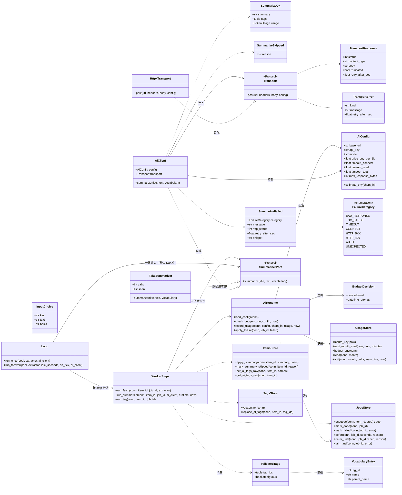
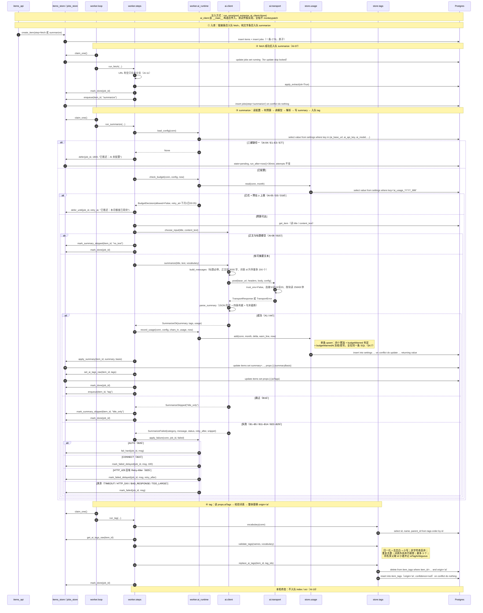
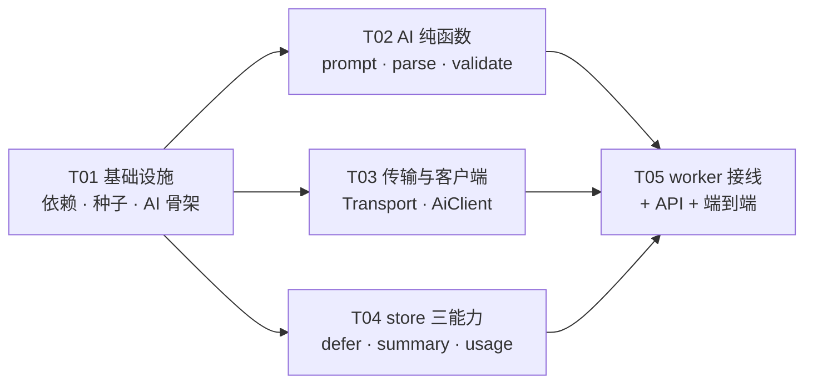

# 个人知识库 · AI 层（摘要 + 标签）设计

| 项 | 内容 |
|---|---|
| 版本 | v1.0 |
| 日期 | 2026-11-27 |
| 需求来源 | `docs/prd/2026-11-27-AI层增量PRD.md`（唯一需求来源，编号 A1–A5 / B1–B29 / C1–C6 / D1–D18 / E1–E7 / F1–F6 / G1–G8） |
| 关联 | `docs/tech/2026-11-26-技术方案.md` §6.4 / §7.4 / §7.5；`AGENTS.md` 五、六、八节；`layer_rules.toml` |
| 工程基线 | 327 passed / 26 skipped，覆盖率 82.13%；本轮不得低于 82% |
| 阅读顺序 | 非技术读者看 §0 与 §1，实现者看 §2 / §3 / §6 / §7，评审看 §5 / §8 |
| 图文件 | 类图另存为 `docs/tech/2026-11-27-AI层-类图.mermaid`，时序图另存为 `docs/tech/2026-11-27-AI层-时序图.mermaid`，与正文内容一致 |

---

## 0. 结论先行（共 14 条）

1. **本轮真正的工作量在「三个接缝」上，不在「调一次大模型」。** 三个接缝是：`fetch` 成功后入队 `summarize`（否则摘要函数永远不执行）；`summarize` → `tag` 之间标签名的落点（否则第二步拿不到输入）；worker 与 AI 层之间注入假实现的接口（否则 45 条验收用例里有 30 条无法机器验证）。

2. **测试接缝设计成两层，注入方式沿用仓内既有的「参数注入」，全程不 monkeypatch。** 这个项目已经在 `run_once(pool, extractor)` 上验证过这条路（`tests/test_worker_loop.py` 传假 `_Extractor`，无一处 patch），AI 客户端必须同构：`run_once(pool, extractor, ai_client=None)`。新参数加在位置参数之后、默认 `None`，实测 11 处现有调用全是「两个位置参数」，**一行都不用改**。两层分工：外层 `SummarizerPort`（worker 只认它）证明「未配置时不调用」「预算超限时零请求」「失败按类别落地」——断言对象是 `client.calls`；内层 `Transport`（AI 层只认它）证明「`trust_env=False`」「总超时守卫」「响应超 256KB 截断」——这些是装配逻辑，把整层打桩会把待测逻辑一起换掉，测试就变成自证。见 §4.2 / §4.2.1 / §6.9。

3. **`kb/ai/` 里不允许出现 `import os`，也不允许出现预算判断与记账。** `E6` 的断言是 `grep -c "os.environ\|getenv\|import os" kb/ai/*.py` 全为 0；`layer_rules.toml` 已禁 `kb/ai` import `kb.store`，而判预算、记账、写库三件事都要数据库连接。所以「配置拼装 + 预算 + 记账 + 失败落地」全部放在 `kb/worker/ai_runtime.py`，`kb/ai/` 只保留四件事：拼 prompt、发请求、解析响应、校验标签。

4. **PRD §8.1 里「标签种子加进 `0003_seed.sql`」这一条无法落地，必须新开 `0004`。** 理由是可验证的：`kb/store/migrate.py` 的 `plan()` 只执行「版本号未记录」的文件，平板真库已经记录了版本 3（`schema_migrations` 里有一条 3），改 `0003_seed.sql` 在那个库上**永远不会被执行**，8 个预置标签一行都进不去，`AI-02` 的验收（F2/F3/F6）全部落空。项目自己的 `kb/store/migrations/README.md` 也写着「现有最大 0003 → 0004」。这是本轮唯一一处**直接推翻 PRD 结论**的地方，见 §9 第 1 条。

5. **`B4`（180 字摘要）与 `AI-13`（≤100 字）自相矛盾。** PRD 的写法是「找不到句末标点才硬截 100 字并补 `…`」，这样得到 101 个字，与同一条需求里的「`len(summary) ≤ 100`」冲突。本设计取「硬截到 99 字 + `…` = 100 字」，两条断言同时成立。见 §8 第 2 条。

6. **本轮不允许照抄 PRD 的「三级超时」当实现细节。** 实测 `httpx` 0.28.1 的 `httpx.Timeout` 只有 `connect` / `read` / `write` / `pool` 四个字段，**没有 `total`**。PRD 的「总 20 秒」（`AI-12`、`B23`）在 `httpx` 上是配不出来的：`read` 超时是「单次读等多久」，服务端每 9 秒吐一个字节就能让一次请求无限延长。本设计把总超时落成 `HttpxTransport.post` 里「按块读 + 累计计时」的守卫，与 `B29` 的 256KB 截断共用同一个读循环。见 §6.1 末尾。

7. **「推迟不消耗 attempts」必须是 store 的新函数，不能给 `mark_failed` 加开关。** `mark_failed` 的核心是一条 SQL，里面 `attempts = attempts + 1`、`state = case when attempts + 1 >= 3`、`run_after = now() + 2^attempts` 三处都依赖「这次算一次失败」。加一个 `count_attempt` 参数等于在这条 SQL 里塞两套互斥分支，读代码的人得靠默认值猜语义。新增 `jobs.defer` / `jobs.defer_until` / `jobs.fail_hard` 三个窄函数，各自一条 SQL，语义写在函数名上。

8. **预算闸门放在 worker，不放在 AI 层，也不放在 store。** 放 AI 层违反分层（要读 `settings`）；放 store 则 store 会知道模型单价与 token 估算口径，那是业务知识不是存储知识。worker 是唯一同时持有数据库连接与 `AiConfig` 的地方。

9. **`mark_done` 之后再 `enqueue` 下一步，是有意为之的顺序。** 反过来（先入队后标完成）在 `mark_done` 失败时会留下一条已完成的上游 + 一条待办的下游，重跑上游会产生两条 `pending`，被 `jobs_pending_uniq` 挡成一条——结果正确但排障时看不出发生过重跑。按本设计顺序，最坏情况是「上游 done、下游缺失」，`C1` 这类用例会在 60 秒内直接暴露，不会静默。

10. **`tag` 成功后不入队 `index`，`fetch` 成功后也不入队 `ocr`。** 这是 `AI-10` 的硬要求，后果写清：本轮结束后新存的内容搜不到，要等索引轮次做一次全量重建。这是用「少一个功能」换「不谎报状态」——未实现的步骤一旦入队，`mark_failed` 会在第 3 次把每条内容都标成「处理失败」。

11. **`items.props.aiTags` 在 `tag` 成功后保留，不清除。** 三个用途：重跑时能对照上次结果排障（`B19`）；P1 的 `AI-20`（一键清除 AI 标签后写 `aiTagsCleared`）需要知道曾贴过什么；`F3` 的 `aiTagAmbiguous` 与之同批写入。

12. **本轮不动前端。** `GET /api/ai/usage` 做到 API 返回七个定死字段（`D18`），鉴权走现有会话中间件（不在 `PUBLIC_PATHS` 里即自动 401，`D15`）。`demo/` 不加假数据。

13. **「本次预估」必须带 0.001 元下限，否则 `D3` 不成立。** 若预估只按 `单价 × 输入字符数` 算，一条 100 字的短内容预估是 0.0002 元，`累计 0.999 + 0.0002 = 0.9992 < 1.0`，`D3` 断言的「零次 HTTP 请求」会失败。加上下限后 `0.999 + 0.001 = 1.0 ≥ 1.0`，拦得住。见 §6.5。

14. **用量累加、`budgetWarned` 判定、`budgetWarnedAt` 写入必须在同一条 SQL 里完成。** `kb/store/` 走 `pg8000.native`，这条路径**不做事务管理**（`native.py` 与 `core.py` 里 `begin`/`commit`/`rollback`/`autocommit` 均无出现，`CoreConnection.__init__` 也不接受 `autocommit` 参数），而现有 `settings.set_value` 是 `value = excluded.value`（整值覆盖）。两者叠加：两个 worker 并发记账时后写的整块覆盖先写的，用量少记 → 预算闸门以为还有额度 → 花超了才发现。所以 `store/usage.add()` 是一条 upsert，Python 侧不做读-改-写。见 §4.7。

---

## 1. 术语表（非技术读者先看）

| 术语 | 一句人话 |
|---|---|
| 接缝（seam） | 代码里「可以换成假货」的那一处。换掉它，测试就能不连网、不连库地跑完整条链路 |
| `Transport` | AI 层里唯一真正发网络请求的那一小块。测试时换成一个「按剧本返回」的假货 |
| `SummarizerPort` | worker 眼里「会出摘要的东西」的接口。它不知道对面是真模型还是假货 |
| 打字面量（tagged union） | 一个结果对象有且只有三种形态：成功 / 跳过 / 失败。用类型区分，不用布尔标志位 |
| 预算闸门 | 发请求之前先算一次「这个月还能不能花」，不能花就不发 |
| 推迟（defer） | 把任务的下次可执行时间往后推，**不算一次失败**，`attempts` 不变 |
| 归一化（标签名） | 去首尾空白 + 转小写，用来判断「AI相关」和「 ai相关 」是同一个标签 |
| 整体替换（`origin='ai'` 标签） | 重跑时先删掉这条内容所有 AI 标签再写新的；用户自己加的不动 |
| 词表 | `tags` 表里的全部标签。AI 只能从里面挑，不能新增 |

---

## 2. 实现方案总述

一条内容进库后，链路这样走通：`POST /api/items` 用一条 CTE 同时写 `items` 和 `jobs`（链接条目入队 `fetch`，纯文字条目入队 `summarize`，这是既有行为）。worker 领到 `fetch` 后**只在这一分支里**做 URL 判空，抓成功则写回 `items`、标 `done`，然后调 `jobs.enqueue(item_id, "summarize")`——这是断点一的修复。领到 `summarize` 时，worker 先用 `store.settings` 读出三个配置键拼成 `AiConfig`（缺任一则视为未配置，推迟 30 分钟、`attempts` 不变、不发请求）；再用 `store.usage` 读当月累计花费，按「已花 + 本次预估 ≥ 上限」判断，超限则推迟到下月 1 日 00:05；预算可达则从 `items` 取 `title` / `content_text`，用 `kb/ai/prompts.choose_input` 决定「正文 / 标题 / 无可摘要」三种输入，无可摘要时直接写 `props.summarySkipped='no_text'` 并标 `done`（零次请求）；有输入时调 `kb/ai/client.AiClient.summarize`，它经 `Transport` 发一次 OpenAI 兼容请求，把响应交给 `kb/ai/parse.parse_summary` 做 JSON 形状校验、四条质量判据与句末截断，回来的是三种结果之一。成功则记账（累加 `settings['ai_usage_YYYY_MM']`，首次跨 80% 时同一次写入里加 `budgetWarned`）、写 `items.summary` 与 `props.summaryBasis`、把原始标签名写进 `props.aiTags`、标 `done`、入队 `tag`；跳过（摘要与标题逐字相同）则写 `props.summarySkipped='title_only'` 并标 `done`；失败则按类别落地（401/403 一次判死；连接失败退避 3 分钟；429 有 `Retry-After` 按它；其余走 `mark_failed` 的 1/2 分钟指数退避）。领到 `tag` 时，worker 读 `props.aiTags` 与 `tags` 全表，用 `kb/ai/validate.validate_tags` 做归一化、去重、类型过滤、词表外丢弃、最多 3 个、同名多父取 `id` 小者，再调 `store.tags.replace_ai_tags` 先删该条目 `origin='ai'` 的行再插新行（`confidence` 写 `NULL`），标 `done`，本轮终态不入队任何后续步骤。

---

## 3. 模块划分与文件清单

### 3.1 新增文件

| 文件 | 一句话职责 | 为什么单独成文件 |
|---|---|---|
| `kb/ai/__init__.py` | AI 层包入口，导出 `AiConfig` / `AiOutcome` 三种结果 / `AiClient` / `build_client` | worker 只 import 这一个模块名。若让它直接 import 子模块，将来拆文件会牵连 worker 的 import 语句 |
| `kb/ai/config.py` | `AiConfig` 数据类；三级超时、响应体上限、预估下限、默认单价等常量；`from_values()` 与 `estimate_cny()` | 配置被 client、worker 的预算判断两处共用。写进 `client.py` 会让 `worker → client → 需要 config` 与 `worker 预算 → 需要 config` 形成两条路径，改一处要翻两个文件 |
| `kb/ai/outcomes.py` | `FailureCategory` 枚举、`SummarizeOk` / `SummarizeSkipped` / `SummarizeFailed` 三个结果类型、`AiOutcome` 联合类型、`TokenUsage` | 三个结果类型被 client 产出、worker 消费、测试断言三处引用。放进 `client.py` 会让只测解析的用例为了拿类型而 import 一个需要 `httpx` 的模块 |
| `kb/ai/prompts.py` | `choose_input(title, content_text)` 决定「正文 / 标题 / 无」三种输入与 `basis`；`build_messages()` 拼 OpenAI 兼容消息体（正文截前 3000 字、标题必带、词表按 `id` 升序去重最多 200 个渲染成「父 › 子」） | prompt 是「内容口径」，改文案不该碰网络代码。`choose_input` 与 `build_messages` 必须同文件：两者都决定「送什么文本给模型」，分开放会出现「判断用正文、拼 prompt 用标题」的不一致 |
| `kb/ai/parse.py` | `parse_summary(raw_text, title)` → `AiOutcome`：JSON 形状校验、`summary` 类型与长度判据、与标题逐字比较、超长按句末标点截断、`tags` 字段缺失或非数组一律判非法 | 本轮测试最密的一块（B1–B5、B11、B16）。单独成文件才能被 `--cov-report=term-missing` 精确统计到 ≥85%（`G8` 要求它必须出现在覆盖率表里） |
| `kb/ai/validate.py` | `validate_tags(raw, vocabulary)` → `ValidatedTags(tag_ids, ambiguous)`：归一化、去重、非字符串丢弃、词表外丢弃、最多 3 个、同名多父取小 id | 与 `parse.py` 分开是因为执行位置不同：`parse` 在 `summarize` 步骤里跑，`validate` 在 `tag` 步骤里跑，中间隔着一次落库。同文件会让「解析失败」与「标签校验」的关系看起来比实际更紧 |
| `kb/ai/transport.py` | `Transport` 协议（`post()` 一个方法）、`TransportResponse`、`TransportError`、`HttpxTransport`（`trust_env=False`、三级超时、按块读并在 256KB 处停） | 这是测试的核心接缝。单独成文件才能让「不装网络也能测」这件事一眼可见，也能让 `B27`（缺包时启动即报错）精确指向一个模块 |
| `kb/ai/client.py` | `AiClient(config, transport)`：拼请求体、调 transport、把 `TransportResponse` / `TransportError` 翻成 `AiOutcome`、**不做重试** | 「一次调用」的完整语义在这里。重试分开是因为重试属于 `jobs.attempts`，写进这一层会让客户端内偷偷重试 2 次而数据库只记 1 次 |
| `kb/store/usage.py` | 用量与预算的读写：`month_key()` / `next_month_start()` / `budget_cny()` / `read()` / `add()`；`add()` 用一条 SQL 完成累加与「首次跨 80% 写标记」 | 写库只能在这一层（`layer_rules.toml`）。与 `settings.py` 分开是因为 `settings.py` 是通用键值读写，`usage.py` 带业务口径（自然月、80% 线、4 位小数） |
| `kb/store/tags.py` | `vocabulary(conn)` 读全表（含父名）；`replace_ai_tags(conn, item_id, tag_ids)` 先删 `origin='ai'` 再插新行 | 现在 `kb/store/` 没有 `tags.py`，标签读写散落在未来各处会让「AI 不得写词表」这条边界失去唯一落点 |
| `kb/worker/steps.py` | 三个步骤的实现：`run_fetch` / `run_summarize` / `run_tag`，各返回「处理完了」 | `kb/worker/loop.py` 现在是「领 → 判 → 做 → 标」一体。加两个步骤后它会变成三个 if 分支塞在 60 行里。拆出来才能让「URL 判空只属于 fetch」在结构上成立（`AI-11` 的根因就是判空写在分派之前） |
| `kb/worker/ai_runtime.py` | `load_config(conn)`（未配置返回 `None`）、`check_budget(conn, config, now)`、`record_usage(...)`、`apply_failure(conn, job_id, failed)` | 唯一同时认识 `store` 与 `kb.ai` 类型的地方。放 `kb/ai/` 会违反分层；放 `loop.py` 会让循环文件同时管调度与业务口径 |
| `kb/api/ai.py` | `GET /api/ai/usage` 的 handler 工厂，返回七个定死字段 | 与 `kb/api/items.py` 同构（工厂捕获 `pool`）。不塞进 `health.py`：health 无鉴权，把「本月花了多少钱」暴露给未登录请求属于信息泄露 |
| `kb/store/migrations/0004_seed_ai_tags.sql` | 插 8 个一级标签（`is_preset=true`、`parent_id` 为空、裸 `on conflict do nothing`） | 必须新开文件，理由见 §0 第 4 条与 §9 第 1 条 |

### 3.2 修改文件

| 文件 | 改什么 | 为什么必须改 |
|---|---|---|
| `pyproject.toml` | `dependencies` 加 `httpx>=0.28` | `G6`：`httpx` 现在是 `parsehub` 的传递依赖，干净环境里 `import httpx` 是否成功取决于上游。断言的是依赖清单里有没有它，不是 `import` 成不成功 |
| `kb/store/jobs.py` | 新增 `defer` / `defer_until` / `fail_hard` | `E1`（推迟 30 分钟不计次）、`D3`（推到下月不计次）、`B26`（401 一次判死）三条都需要 `attempts` 不变或直接 `failed`，现有 `mark_failed` 三种都做不到 |
| `kb/store/items.py` | 新增 `apply_summary` / `mark_summary_skipped` / `set_ai_tags_raw` / `get_ai_tags_raw` | `G1` 要求摘要写入不得污染 `content_text`。现有 `apply_extract` 一条 SQL 同时写 `title` / `content_text` / `kind`，复用它会把正文覆盖成空 |
| `kb/worker/loop.py` | `SUPPORTED_STEPS` 改为 `("fetch", "summarize", "tag")`；URL 判空移进 `fetch` 分支；按 step 分派到 `steps.py`；`run_once` 尾部加 `ai_client=None` 参数 | `AI-11` 的根因就是判空在分派之前。只把 `summarize` 加进 `SUPPORTED_STEPS` 而不动结构，纯文字条目会先撞「无链接可抓」并标 `done`（谎报） |
| `kb/worker/__main__.py` | 启动时先 `import kb.ai`，`ImportError` 则打印含包名与 `pip install httpx` 的错误并 `sys.exit(2)` | `B27`：干净环境缺 `httpx` 时要在启动阶段失败，不是在领到第一条任务、写了心跳、看起来「在跑」之后才崩 |
| `kb/api/app.py` | 注册 `Route("/api/ai/usage", ai_api.usage(pool))` | 端点不注册就 404；不加入 `PUBLIC_PATHS` 即自动走鉴权（`D15`） |
| `tests/test_worker_loop.py` | 把「`summarize` 未实现」的两个用例改成用 `ocr` 步骤 | 现在有一个用例断言「领到 `summarize` 要 `mark_failed('尚未实现')`」。`summarize` 一被支持它就变红。实现者容易误判成「实现错了」而去回退 `SUPPORTED_STEPS`——必须先改测试 |

---

## 4. 关键数据结构与接口

### 4.1 类图



### 4.2 测试接缝（本轮设计的核心）

**注入方式沿用现有模式：构造函数 / 函数参数注入，全程不 monkeypatch。** 这是既有代码已经验证过的做法（`tests/test_worker_loop.py` 用 `_Extractor(ok=True)` 传假抓取器，`kb/worker/loop.py` 的签名是 `run_once(pool, extractor)`），AI 客户端必须同构，理由见 §6.9。

| 接缝 | 位置 | 生产实现 | 测试实现 | 它守住哪几条验收 |
|---|---|---|---|---|
| `Transport` | `kb/ai/transport.py` | `HttpxTransport` | `ScriptedTransport`：按剧本依次返回 `TransportResponse` 或抛 `TransportError`，并记录「第几次、发了什么 body」 | B21（代理变量）、B23（读超时）、B25（429 + `Retry-After`）、B28（HTML 响应）、B29（256KB 截断） |
| `SummarizerPort` | `kb/worker/steps.py` 的入参类型 | `AiClient` | `FakeSummarizer`：返回预设 `AiOutcome`，**必须带 `calls: int` 计数属性**与 `seen: list[tuple[str, str, tuple]]`（每次入参的 title / text / 词表），并可按剧本抛异常 | E1/E2/E3/E4/E7（未配置时零调用）、D3（预算超限零调用）、B12/B26（失败按类别落地）、A1/A4/B15/B16（步骤分支） |
| 纯函数 | `kb/ai/prompts.py` / `parse.py` / `validate.py` | 同一份代码 | 直接调用，无注入 | A1、B1–B11、B16–B18、F1–F3、B17（3000 字截断） |

**假客户端的最小接口（测试代码按这个形状写，不得额外加方法）：**

| 成员 | 类型 | 用途 | 被哪条验收断言 |
|---|---|---|---|
| `calls` | `int` | 累计被调用次数，构造时为 0 | E1/E2/E4/E7、D3 断言 `client.calls == 0` |
| `seen` | `list[tuple[str, str, list]]` | 每次调用的 `(title, text, vocabulary)` | A1（正文走正文）、A4（空正文走标题）、B17（只送前 3000 字）、§2.4（词表最多 200 个） |
| `script` | 构造入参 | 依次弹出的返回值；元素可以是 `AiOutcome`，也可以是待抛出的异常实例 | B12/B22/B26（失败按类别落地）、B2（解析失败三次） |

`calls` 必须是**普通实例属性**而不是 property——测试里要能直接读 `client.calls == 0`，也要能在构造后断言它没被跳过。用 `MagicMock` 会让「没被调用」与「被调用但返回 None」在断言上无法区分，这是不用 mock 库而手写假类的直接理由。

**为什么不打桩 `AiClient` 整体**：`B21` 断言「容器里有 `HTTPS_PROXY` 时请求仍直连成功」，这条只有在 `HttpxTransport` 真的被构造、`trust_env=False` 真的被传进去时才成立。把 `AiClient` 换掉，这条用例变成断言「假货返回了成功」，与实现无关。

**为什么不打桩 `httpx` 本身**：`respx` 一类库替换的是 `httpx` 内部 transport，`B23`（总超时守卫）与 `B29`（256KB 截断）是我们自己的装配代码，替换后不再被执行。

**为什么两层都要**：只有 `Transport` 接缝时，worker 分支的每一个失败用例都要顺手造一个假 HTTP 响应，45 条用例里 30 条会变成「为了测控制流而先造网络包」；只有 `SummarizerPort` 接缝时，`B21`/`B29` 无从验证。两层用同一套结果类型（`AiOutcome`）串起来，假货与真货的契约完全一致。

### 4.2.1 确切签名（注入点，实现者照抄）

```python
# kb/worker/loop.py
def run_once(
    pool: Any,
    extractor: Callable[[str], Coroutine[Any, Any, ExtractOutcome]],
    ai_client: SummarizerPort | None = None,
) -> bool: ...

def run_forever(
    pool: Any,
    extractor: Callable[[str], Coroutine[Any, Any, ExtractOutcome]],
    idle_seconds: float = IDLE_SECONDS,
    on_tick: Callable[[], None] | None = None,
    ai_client: SummarizerPort | None = None,
) -> None: ...

# kb/worker/steps.py —— 三个分支各自的入口，ai_client 只出现在 summarize 分支
def run_fetch(conn, item_id: int, job_id: int, *, extractor) -> None: ...
def run_summarize(conn, item_id: int, job_id: int, *, ai_client: SummarizerPort,
                  runtime: AiRuntime, now: datetime) -> None: ...
def run_tag(conn, item_id: int, job_id: int) -> None: ...
```

**新参数 `ai_client` 一律加在位置参数之后、带默认值 `None`。** 影响面已实测：`tests/test_worker_loop.py` 里 11 处 `loop.run_once(...)` 全部是**两个位置参数**调用，没有一处用关键字传 `extractor`，因此这 11 处**一行都不用改**。`run_forever` 在测试里没有被调用（只有 1 处定义、0 处调用），但 `kb/worker/__main__.py` 调它时用关键字传 `idle_seconds`，所以新参数必须放在 `on_tick` 之后。

`ai_client=None` 时四个分支的行为**逐条定死**（见下表）。两个关键区分：**「客户端为 None」与「配置缺失」是两件不同的事，判定顺序不能颠倒**；**`tag` 分支根本不用客户端，所以它不受 `ai_client` 影响**。

| 情况 | `ai_client` | step | 期望行为 | 为什么 |
|---|---|---|---|---|
| **A 生产正常** | 真实例 | `summarize` | 正常调 `ai_client.summarize(...)` | — |
| **B1 客户端缺席** | `None` | `summarize` | **先 `load_config`**：若配置齐备 → `defer(1800, "已推迟：AI 客户端未装配（配置已存在，检查 worker 启动时是否传 ai_client）")`；`attempts` 不变 | 配置齐备却没客户端，是**装配 bug**，不是「未配置」。写这句 error 才能让人看出是漏传参数而不是没填配置 |
| **B2 配置缺失** | `None` | `summarize` | `defer(1800, "已推迟：AI 未配置（缺 ai_api_key）")`；`attempts` 不变 | 这是 `E1` 的正常路径。与 `ai_client` 是否有值无关——**即使注入了真实例，配置缺失也必须走这条**（否则 AI 层会拿到空 base_url 白发一次请求） |
| **C 客户端缺席** | `None` | `tag` | **正常执行**：读 `props.aiTags` → 校验词表 → `replace_ai_tags` → `mark_done` | ⚠️ 与「同 B」的写法不同，理由见下方「C 的机制」 |
| **D 客户端缺席** | `None` | `fetch` | **完全不受影响**，正常抓取 | 这是 11 处现有用例一行都不改的前提 |

**判定顺序（B 分支内部，写反会报错报错因）**：

```
ai_client is None ?
  ├─ 否 → 进 AI 层（配置已在 load_config 阶段检查过，保证齐备）
  └─ 是 → load_config(conn)
            ├─ 返回 AiConfig（配置齐备）→ defer + "AI 客户端未装配"（装配 bug）
            └─ 返回 None（配置缺失）    → defer + "AI 未配置（缺 xxx）"（正常推迟）
```

先判 `ai_client` 再查配置，是因为「配置齐备但没客户端」只可能来自装配错误，而「配置缺失」无论客户端在不在都是正常推迟。两者混成一句 error，排障时无法区分「该去填配置」还是「该去查 `__main__.py`」。

**C 的机制（为什么 `tag` 不该 defer）**：本设计里 `run_tag(conn, item_id, job_id)` 的签名**不接受 `ai_client`**——`tag` 步骤只读 `props.aiTags`、`tags` 词表、写 `item_tags`，全程不调模型（`aiTags` 是 `summarize` 那次调用已经带回来的）。所以「生成摘要的那一次调用」与「把标签落库」是解耦的：客户端缺席时 `summarize` 已经 defer 了，`tag` 根本不会被入队（`enqueue(item_id, "tag")` 只在 `SummarizeOk` 后执行）。

如果真有一条 `tag` 任务已经存在（重跑场景）而客户端是 `None`，**defer 它是错的**：它不依赖客户端，一 defer 就把「已成功拿到的标签」挂起 30 分钟，而这段时间里 `items.summary` 已经写好了，界面显示「有摘要但没标签」，用户无法理解原因。正确行为是照常执行完。

⚠️ 与 team-lead 给的原始表格在此处不同（原写「同 B」）。差异只有机制，**目标一致**：不谎报、不硬崩、`fetch` 不受影响。若坚持让 `tag` 也 defer，代价是重跑场景下标签永久挂起（每次重新领取仍然 `None`，直到有人传对参数），且 `F1`/`A5` 的空词表用例会被误伤。

**D 是 11 处现有用例一行不用改的唯一前提**：`ai_client` 只出现在 `run_summarize` 的签名里，`run_fetch` 与 `run_tag` 都不接收它。现有 11 处调用喂的全是 `fetch` job（外加那 2 处喂 `summarize` 的，按 §7.3b 改成 `ocr`），因此一律走 D 路径，`_ScriptedConn` 的剧本不用动。

**current state 的事实基础**（核实过的）：`grep -n '"summarize"' tests/test_worker_loop.py` 只有 2 行命中（`:231`、`:244`），就是 §7.3b 要改的那两个用例。改造之后**没有任何测试再命中「`ai_client=None` + `step='summarize'`」**，所以 B1/B2 必须由 T05 新增的用例覆盖，不能靠现有用例兜住。

### 4.3 结果类型（成功 / 失败 / 跳过怎么区分）

| 类型 | 何时产出 | 携带信息 | worker 侧动作 | 对应验收 |
|---|---|---|---|---|
| `SummarizeOk` | 响应合法且摘要通过四条判据 | `summary`、`tags`（原始名数组，可能为空）、`usage`（可能为空） | 记账 → 写 summary → 写 `props.aiTags` → `mark_done` → 入队 `tag` | A1、A2、A3、A5、D1、D2 |
| `SummarizeSkipped` | 调用成功但摘要不可用：与标题逐字相同（`title_only`）；或调用前判定无可摘要文本（`no_text`，由 worker 直接产出，不经 AI 层） | `reason` | 写 `props.summarySkipped` → `mark_done`（`attempts` 不变） | B15、B16 |
| `SummarizeFailed` | 任何不产出可用摘要的情况：HTTP 失败、响应非 JSON、形状非法、长度越界 | `category`、可读 `message`、`http_status`、`retry_after_sec`、`snippet`（响应前 200 字） | 按 `category` 落地（见 §4.5） | B1–B5、B11–B14、B22–B29 |

**为什么不用布尔 + 异常**：`no_text` 与 `title_only` 不是错误，用异常表达会被 `run_once` 现有那条「任何异常收成任务失败」的兜底吞成失败，`attempts` 被 +1，`B15`/`B16` 断言的 `attempts=0` 直接不成立。三种形态必须是类型层面的区分。

### 4.4 配置的传递方式

| 环节 | 谁做 | 具体 |
|---|---|---|
| 权威源 | `settings` 表 | 键名定死：`ai_base_url` / `ai_api_key` / `ai_model`（必需），`ai_price_cny_per_1k`（可选，默认 0.002），`ai_budget_cny`（可选，默认 20） |
| 判定「未配置」 | `kb/worker/ai_runtime.load_config` | 三个必需键**缺任一或值为空串**即返回 `None`。此时 worker 不构造 `AiConfig`、不进 AI 层、不发请求（`E7` 断言假实现调用次数为 0） |
| 拼装 | 同上 | `AiConfig.from_values(...)` 填默认单价与三级超时。超时数值是 `kb/ai/config.py` 里的常量，只有一处 |
| 消费 | `kb/ai/client.py` / `kb/ai/transport.py` | 只读传入的 `AiConfig`，不读 `settings`、不读环境变量、不 `import os` |
| 禁止 | 全体 | AI 层内出现 `os.environ` / `getenv` / `import os` 即违反 `E6`；出现 `import kb.store` 即被 `eng_checks --arch` 拦下 |

### 4.5 失败分类与落地动作（逐条对应验收）

| `category` | 触发条件 | 落地动作 | `attempts` | `run_after` | 对应验收 |
|---|---|---|---|---|---|
| `AUTH` | HTTP 401 / 403 | `jobs.fail_hard`（直接 `failed`） | +1 后停在 3 之外的终态 | 不变 | B26 |
| `HTTP_429` | HTTP 429 | `mark_failed_delayed(delay = Retry-After)`；无 `Retry-After` 时按 `mark_failed` | +1 | `now + Retry-After` | B14、B25 |
| `CONNECT` | DNS 失败 / 连接被拒 / 建连超时 | `mark_failed_delayed(delay = 180s)` | +1 | `now + 3 分钟` | B22 |
| `TIMEOUT` | 读超时（连上了但无数据） | `mark_failed`（1/2 分钟指数退避） | +1 | `now + 2^attempts 分钟` | B12、B23 |
| `HTTP_5XX` | 500 / 502 / 503 | `mark_failed` | +1 | 同上 | B12、B24 |
| `BAD_RESPONSE` | 非 JSON、形状非法、长度越界、`tags` 缺失或非数组 | `mark_failed`，`error` 含 `snippet` | +1 | 同上 | B1、B3、B5、B11、B28 |
| `TOO_LARGE` | 响应超过 256KB 即停读 | 与 `BAD_RESPONSE` 同路径（按解析失败处理） | +1 | 同上 | B29 |
| `UNEXPECTED` | 其他未分类异常 | `mark_failed`，`error` 含异常类型名 | +1 | 同上 | — |

`mark_failed_delayed` 是 `jobs.mark_failed` 的可选延迟版本：`attempts` 与 `state` 的算法完全一致（复用同一条 SQL 的形态），只把 `run_after` 的间隔换成参数。它**不新增语义**，只是把退避间隔从常量变成入参。

### 4.6 「推迟不消耗 attempts」的三个新函数 + 一个改退避的函数

| 函数 | SQL 要点 | 语义 |
|---|---|---|
| `jobs.defer(conn, job_id, seconds, reason)` | `state='pending'`、`run_after = now() + interval '1 second' * :seconds`、`error = :reason`、**不出现 `attempts`** | 未配置 AI（30 分钟）、预算超限的通用推迟 |
| `jobs.defer_until(conn, job_id, when, reason)` | 同上，`run_after = :when` | 预算超限推到下月 1 日 00:05（`D3`） |
| `jobs.fail_hard(conn, job_id, error)` | `state='failed'`、`attempts = attempts + 1`、`run_after` 不变 | 401/403 一次判死（`B26`） |
| `jobs.mark_failed_delayed(conn, job_id, error, seconds)` | 与 `mark_failed` 同形态（`attempts+1`、`attempts+1 >= 3` 判死），只把 `run_after` 的间隔换成 `interval '1 second' * :seconds` | 连接失败退避 3 分钟（`B22`）、429 按 `Retry-After` 退避（`B25`）。**不新增语义**，只把退避间隔从常量变成入参 |

前三个函数**不出现 `attempts`**（`fail_hard` 除外，它的语义就是「算一次并直接判死」），这是「推迟不计次」在代码层面可被一眼确认的证据。第四个函数复用 `mark_failed` 的算法规避了「两套退避算法并存」。

`defer` 与 `defer_until` 都把原因写进 `jobs.error`，前缀固定为 `已推迟：`。`derive_status` 只看 `state`，所以带 `error` 的 `pending` 任务不会让条目显示成「处理失败」，同时用户能在详情页看到「为什么还没出摘要」。

### 4.7 用量记账必须一条 SQL 完成（不能用读-改-写）

**结论：`store/usage.add()` 是单条 upsert，`calls` / `promptTokens` / `completionTokens` / `cny` 的累加、`budgetWarned` 判定、`budgetWarnedAt` 写入三件事全在**这一条 SQL 里**，Python 侧不做「读出来加一加写回去」。**

**为什么不能读-改-写**：`kb/store/` 走 `pg8000.native`，这条路径**不做事务管理**——`pg8000/native.py` 与 `pg8000/core.py` 里 `begin` / `commit` / `rollback` / `autocommit` 一次都没出现，`CoreConnection.__init__` 也不接受 `autocommit` 参数（实测 pg8000 1.31.6）。所以每条语句执行后立即生效，**没有任何事务能罩住「读」与「写」两步**。现有 `kb/store/settings.py:31-38` 的 `set_value` 又是 `value = excluded.value`（整值覆盖，不是合并）。两者叠加的后果：两个 worker 并发记账时，后写的会**整块覆盖**先写的，用量少记，预算闸门以为还有额度——这是「花超了才发现」的直接成因。

**具体形态**（示意，实现时按此形状写一条语句）：

```sql
insert into settings (key, value) values (:k, cast(:seed as jsonb))
on conflict (key) do update set
  value = jsonb_build_object(
    'calls',            coalesce((settings.value->>'calls')::int, 0) + :d_calls,
    'promptTokens',     coalesce((settings.value->>'promptTokens')::int, 0) + :d_prompt,
    'completionTokens', coalesce((settings.value->>'completionTokens')::int, 0) + :d_completion,
    'cny',              round(coalesce((settings.value->>'cny')::numeric, 0) + :d_cny, 4)
  )
  || case
       when settings.value->>'budgetWarned' = 'true'
         then jsonb_build_object('budgetWarned', true,
                                 'budgetWarnedAt', settings.value->'budgetWarnedAt')
       when round(coalesce((settings.value->>'cny')::numeric, 0) + :d_cny, 4) >= :warn_line
         then jsonb_build_object('budgetWarned', true,
                                 'budgetWarnedAt', to_jsonb(now()::text))
       else '{}'::jsonb
     end,
  updated_at = now()
returning value
```

四条不能改的要点：

| 要点 | 为什么 |
|---|---|
| `cny` 用 `round(numeric, 4)`，不用浮点 `round()` | 浮点累加出 `16.010000000000002`，D10 ② 的「`budgetWarnedAt` 逐字不变」会被浮点噪声连坐 |
| **`budgetWarned` 分支里保留原 `budgetWarnedAt`**（`settings.value->'budgetWarnedAt'`） | D10 ② 要求冻结。每次重写时间戳是最容易犯的错，写法上必须显式取旧值 |
| **首次跨线才写 `budgetWarnedAt`**（`when ... >= :warn_line` 且上面那个 `when` 未命中） | D9 要求跨线即写；D10 ② 要求之后不变。两个 `when` 的顺序决定语义 |
| **不写任何写入计数器** | D10a 明确禁止。重复写同一个 `budgetWarned: true` 在最终状态上不可观测，为测它加 `warnCount` 会让每次调用多一处一致性风险 |
| `updated_at = now()` 在 upsert 里显式写 | 现有 `set_value` 已有此行为，累加版本必须保留，否则 D10 ③ 的「`updated_at` 有变」抓不到「整行没更新」这个假通过 |

**测试断言的写法**（D1 与 D10 ③，两处都容易写错）：

| 验收 | 正确写法 | 错误写法 |
|---|---|---|
| D1 累加 | 连续两次调用后 `calls` **精确等于 2**、`promptTokens` 精确等于两次之和 | 断言 `calls > 0`（丢掉「丢更新」这个最可能的失败模式） |
| D10 ③ 时间戳 | `updated_at` 序列**非递减**，且**至少有一次严格大于首次值** | 断言「每次调用后都严格递增」——`now()` 是 `transaction_timestamp`，同一微秒内两次写入取到相同值，会偶发失败 |

---

## 5. 调用时序图



**与 PRD §5.2 状态机的差异（有意）**：PRD 图里「未配置」与「预算超限」画成回到 `summarize` 的虚线。本设计落到具体动作：两者都不改步骤、不改 `attempts`、只改 `run_after`，任务仍是同一条 `summarize`。这样 `jobs` 表里读不到「因为没配置所以没做」这类伪步骤，`C1` 的断言「`jobs` 出现 `step='summarize'`」也不会被干扰。

---

## 6. 技术决策与对比

### 6.1 HTTP 客户端：`urllib` vs `httpx` vs `requests`

| 维度 | 标准库 `urllib.request` | `encode/httpx` | `psf/requests` |
|---|---|---|---|
| 依赖成本 | 零（标准库） | 一个新声明依赖，纯 Python，aarch64 免编译 | 一个新声明依赖，纯 Python |
| 分阶段超时 | 只有一个总 `timeout` | `connect` / `read` / `write` / `pool` 四级，可给总上限 | 只有 `(connect, read)` 两段，无总超时 |
| 代理环境变量 | 默认读 `HTTP_PROXY` 等，关掉要自己拼 `OpenerDirector` | `Client(trust_env=False)` 一行关掉 | 默认读，关掉要逐项构造 `Session` |
| 响应体上限 | 需要自己按块 `read(n)` 并计数 | 同（`httpx` 也不自动限长，按块读同样要自己写） | 同 |
| 连接复用 | 无 | 有 | 有 |
| 同步/异步 | 仅同步 | 两种都有 | 仅同步 |

**选择 `httpx`**，理由三条：① 与技术方案 §3.2 已定选型一致，不另选避免两份文档打架；② `B21` 要的 `trust_env=False` 是一个构造参数，而 `urllib` 要自建 opener、`requests` 要逐项处理；③ `B23` 要断言「单次 ≤25 秒」，`httpx` 的三级超时能让这个上限由配置保证，不必靠外部计时器。

**淘汰 `urllib`**：仓内已有用法（`kb/api/health.py:44`）只探一个 1.5 秒的本地 health，没有连接复用需求。用它做 AI 调用要额外写分阶段超时（靠 `socket` 层或线程计时），代码量不比写一个 `Transport` 实现少，且这些代码正是 `B23` 要断言的对象——自写就多一处会错的地方。

**淘汰 `requests`**：没有总超时是硬伤。`B23` 的断言是「单次调用总耗时 ≤25 秒」，`requests` 的 `(connect, read)` 两段组合起来的上限是 5+10=15 秒仅当只有一次读，遇到服务端慢速滴流（每 9 秒吐一个字节）会无限延长，这正是超时要防的场景。

**`httpx` 进 `dependencies` 的写法**：`httpx>=0.28`。锁下界的理由是 0.28 是当前实测版本，`trust_env` 与 `Timeout(connect=, read=)` 的签名在 0.28 上已验证（本机实测 0.28.1）。不锁上界：`httpx` 1.x 未发布，锁上界会在它发布时挡住升级。

**「总 20 秒」这一条 `httpx` 自己做不到，必须由 `HttpxTransport` 自己守。** 实测核对（`httpx` 0.28.1）：`httpx.Timeout` 的字段只有 `connect` / `read` / `write` / `pool`，**没有 `total`**。`read` 超时是「单次读操作等多久」，服务端慢速滴流（每 9 秒吐一个字节）可以让一次请求无限延长而不触发任何超时。`B23` 断言的是「单次调用总耗时 ≤25 秒」，这条只能靠外部守卫实现：

| 做法 | 判 | 说明 |
|---|---|---|
| **`HttpxTransport.post` 里按块读 + 累计计时，超 `timeout_total` 即中止并归为 `TIMEOUT`** | **采用** | 与 `B29`（256KB 截断）天然同处：两者都在「按块读循环」里判。一次循环同时管住「读太多」与「读太久」，不需要额外线程或计时器，也不会在同步 worker 里引入并发 |
| 用 `signal.alarm` / `SIGALRM` 兜 | 淘汰 | worker 是主线程同步循环，`SIGALRM` 会打断正在进行的数据库操作；且 Windows 上没有 `SIGALRM`，本项目要在 Windows 上开发 |
| 用线程 + `join(timeout)` 包一层 | 淘汰 | 超时后线程仍在跑（Python 无法强杀线程），响应回来后仍会占内存与连接，等于把「卡死」换成「泄漏」 |
| 只靠 `connect` + `read` 两个值 | 淘汰 | 慢速滴流场景下 `B23` 的 25 秒上限不成立，且这条不做的话 `B23` 的断言本身无法满足 |

这也是「`Transport` 为什么必须是独立可测的一层」的第二个理由：这 15 行守卫逻辑是纯装配代码，只有直接测 `HttpxTransport`（配一个按剧本慢速返回的假传输）才能验到，把 `AiClient` 整体打桩就绕过了它。

### 6.2 配置来源：环境变量 vs `settings` 表 vs 两者混合

| 做法 | 判 | 理由 |
|---|---|---|
| AI 层自己读环境变量 | 淘汰 | 配置的权威源是 `settings` 表（方案 §7.4）。两处配置源必然漂移：改了表里的值、环境变量没改，AI 层用旧值且没有任何地方报错 |
| AI 层自己读 `settings` | 淘汰 | 违反 `layer_rules.toml` 的 `[[import_deny]] path_prefix="kb/ai/"`，`eng_checks --arch` 直接拦；且 AI 层无法脱离数据库单测，`E6` 的「单测不建 `conn` fixture 也能跑」不成立 |
| **worker 读出后作为参数传入** | **采用** | 配置只有一个权威源；AI 层变成纯函数（入：配置 + 文本 + 词表；出：摘要 + 标签名），可以完全脱离数据库测试 |

**混合方案为什么不行**：「环境变量提供密钥、`settings` 提供模型名」听起来兼顾安全与灵活，实际会产生「密钥换了但模型名没换」这类半更新状态，而且 `B27` 的启动检查要同时查两个源，错误文案说不清缺哪个。

### 6.3 `summarize` → `tag` 的交接：`props.aiTags` vs 临时表 vs `jobs` 加列

| 做法 | 判 | 代价 |
|---|---|---|
| **`items.props.aiTags`（字符串数组）** | **采用** | `props` 是长尾属性桶，写它不需要迁移；一条 `update items set props = props \|\| ...` 即可；`A5`（空数组）与 `B19`（重跑）都能原样保留 |
| 临时表（`ai_staging`） | 淘汰 | 需要一次迁移 + 一张表的生命周期管理（写、读、清理、崩溃后的残留）；`items` 与临时表之间没有外键约束，条目被软删后残留行要额外清理 |
| `jobs` 表加列（`jobs.payload jsonb`） | 淘汰 | 改动的是状态机表结构。`jobs` 现在只表达「哪条内容、哪一步、什么状态」，加一个业务字段会让「任务」与「任务产出」混在一张表里；`AI-21`（重跑时整体替换 AI 标签）还要求这份数据在 job 标 `done` 后仍然可读，而 `jobs` 的行会被后续轮次清理 |
| 写进 `jobs.error` | 淘汰 | PRD §8.1 已点名这是滥用。`error` 有语义（失败原因），`A5` 断言「`jobs.error` 为空」，把它当数据通道会直接撞这条 |

**放弃 `props.aiTags` 的代价**：`props` 有 GIN 索引（`items_props_gin`），写它比写普通列略贵。实测口径：`props` 现在每次 `apply_extract` 都写，单条 jsonb 在百字节量级，单用户场景下这点开销不构成问题。⚠️ 未做压测，若将来批量补摘要（`AI-18`）出现写入瓶颈，把 `aiTags` 提成生成列即可，不影响接口形状。

### 6.4 预算闸门位置：worker 层 vs AI 层 vs store 层

| 位置 | 判 | 理由 |
|---|---|---|
| AI 层 | 淘汰 | 要在发请求前读 `settings`，违反分层。而且 AI 层拿不到历史用量就意味着它必须被传入一份「剩余额度」，那闸门的判断逻辑仍然在别处 |
| store 层（一条 SQL 判「还能不能花」） | 淘汰 | 「本次预估费用」需要单价与 token 估算口径，那是业务知识不是存储知识。写进 store 会让 `kb/store/` 知道模型定价，将来换供应商要改存储层 |
| **worker 层（`ai_runtime.check_budget`）** | **采用** | worker 是唯一同时持有数据库连接与 `AiConfig` 的地方；判断是纯算术，可以单测（喂一个假 `UsageState` 与一个 `AiConfig` 就能覆盖 D3–D6、D16） |

**闸门与记账必须成对**：只做闸门不记账，闸门永远读到 0，额度永不生效；只记账不做闸门，账单不可控。两者的月份口径共用 `store/usage.month_key(now)` 一个函数（本地时区自然月），不各写一份格式化。

### 6.5 「本次预估」的口径（`D3` 能否通过的支点）

`check_budget` 的判据是 `已花 + 预估 ≥ 上限`。预估写成：

```
预估 = max(price_cny_per_1k × (输入字符数 + 150) / 1000, 0.001)
```

两个常量各有理由：

| 常量 | 取值 | 为什么要它 |
|---|---|---|
| 假定输出 token | 150 | 摘要 ≤100 字 + 标签名，按「字符数 × 1.0」估算约 100–150 token。取 150 偏保守 |
| 预估下限 | 0.001 元 | **没有它 `D3` 就不成立**：一条 100 字的短内容预估为 0.0005 元，`0.999 + 0.0005 < 1.0`，断言「零请求」失败。加下限后 `0.999 + 0.001 = 1.0 ≥ 1.0`，拦得住 |

下限的副作用：当月累计在离上限 0.001 元以内时会提前停一次。这个偏差方向是「少花钱」，与 `D2` 的「宁可提前停」一致。

### 6.6 「推迟不消耗 attempts」：新增 store 函数 vs 复用 `mark_failed` 加参数

| 做法 | 判 | 理由 |
|---|---|---|
| **新增 `jobs.defer` / `defer_until` / `fail_hard`** | **采用** | 三个窄函数各自一条 SQL，语义写在函数名上。`defer` 的 SQL 里根本不出现 `attempts`，看代码就能确认「不会计次」，不需要读参数默认值 |
| 给 `mark_failed` 加 `count_attempt: bool = True` | 淘汰 | `mark_failed` 的 SQL 里 `attempts = attempts + 1`、`state = case when attempts + 1 >= 3`、`run_after = now() + 2^attempts` 三处都依赖「这次算一次失败」。加参数等于在一条 SQL 里塞两套互斥分支，而且默认值 `True` 意味着「忘记传」时就静默变成消耗次数——`E1` 的断言会变成靠调用方自觉 |
| 先 `mark_done` 再 `enqueue` 一条新 `summarize` | 淘汰 | 会在 `jobs` 里留下一条 `done` 记录，界面「重试了几次」统计变脏；且 `A3` 断言 `summarize` 与 `tag` 的 `attempts` 为 0，这种写法会让每次推迟都新增一行 job，排障时分不清「重跑」与「推迟」 |
| 把 `run_after` 直接改成一个月后但走 `mark_failed` | 淘汰 | `attempts` 仍会累加，三次预算超限后任务直接 `failed`，`D4`（下月自动补跑）不成立 |

### 6.7 「标签种子加进 `0003`」为什么不可行（推翻 PRD §8.1）

`kb/store/migrate.py` 的 `plan()` 是 `[m for m in migrations if m.version not in applied]`。平板真库的 `schema_migrations` 里已有版本 3（R1–R5 全部跑过迁移）。改 `0003_seed.sql` 之后：`discover()` 仍然只发现「版本 3 已应用」，`plan()` 返回空，文件内容一个字符都不会执行。

**这件事的后果是可判定的**：`F6` 断言「迁移跑两次，预置的 8 个标签行数仍为 8」。若种子只在 `0003` 里，已部署库上 `tags` 表一直是 0 行，`F1` 的「词表为空」变成常态，`AI-02` 的验收（`F2`/`F3`）无对象可测——功能上等于「AI 永不打标签」。

**做法**：新开 `0004_seed_ai_tags.sql`，内容与 `0003` 同构（裸 `on conflict do nothing`）。裸写而非带冲突目标的原因：`tags` 的唯一索引是表达式索引 `on tags (coalesce(parent_id, 0), lower(btrim(name)))`，PG 不允许把表达式索引用作 `on conflict (cols)` 的仲裁索引；写 `on conflict (name)` 会因「没有匹配的唯一约束」直接报错。

### 6.8 摘要超长截断：`textwrap.shorten` vs 自写句末截断

| 做法 | 判 | 理由 |
|---|---|---|
| **自写（≤20 行）** | **采用** | `B4` 要求「取 100 字以内最后一个句末标点（`。！？…`）」，找不到才硬截。这是「按中文标点断句」，标准库没有对应实现 |
| `textwrap.shorten` | 淘汰 | 它按空白分词，中文没有空白，整段会被当成一个词，结果是「要么原样返回，要么返回空串」，`B4` 的断言不成立 |
| 直接切片 `s[:100]` | 淘汰 | 会把一句话切断成半截（「……他说的意思」），列表页上看起来像数据损坏。`B4` 明确要求末尾是句末标点 |
| 调用模型重新生成更短的摘要 | 淘汰 | 每次截断多花一次调用钱，且模型第二次仍可能超长，形成无界循环 |

**截断的边界（`B4` 与 `AI-13` 的冲突处理）**：硬截时取 99 字 + `…` = 100 字。理由见 §0 第 5 条。

### 6.9 假实现的注入方式：构造函数 / 参数注入 vs monkeypatch vs mock 库

| 做法 | 判 | 理由 |
|---|---|---|
| **新参数注入，加在位置参数之后带默认值**（`run_once(pool, extractor, ai_client=None)`） | **采用** | 与仓内既有模式完全同构：`tests/test_worker_loop.py` 传假 `_Extractor`，全程没有一处 monkeypatch。11 处现有调用全是两个位置参数，新参数在尾部带默认值 → **一行都不用改**。假实现是可数的普通对象，`client.calls == 0` 直接可断言 |
| `monkeypatch.setattr("kb.ai.client.AiClient.summarize", fake)` | 淘汰 | 换了实现但**换不掉构造过程**：`HttpxTransport` 仍会被构造（`trust_env` 装配仍跑），于是 `B21` 的用例在「以为已隔离」的情况下真的发一次网络请求。而且 patch 的位置写错时（patch 了定义处而非引用处）测试照样绿，异常也不会暴露——失败模式是静默的 |
| `unittest.mock.MagicMock` | 淘汰 | `MagicMock` 对任何属性访问都返回新的 Mock，`client.calls == 0` 在「从未被调用」与「被调用了但没设返回值」两种情况下都能通过，区分不开。要区分就得写 `assert_called_once_with`，那已经退化成手写假类，却多了「哪些属性该存在」的隐式约定 |
| 只在 `run_once` 内部按环境变量决定用真货还是假货 | 淘汰 | 测试结果依赖进程环境，同一份代码在不同机器上走不同分支；`E6` 也禁止 `kb/ai/` 里出现 `os.environ` |
| 新增包装函数，老的 `run_once` 保持两参数 | 淘汰 | 会变成两个入口，`C5`/`C7` 的端到端用例要走能注入的那个，而 `kb/worker/__main__.py` 走另一个——两条路径的差异只能靠人记住。参数带默认值已经零成本解决了兼容性，不需要再加一层 |

**「不会破坏现有测试」的证据**（实测，不是推断）：

```
$ grep -c "loop.run_once(" tests/test_worker_loop.py
11
```

11 处调用全部形如 `run_once(_as_pool(_Pool(conn)), extractor)`——**位置参数、两个、没有一处用关键字传 `extractor`**。新参数 `ai_client` 放在第三个位置且默认 `None`，这 11 处既不传它也不受影响。

`run_forever` 的情况：测试里**0 处调用**（只有 `loop.py` 的定义与 `kb/worker/__main__.py` 的一处调用）。`__main__.py` 用关键字传 `idle_seconds=args.idle`，所以 `ai_client` 必须放在 `on_tick` **之后**：

```python
def run_forever(pool, extractor, idle_seconds=IDLE_SECONDS, on_tick=None,
                ai_client=None) -> None
```

把 `ai_client` 插在 `extractor` 之后（第三个位置）会让 `run_once(pool, extractor, 2.0)` 这类写法把浮点数当客户端传进去——虽然现有代码没有这种写法，但签名上一个可选的「间隔」后面跟一个不相关的「客户端」本身就是给后来的人挖坑。

**为什么不用「上下文对象」一次性传全部依赖**（`run_once(pool, ctx)`）：那要改 11 处调用，且 `extractor` 与 `ai_client` 是两个独立能力（一个抓网络、一个调模型），塞进同一个对象会让「只测抓取」的用例被迫构造 AI 依赖。

---

## 7. 任务列表（TDD 顺序，每个任务先写失败测试）

任务之间只有「T01 → {T02, T03, T04} → T05」的依赖，T02 / T03 / T04 可并行。每个任务内的顺序固定：**先写测试文件里的用例（引用 PRD 编号作为测试函数名的后缀）→ 跑红 → 实现 → 跑绿 → 跑 `pytest --cov` 看新文件是否出现在覆盖率表**。

**T05 内部有两条硬顺序，写反了会往真库写脏数据：**

| 顺序 | 内容 | 反了会怎样 |
|---|---|---|
| ① 先 AI-11，后 AI-07 | 先把 URL 判空收归 `fetch` 分支并把分派移到它之前，**再**在 `fetch` 成功后入队 `summarize` | 反了会立刻对纯文字条目执行 `apply_extract(ok=False, "无链接可抓")` + `mark_done`，错误状态**写进真库**。此时你排查时面对的是脏数据，而不再是「这步还没做」——两者的修法完全不同 |
| ② 先改 `test_worker_loop.py` 的 2 个用例，再改 `SUPPORTED_STEPS` | 见 §7.3b 的清单 | 反了会先看到 2 条红，而这两条红是「预期内的前提失效」，与真实回归混在一起，无法分辨 |

这两个断点（`AI-07` / `AI-11`）**相互独立，都得修**：只修 `AI-07` → 纯文字条目无摘要；只修 `AI-11` → 链接条目不进 `summarize`。`C7` 就是为「只修一半」设的守门用例——同时给一条链接条目与一条纯文字条目，两条都得有摘要，任一单修都过不了。

### T01 基础设施：依赖声明 + 标签种子 + AI 层骨架（P0）

| 项 | 内容 |
|---|---|
| 改动文件 | `pyproject.toml`（加 `httpx>=0.28`）、`kb/store/migrations/0004_seed_ai_tags.sql`（新建）、`kb/ai/__init__.py`（新建）、`kb/ai/config.py`（新建）、`kb/ai/outcomes.py`（新建） |
| 先写的测试 | `tests/test_migrate.py` 增 `test_0004_种子插8个一级标签_重复执行仍为8行`（F6）、`test_0004_种子标签_is_preset_为真且_parent_为空`（AI-03）；新建 `tests/test_ai_config.py`：`test_依赖清单里必须有_httpx`（G6，解析 `pyproject.toml` 的 `[project].dependencies`，**不是** `import httpx`）、`test_预估费用有下限`（§6.5，D3 的前置）、`test_默认单价与预算默认值`（AI-05、AI-06）、`test_三级超时常量为_5_10_20`（AI-12）、`test_结果类型三种形态可区分`（§4.3） |
| 依赖 | 无 |
| 验收编号 | AI-03、AI-12、F6、G6、D3（前置）、D5 |
| 完成判据 | `python -m kb.store.migrate` 跑两次，第二次输出「应用 0 个」，`select count(*) from tags where is_preset` 为 8；`python -m pytest tests/test_migrate.py tests/test_ai_config.py -q` 全绿 |
| 易错点 | 写 `on conflict (name)` 会因表达式唯一索引报错；`test_migrate.py` 现有用例读 `0003_seed.sql` 断言 8 个 `item_kinds`，别把它改成读 0004 |

### T02 AI 层纯函数：prompt + 解析 + 标签校验（P0）

| 项 | 内容 |
|---|---|
| 改动文件 | `kb/ai/prompts.py`、`kb/ai/parse.py`、`kb/ai/validate.py`（均新建） |
| 先写的测试 | `tests/test_ai_summarize.py`：`test_正文1200字走正文_basis_content`（A1）、`test_抖音空正文走标题_basis_title`（A4）、`test_非法JSON不产出摘要`（B1）、`test_summary为null或空串或数字判非法`（B3）、`test_180字摘要按句末标点截断到100以内且末尾是句末标点`（B4）、`test_8字摘要判非法`（B5）、`test_tags缺失或不是数组判非法`（B11）、`test_摘要与标题逐字相同则跳过_title_only`（B16）、`test_5000字正文只送前3000字且标题必须出现`（B17）、`test_12字正文与标题同时送且_basis_title`（B18）、`test_词表最多发200个且按id升序去重`（§2.4 供给链）；`tests/test_ai_tag.py`：`test_词表外标签丢弃不报错`（B6）、`test_5个合法标签只取前3`（B7）、`test_完全重复去重为1`（B8）、`test_空白与大小写差异归一化到同一tag`（B9）、`test_非字符串元素丢弃`（B10）、`test_同名多父取id小者并标ambiguous`（F3）、`test_词表为空时返回空列表不抛异常`（F1） |
| 依赖 | T01 |
| 验收编号 | A1、A4、B1、B3、B4、B5、B11、B16、B17、B18、B6、B7、B8、B9、B10、F1、F3、E6 |
| 完成判据 | `pytest tests/test_ai_summarize.py tests/test_ai_tag.py -q` 全绿；`--cov-report=term-missing` 里 `kb/ai/prompts.py` / `parse.py` / `validate.py` 行覆盖率各 ≥85%；`grep -c "import os\|os.environ\|getenv" kb/ai/*.py` 全为 0（E6） |
| 易错点 | ① `B4` 的 99+`…` 而不是 100+`…`；② `B16` 的比较必须两侧都去首尾空白，否则模型回一个带尾随空格的标题就判不出重复；③ `parse` 与 `validate` 都不能接受 `None` 当词表或当标签数组，`B10` 要求「不抛异常」而不是「抛了再兜住」 |

### T03 传输层与客户端：`Transport` + `AiClient`（P0）

| 项 | 内容 |
|---|---|
| 改动文件 | `kb/ai/transport.py`、`kb/ai/client.py`（均新建） |
| 先写的测试 | `tests/test_ai_transport.py`（自带 `ScriptedTransport`，不连网）：`test_容器有代理变量时仍直连_trust_env为假`（B21，断言 `HttpxTransport` 构造时 `trust_env=False`）、`test_连接失败归为CONNECT类别且不抛异常`（B22）、`test_读超时归为TIMEOUT类别且耗时不超过25秒`（B23）、`test_慢速滴流时总耗时仍被20秒总守卫截断`（B23，`ScriptedTransport` 按 9 秒间隔吐字节，断言 `TIMEOUT` 而非挂死）、`test_429带RetryAfter时把秒数带出来`（B25）、`test_401与403归为AUTH类别`（B26）、`test_响应是HTML时归为BAD_RESPONSE并保留前200字`（B28）、`test_响应超过256KB时截断读取并标记truncated`（B29）；`tests/test_ai_client.py`：`test_成功调用只发一次请求`（A1，断言 `ScriptedTransport` 调用次数为 1）、`test_客户端内不做重试`（AI-12，喂两次失败剧本，断言 transport 只被调 1 次）、`test_非200状态码不进解析`（B12）、`test_响应不带usage时按字符数估算token`（D2）、`test_请求体含response_format为json_object`（复用调研 openai-python 那一行）、`test_api_key不写入日志`（§8.2 日志约定） |
| 依赖 | T01、T02（用 `outcomes` 与 `parse`） |
| 验收编号 | A1、B12、B21、B22、B23、B25、B26、B28、B29、D2、AI-12 |
| 完成判据 | `pytest tests/test_ai_transport.py tests/test_ai_client.py -q` 全绿，且整个文件不产生任何真实网络请求（`ScriptedTransport` 是唯一传输）；`kb/ai/transport.py` / `client.py` 行覆盖率各 ≥85% |
| 易错点 | ① 256KB 截断要按块读并在累加超限时停，不能用 `resp.read()` 之后 `len()` 判断——那样整个响应已经进内存，`B29` 的「不把整个响应读进内存」就没做到；② 429 的 `Retry-After` 可能是秒数也可能是 HTTP 日期字符串，只认秒数、认不出就当没有；③ 客户端必须把「响应 200 但 body 是 HTML」交给 `parse` 而不是自己判，否则 `B28` 的错误消息与 `B1` 不一致 |

### T04 store 层三个新能力：推迟 / 摘要落库 / 用量记账（P0）

| 项 | 内容 |
|---|---|
| 改动文件 | `kb/store/jobs.py`（加 `defer` / `defer_until` / `fail_hard` / `mark_failed_delayed`）、`kb/store/items.py`（加 `apply_summary` / `mark_summary_skipped` / `set_ai_tags_raw` / `get_ai_tags_raw`）、`kb/store/tags.py`（新建）、`kb/store/usage.py`（新建） |
| 先写的测试 | `tests/test_jobs_defer.py`（真库，`@pytest.mark.pg`）：`test_defer_推迟后state为pending且attempts不变`（E1）、`test_defer_until_把run_after设到下月1日0点5分`（D3）、`test_fail_hard_一次就failed`（B26）、`test_连续三次defer任务仍是pending`（E3）；`tests/test_items_ai_props.py`（真库）：`test_apply_summary不改content_text不改kind不改ocr_text`（G1、G2、G3）、`test_apply_summary写summaryBasis`（A1、A4）、`test_mark_summary_skipped写summarySkipped且summary保持null`（B15、B16）、`test_aiTags写入后可原样读回`（AI-09）、`test_重复写入aiTags是覆盖不是追加`（B19 前置）；`tests/test_tags_store_pg.py`（真库）：`test_replace_ai_tags只删origin_ai保留origin_user`（B19）、`test_写入行origin为ai且confidence为null`（F5）、`test_AI打标签前后tags表行数不变`（F4）、`test_子标签命中子标签id而不是父id`（F2）；`tests/test_usage_store.py`（真库，**全部走 `usage.add` 一条 SQL 的路径，不得在测试里用 `set_value` 造初始值**）：`test_连续两次累加后calls精确等于2`（D1，精确等值不是 `>0`）、`test_累加后promptTokens与completionTokens精确等于两次之和`（D1）、`test_金额保留4位小数`（D1）、`test_同一进程内两次add不丢更新`（§4.7 的原子性守门）、`test_无记录时按0读取不报错`（D7、D14）、`test_累计15点99时budgetWarned键不存在`（D8）、`test_跨过80线后budgetWarned为true且写入budgetWarnedAt`（D9）、`test_连写10次后budgetWarnedAt逐字不变`（D10②）、`test_连写10次后spentCny单调递增且updated_at序列非递减并至少一次严格大于首次值`（D10③、D10b）、`test_一次跨过80和100时两个标记同时成立`（D11）、`test_新月份键里没有budgetWarned`（D12）、`test_budget_cny未设置时默认20`（D5、D13）、`test_budget_cny为0时预算判断恒为超限`（D16） |
| 依赖 | T01 |
| 验收编号 | A1、A4、D1、D2、D3、D5、D7、D8、D9、D10、D10a、D10b、D11、D12、D13、D14、D16、E1、E3、F2、F4、F5、B15、B16、B19、B26、G1、G2、G3 |
| 完成判据 | `pytest tests/test_jobs_defer.py tests/test_items_ai_props.py tests/test_tags_store_pg.py tests/test_usage_store.py -q` 全绿；`python -m tools.eng_checks --arch` 通过（新增写库 SQL 全在 `kb/store/`）；`grep -c "set_value" kb/store/usage.py` 为 0（证明没用整值覆盖的旧函数做累加） |
| 易错点 | ① `defer` 的 SQL 里出现 `attempts` 就整条作废，哪怕写的是 `attempts = attempts`；② `apply_summary` 不能复用 `apply_extract`（会覆盖 `content_text`）；③ `replace_ai_tags` 的删除条件必须同时含 `item_id` 与 `origin='ai'`，少了 `item_id` 会把全库 AI 标签删掉；④ **`usage.add` 必须是单条 upsert，不能在 Python 里 `read` → 加 → `set_value`**：`pg8000.native` 不做事务管理，`set_value` 又是整值覆盖，读-改-写会丢更新（§4.7）；⑤ `cny` 用 `round(numeric, 4)` 而非浮点 `round()`，否则出现 `16.010000000000002`，D10② 的「逐字不变」被噪声连坐；⑥ `budgetWarned` 分支必须显式取旧 `budgetWarnedAt`（`settings.value->'budgetWarnedAt'`）而不是写 `now()`，这是 D10② 最容易犯的错；⑦ 不要加任何写入计数器（D10a 禁止） |

### T05 worker 接线 + API 端点 + 端到端（P0）

| 项 | 内容 |
|---|---|
| 改动文件 | `kb/worker/loop.py`（`SUPPORTED_STEPS` 加两步、URL 判空移进 fetch、按 step 分派、`run_once` 尾部加 `ai_client=None`）、`kb/worker/steps.py`（新建）、`kb/worker/ai_runtime.py`（新建）、`kb/worker/__main__.py`（启动即 `import kb.ai`，缺包报错退出；构造 `AiClient` 并传给 `run_forever`）、`kb/api/ai.py`（新建）、`kb/api/app.py`（注册路由）、`tests/test_worker_loop.py`（改 2 个用例，见 §7.3b） |
| 先写的测试 | `tests/test_worker_ai_steps.py`（假 `AiClient` + 假 conn / 真库混用）：`test_fetch成功后入队summarize`（C1 前半）、`test_fetch失败时不存在summarize任务`（C2）、`test_纯文字条目出摘要且没有fetchError`（C3、AI-11）、`test_纯文字条目全流程后kind仍为text且url仍为NULL`（C8）、`test_全程不出现ocr与index任务`（C4、AI-10）、`test_链接与纯文字两条同时跑都有摘要`（C7，AI-07 与 AI-11 的联合守门）、`test_未配置AI时零请求且推迟30分钟attempts不变`（E1、E2、E7）、`test_ai_client为None且配置齐备时推迟并说明是未装配`（§4.2.1 情况 B1）、`test_ai_client为None且配置缺失时推迟并说明缺哪个键`（§4.2.1 情况 B2）、`test_summarize步骤不调抓取器`（C3，承接原用例意图）、`test_ai_client为None时fetch步骤照常抓取`（§4.2.1 情况 D）、`test_未配置时5条都pending没有一个failed`（E3）、`test_补齐配置后任务被领取并成功`（E4）、`test_base_url不可达按网络失败处理三次后failed且error含地址`（E5）、`test_预算超限零请求且推到下月`（D3）、`test_把时间推进到下月1日00点06分后任务被领取且摘要写入`（D4）、`test_当月累计15点99时不发请求且无budgetWarned键`（D8 前半）、`test_预算充足时调用后超限不中断在途请求`（D6）、`test_正文标题都空时零请求标done且attempts为0`（B15）、`test_摘要等于标题时标done且不写summary`（B16）、`test_解析失败三次后failed且error含响应前200字`（B2）、`test_连接失败退避3分钟`（B22）、`test_连接超时连续3次后failed且summary仍为NULL`（B13）、`test_401第一次就failed且error提示检查api_key`（B26）、`test_empty词表时tag仍done且AI标签行数为0`（F1、A5）、`test_tag成功后不入队index`（AI-10）；`tests/test_api_ai_usage.py`：`test_未登录返回401`（D15）、`test_七个字段全部存在且类型正确`（D18）、`test_当月无调用时全零不返回null`（D14）、`test_usedRatio保留4位小数`（D17）、`test_budget_cny为0时usedRatio为1`（D16）、`test_budget_cny未设置时返回20`（D13）、`test_未跨80时budgetWarned为false`（D8 后半）、`test_跨80后budgetWarned为true`（D9 后半）、`test_跨100后budgetExhausted为true`（D11 后半）、`test_进下月后month变为新月份且spentCny归零`（D12 后半）；`tests/test_ai_e2e_pg.py`（真库 + 假传输，跑真 worker 循环）：`test_端到端纯文字条目30秒内出摘要且状态done`（C5）、`test_两个合法标签写入item_tags且confidence为null`（A2）、`test_summarize与tag均为done且attempts为0`（A3）、`test_重跑后user标签保留ai标签整体替换`（B19）、`test_连续两次入队summarize只有一条pending`（B20）、`test_重跑抓取成功后summarize再执行一次`（C6）、`test_干净环境缺httpx时启动即报错退出`（B27） |
| 依赖 | T02、T03、T04 |
| 验收编号 | A2、A3、A5、B2、B13、B15、B16、B19、B20、B27、C1–C8、D3、D4、D6、D8、D9、D11、D12、D13、D14、D15、D16、D17、D18、E1–E5、E7、F1、G4、G7 |
| 完成判据 | `python -m pytest -q` 全绿且覆盖率 ≥82%（`G5`）；`--cov-report=term-missing` 里 `kb/ai/*.py` 与 `kb/worker/steps.py`、`kb/worker/ai_runtime.py` 各 ≥85%（`G8`）；`python -m tools.eng_checks --arch` 通过（`G4`）；`python -m tools.doc_checks --all` 通过（`G7`）；平板真机跑一条真实抖音链接 + 一条纯文字，`GET /api/items/{id}` 的 `summary` 非空 |
| 易错点 | ① 只把 `summarize` 加进 `SUPPORTED_STEPS` 而不把 URL 判空移进 fetch 分支，`C3` 会红且现象是「纯文字条目显示已完成但没有摘要」；② `fetch` 成功后 `mark_done` 与 `enqueue` 的顺序；③ 现有用例断言 `summarize` 未实现，不改它会诱导人回退 `SUPPORTED_STEPS`（要改哪两个函数名见 §7.3）；④ `run_once` 新增的 `ai_client` 参数**必须加在位置参数之后且默认 `None`**——实测 `tests/test_worker_loop.py` 里有 **11 处** `loop.run_once(...)` 调用，全是两个位置参数，加在尾部则这 11 处一行都不用改（精确清单见 §7.3）；⑤ `loop.py` 里 `defer` 用的间隔单位与现有 `_ScriptedConn` 假连接识别的 `interval '15 minutes'` 不能撞（那是 `recover_stale` 的判据），`defer` 写 `interval '1 second' * :seconds` 才不冲突 |

### 7.3 「改现有测试」的精确影响面（实现者照此核对，不要靠数数）

**（a）`run_once` 的 11 处调用：一行都不用改。** 新参数 `ai_client` 加在位置参数之后、默认 `None`，以下 11 处全部是「两个位置参数」形式，改签名后仍然通过。

| 行号 | 现有调用 |
|---|---|
| `tests/test_worker_loop.py:139` | `loop.run_once(_as_pool(_Pool(conn)), extractor)` |
| `:150` | `loop.run_once(_as_pool(_Pool(conn)), _Extractor(ok=True))` |
| `:159` | `loop.run_once(_as_pool(_Pool(conn)), _Extractor())` |
| `:166` | `loop.run_once(_as_pool(_Pool(conn)), _Extractor())` |
| `:180` | `loop.run_once(_as_pool(_Pool(conn)), extractor)` |
| `:194` | `loop.run_once(_as_pool(_Pool(conn)), _Extractor(ok=False))` |
| `:204` | `loop.run_once(` 多行调用，接 `_as_pool(_Pool(conn)), _Extractor(raises=RuntimeError(...))` |
| `:216` | `loop.run_once(_as_pool(_Pool(conn)), _Extractor(raises=TimeoutError("超时")))` |
| `:233` | `loop.run_once(_as_pool(_Pool(conn)), _Extractor())` |
| `:247` | `loop.run_once(_as_pool(_Pool(conn)), extractor)` |
| `:258` | `loop.run_once(_as_pool(pool), _Extractor())` |

**（b）必须修改的现有用例：2 个函数，同在一个文件。** 它们的入参写死了 `step="summarize"`，而 `summarize` 一旦被支持，这两个用例的前提消失。

| 函数名 | 现有行号 | 现在断言什么 | 改成什么 |
|---|---|---|---|
| `test_未实现的步骤不假装完成_标回_pending_并说明` | `:225` | 领到 `summarize` → 不标 `done` + `error` 含「尚未实现」 | 把 `_ScriptedConn([[[2, 8, "summarize", 0, "running"]]])` 里的 `"summarize"` 换成 `"ocr"`；函数名改为 `test_未实现的步骤不再假装完成_标回pending并说明`（去掉「不」字造成的双重否定歧义）；docstring 里「summarize/ocr/tag/index 在 R5 之后才有」改成「ocr/index 在后续轮次才有」 |
| `test_未实现步骤不去调抓取器` | `:242` | 同上，断言 `extractor.calls == []` | 同样把 `"summarize"` 换成 `"ocr"`；函数名改为 `test_未实现步骤不去调抓取器也不调AI客户端`，并**新增一条断言** `assert ai_client.calls == 0`（这条顺带成为「未支持步骤不消耗 AI 调用」的守门用例）。**原意图不能丢**：它本想证明「`summarize` 阶段不该调抓取器」，而 `summarize` 现在是已实现步骤，这个约束更重要了 —— 所以在 `tests/test_worker_ai_steps.py` 里新增 `test_summarize步骤不调抓取器`（引用 C3），把原意图保住 |

**（c）不动但要警惕的用例**：`test_队列空时不写任何_job_状态`（`:162`）断言 `"attempts = attempts + 1" not in joined`。新增的 `defer` / `defer_until` 的 SQL 里**不出现 `attempts`**，所以这条不会被新增代码影响；但若实现者给 `defer` 写了 `attempts = attempts`（等价写法），这条会红——这不是测试脆弱，是它在正确报警。

**（d）为什么这次不新增「修现有测试」的独立任务**：改动集中在 2 个函数、1 个文件、约 6 行，且**必须与 `SUPPORTED_STEPS` 的修改在同一次提交里**（分开提交会出现「测试先红」的中间态，而 pre-commit 只查暂存区、CI 查全量，分开提交会让本地的绿与 CI 的绿不一致）。放在 T05 内部按「先改测试 → 跑红 → 改实现 → 跑绿」的顺序做。

### 7.1 任务依赖图



### 7.2 为什么不是六七个更细的任务

`AI-13`（四条质量判据）与 `AI-01`（一次调用）在同一次调用里判，拆成两个任务会要求「先写一个不判质量的解析器」再回头补判据，中间那版代码没有任何验收能覆盖。同理 `B21`/`B29`（装配）与 `AiClient`（调用语义）共用同一套 `outcomes` 类型，拆开会产生两次类型改动。本轮按「同一份契约」聚合，而不是按文件聚合。

---

## 8. 共享知识（跨文件约定）

### 8.1 命名与键名

| 类别 | 约定 | 出现位置 |
|---|---|---|
| 配置键 | `ai_base_url` / `ai_api_key` / `ai_model`（必需）；`ai_price_cny_per_1k`（默认 0.002）；`ai_budget_cny`（默认 20） | `settings` 表、`worker.ai_runtime`、未来的设置界面 |
| 用量键 | `ai_usage_YYYY_MM`，月份取本地时区自然月 | `store/usage.py` 的 `month_key()` 唯一产生处 |
| 用量内字段 | `calls` / `promptTokens` / `completionTokens` / `cny` / `budgetWarned` / `budgetWarnedAt` | `store/usage.py` |
| `props` 键 | `summaryBasis`（`content` / `title`）、`summarySkipped`（`no_text` / `title_only`）、`aiTags`（字符串数组）、`aiTagAmbiguous`（布尔） | `store/items.py`、`worker/steps.py` |
| 步骤名 | `fetch` / `ocr` / `summarize` / `tag` / `index`（本轮只走 1、3、4） | `jobs.VALID_STEPS`、`worker.loop.SUPPORTED_STEPS` |
| `job.error` 前缀 | 推迟写 `已推迟：<原因>`；失败写 `<类别中文名>：<一句话>；<补充>` | `worker/ai_runtime.py` |

### 8.2 错误消息格式（用户会看到，所以要定死）

| 场景 | `jobs.error` 形态 |
|---|---|
| 未配置 | `已推迟：AI 未配置（缺 ai_api_key），30 分钟后重试` |
| 预算超限 | `已推迟：本月额度已用完（16.01 / 20.00 元），下月 1 日 00:05 自动重试` |
| 解析失败 | `AI解析失败：响应不是合法 JSON；响应前 200 字：<snippet>` |
| 长度越界 | `AI输出非法：摘要长度 8 字（要求 10–100 字）；响应前 200 字：<snippet>` |
| 超时 | `AI超时：读超时 10 秒无响应` |
| 连接失败 | `AI连接失败：<主机名> 解析不到；3 分钟后重试` |
| 5xx | `AI服务端错误：HTTP 503；1/2 分钟后重试` |
| 429 | `AI被限流：HTTP 429；按 Retry-After 等 60 秒` |
| 401/403 | `AI鉴权失败：HTTP 401；检查 api_key 是否有效或余额是否充足` |

**日志约定**：每个步骤结束时一条 `log.info`（含 `item=` `job=` `step=` `basis=` 或 `tags=`）；失败一条 `log.warning`（含 `category=`）。**`api_key` 与完整响应体不进日志**，只留前 200 字。这条不可协商：日志会进 `journalctl`，密钥进去等于泄露。

### 8.3 分层与写库的硬边界

| 约束 | 落地位置 | 检查命令 |
|---|---|---|
| 只有 `kb/store/` 出现写库 SQL | `layer_rules.toml` 的 `write_sql_allowed_prefixes` | `python -m tools.eng_checks --arch` |
| `kb/ai/` 不得 `import kb.store` | `layer_rules.toml` 的 `[[import_deny]]` | 同上 |
| `kb/ai/` 不得 `import os` / 读环境变量 | `E6` 的 grep 断言 | `grep -c "import os\|os.environ\|getenv" kb/ai/*.py` |
| 任何人不得直连数据库驱动 | `layer_rules.toml` 的 `[[driver_deny]]` | `python -m tools.eng_checks --arch` |

### 8.4 谁做什么、不做什么

| 谁 | 负责 | 不负责 |
|---|---|---|
| `kb/ai/` | 拼 prompt、发请求、解析与校验、判四条质量判据 | 读库、读环境变量、判预算、记账、决定重试 |
| `kb/worker/` | 读配置、判预算、记账、按 step 分派、按类别落地失败 | 拼 prompt、解析模型响应 |
| `kb/store/` | 写 `items.summary` / `props`、写 `item_tags`、写 `settings` 用量、任务状态流转 | 不知道 AI 存在，不知道模型单价 |

### 8.5 时间与时区

`month_key()` 与 `next_month_start()` 都取**本地时区**（`datetime.now().astimezone()`）。⚠️ 部署侧必须把 worker 进程的 `TZ` 设为 `Asia/Shanghai`，否则「下月 1 日 00:05」按 UTC 计算，`D3` 断言的日期会差 8 小时。这条写进部署检查，不写进代码（代码里读 `TZ` 就要 `import os`，违反 `E6`）。

---

## 9. 待明确事项

| # | 事项 | 我的取法 | 为什么需要 PRD 确认 |
|---|---|---|---|
| 1 | **`PRD §8.1` 说种子标签加进 `0003_seed.sql`** | **新开 `0004`** | 已部署库的 `schema_migrations` 里记着版本 3，`plan()` 会跳过整个文件，种子永远不落库。这是「按 PRD 写会导致功能不存在」的一条，见 §6.7 |
| 2 | **`B4`（硬截 100 字 + 补 `…`）与 `AI-13`（≤100 字）冲突** | 硬截 99 字 + `…` = 100 字 | 按字面执行会得到 101 字，`AI-13` 的断言 `len ≤ 100` 失败。两条都是 P0，必须选一条 |
| 3 | **`B16`（摘要等于标题被判跳过）这一次调用要不要记账** | **记账** | 钱已经花出去了。不记账会让「已花」低于真实账单，预算闸门失效。PRD 的 D 系列没提这种情形 |
| 4 | **「本次预估」的口径 PRD 未定** | `单价 × (输入字符 + 150) / 1000`，下限 0.001 元 | 没有下限 `D3` 不成立（100 字短内容预估约 0.0005 元，`0.999 + 0.0005 < 1.0`，拦不住）。见 §6.5 |
| 5 | **`AI-12` 的「总超时 20 秒」在 `httpx` 上配不出来** | 落成 `HttpxTransport` 读循环里的累计计时守卫 | 实测 `httpx` 0.28.1 的 `httpx.Timeout` 只有 `connect` / `read` / `write` / `pool`，无 `total`。按 PRD 字面写「三级超时」会得到一个不存在的行为，`B23` 的「单次 ≤25 秒」在慢速滴流下不成立。见 §6.1 末尾 |
| 6 | **`AI-13` 第④条「处理完成条目中 `summary` 非空比例 ≥90%」不是单测能断言的对象** | 落成一条 SQL 断言（真库用例里按 fixture 数据算）+ 真机人工核 | 这条依赖整库历史数据，单测里造 10 条就断言 90% 是同义反复。PRD 把它列在 AI-13（P0）里，实际验收方式与①②③不同 |
| 7 | **`items.props.aiTags` 成功后保留还是清除** | **保留** | PRD 只说「写入」，没说何时清。保留是 P1 的 `AI-20`（清除后写 `aiTagsCleared`）与排障的前提；清除会让 `B19` 的重跑对照无据 |
| 8 | **`E6` 的 grep 断言禁止 `kb/ai/` 里出现 `import os`** | 遵守，时区处理全放 worker 侧 | 字面执行等于「AI 层完全不能碰任何进程级环境」。本轮不需要它，但将来若要做「按模型名自动选分词口径」这类事，就得先改这条断言的写法 |
| 9 | **`B25` 的 `Retry-After` 允许两种格式（秒数 / HTTP 日期）** | 只认秒数，认不出就当没有该头 | 按日期解析要多 15 行且依赖本地时钟正确；认不出时退回 `mark_failed` 的 1/2 分钟退避，行为仍然确定 |
| 10 | **`defer` 时要不要写 `jobs.error`** | 写，前缀 `已推迟：` | PRD 的 E1/D3 只断言 `state` / `attempts` / `run_after`，没说 `error`。写它能让用户在详情页看到「为什么还没出摘要」；「已推迟：」前缀让它不被当成失败原因 |
| 11 | **`ocr` / `index` 的「未实现」处理在本轮之后要不要改** | 不改：领到仍 `mark_failed('尚未实现')` | 本轮不入队这两个步骤，所以这段代码不会被走到。但 `tests/test_worker_loop.py` 现在用它做用例，实现者要把它保留成「未实现步骤的守门用例」 |

---

## 复用调研

> 结论枚举：复用 / 参考 / 不采用 / 自写。本项目前提是**个人非商用、单机自托管于 ARM 平板（proot Debian）**，因此判断重点不是「能否商用」，而是「能否在 proot/aarch64 跑起来」与「会不会产生不可预期的账单」。下面星数与许可是 2026-11-27 通过 GitHub API 实测。

| 组件 | 候选 | 星数 | 许可 | 结论 | 运行环境 | 理由 |
|---|---|---|---|---|---|---|
| AI 调用的 HTTP 客户端 | encode/httpx | 15863 | BSD-3-Clause | 复用 | 纯Python（本机实测 0.28.1，aarch64 有现成 wheel 免编译，免费） | 取其分阶段超时（connect / read 两级可分别设值）与 `trust_env=False` 开关，后者一行就能对应 B21 的「容器有代理变量仍直连」；**不取其超时体系里的「总超时」概念因为它不存在**（0.28.1 的 `httpx.Timeout` 只有 connect/read/write/pool），总 20 秒由我们读循环里的累计计时守（§6.1）；弃其应用级重试与默认连接池上限，重试统一由 `jobs.attempts` 管，两套计数会让界面上的「重试了几次」与数据库不一致 |
| HTTP 客户端（对比项） | psf/requests | 54778 | Apache-2.0 | 不采用 | 纯Python，免费 | 检索过 requests 与 httpx 的超时差异：requests 的 `timeout` 只有连接与读两个值，没有总超时，服务端慢速滴流时单次请求可无限延长，B23 要断言的「单次 ≤25 秒」无法由配置保证 |
| HTTP 客户端（对比项） | 自写（标准库 urllib.request） | 0 | PSF-2.0 | 自写 | - | 检索过仓内唯一现成用法（`kb/api/health.py` 探本地 Meilisearch）；urllib 无连接复用、无分阶段超时，256KB 截断与 `Content-Type` 容错全要自拼，代码量不比写一个 `Transport` 实现少，而这些正是 B23/B29 要断言的对象，自写等于多一处会错的地方 |
| 测试用的假 HTTP 传输 | 自写（`Transport` 协议 + 剧本式假实现） | 0 | PSF-2.0 | 自写 | - | 检索过 respx / responses / pytest-httpx 三类打桩方案；它们替换的是 httpx 内部传输层，而 B21（trust_env）、B23（三级超时）、B29（256KB 截断）断言的正是我们自己那层装配，替换后待测逻辑不再执行，用例会变成自证；自写一个两方法的协议只需 20 行 |
| HTTP 打桩库（对比项） | lundberg/respx | 847 | BSD-3-Clause | 不采用 | 纯Python，免费 | 取其 `respx.route(...).mock(...)` 的剧本式写法作为假传输接口形状的参照；不采用的理由是它挂在 httpx 的 transport 之下，一旦替换，trust_env、超时与截断三处装配全部绕过，B21/B23/B29 无法验证 |
| 模型接口 SDK | openai/openai-python | 32261 | Apache-2.0 | 不采用 | 纯Python，免费 | 取其 `response_format={"type":"json_object"}` 这一字段口径并在自拼请求体里沿用；不引 SDK 的理由是它自带重试、超时与异常包装三层，与 `jobs.attempts` 的计数必然打架，而本项目只需要一次 POST，用 httpx 自拼不到 30 行 |
| token 计量 | openai/tiktoken | 19730 | MIT | 不采用 | 纯Python，免费 | 取其「按 BPE 精确计量」的思路；弃其分词表——本项目接的是 OpenAI 兼容端点而非官方模型，分词表与实际计费口径对不上会稳定偏低，算出的用量低于真实账单，改用「字符数 × 1.0」保守估算（D2） |
| 模型输出结构约束 | dottxt-ai/outlines | 16028 | Apache-2.0 | 不采用 | 需本地模型（取 logits 做 token 级屏蔽） | 检索过 JSON Schema 强约束的两种路线；outlines 在解码阶段屏蔽非法 token 分支，只在本地推理有效，本项目走远端兼容端点拿不到 logits，格式错误只能靠响应后校验兜住 |
| 响应校验 | pydantic/pydantic | 29687 | MIT | 不采用 | 纯Python，免费 | 检索过用模型类校验模型输出的做法；本项目要校验的只有两个字段（summary 字符串、tags 数组），手写不足 20 行判断即可。额外引一个运行时依赖不值——本机装着的 pydantic 是 parsehub 的传递依赖，B27 那条教训就是别靠传递依赖 |
| 摘要与标签合并的 prompt 结构 | karakeep-app/karakeep | 30879 | AGPL-3.0 | 参考 | 不适用（只借 prompt 结构与出参形状，不装它） | 取其「一次调用返回 `{summary, tags}`」的出参结构与「标签只能从给定集合里挑」的提示写法；弃其允许模型自建标签并落库的处理，那与本项目「AI 只读词表」（AI-02 / F4）冲突。AGPL 在个人自用、不分发的场景不触发对外义务 |
| 预算闸门的位置与顺序 | open-webui/open-webui | 159673 | NOASSERTION | 不采用 | Docker，自托管免费 | 检索过它的闸门实现顺序（先读当月累计、再决定发不发请求）并沿用这个顺序；不采用的理由是它的配额表绑住多用户与角色体系，单人自用只需 `settings` 里两个键；且它只发 Docker 镜像，proot 内没有 Docker，跑不起来 |
| 摘要质量的自动评估 | 自写（四条机器判据） | 0 | - | 自写 | - | 检索过 ROUGE、G-Eval、BERTScore 三类自动评估方案；它们需要人工标注的参考摘要，或额外多次模型调用打分，个人库没有标注数据也不该为评估再花钱；改用四条可判定指标：非空、≤100 字、不等于标题、整批非空率 ≥90%（AI-13） |
| 中文摘要超长截断 | 自写（按句末标点断句） | 0 | - | 自写 | - | 检索过 `textwrap.shorten` 与若干 truncate 实现的差异；标准库按空白分词，中文没有空白，整段会被当成一个词，结果是原样返回或返回空串；B4 要求「优先在句末标点处断开」，自写不足 20 行 |
| 标签词表的初始内容 | 自写（8 个中文一级标签写进迁移） | 0 | - | 自写 | - | 检索过 karakeep 与 linkding 的默认标签集；两者都是英文分类词，与中文口语化的一级标签（「先存着以后用」）不通用，且用户已拍板照设计文档那 8 个，直接写 8 行 SQL 更贴口径 |
| 用量累加的原子写法 | 自写（沿用 `settings.py` 的 upsert 形状，改其覆盖语义为 jsonb 累加） | 0 | - | 自写 | - | 检索过仓内 `store/settings.py` 与 `store/jobs.py` 的写入写法；取 `set_value` 的 upsert 骨架（`insert … on conflict do update … updated_at = now()`），弃其 `value = excluded.value` 整值覆盖语义——累加必须单条 SQL 完成，因为 `pg8000.native` 不做事务管理（`begin`/`commit`/`rollback`/`autocommit` 在 `native.py` 与 `core.py` 里均无出现），Python 侧读-改-写会丢更新 |
| 种子数据的迁移写法 | 自写（沿用 `0003_seed.sql` 的 `on conflict do nothing`） | 0 | - | 自写 | - | 检索过仓内三份既有迁移；沿用其幂等写法（裸 `on conflict do nothing`，因为 `tags` 的唯一索引是表达式索引，带列名会报错），但必须新开 `0004`：`migrate.py` 的 `plan()` 跳过已记录版本，改 `0003` 在已部署库上永远不执行 |