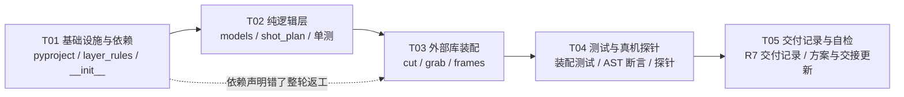

# 个人知识库 · P2 视觉链路（切镜头 + 抽帧）设计

| 项 | 内容 |
|---|---|
| 版本 | v1.0 |
| 日期 | 2026-11-27 |
| 需求来源 | `docs/tech/2026-11-26-技术方案.md` §4.11「视频理解：ASR 为主、画面为辅」 |
| 参照实现 | `kb/asr/segment.py`（纯算术）+ `kb/asr/decode.py`（装配）两层结构 |
| 工程基线 | 646 passed / 90 skipped，覆盖率 88%（阈值 55%） |
| 本轮边界 | 只做「从视频文件拿到一组带时间戳的帧」，不下载视频、不接 worker、不调视觉模型、不改数据库 |
| 图文件 | 类图 `docs/tech/2026-11-27-P2视觉链路-类图.mermaid`；时序图 `docs/tech/2026-11-27-P2视觉链路-时序图.mermaid` |

---

## 0. 结论先行（共 15 条）

1. **依赖必须锁 `scenedetect==0.6.6`，不能锁 0.7.x。** 这是本轮唯一一处与交接文档（写的是 0.7.3）相反的结论，有实测支撑：`pip install scenedetect==0.7.3` 的 METADATA 里 `Requires-Dist: opencv-python` 是**无条件依赖**（0.7.0/0.7.1/0.7.2 同样如此），而 `opencv-python`（带 GUI）在无桌面的 proot 容器里 `import cv2` 直接失败。0.6.6 把 OpenCV 放进 extras（`opencv` / `opencv-headless`），`Requires-Dist` 只剩 `Click / numpy / platformdirs / tqdm`，我们显式声明 `opencv-python-headless` 就能装出干净环境。见 §6。

2. **`opencv-python` 与 `opencv-python-headless` 共用 `cv2/` 目录，卸载会互相删文件——这条坑在本机复现了。** 同一 venv 先装 headless 再装 GUI 版，`import cv2` 的 `getBuildInformation()` 从 `GUI: NONE` 变成 `GUI: WIN32UI`；再 `pip uninstall opencv-python` 之后，**headless 版还在 `pip list` 里但 `import cv2` 变成 `ModuleNotFoundError`**。所以依赖声明要写清"不许装 GUI 版"，而不是"装错了再卸"。见 §6.2。

3. **帧数上限按「时间分层 + 层内取与该层重叠最长的镜头 + 帧位取交集中点」裁，不按镜头长度全局 top-K，也不均匀抽。** 四条理由：① 方案 §4.11 说画面给「章节骨架」，骨架是**时间上铺满的框架**，全局 top-K 会把帧挤在少数长镜头里——按「10 分钟视频、前 2 分钟一个标题页、后面 200 个 2.4 秒镜头」这组分布手算，全局 top-K 的前 2 分钟只有 1 帧、后 1 分半占 10 帧；分层则 12 个时间窗各一帧。② 均匀按时间抽会抽到转场与黑帧，且丢掉"章节"语义。③ 帧位取**交集中点**而非镜头中点：一个镜头横跨多层时，取镜头中点会让多层抽到同一时刻，12 层只覆盖 11 个窗（已手算复现），取交集中点则铺满。④ 层内取重叠最长而非任意镜头，保证落在该层占比最大的稳定画面上。算法见 §4.3.3。

4. **超长视频靠 `frame_skip` 控预算，不靠截断扫描。** 实测 1080x1920 竖屏 120 秒视频（12 个 10 秒镜头）：`frame_skip` 从 0 提到 2，耗时从 11.21 秒降到 5.12 秒（RTF 0.093 → 0.043），**切点数量都是 12、位置完全一致**；另在 8 个 2 秒镜头的视频上验 `frame_skip=2` 仍 8 个全检出，切点最大偏 0.08 秒。所以跳帧只损失边界精度，不损失检出率。截断扫描（只扫前 N 秒）会丢掉后半段全部章节，信息损失不可逆。`max_scan_sec` 保留为最后防线（默认 1800 秒），只在超过 30 分钟的视频上触发。

5. **切不出镜头（`get_scene_list()` 返回 `[]`）是正常路径，不是异常。** 实测 2 秒纯色视频、60 秒静态画面视频都返回 0 个切点。口播视频全程一个机位就是这种情形。处理方式：视为「整条视频一个镜头」，而不是报错，也不是返回空——返回空会让下游以为"这条视频没画面"。

6. **`get_scene_list(start_in_scene=True)` 是必传参数，不是可选项。** 实测同一函数不带参数时，无切点的视频返回 `[]`；带 `start_in_scene=True` 返回 `[(0.0, 2.0)]`。少了这个参数，"口播视频一个镜头"这条正常路径会静默变成"零个镜头"。这是本轮最容易漏的一行。

7. **不用 `detect(path, ContentDetector())` 便捷函数**（交接文档已记录踩坑：默认阈值 27.0 对纯色/低对比画面返回 0 个镜头）。统一走 `open_video` + `SceneManager` + 显式 `ContentDetector(threshold=15.0)`。

8. **全黑/纯色帧用灰度标准差 `< 2.0` 判，不用平均亮度。** 实测（长边缩到 1024 后取灰度）：纯黑 `mean=0.0 std=0.0`、纯白 `255.0 / 0.0`、18 灰 `18.0 / 0.0`、50% 灰 `128.0 / 0.0`、暗场景（有边缘）`27.5 / 16.8`、PPT 文字 `181.6 / 99.2`、人脸渐变 `100.3 / 58.4`。用平均亮度判会把"暗但有内容"的场景判成空白帧；标准差对纯色的取值恒为 0，与亮度无关，阈值 2.0 距最近的 16.8 有 8 倍余量。

9. **帧图统一缩到长边 1024、JPEG q85。** 实测真实界面画面（白底标题 + 三行中文字幕，1080x1920）：原尺寸 55 KB → 长边 1024 时 18 KB → 长边 768 时 11 KB。12 帧合计 200 KB 量级。极端情况（每 26 像素一行黑条铺满全屏的合成图）长边 1024 是 383 KB，12 帧 4.6 MB——这是上限而不是常态。取 1024 不取 768 的理由：字幕字号在小屏视频里可能只有 20 像素高，缩到 768 后只剩 16 像素，视觉模型读中文的成功率会掉。

10. **`cv2.imwrite` 对中文路径静默失败，必须走 `imencode` + 自己写文件。** 实测：`cv2.imwrite('.tmp_cn/知识库测试/a.jpg', img)` 返回 `False` 且文件不存在；改 `cv2.imencode` 拿 bytes 再 `open(...,'wb').write(...)` 成功。用户目录是中文（`C:/Users/.../知识库`），临时目录也可能带中文，这条不是理论风险。

11. **`cv2.VideoCapture` 要复用，不要每帧重开。** 实测同一视频抽 40 帧：复用同一个 cap 用 0.219 秒（5.5 ms/帧），每帧重开用 1.372 秒（34.3 ms/帧），差 6.2 倍。所以 `FrameGrabber` 要有 `open()` 显式持有句柄，而不是每次 `read_at` 内部新建。

12. **抽帧位置取镜头中点，不取镜头起点。** 定位本身是准的（实测 0.96 秒取到第 1 个镜头、1.00 秒取到第 2 个，逐帧对齐），但起点离边界太近：`CAP_PROP_POS_MSEC` 的定位精度到帧，镜头起点那一帧正好处在切换的临界位置，向上取整就落到前一镜头。中点距两侧边界各半个镜头长度，同样 1 帧的精度误差落在中点不会有影响。

13. **`frame_skip` 必须配 `min_scene_len`，单独用会放大噪声。** 实测 250 帧黑白交替的闪烁视频（模拟片头闪白）：`frame_skip=0, min_scene_len=1` 切出 250 个镜头；`frame_skip=2, min_scene_len=1` 切出 84 个；两者加 `min_scene_len=15` 帧都收敛到 1 个。所以 `min_scene_len` 从 `min_shot_sec × fps` 算出并**始终传入**，不能因为设了 `min_scene_len` 就省掉跳帧，也不能反过来。

14. **0.6.6 的 `FrameTimecode` 没有 `.seconds`，只有 `.get_seconds()`；`min_scene_len` 只接受整数帧数（传 float 秒会 `TypeError: slice indices must be integers`）。** 这两处与 0.7.x 不同，写代码时要按 0.6.6 的接口写，否则在平板上直接崩。

15. **本轮不清理临时目录。** `FrameSet.work_dir` 原样交回调用方，由调用方决定保留还是 `shutil.rmtree`。理由：清理时机属于调用方的生命周期，本层擅自删会删掉调用方正要读的帧（探针脚本要把帧给人眼看）。这条写进 `FrameSet` 的 docstring，不靠口头约定。

---

## 1. 术语表（非技术读者先看）

| 术语 | 一句人话 |
|---|---|
| 镜头（shot） | 摄像机一次连续拍摄的画面。切镜头 = 画面发生硬切的那一刻 |
| 切点（cut） | 两个镜头之间的交界时刻，单位秒 |
| 关键帧（本设计里指代表帧） | 从某个镜头里取出的那一张静态图，代表这个镜头 |
| 章节骨架 | PPT/讲解类视频里，画面上的大标题（「01 — L7 应用层」）构成的结构。它按时间铺满全片 |
| RTF（实时率） | 处理耗时 ÷ 视频时长。0.087 表示 1 分钟视频用 5.2 秒处理完 |
| 纯逻辑层 | 只做算术与比较、不加载模型也不碰视频文件的代码。可以毫秒级单测 |
| 装配层 | 把外部库（PySceneDetect / OpenCV）接进纯逻辑的那一层。库在方法内部 import |
| 注入（Protocol） | 定义一个只有方法签名的接口，真实现和假实现都能满足它。测试塞假货，线上塞真货 |
| 分层抽样 | 把时间轴等分成 K 段，每段各取一帧。保证帧在时间上铺满，而不是挤在某几处 |

---

## 2. 实现方案：模块划分与职责

### 2.1 为什么不塞进 `kb/asr/`

`kb/asr/` 已经交付且行为不许动（本轮硬约束）。音频与画面的失败模式也不同：音频失败是模型退化与切点不当，画面失败是编解码缺失与镜头检测误判。混在一层里，排查时分不清是哪一边。这与 `kb/asr/__init__.py` 里"为什么单独一层"的论证同构。

### 2.2 五个文件的职责

| 文件 | 职责 | 依赖外部库 | 可单测 |
|---|---|---|---|
| `kb/vision/models.py` | 八个 frozen dataclass + 一个异常类。全部是值与属性方法 | 否 | 是 |
| `kb/vision/shot_plan.py` | 四个纯函数：`plan_scan` / `merge_shots` / `plan_picks` / `is_blank`，加一个文件名生成 `frame_filename` | 否 | 是（毫秒级） |
| `kb/vision/cut.py` | `ShotCutter` Protocol + `SceneDetectCutter` 真实现 | 是（`scenedetect`，方法内 import） | 假实现可测 |
| `kb/vision/grab.py` | `FrameGrabber` Protocol + `Cv2Grabber` 真实现 | 是（`cv2`，方法内 import） | 假实现可测 |
| `kb/vision/frames.py` | `extract_frames()` 装配：probe → plan_scan → cut → merge → plan_picks → read → 过滤 → 写盘 | 否（只依赖上面两个 Protocol） | 是（两个假实现） |

**为什么把 `models.py` 单列而不是塞进 `shot_plan.py`**：`cut.py`、`grab.py`、`frames.py` 都要用这些类型，任何一个文件定义它们都会造成三处以上循环引用或单点依赖。单列一个只有 dataclass 的文件，谁 import 都不产生耦合。

**为什么 `shot_plan.py` 里既有切分规划又有空白判定**：两者都是"给定数字、返回布尔或区间"的纯算术。分成两个文件会让"纯逻辑"这一层变成两个文件各自都要在 docstring 里解释一遍为什么可以脱离 cv2 测试。合并后一处说清。

### 2.3 依赖方向（单向，无环）

```
models.py  ←  shot_plan.py  ←  frames.py
   ↑              ↑               ↑
 cut.py ──────────┘               │
 grab.py ─────────────────────────┘
```

`shot_plan.py` import `models.py`；`cut.py`/`grab.py` import `models.py`；`frames.py` import 全部四个。没有文件 import `frames.py`。

### 2.4 分层边界（由 `layer_rules.toml` + AST 检查强制）

`kb/vision/` **不碰数据库**：不 `import kb.store`，不出现写库 SQL，不 import `pg8000`/`psycopg`/`sqlite3`。落库由调用方（将来的 worker 步骤）经 `kb/store` 做。这条与 `kb/extract/`、`kb/ai/` 一致，需在 `layer_rules.toml` 新增一条 `import_deny`，否则新层无人管。

### 2.5 外部库延迟 import 的具体位置

`cut.py` 与 `grab.py` 的**模块顶层只有 `from __future__`、标准库、`models`**。`import scenedetect` / `import cv2` 放在方法体内。理由不是洁癖：CI 的 `pr-fast.yml` 只 `pip install -e ".[dev]"`，如果 `scenedetect` 写进 `dev` extras 之外的普通依赖就会装；但本机（当前环境）没装 `scenedetect`，若顶层 import，`pytest` 收集 `tests/test_vision_plan.py` 时会连带失败——纯逻辑测试被一个没装的视频库拖死。放方法内，`kb/vision/` 在任何环境下都能 import。

---

## 3. 文件列表

### 3.1 新增（代码 10 个 + 文档 3 个）

```
kb/vision/__init__.py                     层说明（为什么单独一层、边界、实测数据摘要）
kb/vision/models.py                       8 个 frozen dataclass + 1 个异常类
kb/vision/shot_plan.py                    4 个纯函数 + 1 个文件名生成
kb/vision/cut.py                          ShotCutter Protocol + SceneDetectCutter
kb/vision/grab.py                         FrameGrabber Protocol + Cv2Grabber
kb/vision/frames.py                       extract_frames 装配
tests/test_vision_plan.py                 纯逻辑单测（不装 cv2/scenedetect 也能跑）
tests/test_vision_frames.py               假 Cutter + 假 Grabber 的装配测试
tests/test_vision_arch.py                 AST 断言：顶层不 import cv2/scenedetect、不 import kb.store
scripts/probe_frames_vision.py            平板真机探针（不放进 pytest，要真视频）
docs/tech/2026-11-27-P2视觉链路设计.md     本文档
docs/tech/2026-11-27-P2视觉链路-类图.mermaid
docs/tech/2026-11-27-P2视觉链路-时序图.mermaid
```

### 3.2 修改（2 个代码配置 + 3 个文档）

```
pyproject.toml                            dependencies 加 2 项、packages 加 kb.vision
layer_rules.toml                          加一条 import_deny：kb/vision/ 不得 import kb.store
docs/tech/2026-11-26-技术方案.md           §4.11「实现设计」表的视觉行：⚠️ 未接入 → ✅ 已实现
deliverables/construction/HANDOFF-2026-11-27.md   P2 段落改为已完成，写清缺口
deliverables/construction/R7-视觉链路-2026-11-27.md  本轮交付记录（新建）
```

改技术方案那一行是必须的：不改的话，方案会永久停在「⚠️ PySceneDetect 未接入」，而它已经是本轮交付的一部分。这是 2026-11-27 那轮文档检查抓到的同类问题（「文档里写了没执行」）。

### 3.3 明确不动（4 个）

```
scripts/probe_frames.py                   保留作对照（本轮探针是它的加强版，不替换它）
kb/asr/**                                 一行不改
kb/ai/**                                  一行不改
kb/store/**                               一行不改（本轮无表结构变更）
```

---

## 4. 数据结构与接口

### 4.1 `kb/vision/models.py`

全部 `@dataclass(frozen=True)`，时间单位统一为**秒（float）**。

```python
@dataclass(frozen=True)
class VideoMeta:
    path: str
    width: int
    height: int
    duration_sec: float
    fps: float


@dataclass(frozen=True)
class ScanPlan:
    """检测预算的分配结果。纯算术产出，不依赖视频文件。"""
    frame_skip: int      # 每 N+1 帧算一次，0 = 每帧都算
    scan_sec: float      # 实际扫描的时长（<= 视频总长）
    truncated: bool      # scan_sec < duration_sec，即尾部没扫


@dataclass(frozen=True)
class Shot:
    index: int           # 从 0 开始，按时间排序后的序号
    start_sec: float
    end_sec: float
    partial: bool = False   # 该镜头因扫描截断而未看到结尾

    @property
    def duration_sec(self) -> float: ...


@dataclass(frozen=True)
class FramePick:
    """要抽哪一帧的意图，尚未真正读取。"""
    shot_index: int
    at_sec: float
    start_sec: float     # 所属镜头的区间，带给下游排查
    end_sec: float


@dataclass(frozen=True)
class FrameImage:
    """刚从视频读出来的一帧（未编码、未压缩）。"""
    data: Any            # numpy.ndarray，BGR 三通道；用 Any 是为了本文件不 import numpy
    width: int
    height: int
    mean_luma: float     # 灰度均值 0–255，仅用于排查
    std_luma: float      # 灰度标准差 0–255，判定空白帧的依据


@dataclass(frozen=True)
class ExtractedFrame:
    """已落盘的一帧。"""
    shot_index: int
    at_sec: float
    start_sec: float
    end_sec: float
    path: str
    width: int
    height: int
    size_bytes: int


@dataclass(frozen=True)
class SkippedFrame:
    """本该抽但没抽成的一帧，以及原因。留存是为了排查『为什么只有 8 帧』。"""
    shot_index: int
    at_sec: float
    reason: str          # "blank" / "read_failed"


@dataclass(frozen=True)
class FrameSet:
    frames: tuple[ExtractedFrame, ...]
    shots: tuple[Shot, ...]
    meta: VideoMeta
    scan: ScanPlan
    work_dir: str
    skipped: tuple[SkippedFrame, ...] = ()

    @property
    def count(self) -> int: ...
    def paths(self) -> tuple[str, ...]: ...


class VideoUnreadable(Exception):
    """视频打不开（文件损坏、缺编解码、不是视频文件）。

    单独一个异常类而不用返回值：调用方必须显式决定怎么降级
    （跳过这条内容 / 标处理失败 / 告警），静默返回空集会让
    『视频坏了』与『视频没内容』在库里长得一样。
    """
    def __init__(self, path: str, reason: str) -> None: ...
```

`partial` 与 `truncated` 两个字段是给排查用的：看到一帧标 `partial=True`，就知道它的 `end_sec` 不是真实结尾。不留这两个字段，"第 500 个镜头特别长"这种假象无法解释。

### 4.2 注入点：两个 Protocol

```python
class ShotCutter(Protocol):
    """把视频切成镜头。只要求这一个方法，真实现和假实现都能满足。"""

    def detect(
        self, video_path: str, plan: ScanPlan, min_shot_sec: float
    ) -> tuple[Shot, ...]: ...


class FrameGrabber(Protocol):
    """读一帧、压一张图。五个方法，全部与『拿文字』无关。"""

    def probe(self, video_path: str) -> VideoMeta: ...
    def open(self, video_path: str) -> None: ...
    def read_at(self, at_sec: float) -> FrameImage: ...
    def encode(self, image: FrameImage, long_side: int, quality: int) -> bytes: ...
    def close(self) -> None: ...
```

**为什么 `probe` 与 `open` 分开**：`probe` 要在切镜头之前拿时长与 fps（`plan_scan` 需要它）；`open` 要在帧选定之后才持有解码句柄（实测复用句柄 5.5 ms/帧 vs 重开 34.3 ms/帧）。合成一个 `open` 会让解码句柄在整个切镜头过程里开着，而那段过程 PySceneDetect 自己要开一个解码器，两个解码器同时占内存——平板 8 GB 上这是要避免的。

**为什么 `encode` 属于 `FrameGrabber` 而不属于纯逻辑**：JPEG 编码是 OpenCV 的事。放纯逻辑层就要在那一层 import cv2，可单测性就没了。

### 4.3 `kb/vision/shot_plan.py`：四个纯函数

#### 4.3.1 `plan_scan(duration_sec, fps) -> ScanPlan | None`

按视频时长决定跳帧步长与扫描上限。返回 `None` 表示元信息不可信（`duration_sec <= 0` 或 `fps <= 0`），调用方直接返回空 `FrameSet`。

```python
# 三档的依据见下面两张实测表
SKIP_TIERS: tuple[tuple[float, int], ...] = (
    (300.0, 0),         # <= 5 分钟：每帧都算，切点零偏移
    (1200.0, 1),        # <= 20 分钟：隔一帧算
    (float("inf"), 2),  # 更长：隔两帧算（25fps 下每 0.12 秒算一次）
)
DEFAULT_MAX_SCAN_SEC = 1800.0   # 30 分钟，最后防线
```

**表一：跳帧对耗时的作用**（1080x1920 竖屏，12 个 10 秒镜头，120 秒，本机 Windows）

| frame_skip | 检测耗时 | RTF | 切点数 | 1 小时视频推算 |
|---|---|---|---|---|
| 0 | 11.21 s | 0.093 | 12 | 336 s |
| 1 | 7.74 s | 0.065 | 12 | 232 s |
| 2 | 5.12 s | 0.043 | 12 | 153 s |
| 3 | 3.97 s | 0.033 | 12 | 119 s |

**表二：跳帧对切点精度的影响**（320x240，8 个 2 秒镜头，25 fps，`min_scene_len=13` 帧）

| frame_skip | 检出镜头数 | 切点位置（秒） |
|---|---|---|
| 0 | 8 | 0.0 / 2.0 / 4.0 / 6.0 / 8.0 / 10.0 / 12.0 / 14.0 |
| 1 | 8 | 同上，零偏移 |
| 2 | 8 | 0.0 / 2.04 / 4.08 / 6.0 / 8.04 / 10.08 / 12.0 / 14.04 |
| 3 | 8 | 0.0 / 2.08 / 4.0 / 6.08 / 8.0 / 10.08 / 12.0 / 14.08 |

两张表合起来说明三件事：

1. **跳帧只损失切点精度，不损失检出率。** 2 秒镜头在 `frame_skip=3` 下 8 个全部检出，切点最大偏 0.08 秒（2 帧）。所以档位可以按耗时选，不用担心漏镜头。
2. **偏移量与 `frame_skip/fps` 同阶。** 25 fps 下 `frame_skip=2` 的采样间隔 0.12 秒，实测最大偏移 0.08 秒，同阶。这条决定了档位的下界：要保证偏移小于 0.1 秒，`frame_skip/fps < 0.1`，即 25 fps 下 `frame_skip <= 2`。
3. **不再往上跳的理由是偏移，不是检出率。** `frame_skip=3` 在 30 fps 下偏移约 0.1 秒，对「章节骨架」这个用途已经够用，但再往上（比如 5）偏移就进入 0.2 秒量级，而收益只剩 1 秒——不值得为省 1 秒让切点挪 0.2 秒。

按表一的最慢档（RTF 0.033）推：1 小时视频本机约 2 分钟。平板换算要用实测比值，不能用"ARM 比 x86 慢"这类先验——ASR 那轮同一模型的实测是本机 8.81 秒 / 平板 10.63 秒（约 1.2 倍），按 1.2 倍算是 2.4 分钟，按本设计留的 2 倍余量是 4 分钟。⚠️ 这两个数字是推算，不是实测：本轮的耗时数据全部来自本机 Windows + 合成视频，**平板真机耗时未测**，`scripts/probe_frames_vision.py` 跑完会把真实数字补进 R7 交付记录。

`scan_sec = min(duration_sec, max_scan_sec)`，`truncated = scan_sec < duration_sec`。默认 1800 秒意味着只有超过 30 分钟的视频被截断，这类视频在个人知识库里是长课程/长访谈，属于少数。

#### 4.3.2 `merge_shots(raw, duration_sec, scan_sec, min_shot_sec) -> tuple[Shot, ...]`

六步，每步都对应一种实测见过的坏输入：

| 步 | 做什么 | 对应的坏输入 |
|---|---|---|
| ① | 裁掉 `start < 0` 或 `end <= start` 的区间 | 解码器给的越界时间码 |
| ② | 按 `start_sec` 排序 | 库返回顺序未定义 |
| ③ | 同一 `start_sec` 的合并，保留 `end` 更大的 | 相邻两窗口在同一帧都报切点 |
| ④ | 时长短于 `min_shot_sec` 的并进**前**一段；若是第一段则并进后一段 | 闪烁视频切出 250 个 0.02 秒镜头（实测） |
| ⑤ | `raw` 为空 → 返回单个 `Shot(0, 0.0, scan_sec)` | 纯色/静态视频返回 0 个切点（实测 2 秒纯色、60 秒静态画面） |
| ⑥ | `scan_sec < duration_sec` → 尾部补 `Shot(partial=True, scan_sec, duration_sec)` | 30 分钟以上视频被截断 |

**为什么短镜头并进前一段而不是删掉**：删掉会在时间轴上留空隙，后面的分层抽样就会在空隙里找不到"与该层重叠的镜头"，退化成"该层无帧"。并进前一段则时间轴始终连续覆盖 `[0, scan_sec]`，这是分层抽样的前提。

**第 ⑥ 步的 `partial` 为什么标在尾部补的那一段**：那一段的真实内容没被检测过，它可能包含 50 个镜头。标 `partial=True` 让下游知道"这一帧不代表整个 30–60 分钟"。

#### 4.3.3 `plan_picks(shots, max_frames) -> tuple[FramePick, ...]`

这是本轮最核心的算法。三句话：

1. 把 `[0, 最后一个镜头的 end_sec]` 等分成 `K = min(max_frames, len(shots))` 层。
2. 每层内取**与该层重叠最长**的镜头，帧位置取**该镜头与这一层交集的中点**。
3. 按 `at_sec` 升序返回。

```python
def plan_picks(shots: Sequence[Shot], max_frames: int = 12) -> tuple[FramePick, ...]:
    """按时间分层，每层取与该层重叠最长的镜头，帧位取交集中点。

    为什么分层而不直接取最长的 K 个镜头：方案 §4.11 的定位是「画面给章节骨架」，
    骨架是时间上铺满的框架。取全局最长的 12 个镜头会让帧挤在少数长镜头里。
    2026-11-28 用「10 分钟视频、前 2 分钟一个超长标题页、后面 200 个 2.4 秒镜头」
    这组分布验过：全局 top-K 得到 [60, 514.8, 522, 526.8, ...]——前 2 分钟只 1 帧，
    后 1 分半挤出 10 帧；分层得到 [25, 75, 110, 152.4, ..., 553.2]，12 个时间窗
    每窗一帧。

    **帧位取「交集中点」而不是「镜头中点」**：一个镜头可能横跨多层
    （上面那组分布里 0–120 秒的标题页横跨前 3 层）。取镜头中点会让 3 层抽到
    同一张图（都 60.0 秒），第 4 层起到第 12 层才能拿到新内容，结果 12 层只覆盖
    11 个时间窗。取交集中点则同镜头在不同层给出不同位置，12 层铺满 12 个窗。
    """
```

分层边界：第 `i` 层是 `[i/K * total, (i+1)/K * total)`，最后一层闭到 `total`。层内与该层交集长度相同的镜头，取**更靠前**的那个（`max` 在相等时保留先遇到者，`shots` 已按 `start_sec` 排序，因此等价于取靠前者）。

**兜底分支**：层内没有任何镜头与之重叠时取该层中点。按 `merge_shots` 的契约这条不会发生（它保证时间轴连续覆盖 `[0, scan_sec]`），但保留 `# pragma: no cover`：删掉它，一旦 `merge_shots` 出 bug，`plan_picks` 就抛 `IndexError`，而抛异常的位置在"帧规划"这一层，排查时看不出根因在上游。

**为什么 `K` 要 `min(max_frames, len(shots))`**：`max_frames=12` 而视频只有 3 个镜头时，硬分 12 层会让 9 层指向重复的镜头位置。取镜头数为上限，3 个镜头就抽 3 帧（实测三镜头 15 秒视频 → `2.5 / 7.5 / 12.5` 秒）。

**这个算法的三个已知形状**（都已手算验证）：

| 输入 | 输出 | 说明 |
|---|---|---|
| 单镜头 480 秒 | 1 帧 @ 240 秒 | 口播视频：一帧代表全片，不制造假的多帧 |
| 两镜头 600 秒 | 2 帧 @ 150 / 450 秒 | 镜头数 < `max_frames`，按镜头数出帧 |
| 12 镜头 60 秒 | 12 帧 @ 2.5 / 7.5 / … / 57.5 秒 | 每镜头一帧，各取中点 |

#### 4.3.4 `is_blank(image: FrameImage, min_std: float = 2.0) -> bool`

```python
return image.std_luma < min_std
```

只用标准差。理由见结论 8 的实测表：纯色的标准差恒为 0，与亮度无关；「暗但有内容」的场景标准差 16.8 不会被误杀。`mean_luma` 只留在 `FrameImage` 里供排查，不参与判定。

#### 4.3.5 `frame_filename(shot_index: int, at_sec: float) -> str`

```python
return f"shot{shot_index:03d}_{at_sec:09.2f}s.jpg"
# 例：shot007_000123.45s.jpg
```

三处都是为了能排序与能读：`{index:03d}` 让文件名按镜头序号字典序等于数值序；`{at_sec:09.2f}` 固定 9 字符宽度，字典序等于时间序；时间进文件名是为了不打开图就知道这一帧来自第几秒。

### 4.4 `kb/vision/cut.py`

```python
class SceneDetectCutter:
    """PySceneDetect 0.6.6 的装配。

    库在方法内 import：CI 与本机都可能没装 scenedetect，顶层 import 会让
    tests/test_vision_plan.py 收集失败——纯逻辑测试被视频库拖死。
    """

    def __init__(self, threshold: float = 15.0) -> None:
        self._threshold = threshold

    def detect(
        self, video_path: str, plan: ScanPlan, min_shot_sec: float
    ) -> tuple[Shot, ...]:
        from scenedetect import ContentDetector, SceneManager, open_video

        video = open_video(video_path)
        fps = float(video.frame_rate)
        # 0.6.6 的 min_scene_len 只收整数帧数：传 float 秒会
        # TypeError: slice indices must be integers
        min_len_frames = max(1, int(round(fps * min_shot_sec)))
        manager = SceneManager()
        manager.add_detector(
            ContentDetector(threshold=self._threshold, min_scene_len=min_len_frames)
        )
        # duration 用 float 秒，实测 0.6.6 接受（60 秒视频传 30.0 只返回前 30 秒的镜头）
        manager.detect_scenes(video, duration=plan.scan_sec, frame_skip=plan.frame_skip)
        # start_in_scene=True 必传：不带它时无切点的视频返回 []，
        # 「口播视频全程一个镜头」这条正常路径会静默变成零个镜头
        spans = manager.get_scene_list(start_in_scene=True)
        return tuple(
            Shot(
                index=i,
                start_sec=float(a.get_seconds()),
                end_sec=float(b.get_seconds()),
            )
            for i, (a, b) in enumerate(spans)
        )
```

`index` 在这里先按检测顺序给，`merge_shots` 会重新编号（因为要合并与补段）。

### 4.5 `kb/vision/grab.py`

```python
class Cv2Grabber:
    """OpenCV 的装配。cv2 在方法内 import。"""

    def __init__(self) -> None:
        self._cap: Any = None
        self._path: str | None = None

    def probe(self, video_path: str) -> VideoMeta:
        import cv2
        cap = cv2.VideoCapture(video_path)
        try:
            if not cap.isOpened():
                raise VideoUnreadable(video_path, "cv2 打不开（缺编解码或不是视频）")
            fps = float(cap.get(cv2.CAP_PROP_FPS))
            frames = float(cap.get(cv2.CAP_PROP_FRAME_COUNT))
            return VideoMeta(
                path=video_path,
                width=int(cap.get(cv2.CAP_PROP_FRAME_WIDTH)),
                height=int(cap.get(cv2.CAP_PROP_FRAME_HEIGHT)),
                duration_sec=(frames / fps) if fps > 0 else 0.0,
                fps=fps,
            )
        finally:
            cap.release()

    def open(self, video_path: str) -> None: ...
    def read_at(self, at_sec: float) -> FrameImage: ...
    def encode(self, image: FrameImage, long_side: int, quality: int) -> bytes: ...
    def close(self) -> None: ...
```

`read_at` 三个细节：

1. **不做帧偏移补偿。** 实测 3 镜头合成视频（红 0–1s / 绿 1–2s / 蓝 2–3s，25 fps），`CAP_PROP_POS_MSEC` 定位是准的：问 0.40s 得红、0.96s 得红、1.00s 得绿、2.40s 得蓝，逐帧对齐，没有偏差。早先的设计稿里写过"减半帧抵掉 1 帧偏移"，那是把 `0.96s → 红`（本来正确）误读成偏差，已删掉；加一个不存在的补偿会让每帧落在镜头边界前 0.02 秒，反而有风险。
2. **`ok=False` 只表示越界，不能拿 `CAP_PROP_POS_MSEC` 判断位置。** 实测 3 秒视频问 3.0 秒与 5.0 秒都返回 `False`，而此时 `CAP_PROP_POS_MSEC` 读回 **0**（不是 3.0 或 5.0），`CAP_PROP_POS_FRAMES` 停在最后一帧。所以越界判定只能用 `ok`，位置信息不可信。
3. **`at_sec` 上限钳到 `duration_sec - 1/fps`。** 由第 2 条的实测可知，`at_sec >= duration_sec` 必然返回 `False`。`plan_picks` 给的是镜头中点，正常情况下不会越界；但 `merge_shots` 补的尾部段若 `end_sec` 等于浮点 `duration_sec`，取中点仍可能因浮点误差擦到边界。钳一次比在 `read_at` 里抛异常干净。
4. 灰度统计用 `cv2.cvtColor(..., COLOR_BGR2GRAY)` + `cv2.meanStdDev`，与 §4.3.4 的阈值口径一致。

`encode` 用 `cv2.resize(..., interpolation=cv2.INTER_AREA)` 缩小，再 `cv2.imencode(".jpg", img, [cv2.IMWRITE_JPEG_QUALITY, quality])`。**不用 `cv2.imwrite`**：实测中文路径下返回 `False` 且不写文件（见结论 10）。

### 4.6 `kb/vision/frames.py`

```python
def extract_frames(
    video_path: str,
    work_dir: str,
    *,
    cutter: ShotCutter | None = None,
    grabber: FrameGrabber | None = None,
    max_frames: int = 12,
    min_shot_sec: float = 0.5,
    long_side: int = 1024,
    jpeg_quality: int = 85,
    min_std_luma: float = 2.0,
    max_scan_sec: float = DEFAULT_MAX_SCAN_SEC,
) -> FrameSet:
    """从视频拿到一组带时间戳的帧。

    失败口径（三层，逐层不同）：
    - 视频打不开 → raise VideoUnreadable。调用方必须显式降级，
      否则「视频坏了」与「视频没内容」在库里长得一样。
    - 切镜头抛异常 → log.warning 后当作「无切点」继续，走单镜头兜底。
      一条视频的镜头检测失败不该让整条视频零帧。
    - 单帧读失败或空白 → 记 SkippedFrame 继续下一帧。
    """
```

**兜底逻辑**：`plan_picks` 之后如果一帧都没抽到（全被判定为 blank 或全读失败），在 `shots[0]` 的中点再试一次，仍失败就返回 `FrameSet(frames=())`。不抛异常：一帧都没有是「这条视频画面无信息」的正常结论，不是故障。

**为什么参数这么多而不是一个 `Options` 对象**：每个参数都是独立的物理量（帧数、秒数、像素、质量、阈值），合成对象会让调用处变成 `Options(max_frames=12, ...)` 多一层括号，而单测想改的往往只有其中一个。8 个关键字参数在这个规模上是清楚的。

---

## 5. 调用流程

完整时序见 `docs/tech/2026-11-27-P2视觉链路-时序图.mermaid`。主干七步：

1. `grabber.probe(video)` → `VideoMeta`；打不开抛 `VideoUnreadable`。
2. `plan_scan(duration_sec, fps)` → `ScanPlan | None`；`None` 则返回空 `FrameSet`。
3. `cutter.detect(video, plan, min_shot_sec)` → `tuple[Shot, ...]`；抛异常则记日志、`raw=()`。
4. `merge_shots(raw, duration_sec, scan_sec, min_shot_sec)` → 时间轴连续覆盖 `[0, scan_sec]`。
5. `plan_picks(shots, max_frames)` → 分层抽样。
6. `grabber.open(video)`，逐帧 `read_at` → `is_blank` → `encode` → 写盘；`close()`。
7. 返回 `FrameSet`。

第 6 步的 `read_at` 顺序是 `at_sec` 升序——`plan_picks` 已经按升序返回，`extract_frames` 不重排。理由：seek 单调向前时解码器不用回溯，实测正序 10 次 seek 用 0.081 秒，混合顺序 0.056 秒，差异不大但顺序读更可预测。

---

## 6. 依赖包变更（本轮最容易出事的一处）

### 6.1 `pyproject.toml` 的 `dependencies` 增加两行

```toml
    # 视觉链路（P2）。**必须是 0.6.6，不能升 0.7.x**：
    # 0.7.0 起 METADATA 里 `Requires-Dist: opencv-python` 是无条件依赖
    # （pip install --dry-run 实测 0.7.0/0.7.1/0.7.2/0.7.3 都拉 opencv-python 5.1.0.95），
    # 而 GUI 版 opencv 在无桌面的 proot 容器里 import cv2 直接失败（需要 libxcb.so.1）。
    # 0.6.6 把 opencv 放进 extras（opencv / opencv-headless），
    # Requires-Dist 只剩 Click / numpy / platformdirs / tqdm，我们显式声明 headless 版。
    # 0.6.6 顶层不 import click（实测 import scenedetect 后 sys.modules 里没有 click），
    # tqdm 是 try/except 可选导入，缺了用 FakeTqdmObject 顶上。
    "scenedetect>=0.6.6,<0.7",
    # **不许装 opencv-python（GUI 版）**：与 headless 共用 site-packages/cv2/ 目录，
    # 两者同时存在时 GUI 版覆盖 __init__（本机实测 getBuildInformation() 从
    # GUI: NONE 变成 GUI: WIN32UI），此时 pip uninstall opencv-python 会把
    # cv2/ 里的文件一起删掉，headless 版仍在 pip list 里但 import cv2 变成
    # ModuleNotFoundError（本机已复现）。所以只能显式钉 headless 版，
    # 并保证没有任何包把 GUI 版带进来。
    "opencv-python-headless>=4.8",
```

`numpy` 不写：`opencv-python-headless` 与 `scenedetect` 都依赖它，写第三遍属于重复。但 `kb/vision` 的代码不 import numpy（`FrameImage.data` 声明为 `Any`），所以本层不因 numpy 缺失而挂。

### 6.2 为什么不用 `pip install scenedetect --no-deps`

那样 pyproject 里写的版本约束与实际装的东西不一致，`pip install -e .` 在干净机器上（CI、平板重建）会重装一次并带回 GUI 版。依赖声明是给机器执行的，绕过它的做法在第二轮部署时必然失效。这也是 `pyproject.toml` 里 httpx 那条注释的同一个教训（"别靠传递依赖"）。

### 6.3 版本锁的代价（写明，不藏）

`<0.7` 放弃了三样东西：① `ContentDetector(min_scene_len=0.6)` 直接收 float 秒（0.6.6 要整数帧数，我们自己乘 fps）；② `FrameTimecode.seconds` 属性（0.6.6 只有 `get_seconds()`）；③ 0.7 的 `Backend` 名称探测。三项都不影响本设计的能力。等上游把 opencv 挪回 extras（0.7 的 METADATA 里 `Provides-Extra: pyav` 说明作者在收缩体积），再开一轮升级，本轮不赌。

### 6.4 `[tool.setuptools]` 的 packages

```toml
packages = ["kb", "kb.ai", "kb.asr", "kb.store", "kb.vision", "tools", "tools.doc_checks"]
```

新模块不登记进 `packages` 时，`pip install -e .` 装出来的包缺这个目录，测试用 `pythonpath = ["."]` 照跑得通，**只有部署到平板后 `import kb.vision` 才会失败**。这类"本地绿、真机红"的缺口要在这里堵。

### 6.5 `layer_rules.toml` 增加一条

```toml
[[import_deny]]
path_prefix = "kb/vision/"
layer = "视觉层"
modules = ["kb.store"]
```

不登记时 `python -m tools.eng_checks --arch` 对 `kb/vision/` 只有"写库 SQL"与"直连驱动"两条规则生效，"import kb.store"这条漏检。

---

## 7. 任务分解

### T01 项目基础设施与依赖（P0，无依赖）

- **源文件**：`pyproject.toml`、`layer_rules.toml`、`kb/vision/__init__.py`
- **内容**：
  - `dependencies` 加 `scenedetect>=0.6.6,<0.7`、`opencv-python-headless>=4.8`，注释照 §6.1 写（含两条实测事实：0.7.x 硬依赖 GUI 版、GUI 与 headless 互删文件）
  - `packages` 加 `kb.vision`
  - `layer_rules.toml` 加 `kb/vision/` 的 `import_deny`
  - `kb/vision/__init__.py` 只写模块 docstring：为什么单独一层、边界（不碰库）、四份实测数据摘要（帧数策略、跳帧档位、空白判定、尺寸压缩）
- **验收**：`pip install -e .` 后 `pip list | grep opencv` 只有 `opencv-python-headless`；`python -c "import kb.vision"` 成功；`python -m tools.eng_checks --arch` 通过

### T02 纯逻辑层（P0，依赖 T01）

- **源文件**：`kb/vision/models.py`、`kb/vision/shot_plan.py`、`tests/test_vision_plan.py`
- **内容**：
  - 8 个 frozen dataclass + `VideoUnreadable`（签名照 §4.1）
  - `plan_scan` / `merge_shots` / `plan_picks` / `is_blank` / `frame_filename`（签名照 §4.3）
  - 单测覆盖 §4.3.2 表格里六步各自的输入，以及这七类边界：`duration_sec=0`、`fps=0`、`raw` 为空、单镜头视频、镜头数少于 `max_frames`、尾部截断、短镜头并前一段
  - 单测**不 import cv2 也不 import scenedetect**，构造 `FrameImage` 时 `data` 传 `None`
- **验收**：`python -m pytest tests/test_vision_plan.py -q` 全绿，耗时 < 1 秒；`mypy kb/vision` 通过

### T03 外部库装配（P0，依赖 T02）

- **源文件**：`kb/vision/cut.py`、`kb/vision/grab.py`、`kb/vision/frames.py`
- **内容**：
  - `SceneDetectCutter`（`start_in_scene=True` 必传、`min_scene_len` 用整数帧数、方法内 import）
  - `Cv2Grabber`（复用 cap 不重开、越界判定只用 `ok`、`at_sec` 钳到 `duration - 1/fps`、`imencode` 不 `imwrite`、`close` 释放）
  - `extract_frames` 装配（三层失败口径、兜底抽帧）
- **验收**：`python -c "import kb.vision.frames"` 在**没装 scenedetect 的环境**里成功（证明顶层没有硬 import）

### T04 测试与真机探针（P0，依赖 T03）

- **源文件**：`tests/test_vision_frames.py`、`tests/test_vision_arch.py`、`scripts/probe_frames_vision.py`
- **内容**：
  - `test_vision_frames.py`：假 `Cutter`（按剧本返回预设镜头区间）与假 `Grabber`（按 `at_sec` 返回预设 `FrameImage`）共 5 类用例：正常 12 帧、全空白、单帧读失败不影响其余、`VideoUnreadable` 上抛、切镜头抛异常后走单镜头兜底
  - `test_vision_arch.py`：AST 断言 `kb/vision/*.py` 顶层 import 里没有 `cv2`/`scenedetect`/`numpy`，且没有任何文件 import `kb.store`
  - `scripts/probe_frames_vision.py`：接真实现，打印镜头数、每个镜头时长、抽帧数、每帧 `at_sec` 与 KB 大小、空白跳过数、总耗时；参数 `--video`、`--out`、`--max-frames`、`--keep`
- **验收**：`python -m pytest tests/test_vision_frames.py tests/test_vision_arch.py -q` 全绿；探针在本机用合成视频跑通

### T05 交付记录与自检（P0，依赖 T04）

- **源文件**：`deliverables/construction/R7-视觉链路-2026-11-27.md`（新建）、`docs/tech/2026-11-26-技术方案.md`、`deliverables/construction/HANDOFF-2026-11-27.md`
- **内容**：
  - 新建 R7 交付记录：本机与平板两组实测数据（镜头数、抽帧数、耗时、每帧大小）、`probe_frames.py`（旧）与 `probe_frames_vision.py`（新）的对照、已知缺口（未接 worker、未调视觉模型、视觉模型读字准确率未验）、平板复跑命令
  - 技术方案 §4.11「实现设计」表的视觉行：从「⚠️ cv2 抽帧已验证，PySceneDetect 未接入」改为「✅ 已实现（`kb/vision/`），只做切镜头 + 抽帧，视觉模型未接」
  - HANDOFF 的 P2 段落改为已完成，并把本轮新增的两条环境事实写进去（0.6.6 与 0.7.x 的依赖差异、GUI/headless 互删文件）
- **验收**：`python -m pytest -q` 全绿且覆盖率不低于基线 88%；`python -m tools.doc_checks --all --cross-refs` 通过；`python -m tools.eng_checks --all` 通过

依赖链是线性的（T02→T03→T04→T05），无法并行。原因不是拆得粗，是这四层之间有真实的编译期依赖：没有 `models.py` 的 `Shot` 就写不出 `cut.py` 的返回类型，没有 `extract_frames` 就写不出装配测试。硬拆成并行会让每层都得自带一份临时类型定义，最后合并时删一遍。

### 7.1 任务依赖图



`T01` 到 `T03` 那条虚线是要提醒的一点：`T01` 里 `scenedetect` 的版本锁如果写成 `<0.8`，`T03` 装出来的环境会带 GUI 版 OpenCV，而那一层在本机（Windows，有桌面）照样能 `import cv2`、单测照样绿——只有部署到平板才炸。所以 `T03` 的验收里必须有一条「`pip list | grep opencv` 只有 headless」，不能只看测试绿。

---

## 8. 共享知识（跨文件约定）

| 项 | 约定 |
|---|---|
| 时间单位 | **全部是秒，`float`**。任何字段名以 `_sec` 结尾的都表示秒。视频帧号只在 `Cv2Grabber` 内部出现，不外传 |
| 时间区间 | 镜头是 **左闭右开** `[start_sec, end_sec)`，与 `kb/asr` 的采样点区间口径一致 |
| 时间精度 | 内部保留库给的原始精度（`FrameTimecode.get_seconds()` 是 float）；写进文件名时取 2 位小数；`at_sec` 返回给调用方时取 3 位小数 |
| 抽帧位置 | 镜头中点 `(start + end) / 2`，不是起点，不是段内随机 |
| 空白判定 | 只用 `std_luma < 2.0`。`mean_luma` 记录但不判定 |
| 帧文件命名 | `shot{index:03d}_{at_sec:09.2f}s.jpg`，只用 ASCII，不用中文——避免 `cv2.imwrite` 类的路径问题 |
| 帧目录 | 由调用方传 `work_dir`，本层只 `os.makedirs(work_dir, exist_ok=True)`，**不删除** |
| 图片格式 | JPEG，`long_side=1024`，`IMWRITE_JPEG_QUALITY=85`。不改格式、不加 EXIF |
| 错误口径 | 视频级失败抛 `VideoUnreadable`；镜头检测失败降级为单镜头 + `log.warning`；单帧失败记 `SkippedFrame` 继续。三层不许混 |
| 日志 | 用 `logging.getLogger(__name__)`，**不许 `print`**（`ruff` 的 `T20` 会拦）。需要人眼看的输出只出现在 `scripts/` 下 |
| 分层 | `kb/vision/` 不 import `kb.store`、不出现写库 SQL、不 import 数据库驱动 |
| import 位置 | `cv2`、`scenedetect`、`numpy` 只能在方法体内 import，模块顶层不许出现 |
| 类型注解 | 全部函数写完整注解（`disallow_untyped_defs` 已开）；外部库返回的对象用 `Any` 收口并在下一行转成本层的 dataclass |
| 测试注入 | 一律走构造参数注入假实现，**不许 `monkeypatch`**（沿用 `tests/test_worker_loop.py` 的口径） |
| 空结果 | 零帧是合法结果，返回 `FrameSet(frames=())`，不抛异常；`VideoUnreadable` 只用于打不开 |

---

## 9. 待明确事项

### 9.1 需要人拍板的一项

**`max_frames` 的默认值取 12 的依据是「成本」，而这个成本还没有真实数字。**

12 是我按 §4.11 那 8 帧（均分 5 段 + 3 个转折帧，成功读到 4 个章节标题）往上留了一半余量定的。视觉模型的单价与单帧 token 消耗本轮不验（视觉通道未配），所以"12 帧多少钱"这笔账**现在是算不出来的**。等视觉通道配好后，如果单帧成本高于预估，这个默认值要往下调；如果低于预估，可以往上调到 20 帧换取更细的章节骨架。写这一条是为了避免后来的人以为 12 有实测依据。

### 9.2 本轮不解决、留给后续轮次的四项

1. **不下载视频**。项目当前只存链接（`kb/store/items.py` 明确"R5 只抓元数据不下载"）。本轮的输入是"本地已有一个视频文件"，下载轮次（R8 之后）才把这条链路接进 worker。
2. **不接 worker**。拿不到视频文件时接进 worker 只是空转，`jobs` 会被标成处理失败。等下载能力交付后，`extract_frames` 的返回 `FrameSet` 直接喂给 visual 步骤。
3. **不调视觉模型**。视觉通道属于 `kb/ai/`（要真实 API 配置），本轮交付的是它的输入。
4. **视觉模型读画面文字的准确率未验**。交接文档列在"未验证清单"里，本轮仍无法验——没有视觉通道就没有可对照的读数。

### 9.3 两处我不改动但需要知道的事实

1. **`scripts/probe_frames.py` 与新的 `probe_frames_vision.py` 会并存。** 前者用自写的帧差法（均分 5 段 + 变化最大的 3 帧），后者用 PySceneDetect。保留前者的理由是它给了一条不依赖 `scenedetect` 的对照路径——如果 `scenedetect` 在平板上装不起来，前者仍能抽帧。这不是冗余，是降级路径。
2. **平板上的 `probe_frames_vision.py` 需要先确认 `scenedetect` 装得上。** 交接文档记录的平板环境只装了 `cv2 5.1.0` / `av 19` / `sherpa-onnx 2.0.3` / `numpy 2.5.5`，**没有 `scenedetect`**。0.6.6 是 `py3-none-any` 的纯 Python wheel（0.1 MB），本身无编译，但它的依赖 `tqdm`/`platformdirs`/`click` 要能装上。这三个都是纯 Python 包，aarch64 无编译风险，装不上的可能性低，但**这属于未验证项**：先跑 `pip download scenedetect==0.6.6 --no-deps` 确认有网、再装。

---

## 10. 设计取舍的对照（为什么不是另外三种做法）

| 备选做法 | 淘汰理由 |
|---|---|
| 每帧重开 `VideoCapture` | 实测 34.3 ms/帧 vs 复用 5.5 ms/帧，差 6.2 倍。12 帧多花 0.35 秒不致命，但一条视频多处调用会累积；且重开在大文件上要重新解析容器头 |
| 用 `frame_skip` 替代 `min_scene_len` | 实测闪烁视频 `frame_skip=2, min_scene_len=1` 切出 84 个镜头，加 `min_scene_len=15` 帧才收敛到 1 个。两个参数管两件事（跳过多少帧、最短镜头多长），互相不能替代 |
| 截断扫描控制超长视频成本 | 截断会丢掉后半段全部章节，且丢掉的信息无法从 `FrameSet` 里看出来（只能从 `truncated` 标志知道"丢了"）。跳帧只损失边界精度，切点数量实测不变 |
| 只返回帧路径、不带时间区间 | 方案 §4.11 的用途是"摘要里的词来自第几秒要能查"。没有 `start_sec`/`end_sec`，"01 — L7 应用层"这个标题来自哪个镜头的哪一段就说不清，排查时要重新跑一遍切分 |
| 空白帧也保留（不过滤） | 全黑帧送给视觉模型只会得到"这是一张纯黑图片"，白花一次调用。`SkippedFrame` 保留原因，能从 `FrameSet` 看出"12 个镜头里有 3 个是纯黑"，这是内容信息不是故障 |
| 抽帧结果落进数据库 | `layer_rules.toml` 的边界与 `kb/asr` 的既有口径都是"本层不碰库"。落库由调用方经 `kb/store` 做，本层只交 `FrameSet` |

---

## 复用调研

> 结论枚举：复用 / 参考 / 不采用 / 自写。本项目前提是**个人非商用、单机自托管于 ARM 平板（proot Debian）**，判断重点是"能否在 proot/aarch64 跑起来"与"会不会产生不可预期的账单"。下面星数与许可是 2026-11-27 通过 GitHub API 与 PyPI JSON 实测。

| 组件 | 候选 | 星数 | 许可 | 结论 | 运行环境 | 理由 |
|---|---|---|---|---|---|---|
| 镜头切分 | Breakthrough/PySceneDetect | 5670 | BSD-3-Clause | 复用 | 纯Python（`py3-none-any` wheel 0.1 MB，aarch64 无需编译，免费） | 取其 `ContentDetector` 的 HSV 分量加权差异 + `min_scene_len` 过滤 + `frame_skip` 跳帧，这三项恰好对应本项目的三个需求（切点准、抑制闪烁误切、长视频控预算）；**锁 0.6.6 不取 0.7.x**，因为 0.7.0 起把 `opencv-python`（GUI 版）写成无条件依赖，无桌面容器 `import cv2` 直接失败；弃其 `detect()` 便捷函数与 CLI，前者用默认阈值 27.0 对纯色画面返回 0 个镜头（已实测） |
| 镜头切分（对比项） | FFmpeg/FFmpeg | 68342 | NOASSERTION | 不采用 | proot 内无 ffmpeg 二进制（交接文档记录） | 检索过 `ffmpeg -vf select='gt(scene,0.4)'` 这类滤镜方案；它要先在 proot 里装 ffmpeg 二进制，而容器当前没有，新增一个不带编译器的二进制依赖在 aarch64 上装不起来；PySceneDetect 用 Python 侧的 OpenCV 就能做同一件事，不需要额外二进制 |
| 镜头切分（对比项） | soCzech/TransNetV2 | 1083 | MIT | 不采用 | 需本地深度学习模型（ONNX 推理） | 检索过 PySceneDetect 自带的 `TransNetV2` 检测器（对应 soCzech/TransNetV2）：它基于深度网络，准确率高于 `ContentDetector`，但要多下一个模型文件并跑推理。本项目对镜头边界的精度要求是"能落在章节之间的切换处"，实测 `ContentDetector(threshold=15.0)` 在合成 3 镜头视频上切点精确到 1.0s/2.0s，已满足；再引入模型与推理时间不值 |
| 视频解码与抽帧 | opencv/opencv-python | 5461 | MIT | 复用 | 纯Python（`opencv-python-headless` aarch64 有预编译 wheel，免费） | 取其 `VideoCapture` 的 `CAP_PROP_POS_MSEC` 定位与 `imencode` 编码；**必须用 headless 变体**：GUI 版在无桌面容器 `import cv2` 失败（需要 `libxcb.so.1`），且与 headless 版共用 `cv2/` 目录、卸载会互删文件（本机已复现） |
| 视频解码与抽帧（对比项） | PyAV-Org/PyAV | 3350 | BSD-3-Clause | 不采用 | 纯Python（aarch64 有 `cp312-abi3-manylinux_2_28_aarch64` wheel） | 检索过 PyAV：平板容器已装 `av 19`（ASR 提音频用），它自带 ffmpeg 绑定。本设计不取它的理由是本轮**只要帧与时间戳**，OpenCV 一个库同时提供解码与 JPEG 编码；PyAV 拿到帧后还要另配编码器。两条路径并存会让"平板缺哪个库"变成两种排查路径。若将来要做音频+画面混流，再切 PyAV |
| 视频解码与抽帧（对比项） | dmlc/decord | 2532 | Apache-2.0 | 不采用 | 需编译（aarch64 无官方 wheel） | 检索过 decord：它的优势是随机访问快，但那依赖它自己的视频加载器与专用索引，proot aarch64 上要自己编译。本项目的抽帧次数是个位数到十几次，`CAP_PROP_POS_MSEC` 定位实测 5.5 ms/帧，快得没有意义 |
| 帧图压缩 | python-pillow/Pillow | 14024 | NOASSERTION | 不采用 | 纯Python（aarch64 有 wheel，免费） | 检索过 Pillow 的 `Image.thumbnail` + `save(quality=)`；它多一个依赖，而 OpenCV 的 `resize(INTER_AREA)` + `imencode` 已经够用。且 Pillow 的许可在 GitHub API 里是 NOASSERTION（实为 MIT-CMU），核实要多一步；既然不需要它，就不引入一个需要额外核实许可的依赖 |
| 帧图压缩（对比项） | imageio/imageio | 1726 | BSD-2-Clause | 不采用 | 纯Python，免费 | 检索过 imageio 的 `imwrite` 与 `mimsave`；它擅长读写多种科学图像格式，而本项目只输出 JPEG。且它的 `imwrite` 在中文路径上的行为同样依赖后端插件，问题没解决只是换了个地方 |
| 空白帧判定 | 自写（灰度标准差阈值） | 0 | - | 自写 | - | 检索过 OpenCV 的 `cv2.Laplacian().var()`（清晰度/模糊度指标）与直方图熵；实测纯色帧的拉普拉斯方差也是 0，与标准差同样能判，但标准差对"纯色"的取值恒为 0 与亮度无关，而拉普拉斯方差在低对比的真实画面上会与"模糊"混淆。判据写成一个 `return` 语句，不需要库 |
| 帧数量裁剪策略 | 自写（时间分层 + 层内取重叠最长镜头 + 交集中点） | 0 | - | 自写 | - | 检索过三种现成做法：均分时间抽帧（`probe_frames.py` 的做法）、按镜头长度全局 top-K、按 `ffmpeg thumbnail` 的等间隔。三者各自的缺口是：均分会抽到转场黑帧且丢掉章节语义；全局 top-K 会让帧挤在少数长镜头里，时间上不铺满；等间隔与均分同病。分层 + 层内重叠最长 + 交集中点同时满足"时间铺满"与"落在稳定画面"，`plan_picks` 本身约 20 行算术，可毫秒级单测 |
| 一次抽多帧的现成工具 | Breakthrough/PySceneDetect | 5670 | BSD-3-Clause | 不采用 | 纯Python，免费 | 检索过它的 `scenedetect.output.save_images`：它按镜头列表逐镜头存首帧/中帧/末帧，能一次存很多张，但取帧规则固定（首/中/末），不能表达"分层抽样取 12 张"，也没有空白帧过滤与尺寸压缩参数。我们要的抽样规则是本轮的核心逻辑，交给它等于把核心逻辑外包给一个改不动的函数；同仓库的切分能力仍复用，只是不取这个存图函数 |
| 临时目录管理 | python/cpython | 78497 | PSF-2.0 | 不采用 | 纯Python 标准库，免费 | 检索过 `tempfile.TemporaryDirectory`：它用 `__del__` 在对象销毁时删目录，而 `FrameSet` 要把 `work_dir` 交回调用方继续读图。文件在调用方读之前被删，是这条路径上最典型的故障；改由调用方显式管理生命周期，本层只 `makedirs` |
