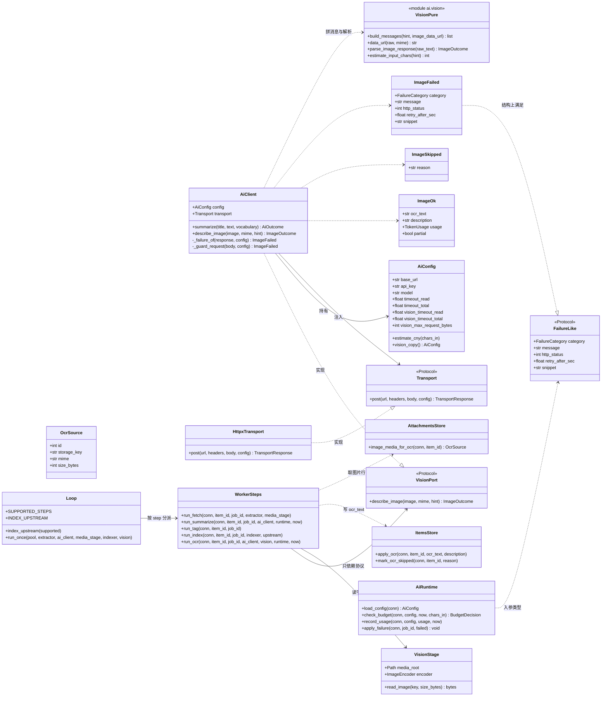
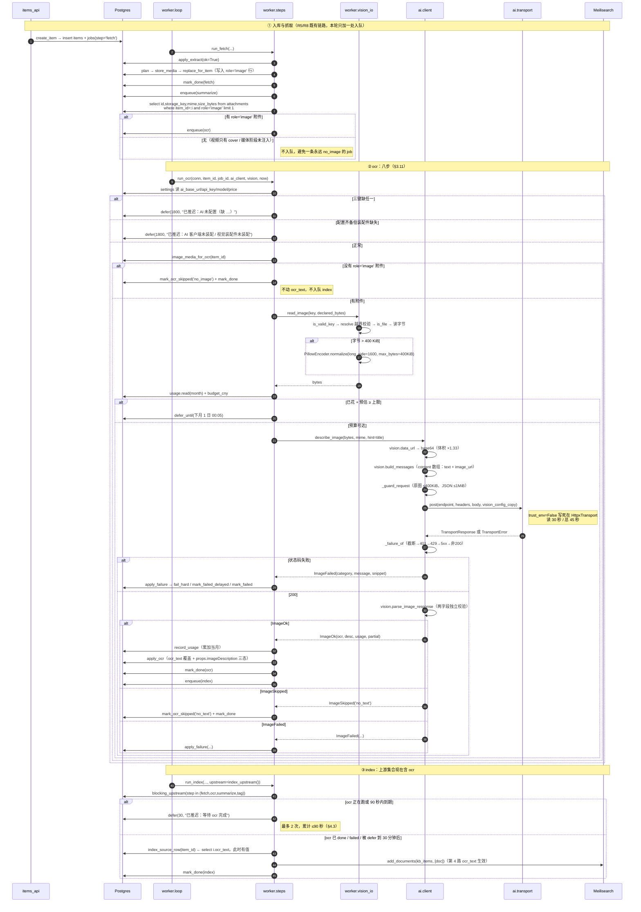
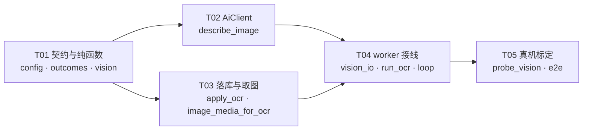

# 个人知识库 · M3-05 视觉 OCR 设计（一次调用产出 OCR + 描述 → `ocr` 步 → 索引第 4 路）

| 项 | 内容 |
|---|---|
| 版本 | v1.0 |
| 日期 | 2026-11-28 |
| 需求来源 | `docs/prd/2026-11-25-PRD-v0.2.md` 的 M3-05（P0）；`docs/prd/2026-11-27-AI层增量PRD.md` 的 AI-23（P2，本轮提前做 M3-05 的 P0 部分）；`docs/tech/2026-11-26-技术方案.md` §6.4 / §6.7 / §7.4 / §11.2 T10 |
| 前置设计 | `docs/tech/2026-11-27-AI层设计.md`（`AiConfig` / `Transport` / `AiOutcome` 三形态）、`docs/tech/2026-11-28-R6检索设计.md`（index 步、`INDEX_UPSTREAM`、90 秒窗口）、`docs/tech/2026-11-28-R8媒体下载设计.md`（`attachments` 落盘与归一化压缩） |
| 图文件 | 类图 `docs/tech/2026-11-28-M3-05视觉OCR-类图.mermaid`；时序图 `docs/tech/2026-11-28-M3-05视觉OCR-时序图.mermaid` |
| 明确不做 | 多图逐张 OCR（本轮只 OCR 一张展示图，见 §0 第 5 条）、视频抽帧 OCR（M2-08 未做）、以图找图（AGENTS.md §3 明确不做）、描述进检索索引（见 §0 第 1 条）、`POST /api/items/{id}/retry`（技术方案 §8.2 有定义但未实现，本轮不扩范围） |

---

## 0. 结论先行

| # | 问题 | 结论 |
|---|---|---|
| 1 | 「描述」存哪里 | **进 `items.props.imageDescription`（选项 b）**，与 OCR 文字分开：OCR 进已有的 `items.ocr_text` 列。**不加列、不写迁移、不改任务总表**。描述**不进**检索索引——`searchableAttributes` 不动、`IndexDoc` 不动、`MIN_SCORE` 不用重标。连带好处：`GET /api/items/{id}` 已经把 `props` 整个吐出来，描述**零改动**对前端可见。比选与淘汰理由见 §1.2，进索引会引发的四处连锁见 §1.3 |
| 2 | 视觉调用怎么接进 `kb/ai/client.py` | **给 `AiClient` 加 `describe_image()` 方法，复用同一个 `Transport` 与同一个 `AiConfig`，不另起一套**。请求体走 OpenAI 兼容形状：`content` 数组里一个 `{"type":"text"}` + 一个 `{"type":"image_url","image_url":{"url":"data:image/jpeg;base64,…"}}`。`trust_env=False` 由 `HttpxTransport` 继承，**视觉路径不新建 httpx 客户端**。请求侧大小上限独立于响应侧：`VISION_MAX_IMAGE_BYTES = 400 KiB`（原始字节）+ `VISION_MAX_REQUEST_BYTES = 1 MiB`（整个 JSON 体），两道闸门，见 §3.6 |
| 3 | `ocr` 步的入队与上游联动 | 入队判据**不看 `kind` 字符串**，看库：`attachments` 里存在 `role='image'` 的附件 → 入队 `ocr`（视频条目的展示图是 `role='cover'`，天然被排除）。改动点只有 `run_fetch` 末尾一处（§4.2）。`ocr` 进 `SUPPORTED_STEPS` 后 `index_upstream()` 求交自动把它算进上游 → **index 会等 ocr**，推迟 1–2 次、累计 30–90 秒（量化见 §4.3）。90 秒窗口**够**：视觉单次调用上界 45 秒 + 一次 30 秒 defer = 75 秒 < 90 秒 |
| 4 | 图片字节从哪来 | `attachments` 行（`role='image'`、`sort_order` 最小）→ `storage_key` → `<media_root>/<key>`。**读字节的装配在 `kb/worker/vision_io.py`**，`kb/media/` 一行不改、不 import `kb.store`。路径拼接沿用 `kb/api/media.py` 的三重防护（格式校验 → `resolve()` 越界校验 → `is_file()`）。**不再压缩**：R8 落盘的文件已 ≤1600 长边且 ≤200 KiB（实测 1080×1920 文字截图归一化后 204311 字节），只在超出 400 KiB 时才用已有的 `PillowEncoder` 现压 |
| 5 | 多图内容 OCR 几张 | **只 OCR 一张（`sort_order` 最小的 `role='image'`）**。代价写清：抖音图文第 2–20 张的文字不进索引。理由：单张一次视觉调用（3–10 秒 + 一次计费），20 张会把一条内容的处理时间推到 2 分钟以上并让单条内容成本乘 20；M6-01 只要求「图片 OCR 能搜到」这一路可用，不要求「每张图都搜到」 |
| 6 | OCR 与描述会不会互相串 | 不会，靠**字段级独立校验**而不是靠 prompt 自觉：`ocr` 允许空串（图上确实没字），`description` 要求 10–80 字且不得与 `ocr` 逐字相同。任一字段缺失**仍算成功**（`partial=True`），只写有值的那个；两字段都空 → `ImageSkipped('no_text')`（正常终态，不动 `ocr_text`、不入队 index） |
| 7 | 解析失败怎么办 | **不重试**（`AI-12` 已定「客户端内不重试」）→ `ImageFailed(BAD_RESPONSE)` → 走既有的 `mark_failed` 指数退避（1/2 分钟），3 次后 `failed`。**不写宽松二次调用**：一次宽松重试会让单条内容的计费翻倍且掩盖 prompt 缺陷 |
| 8 | 视觉调用的预算闸门 | **必须过**，与文本调用同一套（`ai_runtime.check_budget`）。视觉计费按图片 token 而非字符，因此新增常量 `VISION_ESTIMATE_TOKENS = 1500` 折算为「等价的输入字符数」，沿用「宁可估高」的既有口径（`D2`）。⚠️ 该数值是保守上界，不是实测值，标定方法见 §8 第 1 条 |
| 9 | 检索侧要改什么 | **零改动**。`kb/store/search.py` 的 `_ROW_COLUMNS` 已 `select i.ocr_text`；`kb/search/config.py` 的 `SEARCHABLE_ATTRIBUTES` 第 4 位已是 `ocr_text`；`IndexDoc` 已有该字段。R6 真机探测里「剪映卡点」只在 `ocr_text` 命中时得分 **0.999**，远高于阈值 0.30，说明 OCR 路一开始就是通的，只是没人往列里写值。唯一要做的是「写完 `ocr_text` 必须入队 `index`」这条硬规则（§7） |
| 10 | 会不会把 `index` 拖死 | 不会。三类失败都不会让 `index` 永远等：`ocr` 三次失败 → `state='failed'`，`blocking_upstream` 的 SQL 只认 `running` 与 90 秒内到期的 `pending`，`failed` 不阻塞；`ocr` 因未配置 AI 被 `defer 1800 秒` → `run_after` 在 90 秒之外，不阻塞（与 R6 §4.2 同一机制）；`ocr` 卡在 `running` 超过 15 分钟 → `recover_stale` 退回 `pending`。三者的共同落点都是「索引先写一版没有 OCR 文字的文档，OCR 成功后再 upsert 一次」，upsert 幂等，无正确性影响 |
| 11 | 是否要新增 Python 包 | **零新增**。base64 是标准库；图片解码/压缩复用已声明的 `pillow`；HTTP 复用已声明的 `httpx`。本地 OCR 引擎（PaddleOCR / RapidOCR / Tesseract）全部不采用，理由见「复用调研」——它们只出文字不出描述，而 M3-05 要求**一次调用同时出两样**，装它们之后仍要再调一次视觉模型 |

### 0.1 术语表（非技术读者先看）

| 术语 | 一句人话 |
|---|---|
| OCR | 「把图片里的字认出来」。截图里那段文字，机器原本只看见一堆像素，OCR 让它变成可以搜的字 |
| 视觉模型 | 能「看图」的大模型。给它一张图片，它能读出图里的字，还能用一句话说这张图是什么 |
| `ocr` 步 | 后台流水线里的一步：拿到这张内容的展示图 → 调一次视觉模型 → 把文字写进 `ocr_text`、把描述写进 `props.imageDescription` |
| base64 | 把二进制图片变成一串纯文本字母的办法。传图片给模型时，HTTP 请求体只能装文本，所以图片要先这样「转写」一遍。代价是体积变大三分之一 |
| `data:` URL | 一种把图片内容直接写进地址里的写法，形如 `data:image/jpeg;base64,/9j/4AAQ…`。模型服务靠它区分「这是个网址」还是「这是图片本身」 |
| 展示图（`items.primary_media`） | 卡片上显示的那一张图。视频的展示图是封面，图文的展示图是第一张配图 |
| `attachments.role` | 附件在内容里扮演的角色。`cover` = 视频封面，`image` = 图文里的配图。这两个值不是一回事，OCR 只认 `image` |
| 上游 / 下游 | 同一条内容的处理步骤有先后：抓取 → OCR / 摘要 → 打标签 → 建索引。前一个叫上游，后一个叫下游 |
| 幂等（upsert） | 同一件事做两遍与做一遍结果相同。「有就更新、没有就新增」的写入方式天然幂等，所以重复写索引不会写出两条记录 |
| 预算闸门 | 发请求之前先算一次「这个月还能不能花」，不能花就不发，改为把任务推迟 |
| `defer` | 把任务的下次可执行时间往后推，**不算一次失败**（`attempts` 不变）。与之相对的是 `mark_failed`，那是「试过了，失败了」 |

---

## 1. 实现方案与框架选型

### 1.1 四个技术难点与对策

| 难点 | 现象 | 对策 |
|---|---|---|
| 文档缺一列 | M3-05 要「OCR + 描述」两样产出，`items` 表只有 `ocr_text` 一列，**没有描述列** | 描述进 `props.imageDescription`（`props` 是本项目登记的长尾属性桶，已有 `aiTags` / `summaryBasis` / `mediaError` 三个先例）。不加列的理由见 §1.2 |
| 请求体比响应体危险 | `AiConfig.MAX_RESPONSE_BYTES = 256 KiB` 管的是「读回来多少」，图像请求是「发出去多少」，两者量级与失败模式完全不同 | 两道独立的请求侧闸门：单张原始图 ≤ 400 KiB、整个 JSON 体 ≤ 1 MiB。数值依据见 §3.6 |
| 一次调用要两段结构化输出 | 模型容易把描述写成 OCR 的复述，或者把 OCR 写成描述的摘要 | prompt 里把两个字段的**职责与格式**分开写死（OCR 保留换行、描述不得出现 OCR 里的连续 8 个字），解析层**逐字段独立校验**，不靠模型自觉 |
| 视觉调用慢，会把 index 拖住 | `index` 的上游集合求交后自动包含 `ocr`（R6 §4.3 的机制），而视觉调用 3–10 秒、上界 45 秒 | 90 秒窗口 + `defer 30 秒` 的组合已覆盖（§4.3 给了三种情形的量化），不需要改 `blocking_upstream` |

架构模式：**沿用既有分层（纯逻辑层不碰网络与数据库，装配件由 `worker/__main__.py` 注入）**，与 `kb/media/`、`kb/search/` 完全同构。不引入 DI 框架。

### 1.2 「描述」存哪里：三个选项的取舍

| 选项 | 代价 | 判定 |
|---|---|---|
| **(b) `items.props.imageDescription`** | 描述与 OCR 文字分处两列，读「这条内容的全部文字」要拼两处 | **采用**。不需要迁移；`props` 已登记为长尾属性桶（`items_props_object` 只要求是对象）；`GET /api/items/{id}` 已经把 `props` 整个返回，前端零改动；写入是一条 `props \|\| jsonb` 更新，与 `set_ai_tags_raw` 同形状 |
| (a) 描述并入 `ocr_text`，用分隔符 | 检索侧会把描述当 OCR 文字命中（第 4 路权重被污染）；用户复制 OCR 文字时带上「——— 描述：…」；分隔符选什么都没人记得住；两者长度上限不同（OCR 可到 2000 字，描述 ≤80 字），截断策略无法统一 | 淘汰。**这是「省一次迁移」，代价是让两个语义不同的东西永久混在一个字段里**，而 M6-01 明写 OCR 是独立一路（技术方案 §6.7 修 N17 的原始教训：v8.0 把 OCR 塞进 `content_text`，导致索引字段表里 OCR 被作者顶掉） |
| (c) 新增 `items.summary_image` 之类的新列 | 需要 `0005_*.sql`；迁移文件规则禁止 `drop table` / `truncate`（`migrations/README.md` 第 2 条），错了改不回去；一条只为单个 P0 需求服务的列，之后不会再被其它需求用到（描述只有图片类内容有，占比低） | 淘汰。**「能不能不迁移就不迁移」在本项目是硬偏好**：平板是唯一部署环境，迁移失败的恢复成本远高于多写一行 `props` 的读取代码 |

**为什么不选 (a) 的变体「描述拼在 ocr_text 末尾但索引时截掉」**：那会让库里的值与索引里的值不一致，`rebuild` 的对账（逐条比对索引文档与库）立刻失去意义，而 R6 §7.1 把对账列为「索引与库不同步」的三条兜底之一。淘汰。

### 1.3 描述要不要进检索索引（带上的四处连锁，逐条列清）

**结论：不带。** M6-01 要求的五路是 `title` / `content_text` / `summary` / `tags` / `ocr_text`（技术方案 §6.7 的表格），描述不在其中。

先回答「带上会怎样」——四处连锁，每一处都是真改动：

| 连锁 | 具体要改什么 | 代价 |
|---|---|---|
| ① `IndexDoc` 加字段 | `kb/search/models.py` 的 `IndexDoc` 加 `image_description`，`to_meili_dict()` 跟着加 | `tests/test_search_arch.py::test_IndexDoc字段集合与设计表逐字一致` 断言的是**有序元组**，必须改；改测试这件事本身要写进任务，否则实现的人会以为是回归 |
| ② `searchableAttributes` 加一项 | `kb/search/config.py` 的 `SEARCHABLE_ATTRIBUTES` 变成 7 个 | R6 §5.4 明写「任何一次改动 `searchableAttributes` 的顺序或增删字段 → 标签分与正文分会同时移动，`0.30` 可能不再成立」。必须重跑真机 A5 取四个数（垃圾分 / 标签分 / 正文分 / 阈值），而这需要平板在线 |
| ③ 兜底路径的分母 | `kb/store/search.py` 的 `field_hits` 表达式与 `config.FALLBACK_FIELD_COUNT = 5` | `tests/test_api_search.py` 与 `tests/test_store_search_pg.py` 各有断言写死 `3 / 5`，要改成 `3 / 6`；`rankingScore` 的取值范围随之变化，前端同一屏内可能出现两种分母的结果 |
| ④ 结果不可复现 | 无代码改动，是性质变化 | 描述是**模型生成的措辞**，同一张图重跑一次会换个说法（「一张雨天的街景」vs「雨中的城市街道」）。把生成文本放进索引，等于让「同一条内容搜不搜得到」取决于上次调用时模型怎么措辞。关键词检索的价值是稳定，这条性质会被破坏 |

由此：**本轮不动检索层任何一个文件**。OCR 文字进 `ocr_text` 之后第 4 路自动生效（§0 第 9 条）。

**将来若要带**（M6-06 语义检索时重新评估）：路径是「加 `IndexDoc` 字段 + `rebuild` 全量重灌 + 真机重标 `MIN_SCORE`」三件一起做，**不是**「偷偷把描述拼进 `ocr_text`」。

### 1.4 视觉调用接进 `kb/ai/` 的方式（不另起一套）

| 维度 | 做法 | 为什么不另起一套 |
|---|---|---|
| 配置 | `AiConfig` 加三个带默认值的字段（`vision_timeout_read` / `vision_timeout_total` / `vision_max_request_bytes`），其余复用 | 多一套配置 = 多一处「用户改了 `ai_base_url` 但视觉还在用旧值」的可能。`AiConfig` 是 frozen dataclass，加带默认值的字段对既有构造零影响 |
| 传输 | **同一个 `Transport` 协议、同一个 `HttpxTransport` 实例** | `trust_env=False` 写在 `HttpxTransport.post` 里，新建客户端等于把这条教训重犯一次（`B21` 的原始症状是「容器里残留 `HTTPS_PROXY` → 请求走到不存在的地址 → 卡到超时」，排障时看起来像「模型服务挂了」） |
| 超时 | 用 `dataclasses.replace(config, timeout_read=30.0, timeout_total=45.0)` 造一个视觉用的配置副本 | `Transport.post` 只读 `config.timeout_total`，**不加参数**。加参数要改 `Transport` 协议 + `HttpxTransport` + 测试里全部 `ScriptedTransport` 假实现的签名，破坏面远大于收益 |
| 失败类型 | 新增 `ImageFailed` / `ImageOk` / `ImageSkipped`，与 `SummarizeFailed` 同形 | 三个形态的契约与 `AiOutcome` 一致（成功 / 跳过 / 失败），worker 的分支写法可以照抄；混用 `SummarizeFailed` 会让 `jobs.error` 里出现「AI解析失败：摘要长度…」这种讲不通的消息 |
| 状态码阶梯 | 从 `AiClient._interpret` 抽出共享函数 `_failure_of(response, config)` | 401/403/429/5xx/截断 五条判定与它们的文案**只能有一份**。两处各写一份，`B26`（鉴权失败提示检查 api_key）在视觉路径上就会漏掉 |

### 1.5 本地 OCR 引擎为什么全部淘汰（这是本轮最容易被做错的选择）

M3-05 的原文是「**一次**视觉模型调用，**同时**产出『图中文字』和『一句话描述』」。本地 OCR 引擎只解决前半句：

| 方案 | 能出 OCR | 能出「一句话描述」 | 结论 |
|---|---|---|---|
| 视觉大模型（本轮） | 能 | 能 | **一件事件、一次调用、一次计费** |
| PaddleOCR / RapidOCR / Tesseract | 能 | **不能** | 装完之后仍要再调一次视觉模型出描述 → 两次调用、两套依赖、两份失败处理 |

所以「先上本地 OCR 省钱」在本需求上不成立：它省不掉那次视觉调用，只多出一套常驻的模型与依赖。详细对比见「复用调研」。

---

## 2. 文件清单

**本轮新增 10 个，修改 14 个。**

**Create**

| 文件 | 作用 |
|---|---|
| `kb/ai/vision.py` | 纯函数：`build_messages()`（拼视觉消息体，含 prompt 里两字段的职责与格式）、`data_url()`（base64 转 data URL）、`parse_image_response()`（两字段独立校验 + 长度截断）、`estimate_input_chars()`（预算口径）。**不碰网络、不碰磁盘、不读环境变量** |
| `kb/worker/vision_io.py` | 字节装配：`VisionStage`（`media_root` + `encoder` 打成一个包）、`read_image()`（格式校验 → 路径越界校验 → 读文件 → 超限现压）、`production_stage()`。**这里是唯一读图片文件的地方**，`kb/media/` 不认识 `kb.store` |
| `tests/test_ai_vision.py` | 纯函数用例：两种字段的解析边界、空字段、超长截断、`data_url` 形状、`estimate_input_chars` |
| `tests/test_ai_vision_client.py` | 假 `Transport`：请求体形状（`content` 数组两段、`data:` 前缀）、请求侧两道闸门、状态码阶梯五条与 `summarize` 逐字一致、不重试 |
| `tests/test_worker_ocr_step.py` | `run_ocr` 的分支：无图 → skip、AI 未配置 → defer、装配件缺失 → defer、成功 → 写库 + 入队 index、失败 → 按类别落地；`run_fetch` 的入队判据；`read_image` 的路径穿越与超限 |
| `tests/test_items_ocr_props.py` | `apply_ocr` / `mark_ocr_skipped` 的 SQL 形状（不污染 `summary` / `content_text` / `kind`、空描述删键、`- 'ocrSkipped'`）。与 `tests/test_items_ai_props.py` 的 G1/G2/G3 对称 |
| `tests/test_ocr_e2e_pg.py` | 端到端（`pg` + `external` 双标记，平板真库 + 真模型）：OCR 落库、可被搜到、失败不拖死索引、未配置时索引照常 |
| `scripts/probe_vision.py` | 真机标定探针：打印六个数（原始字节 / base64 字节 / 请求体字节 / `usage.prompt_tokens` / 耗时 / 失败类别）。与 `scripts/probe_search.py` 同构 |
| `docs/tech/2026-11-28-M3-05视觉OCR-类图.mermaid` | 类图（与 §3 一致） |
| `docs/tech/2026-11-28-M3-05视觉OCR-时序图.mermaid` | 时序图（与 §4 一致） |

**Modify**

| 文件 | 改动 |
|---|---|
| `kb/ai/config.py` | 新增九个常量（`VISION_TIMEOUT_READ` / `VISION_TIMEOUT_TOTAL` / `VISION_MAX_REQUEST_BYTES` / `VISION_MAX_IMAGE_BYTES` / `VISION_ESTIMATE_TOKENS` / `VISION_OCR_MAX_CHARS` / `VISION_DESC_MIN_CHARS` / `VISION_DESC_MAX_CHARS` / `VISION_LONG_SIDE`）与 `AiConfig` 三个带默认值的字段（`vision_timeout_read` / `vision_timeout_total` / `vision_max_request_bytes`）+ 一个 `vision_copy()` 方法 |
| `kb/ai/outcomes.py` | 新增 `ImageOk` / `ImageSkipped` / `ImageFailed` / `ImageOutcome`，以及 `FailureLike` Protocol（`apply_failure` 与 `failure_message` 的类型收口，见 §3.4） |
| `kb/ai/client.py` | 新增 `describe_image()`；把状态码阶梯抽成 `_failure_of()` 供两条路径共用；新增 `_guard_request()`（请求侧两道闸门） |
| `kb/ai/__init__.py` | 模块级导出 `ImageOutcome` 三形态与 `FailureLike`（它们不依赖 `httpx`，可以放模块级，不影响 `B27` 的惰性导入教训） |
| `kb/worker/loop.py` | `SUPPORTED_STEPS` 加 `"ocr"`；分派加 `elif step == "ocr"`；`run_once` 与 `run_forever` 末尾追加 `vision: Any = None` |
| `kb/worker/steps.py` | 新增 `run_ocr()`；`run_fetch` 末尾追加 `ocr` 入队（判据取自库，不看 `kind` 字符串） |
| `kb/worker/__main__.py` | 构造 `VisionStage` 并以关键字传给 `run_forever`；启动日志多打一行媒体根目录（复用已有那行，不新增） |
| `kb/store/items.py` | 新增 `apply_ocr()`（写 `ocr_text` + `props.imageDescription`，三态处理空描述）与 `mark_ocr_skipped()` |
| `kb/store/attachments.py` | 新增 `image_media_for_ocr()` 与 `OcrSource`（`sort_order` 最小的 `role='image'` 附件） |
| `kb/worker/ai_runtime.py` | `apply_failure` / `failure_message` 的入参类型由 `SummarizeFailed` 放宽为 `FailureLike`（行为零改动） |
| `tests/test_worker_ai_steps.py` | `SUPPORTED_STEPS` 断言由四步骤改为五步骤；`test_ocr仍不在SUPPORTED_STEPS` 反转；`run_once` 末尾参数断言由 `names[-1] == "indexer"` 改为 `names[-2] == "indexer"` 且 `names[-1] == "vision"` |
| `tests/test_worker_index_step.py` | `test_index_upstream保持依赖顺序` 的期望值由 `("fetch","summarize","tag")` 改为 `("fetch","ocr","summarize","tag")`——`SUPPORTED_STEPS` 含 `ocr` 之后交集变了 |
| `tests/test_worker_loop.py` | 两条用 `"ocr"` 当「未实现步骤」样例的用例必须改写。**不改成另一个假步骤名**（`jobs_step_check` 只允许五个值，编一个 `"archive"` 出来就是在测一个库里永远不可能出现的状态）：改成 `monkeypatch.setattr(loop, "SUPPORTED_STEPS", ("fetch","summarize","tag"))` 后喂 `step="index"`，断言它走「未实现」分支。这样测的是真分支、真取值，且五个步骤全部实现之后这条用例仍然有意义（守 `SUPPORTED_STEPS` 与分派的对应关系） |

**本轮只读**（需要参考但不许改）

- `kb/search/*`（索引文档 schema 与 `searchableAttributes` 不动，§1.3）
- `kb/store/search.py`（已 `select i.ocr_text`）
- `kb/media/*`（R8 已封闭，读字节的装配在 worker 层）
- `kb/store/migrations/`（**本轮无 schema 变更**）
- `tests/test_qa_search_probe.py`（它断言「`step='ocr'` 不被分派给 `run_index`」，`ocr` 上线后仍然成立，见 §5 T04 判据）
- `任务总表-2026-11-28.csv`（用户明确要求不加行）

---

## 3. 数据结构与接口

### 3.1 类图



### 3.2 `ImageOutcome` 三形态（`kb/ai/outcomes.py`）

```python
@dataclass(frozen=True)
class ImageOk:
    """一次视觉调用的成功产出。两个字段各自可能为空串（见 §3.3）。"""
    ocr_text: str
    description: str
    usage: TokenUsage = field(default_factory=TokenUsage)
    #: 有一个字段缺失。**仍是成功**：OCR 有值描述空，绝不因为描述缺失而丢掉 OCR。
    partial: bool = False

@dataclass(frozen=True)
class ImageSkipped:
    """调用成功但这次没有可用产出。`reason` 三个值见 §3.3。"""
    reason: str

@dataclass(frozen=True)
class ImageFailed:
    """不产出可用结果：HTTP 失败、非 JSON、形状非法、请求体超限。"""
    category: FailureCategory
    message: str
    http_status: int = 0
    retry_after_sec: float = 0.0
    snippet: str = ""

ImageOutcome = ImageOk | ImageSkipped | ImageFailed
```

**为什么不复用 `SummarizeOk`**：`SummarizeOk` 的第二个字段是 `tags`，语义是「从词表里挑的标签名」。把描述塞进去，`tag` 步骤会把描述当标签名去词表里查——`validate_tags` 的「词表外丢弃」会让它静默消失，表现为「有时有标签有时没有」。三个形态必须是独立类型。

**`FailureLike` 是 Protocol 而不是联合类型**：`apply_failure` 与 `failure_message` 的行为对 `SummarizeFailed` 与 `ImageFailed` 完全相同（都是「按 `category` 落地 + 拼 `snippet`」）。写成 `SummarizeFailed | ImageFailed` 会让函数体里的每个字段访问都要先收窄；Protocol 在 mypy 严格模式下做结构检查，两个 dataclass 都自动满足，函数体一行不改。

### 3.3 解析规则（`kb/ai/vision.py`）——「不串」靠这一节

| 情形 | 判定 | 产出 | 为什么不这样就会串 |
|---|---|---|---|
| 两个字段都是非空串 | 成功 | `ImageOk(ocr, desc, partial=False)` | — |
| `ocr` 非空、`description` 空或缺失 | **成功** | `ImageOk(ocr, "", partial=True)` | 把描述缺失判失败，会让「图里有字但模型没答上描述」的条目 `mark_failed` 三次后变「处理失败」，而 OCR 其实已经拿到、`ocr_text` 明明可以入库 |
| `ocr` 空、`description` 非空 | **成功** | `ImageOk("", desc, partial=True)` | 图上确实没有文字是**正常结论**（风景照、纯色图）。判失败会把它当故障重试 3 次 |
| 两个都空 | 跳过 | `ImageSkipped("no_text")` | 正常终态：这张图既没字也没内容可描述。`ocr_text` 不动、不入队 index（没有字段变化） |
| `description` 与 `ocr_text` 有连续 8 个字逐字相同 | **成功但清空描述** | `ImageOk(ocr, "", partial=True)` | 这就是「串」的具体形态：模型把描述写成了 OCR 的复述。清空比留一句复述好——复述既占位置又不提供新信息 |
| `ocr` 超过 2000 字 | 成功，截到 2000 字 | `ImageOk(ocr[:2000], …)` | `items.ocr_text` 没有长度 CHECK，但 2000 字以上的 OCR 只可能来自整页扫描，而列表页与索引都不需要那么长（与 `prompts.TEXT_LIMIT = 3000` 同一取向） |
| `description` 超过 80 字 | 成功，按句末标点截到 80 字以内 | 同上 | 复述 `parse._truncate` 的做法：找最后一个句末标点，找不到才硬截 79 字 + `…` |
| 非 JSON / 顶层不是对象 | 失败 | `ImageFailed(BAD_RESPONSE, snippet=前200字)` | 与 `parse_summary` 同一条路径、同一句文案前缀 |
| `ocr` 或 `description` 是数字 / 数组 | 该字段当空串 | 取决于另一个字段 | 类型错的字段单独丢，不连坐另一个。这与 `parse_summary` 里「`tags` 非字符串元素直接摘掉」同一个口径 |

**prompt 怎么写才要不串**（`build_messages` 的 system 段，要点四条）：

1. 明确两个键的**职责边界**：`ocr_text` 是「照抄图里的字」，`description` 是「用一个句子说这张图是什么」，并写死「`description` 里不要出现图里的整句文字」。
2. 明确 `ocr_text` 的**格式**：保留原有换行与顺序、不翻译、不加解释、不补标点；图里没有文字就返回空串（**不要**返回「无」「没有文字」——那会让下游把「无」当成 OCR 结果入库）。
3. 明确 `description` 的**长度与语言**：中文，10–80 字，一句话。
4. 保留 `response_format={"type":"json_object"}`，与文本调用同一口径；并保留解析失败的重试路径（有些兼容端点不真的实现这个参数）。

### 3.4 `kb/ai/client.py` 精确签名

```python
class AiClient:
    def __init__(self, *, config: AiConfig, transport: Transport) -> None: ...

    # 既有
    def summarize(self, title: str, text: str,
                  vocabulary: tuple[tuple[int, str, str], ...] = ()) -> AiOutcome: ...

    # 新增
    def describe_image(self, image: bytes, *, mime: str,
                       hint: str = "") -> ImageOutcome: ...

    # 内部（新增两个，改动一处）
    def _vision_payload(self, messages: list[dict[str, object]]) -> dict[str, Any]: ...
    def _guard_request(self, body: str, config: AiConfig) -> ImageFailed | None: ...
    def _failure_of(self, response: TransportResponse,
                    config: AiConfig) -> ImageFailed | None: ...
```

`_failure_of` 的判定顺序**原样保留**（截断 → 401/403 → 429 → 5xx → 非 200 → `None`）：

| 顺序 | 判据 | 为什么顺序不能改 |
|---|---|---|
| 1 | `response.truncated` | 截断的响应即使能解析出 JSON 也是残片。放在状态码前是因为 `B29` 断言「超 256KB 即判 TOO_LARGE」，而截断时状态码多半是 200 |
| 2 | 401 / 403 → `AUTH` | 密钥错不可自愈，一次判死 |
| 3 | 429 → `HTTP_429` | 带 `Retry-After` |
| 4 | ≥500 → `HTTP_5XX` | — |
| 5 | ≠200 → `UNEXPECTED` | — |

`_interpret`（文本）改成：先调 `_failure_of`，非 `None` 就按字段转成 `SummarizeFailed`，`None` 才交给 `parse_summary`。**消息文案由共享函数生成，逐字不变**——`tests/test_ai_client.py` 与 `tests/test_ai_transport.py` 里那条断言 `AUTH` 消息含 `api_key` 的用例是这次重构的回归守卫（§5 T02 判据）。

### 3.5 视觉请求体形状（照抄这一节）

```json
{
  "model": "<settings.ai_model>",
  "messages": [
    {"role": "system",
     "content": "你是个人知识库的图片理解助手。只输出一个 JSON 对象，字段只有两个：
                 {\"ocr_text\": 字符串, \"description\": 字符串}。…（§3.3 四条要点）"},
    {"role": "user",
     "content": [
       {"type": "text", "text": "内容标题：<items.title>（供你判断这张图在什么语境里）"},
       {"type": "image_url",
        "image_url": {"url": "data:image/jpeg;base64,/9j/4AAQSkZJRg…"}}
     ]}
  ],
  "response_format": {"type": "json_object"},
  "temperature": 0.1
}
```

三点必须写死：

| 项 | 值 | 理由 |
|---|---|---|
| `content` 是**数组**（文本 + 图片两段） | 数组 | 纯文本调用的 `content` 是字符串。视觉调用必须是数组，否则网关按纯文本处理，图片被静默丢弃，模型回一句「我看不到图片」——而这句话会被解析成 `description` 入库 |
| `data:` URL 的 mime 部分 | 只允许 `image/jpeg` / `image/png` / `image/webp` / `image/gif` | 由 `attachments.mime` 决定（R8 的 `attachments_mime_allowed` 已白名单过一遍）。**不允许 SVG**（`kb/media/sniff.py` 的 `FORBIDDEN_MIMES` 已在下载阶段拒掉，这里是第二道） |
| `temperature` | `0.1`（文本摘要是 `0.3`） | OCR 是抄写任务，越低越稳定；描述需要一点措辞自由度但不需要创意。两个值都在 `client.py` 里各有注释 |

### 3.6 请求侧两道闸门（数值与依据）

**为什么必须独立于 `MAX_RESPONSE_BYTES`**：那个常量守的是「服务端往回吐多少」，本轮的失败模式是「我们往外发多少」——平板 8 GB 内存，一次 `json.dumps` 会把整张图的 base64 复制进字符串，再进请求体。

| 闸门 | 常量 | 值 | 依据（实测，本机 2026-11-28） |
|---|---|---|---|
| 单张原始图字节 | `VISION_MAX_IMAGE_BYTES` | **400 KiB** | R8 落盘目标 200 KiB。实测一张 1080×1920 的中文文字截图：原始 q95 = 437403 字节 → 经 `PillowEncoder.normalize(long_side=1600, max_bytes=200KiB)` 后 **204311 字节**、900×1600。400 KiB = 落盘上限的 2 倍，同时覆盖「历史数据未经 R8 归一化」与「用户经 API 传进来的图」两种情况 |
| 整个 JSON 请求体 | `VISION_MAX_REQUEST_BYTES` | **1 MiB** | base64 膨胀系数实测 1.3333（`ceil(n/3)*4`）：200 KiB → 273 KiB，加 JSON 包装约 1–2 KiB。1 MiB 留 3.7 倍余量。**内存峰值口径**：读文件 400 KiB + base64 字符串 ~533 KiB + `json.dumps` 副本 ~540 KiB ≈ **1.5 MiB**（一次性、不并发，8 GB 平板无压力）。反例：若不设闸门，一张 4 MB 原图 → base64 5.3 MB → JSON 5.4 MB，三次复制约 16 MiB，且多数网关直接回 413，错误信息与「图太大」毫无关联 |

两道闸门的动作不同：

| 触发哪道 | 动作 | 为什么不同 |
|---|---|---|
| 原始图 > 400 KiB | **先现压**：`VisionStage.read_image` 调 `PillowEncoder.normalize(long_side=1600, max_bytes=400KiB)`，压完再往下走 | 压得下来就不该放弃。R8 已证明这条编码路径在平板上可用 |
| 现压仍 > 400 KiB（`EncodeError`） | `ImageSkipped("too_large")` | 极端图（巨型 PNG 截图）压不下来。**判 skipped 不判 failed**：这不是故障，重试 3 次也还是那张图 |
| JSON 体 > 1 MiB | `ImageFailed(TOO_LARGE)`，**不发请求** | 走到这里说明 base64 之后的体量失控，是编程错误（表格里的两行都通过了却还超 1 MiB），判失败让 `mark_failed` 的退避把它暴露出来。**不能判 skipped**——那会让一个 bug 表现为「这条内容安静地没有 OCR」 |

### 3.7 视觉超时（两个新常量）

| 常量 | 值 | 依据 |
|---|---|---|
| `VISION_TIMEOUT_READ` | **30 秒** | 文本调用的 `TIMEOUT_READ = 10` 是「单次读操作等多久」。视觉模型首字延迟明显更长（要大图编码 + 图像 token 化），10 秒会在正常服务上就开始误杀。30 秒是文本值的 3 倍，与「连接 5 秒不变」一起构成「连得上就一定读得到」 |
| `VISION_TIMEOUT_TOTAL` | **45 秒** | `Transport` 的总时长守卫读它。**上界必须小于 `UPSTREAM_SOON_SEC = 90` 减去一次 `defer`（30 秒）**：45 + 30 = 75 < 90，§4.3 的量化靠这个不等式成立 |

用 `dataclasses.replace(config, timeout_read=…, timeout_total=…)` 造副本，`Transport` 一行不改（§1.4）。

### 3.8 `kb/worker/vision_io.py` 精确签名

```python
@dataclass(frozen=True)
class VisionStage:
    media_root: Path
    encoder: ImageEncoder          # kb.media.encode.PillowEncoder（协议注入）

    def read_image(self, key: str, *, declared_bytes: int) -> bytes: ...

def production_stage(media_root: Path) -> VisionStage: ...
```

`read_image` 四步，顺序一条不许挪（**照抄 `kb/api/media.py` 的三重防护**，那份代码的注释解释了为什么）：

| 步 | 判定 | 不通过的动作 |
|---|---|---|
| 1 | `layout.is_valid_key(key)` | `ImageUnavailable("storage_key 格式不合法")` |
| 2 | `(media_root / key).resolve().is_relative_to(media_root.resolve())` | 同上。正则本身已是路径穿越的充分防线，这是第二道 |
| 3 | `path.is_file()` | `ImageUnavailable("附件文件不存在（库里有一行、磁盘上没有）")` |
| 4 | 读字节 → `len(data) > VISION_MAX_IMAGE_BYTES` 时 `encoder.normalize(...)`；`EncodeError` → `ImageUnavailable(reason)` | — |

`ImageUnavailable` 是 `vision_io` 自己的异常，worker 把它翻成 `ImageSkipped("no_image")` 或 `mark_failed`，**由调用方决定**（`kb/media` 的 `_Skip` 是同一个手法）。

**`declared_bytes` 为什么单独传**：库里 `attachments.size_bytes` 是权威值。文件被手工删/替换时它会与真实大小不符，先比一次能让「磁盘上是另一个文件」这件事在日志里可见，而不是等模型读出一段不相干的内容。

### 3.9 `kb/store/attachments.py` 新增（**不看 `kind` 字符串**）

```python
@dataclass(frozen=True)
class OcrSource:
    id: int
    storage_key: str
    mime: str
    size_bytes: int

def image_media_for_ocr(conn, item_id: int) -> OcrSource | None: ...
```

SQL（只读）：

```sql
select id, storage_key, mime, size_bytes
  from attachments
 where item_id = :i and role = 'image'
 order by sort_order, id
 limit 1
```

**为什么判据是 `role='image'` 而不是 `kind in ('image','image_text')`**：

1. `kind` 的合法值来自 `item_kinds` 表（`known_kinds()` 是真源），在业务代码里写 `kind in (...)` 就是把一个数据库驱动的枚举硬编码进 Python——这正是本项目反复禁止的写法（R6 §T04 判据原话：「不许硬编码类型枚举」）。
2. `role='image'` 是**客观事实**：R8 的 `plan.plan_attachments` 只给图文的配图产 `role='image'`，视频的封面产 `role='cover'`，视频原文件产 `role='video'`（本轮不下）。所以「有 `role='image'` 附件」与「它是图片或图文」在本项目当前数据里**等价**，而前者不需要认识任何 kind 名称。
3. 用户将来在 `item_kinds` 里加一类（迁移设计明确支持「加新形态 = 插一行」），只要那一类的配图按 `role='image'` 下载，OCR 自动生效，不用改一行代码。

**`order by sort_order, id`**：`sort_order` 由 `plan_attachments` 从 1 递增，`id` 是兜底（同 `sort_order` 的两行也有确定结果，理由同 `attachments.primary_media_id` 的 `sort_order, id` 双次要键）。

### 3.10 `kb/store/items.py` 新增两个函数

```python
def apply_ocr(conn, item_id: int, *, ocr_text: str, description: str) -> None: ...
def mark_ocr_skipped(conn, item_id: int, reason: str) -> None: ...
```

`apply_ocr` 的 SQL 要点（**三态**，照 `set_media_props` 的写法）：

```sql
update items set
  ocr_text = :o,
  props = ((case when :d = '' then props - 'imageDescription'
                 else props || cast(:p as jsonb) end)
           - 'ocrSkipped'),
  updated_at = now()
where id = :i
```

| 要点 | 为什么 |
|---|---|
| `ocr_text = :o` 是**覆盖写** | 重跑时旧的 OCR 必须被新结果替换。追加会让「重跑三次」的条目 OCR 变成三段重复文字 |
| 描述为空时**删除** `imageDescription` | `\|\|` 只覆盖同名键、不删旧键。删不掉的话「上次有描述、这次模型没给」会让界面一直显示旧描述（`set_media_props` 的 `mediaTruncated` 注释记的是同一个坑） |
| 无条件 `- 'ocrSkipped'` | 成功了就说明不是「跳过」，旧标记必须消失，否则界面一直显示「图上没有文字」 |
| SQL 里**不得出现** `content_text` / `kind` / `summary` | 与 `apply_summary` 的 G1/G2/G3 同一条纪律。`apply_summary` 的测试逐字断言「SQL 里没有 `ocr_text`」，本轮新增对称的一条：「`apply_ocr` 的 SQL 里没有 `summary` / `content_text` / `kind`」 |

`mark_ocr_skipped` 只写 `props.ocrSkipped = reason`，**不动 `ocr_text`**（理由同 `mark_summary_skipped`：不清空已有值，那是数据丢失）。

`reason` 三个值：`no_image`（没有可 OCR 的图片）、`no_text`（图上没字也没内容可描述）、`too_large`（压到 400 KiB 仍失败）。**这三个不是内容类型枚举**，是「这一次为什么没产出」的状态标记，与 `summarySkipped`（`no_text` / `title_only`）同族，不来自数据库。

### 3.11 `kb/worker/steps.py::run_ocr` 精确签名与判定顺序

```python
def run_ocr(conn, item_id: int, job_id: int, *,
            ai_client: Any, vision: Any, runtime: Any = ai_runtime,
            now: datetime) -> None: ...
```

判定顺序**写死**（顺序变了会报错因，与 `run_summarize` 同构）：

```
① runtime.load_config(conn)
   └─ None（配置缺失）→ defer 1800 秒 + "AI 未配置（缺 xxx）"   ← 复用 _defer_not_configured
② ai_client is None → defer 1800 秒 + "AI 客户端未装配"        ← 复用 _defer_no_client
③ vision is None → defer 1800 秒 + "视觉装配件未装配"
④ attachments_store.image_media_for_ocr(conn, item_id)
   └─ None → mark_ocr_skipped('no_image') + mark_done + return    ← **不入队 index**
⑤ vision.read_image(...) 抛 ImageUnavailable
   └─ → mark_ocr_skipped('too_large' 或 'no_image') + mark_done   ← 不入队 index
⑥ 预算闸门 check_budget(conn, config, now, chars_in=estimate)
   └─ 不放行 → defer_until / defer（与 run_summarize 同一段代码）
⑦ ai_client.describe_image(bytes, mime=..., hint=detail.title)
   └─ 抛异常 → mark_failed（单条异常不能打死 worker）
⑧ 三种结果落地：
   ImageOk      → record_usage → apply_ocr → mark_done → **enqueue index**
   ImageSkipped → mark_ocr_skipped(reason) → mark_done → 不入队 index
   ImageFailed  → runtime.apply_failure(conn, job_id, failed)   ← 按 category 落地
```

**为什么第 ④ 步 `None` 时不入队 `index`**：R6 §10 的硬规则是「改动 `ocr_text` 等可搜字段的路径必须入队 index」。`no_image` 与 `too_large` 都没有改动任何字段，入队只会多一次幂等写入与一条 `done` 的 job 记录，让「这条内容到底跑过几步」变模糊。

**为什么第 ③ 步用 `defer` 不用 `mark_done`**：与 `run_index` 的「索引器未装配」同一条理由——`None` 意味着 `__main__.py` 漏传装配件，那是装配 bug。写 `defer` 并写明「视觉装配件未装配」，才能让人看出是漏传参数而不是图片有问题。

**读字节在预算闸门之后**（第 ⑤ 步在 ⑥ 之前是「先判后读」的另一面）：文件读与压缩是本地 IO，很便宜；但顺序上先确认「有图」再花钱更符合「先判后读」的口径（`run_index` 的先判上游再读数据是同一条）。⚠️ 注意第 ⑤ 步（读图）在 ⑥（预算）之前，因为「能不能读出图」决定了这次调用有没有对象；预算闸门只管「要不要花这笔钱」。

---

## 4. 程序调用流程

### 4.1 一次图片内容的全链路

完整时序见 `docs/tech/2026-11-28-M3-05视觉OCR-时序图.mermaid`。主干：

1. `POST /api/items`（带链接）→ `items.create_item` 一条 CTE 写 `items` + `jobs(step='fetch')`。
2. worker 领 `fetch` → `run_fetch` → `apply_extract` → `_download_media`（R8：`plan` → `store_media` → `replace_for_item` → `set_media_props`）。
3. **`run_fetch` 末尾**：`mark_done` → `enqueue(item_id, "summarize")` → **新增**：`image_media_for_ocr()` 非空则 `enqueue(item_id, "ocr")`。
4. worker 领 `ocr` → `run_ocr`（§3.11 八步）→ `apply_ocr` → `enqueue(item_id, "index")`。
5. worker 领 `index` → `run_index` → `blocking_upstream`（上游集合此时含 `ocr`）→ `index_source_row`（`select i.ocr_text` 现在有值了）→ `indexer.upsert`。
6. Meili 第 4 路（`ocr_text`）从这一刻起可命中。

### 4.2 `run_fetch` 改哪一行（精确到行）

现状（`kb/worker/steps.py`，`run_fetch` 末尾）：

```python
    jobs_store.mark_done(conn, job_id)
    jobs_store.enqueue(conn, item_id, "summarize")
    log.info("抓取完成 item=%s job=%s step=fetch kind=%s", item_id, job_id, outcome.kind)
```

改为在 `enqueue(..., "summarize")` 之后追加三行：

```python
    jobs_store.mark_done(conn, job_id)
    jobs_store.enqueue(conn, item_id, "summarize")
    # R9/M3-05：这条内容有配图就同时入队 ocr。判据取自库（role='image'），
    # 不看 kind 字符串——kind 的合法值来自 item_kinds 表，写进 Python 就是硬编码枚举。
    if attachments_store.image_media_for_ocr(conn, item_id) is not None:
        jobs_store.enqueue(conn, item_id, "ocr")
    log.info(...)
```

**顺序不能反**：`mark_done` 在两次 `enqueue` 之前，理由与现有代码相同（最坏情况是「上游 done、下游缺失」，`C1` 类用例 60 秒内暴露；反过来会产生两条 `pending` 被 `jobs_pending_uniq` 塌成一条，排障时看不出发生过重跑）。

**为什么放在两处 `enqueue` 之间而不是之前**：`summarize` 的入队与 `ocr` 的入队在语义上是并列的两个下游，谁先谁后不影响正确性；放在后面是为了让「`summarize` 一定被入队」这件事不受新增判据的任何影响（该判据要读库，读库这一步会抛异常）。

**`_download_media` 失败（媒体阶段整段异常）时**：`image_media_for_ocr` 返回 `None`（表里没有 `role='image'` 行）→ 不入队 `ocr` → 不产生一条永远 `no_image` 的 job。这是 `media_stage=None`（测试里 11 处 `run_once(pool, extractor)` 与两个契约用例）时同样成立的路径：**不入队，所以现有用例一行都不用改**。

### 4.3 `index` 会不会被 `ocr` 拖住（量化到三种情形）

`ocr` 进 `SUPPORTED_STEPS` 之后，`index_upstream()` 的求交结果从 `("fetch","summarize","tag")` 变成 `("fetch","ocr","summarize","tag")`。`blocking_upstream` 的判据不变（`running` 或 90 秒内到期的 `pending`），所以「会不会被拖住」变成一道算术题：

| 情形 | `ocr` 的 job 状态 | `index` 被推迟几次 | 累计延迟 | 结果 |
|---|---|---|---|---|
| 正常（视觉调用 3–10 秒） | 领 `index` 时 `ocr` 是 `running` | **1 次**（`defer 30 秒`） | **30 秒** | 30 秒后 `index` 再领，`ocr` 已 `done`，一次写入且字段齐 |
| `ocr` 首次失败（网络抖动） | `mark_failed` → `pending`，`run_after = now + 60 秒` | **2 次**（60 ≤ 90，仍在窗口内） | **约 90 秒** | 第二次 `ocr` 成功后写入，字段齐；若第二次也失败，`run_after = now + 120 秒 > 90` → 见下一行 |
| `ocr` 连续失败两次以上 / AI 未配置（`defer 1800 秒`） | `pending`，`run_after` 在 90 秒之外；或 `failed` | **0 次** | **0 秒** | `index` 立刻写入 title/summary/tags 的版本，新内容秒级可搜；等 `ocr` 真成功后会再入队一次 `index`，upsert 补上 `ocr_text` |

**「90 秒窗口够不够覆盖一次视觉调用」的答案：够，且不等式可写出来。**

```
视觉单次调用上界 45 秒（VISION_TIMEOUT_TOTAL）
+ 一次 defer 30 秒（UPSTREAM_WAIT_SEC）
= 75 秒  <  90 秒（UPSTREAM_SOON_SEC）   ✅
```

若将来把 `VISION_TIMEOUT_TOTAL` 提到 65 秒以上，这个不等式就不成立——那时 `index` 会在 `ocr` 还在跑的时候停止等待，写出没有 `ocr_text` 的文档。**两个常量必须在同一次改动中一起看**，这条写进 §7 的共享约定。

**不会出现「`index` 永远等 `ocr`」的三条保证**：

1. `ocr` 三次失败 → `state='failed'`，SQL 只认 `running` / 90 秒内到期的 `pending`，`failed` 不阻塞。
2. `ocr` 未配置 AI → `defer 1800 秒`，`run_after` 远在窗口之外。
3. `ocr` 卡在 `running`（worker 被 kill）→ `recover_stale` 15 分钟后退回 `pending`，且那 15 分钟里 `index` 最多推迟 1 次就停止等待（`run_after` 一过 90 秒窗口就不再阻塞）。

### 4.4 时序图



---

## 5. 任务列表

| 任务 | 名称 | 源文件 | 依赖 | 优先级 |
|---|---|---|---|---|
| **T01** | 基础设施：契约、常量、纯函数 | `kb/ai/config.py`、`kb/ai/outcomes.py`、`kb/ai/vision.py`、`kb/ai/__init__.py`、`tests/test_ai_vision.py` | — | P0 |
| **T02** | 视觉调用接进 `AiClient`（共用 `Transport`，状态码阶梯抽公共） | `kb/ai/client.py`、`tests/test_ai_vision_client.py`、`tests/test_ai_client.py`（回归守卫） | T01 | P0 |
| **T03** | 落库与取图：`apply_ocr` / `mark_ocr_skipped` / `image_media_for_ocr` | `kb/store/items.py`、`kb/store/attachments.py`、`tests/test_items_ocr_props.py`、`tests/test_store_attachments_pg.py` | T01 | P0 |
| **T04** | 读字节装配 + `ocr` 步 + worker 接线 + 上游联动 | `kb/worker/vision_io.py`、`kb/worker/steps.py`、`kb/worker/loop.py`、`kb/worker/__main__.py`、`kb/worker/ai_runtime.py`、`tests/test_worker_ocr_step.py`、`tests/test_worker_ai_steps.py`、`tests/test_worker_index_step.py`、`tests/test_worker_loop.py` | T02、T03 | P0 |
| **T05** | 真机标定与端到端 | `scripts/probe_vision.py`（新建）、`tests/test_ocr_e2e_pg.py`（新建） | T04 | P0 |

### 每个任务的完成判据（逐条可被命令验证）

**T01 — 基础设施：契约、常量、纯函数**

| 判据 | 验证 |
|---|---|
| `ImageOk` / `ImageSkipped` / `ImageFailed` 三形态可区分，且 `ImageFailed` 结构上满足 `FailureLike` | `python -m pytest tests/test_ai_vision.py -q` 绿；一条用例 `isinstance(ImageFailed(...), FailureLike)`（`runtime_checkable`） |
| `kb/ai/` 里不出现 `import os` / `os.environ` / `getenv`（`E6` 的既有断言对新文件同样成立） | `grep -c "import os\|os.environ\|getenv" kb/ai/*.py` 全为 0 |
| `build_messages` 的 `content` 是**数组**，且 `image_url.url` 以 `data:image/jpeg;base64,` 开头 | `tests/test_ai_vision.py` 断言 `isinstance(messages[1]["content"], list)`、两段 `type` 依次为 `text` / `image_url`、前缀逐字比对 |
| `data_url` 的膨胀系数是 `ceil(n/3)*4` | 一条用例：1000 字节输入 → `len(b64) == 1336` |
| 七个解析分支（§3.3 表）各一条用例 | `tests/test_ai_vision.py` 表驱动，用例名后缀带分支名 |
| `description` 与 `ocr_text` 有连续 8 字相同时被清空且 `partial=True` | 同上，一条 |
| `ocr` 超 2000 字被截、`description` 超 80 字按句末标点截 | 同上，两条；断言截断后末尾是 `。！？…；` 之一或 `…` |
| 非 JSON / 顶层是数组 → `ImageFailed(BAD_RESPONSE)` 且 `snippet` 是前 200 字 | 同上，两条 |
| `VISION_*` 九个常量只在 `kb/ai/config.py` 出现一次 | `grep -c "VISION_TIMEOUT_TOTAL\|VISION_MAX_REQUEST_BYTES\|VISION_ESTIMATE_TOKENS" kb/ai/*.py`，只有 `config.py` 计数非 0 |
| `AiConfig` 加字段后旧构造方式仍可用 | `python -c "from kb.ai import AiConfig; AiConfig(base_url='',api_key='',model='')"` 不抛 |
| 45 + 30 < 90 这条不等式被写死成断言 | `tests/test_ai_vision.py` 一条：`VISION_TIMEOUT_TOTAL + 30 < UPSTREAM_SOON_SEC`（跨包 import `kb.search.config`） |

**T02 — 视觉调用接进 `AiClient`**

| 判据 | 验证 |
|---|---|
| 假 `Transport` 下发出**一次**请求，请求体里 `content` 是数组、含 `data:` 前缀 | `python -m pytest tests/test_ai_vision_client.py -q` 绿 |
| 客户端内**不重试**：喂两次失败剧本，`transport.calls == 1` | 同上，一条 |
| 状态码阶梯五条（截断 / 401 / 429 / 5xx / 400）各自映射到正确的 `category` | 同上，五条表驱动 |
| **`summarize` 的错误消息逐字未变**（重构 `_failure_of` 的回归守卫） | `python -m pytest tests/test_ai_client.py tests/test_ai_transport.py -q` 全绿，且这两份文件**一处未改** |
| 请求侧闸门一：原图 500 KiB → 不调 `transport.post`，返回 `ImageFailed(TOO_LARGE)` | `tests/test_ai_vision_client.py` 一条，断言 `transport.calls == 0` |
| 视觉副本的超时是 30/45，文本调用的 10/20 不受影响 | 一条用例断言 `client.config.vision_copy().timeout_total == 45.0`；另一条断言 `client.config.timeout_total == 20.0`（原对象未被改动） |
| 视觉路径的 `transport.post` 收到的第 4 个参数（`config`）是副本而非原对象 | 一条用例断言 `id(...) != id(client.config)` 且 `timeout_total == 45.0` |
| `kb/ai/client.py` 里不出现第二个 `httpx` import | `grep -c "httpx" kb/ai/client.py` 为 0（`httpx` 只在 `transport.py`） |

**T03 — 落库与取图**

| 判据 | 验证 |
|---|---|
| `apply_ocr` 的 SQL 里**不出现** `summary` / `content_text` / `kind` | `python -m pytest tests/test_items_ocr_props.py -q` 绿（与 `apply_summary` 的 G1/G2/G3 对称的那条） |
| `apply_ocr` 写 `ocr_text` 且描述非空时写 `props.imageDescription` | 同上，断言参数与语句 |
| 描述为空时语句里含 `- 'imageDescription'`（删除旧值） | 同上 |
| 成功后语句里含 `- 'ocrSkipped'` | 同上 |
| `mark_ocr_skipped` **不动** `ocr_text` | 同上，SQL 里不出现 `ocr_text` 的赋值 |
| `image_media_for_ocr` 只认 `role='image'`：视频条目（只有 `cover`）返回 `None` | `python -m pytest tests/test_store_attachments_pg.py -q`（需 `KB_PG_*`），新增两条：只有 cover → `None`；cover + image → 返回 image 行 |
| 多条 image 时取 `sort_order` 最小；同 `sort_order` 时取 `id` 小者 | 同上，两条 |
| `image_media_for_ocr` 对不存在/软删的 item 返回 `None` | 同上，一条 |

**T04 — 读字节装配 + `ocr` 步 + worker 接线**

| 判据 | 验证 |
|---|---|
| `SUPPORTED_STEPS == ("fetch","ocr","summarize","tag","index")`（五个） | `tests/test_worker_ai_steps.py` 改后的断言 |
| `index_upstream()` 现在返回 `("fetch","ocr","summarize","tag")` | `tests/test_worker_index_step.py` 改后的断言 |
| **`step='ocr'` 不被分派给 `run_index`**（QA 的守门用例仍绿） | `python -m pytest tests/test_qa_search_probe.py -q` 绿，该文件一处未改 |
| `run_once` 的 `vision` 在**最末**且默认 `None`；`indexer` 在其前 | `tests/test_worker_ai_steps.py` 改后的断言 `names[-2:] == ["indexer","vision"]` |
| 现有 11 处 `run_once(pool, extractor)` 与两个契约用例一行未改且全绿 | `python -m pytest tests/test_worker_loop.py tests/test_media_worker.py -q` 绿，`test_media_worker.py` 一处未改；`test_worker_loop.py` 只改那两条「未实现步骤」样例（§2 Modify 表最后一行），其余用例一行未改 |
| `run_fetch` 在有 `role='image'` 附件时入队 `ocr`，无附件时不入队 | `tests/test_worker_ocr_step.py` 两条，用假 `attachments` 行 |
| `run_fetch` **不**看 `kind` 字符串：喂 `kind="video"` 但有 image 附件 → 入队 `ocr`；喂 `kind="image"` 但无附件 → 不入队 | 同上，两条（这条守「不硬编码类型枚举」） |
| `run_ocr` 六种分支各一条：无图 / AI 未配置 / 客户端缺失 / 装配件缺失 / 成功 / `ImageFailed` | `tests/test_worker_ocr_step.py` 六条 |
| 成功路径：`apply_ocr` 被调用、`mark_done` 在 `enqueue(index)` 之前 | 同上，断言调用顺序 |
| `no_image` / `too_large` 路径**不**入队 `index` | 同上，断言 `params_of("insert into jobs") == []` |
| `read_image` 的路径穿越：`key="../../etc/passwd"` → `ImageUnavailable`，且未打开任何文件 | `tests/test_worker_ocr_step.py` 一条，用 `tmp_path` |
| `read_image` 在文件不存在 / 大小超 400 KiB 压缩失败时抛 `ImageUnavailable` | 同上，两条 |
| 从没出现「`defer` 的 SQL 里带 `attempts`」 | `python -m pytest tests/test_jobs_defer.py -q` 仍绿（本轮不改 `jobs.py`） |

**T05 — 真机标定与端到端**

| 判据 | 验证 |
|---|---|
| `python scripts/probe_vision.py`（平板内跑）打印六个数：原始字节、base64 字节、请求体字节、`usage.prompt_tokens`、耗时、`category`（失败时） | 输出贴进交接包；**这六个数是 §3.6 与 §0 第 8 条标定的唯一来源** |
| `VISION_ESTIMATE_TOKENS` 由实测 `usage.prompt_tokens` 校准（取实测值的 1.3 倍，宁可估高） | 把实测值写进 `kb/ai/config.py` 的注释；若实测 > 5000 则同步上调常量与 §8 第 1 条 |
| 视觉调用耗时 P95 记下来；若 > 30 秒则 `VISION_TIMEOUT_TOTAL` 上调且必须重算 §4.3 的不等式 | 同上 |
| 端到端：`POST /api/items` 存一条抖音图文 → 轮询到 `ocr` job 变 `done` → `GET /api/items/{id}` 的 `props.imageDescription` 非空、`ocr_text` 视图内容非空 | `python -m pytest tests/test_ocr_e2e_pg.py -q -m "pg and external"`（平板真库 + 真模型）；轮询 job 状态，不 `sleep` 固定秒数 |
| 端到端：`q=<OCR 里出现的词>` 能搜到这条内容 | 同上，走 `GET /api/search`；这是 M6-01 第 4 路「用户能搜到」的最终判据 |
| 端到端：视觉失败（把 `ai_base_url` 改成不可达地址）三次后 `ocr` job 为 `failed`，`items.ocr_text` 仍为 `NULL`，且 `index` job 仍是 `done` | 同上；这条守「OCR 失败不拖死索引」 |
| 端到端：AI 未配置时 `ocr` 为 `pending` 且 `run_after` 在 30 分钟后，同时 `index` 照常 `done`、内容可搜 | 同上；这条守 §4.3 第三行 |
| 任务总表未改动 | `git diff --stat 任务总表-2026-11-28.csv` 输出为空 |

**依赖图**



**为什么 T02 与 T03 可并行**：`describe_image` 的输入是 `bytes` + `mime` + `hint` 三个纯值，不碰数据库；`apply_ocr` / `image_media_for_ocr` 是纯 SQL。两者只在 T04 的 `run_ocr` 里交汇。

---

## 6. 依赖包列表

| 包 | 状态 | 理由 |
|---|---|---|
| `httpx>=0.28` | **已有，不动** | 视觉调用走同一个 `Transport`，`trust_env=False` 与显式 `Timeout` 的用法已实测 |
| `pillow>=13` | **已有，不动** | 视觉路径只在「文件超 400 KiB」时才用 `PillowEncoder`，与 R8 共用同一个实现 |
| `base64` | **标准库** | 转 data URL。`binascii` 的封装，无安装成本 |
| `paddleocr` / `paddlepaddle` | **不引入** | 见「复用调研」：PyPI 无 aarch64 manylinux wheel（实测 3.3.1 共 15 个文件，aarch64 一个都没有），且只出文字不出描述 |
| `rapidocr` / `rapidocr-onnxruntime` | **不引入** | 见「复用调研」：`onnxruntime` 有 aarch64 wheel，但 `pyclipper` 需编译；且只出文字不出描述，装上之后仍要调一次视觉模型 |
| `pytesseract` / `tesseract` | **不引入** | 见「复用调研」：要装系统二进制 + 中文语言包；且只出文字不出描述 |
| `openai` SDK | **不引入** | 沿用 `AI层设计` §复用调研 的结论：SDK 自带重试与超时包装，与 `jobs.attempts` 的计数必然打架 |

**零新增依赖。** `pyproject.toml` 本轮**一行不改**——`kb.ai` 已在 `packages` 里，新文件都在已登记的包内。这是本设计的一个明确取舍：视觉调用的全部新增需求是「base64 编码 + 一个不同的请求体 + 一个长度校验」，标准库与已有依赖全覆盖。

---

## 7. 共享知识（跨文件约定）

| 项 | 约定 |
|---|---|
| 描述存哪 | `items.props.imageDescription`（字符串，可缺）。**不加列、不迁移**。读「全部文字」时要拼 `items.ocr_text` + `props.imageDescription` 两处 |
| 跳过标记 | `items.props.ocrSkipped`，取值只有三个：`no_image` / `no_text` / `too_large`。成功时**必须删掉**这个键（`props - 'ocrSkipped'`），否则界面一直显示旧状态 |
| OCR 长度 | `items.ocr_text` 上限 2000 字（`config.VISION_OCR_MAX_CHARS`），超出截断并保留原换行 |
| 描述长度 | 10–80 字（`config.VISION_DESC_MIN_CHARS` / `VISION_DESC_MAX_CHARS`）。超 80 按句末标点截，找不到才硬截 79 + `…` |
| 视觉请求体 | `messages[1].content` 是**数组**，两段 `type` 依次是 `text` / `image_url`；`image_url.url` 必须以 `data:image/jpeg;base64,`（或 png/webp/gif）开头。**`content` 写成字符串的后果是图片被静默丢弃，模型回一句「我看不到图片」，那句话会被当描述入库** |
| 视觉传输 | 必须走 `HttpxTransport`（`trust_env=False` 写在它里面）。**任何新建 httpx 客户端的做法都算违规**：容器里残留 `HTTPS_PROXY` 会让请求走到不存在的地址并卡到超时，现象与「模型服务挂了」无法区分 |
| 视觉超时 | 读 30 秒 / 总 45 秒（`VISION_TIMEOUT_READ` / `VISION_TIMEOUT_TOTAL`），靠 `dataclasses.replace` 造配置副本，**不改 `Transport` 协议** |
| 请求侧两道闸门 | 单张原始图 ≤ 400 KiB（超了先压，压不下判 `skipped: too_large`）；整个 JSON 体 ≤ 1 MiB（超了判 `failed: TOO_LARGE`，**不发请求**） |
| 一对常量必须同看 | `VISION_TIMEOUT_TOTAL + UPSTREAM_WAIT_SEC < UPSTREAM_SOON_SEC`（45 + 30 < 90）。改任何一个都要重算这条不等式，否则 `index` 会在 `ocr` 还在跑时停止等待，写出没有 OCR 文字的文档 |
| 写路径硬规则（R6 §10 的延伸） | 任何改动 `ocr_text` 或 `props.imageDescription` 的代码路径，必须在同一事务点之后 `jobs.enqueue(item_id,"index")`。本轮唯一的违反者是「`skipped` 路径」——它没改字段，所以**刻意不入队** |
| OCR 用哪张图 | `attachments` 里 `role='image'` 且 `sort_order` 最小的那一条。**判据不看 `kind`**：`kind` 的合法值来自 `item_kinds` 表，写进 Python 就是硬编码枚举 |
| 图片文件路径 | `<KB_MEDIA_ROOT>/<storage_key>`，与 `kb/api/media.py` 同一个根。**三重防护一条都不能少**：`is_valid_key` → `resolve()` 越界校验 → `is_file()` |
| 失败分级 | 与文本调用完全一致：`AUTH` → `fail_hard`；`CONNECT` → `mark_failed_delayed(180)`；`HTTP_429` 有 `Retry-After` → 按它；其余 → `mark_failed`（1/2 分钟指数退避） |
| 错误文案 | 一律人话，含「下一步该做什么」。例：「AI解析失败：响应不是合法 JSON；响应前 200 字：…」「图片理解超时：读超时 30 秒无响应，1/2 分钟后重试」。不把 `ImageFailed` 这类类名抛给用户 |
| 日志 | 每次 `run_ocr` 结束一条 `log.info`（含 `item=` `job=` `step=ocr` `ocr_len=` `desc_len=` `partial=`）；失败一条 `log.warning`（含 `category=`）。**base64 与完整响应体不进日志**，只留前 200 字（与 `AI层设计` §8.2 同一条纪律：日志会进 `journalctl`） |
| 环境变量 | 视觉路径**不新增任何环境变量**。媒体根目录沿用 `KB_MEDIA_ROOT`（`kb/media/config.py` 的 `media_root_from_env`），模型与密钥沿用 `settings` 表的四个键 |

---

## 8. 待明确事项

| # | 事项 | 现状 | 处置与验证方法 |
|---|---|---|---|
| 1 | `VISION_ESTIMATE_TOKENS = 1500` 是保守上界还是接近实测 | ⚠️ **未标定**。视觉计费按图片 token 而非字符，一张 900×1600 图在 OpenAI 的高细节口径下约 1.1k–1.6k token，但本项目接的是第三方兼容端点，口径可能不同 | 跑 `scripts/probe_vision.py`，读响应 `usage.prompt_tokens`，取实测值的 1.3 倍写回常量注释。若实测 > 5000，同步上调常量并在 §0 第 8 条改口径 |
| 2 | 视觉调用耗时 P95 | ⚠️ **未测**。`VISION_TIMEOUT_TOTAL = 45` 是「文本 20 秒的 2.25 倍」的推算值，不是实测 | `probe_vision.py` 计时。若 P95 > 30 秒，上调 `VISION_TIMEOUT_TOTAL` 并**必须重算** §4.3 的不等式（45 + 30 < 90）；若 P95 < 8 秒，可下调到 30 秒，腾出更多余量 |
| 3 | 视觉模型读中文小字的准确率 | ⚠️ **未验证**。R8 的归一化把 1080×1920 的文字截图压到 900×1600（长边缩放 0.83），28px 的字变成约 23px | 用同一张截图跑 `probe_vision.py`，人工比对 OCR 输出与原文；若错字率高于可接受，把视觉路径的 `long_side` 从 1600 提到 2048（`VISION_LONG_SIDE` 单独一个常量，不改 R8 的 1600）并重测请求体大小 |
| 4 | 一张内容的图远超一张时怎么办 | 本轮只 OCR 一张（§0 第 5 条）。抖音图文可达 20 张，第 2–20 张的文字不进索引 | 明确接受，写进 §0。扩到 N 张的路径：`image_media_for_ocr` 改成分页返回列表 + `run_ocr` 循环 + 每张一次调用（计费线性增长）。**不写进本轮任务**，等真实库里有图文内容之后再评估成本 |
| 5 | 视觉模型对「图上没有字」的返回形态 | 要求返回空串（§3.3），但模型可能返回「无」「图中没有文字」 | 解析层对这三个已知形态做识别（`NO_TEXT_MARKS = ("", "无", "没有文字", "图中无文字")`）并归一成空串。验证：`probe_vision.py` 用一张纯色图跑一次，看实际返回什么，把实际值补进常量 |
| 6 | 第三方兼容端点是否都支持 `content` 数组 + `data:` URL | 未验证。部分国产兼容网关只实现了文本 chat | `probe_vision.py` 的第一件事就是发一次最小视觉请求；若返回 400 且消息提到 `content`，说明该端点不支持视觉，此时 `ImageSkipped("no_image")` 语义不对——应改为 `mark_failed` 并在 `jobs.error` 写明「当前端点不支持图片输入，换一个支持 vision 的 ai_model」。⚠️ 处置方案取决于实测的错误码形状，**实现时以实测为准并回写本表** |
| 7 | `items.ocr_text` 的 2000 字上限 | 该列没有长度 CHECK，2000 是设计取值 | 若真实 OCR 常见超过 2000 字（整页文档截图），上调到 4000 并同步 §3.3 的截断规则。判据：真机跑 10 张长截图，看 `len(ocr_text)` 的分布 |
| 8 | `ocr` 与 `summarize`/`tag` 的先后顺序 | 不确定也无影响：三者互不依赖，`index` 会等它们全部完成（90 秒窗口内） | 不做额外约束。验证：`tests/test_ocr_e2e_pg.py` 断言「三个 job 都 `done` 之后 `index` 才 `done`」 |
| 9 | 视觉调用是否要计入 `ai_usage` 的 `calls` | **要**。钱花出去了，不记账会让「已花」低于真实账单，预算闸门失效（与 `AI层设计` §9 第 3 条同一个判断） | `record_usage` 原样复用。验证：`tests/test_worker_ocr_step.py` 一条断言 `usage.add` 被调用一次 |

---

## 复用调研

> 结论枚举：复用 / 参考 / 不采用 / 自写。本项目前提是**个人非商用、单机自托管于 ARM 平板（proot Debian 13 aarch64）**，因此判断重点不是「能否商用」，而是「能否在 proot/aarch64 跑起来」「是否产生不可预期的账单」。下面星数与许可是 2026-11-28 通过 GitHub API 与 PyPI JSON API 实测。

| 组件 | 候选 | 星数 | 许可 | 结论 | 运行环境 | 理由 |
|---|---|---|---|---|---|---|
| 图片文字识别（本地，主力候选一） | PaddlePaddle/PaddleOCR | 93417 | Apache-2.0 | 不采用 | 需编译或超大方轮子：PyPI 实测 `paddlepaddle` 3.3.1 共 15 个发布文件，**aarch64 manylinux wheel 一个都没有**，proot 内要现编或走 x86 交叉 | 检索过它的安装矩阵与推理依赖：核心依赖 `paddlepaddle` 本身在 aarch64 上无预编译轮子，装它等于在平板上做一次长时间的本地编译。更关键的是**能力缺口**——它只出「图中文字」，不出「一句话描述」，而 M3-05 要求一次调用同时产出两样，装完之后仍要调一次视觉模型出描述，等于两套依赖两次调用 |
| 图片文字识别（本地，主力候选二） | RapidAI/RapidOCR | 8650 | Apache-2.0 | 不采用 | 纯Python，但依赖链含 `pyclipper`（需编译）与 `opencv-python`（GUI 版，本项目的 `pyproject.toml` 已明令禁止共存） | 检索过 `rapidocr` 3.10.0 与 `rapidocr-onnxruntime` 1.4.4 的 `requires_dist`：前者要 `pyclipper`（C 扩展，aarch64 无预编译轮子），后者要 `opencv-python>=4.5.1.48` 而非 headless 版——与本项目 `opencv-python-headless` 共用 `site-packages/cv2/` 会互相覆盖，`pyproject.toml` 里记着那次实测。`onnxruntime` 1.32.0 确实有 `cp313-manylinux_2_28_aarch64` 轮子，但只解决三个依赖里的一个。能力缺口同 PaddleOCR：只出文字不出描述 |
| 图片文字识别（本地，主力候选三） | tesseract-ocr/tesseract | 77702 | Apache-2.0 | 不采用 | 需装系统二进制 + 中文语言包 `chi_sim`（proot Debian 内 `apt install tesseract-ocr tesseract-ocr-chi-sim`），额外约 30 MB 模型 | 检索过 Debian 13 的包可用性与本项目已有的系统依赖面：apt 能装，运行没问题。淘汰的决定性理由同样是能力缺口——它只出文字，不出描述，M3-05 的后半句仍要一次视觉调用；此外它引入一条「系统层依赖」（`apt`），而本项目当前的所有 Python 依赖都是 `pip` 层面，多一条包管理路径会让「换设备重装」多一个失败点 |
| 图片文字识别（Python 包装） | madmaze/pytesseract | 6396 | Apache-2.0 | 不采用 | 纯Python，但它只是 tesseract 二进制的子进程包装 | 检索过它的实现方式：`subprocess.run(["tesseract", ...])`。它不减少任何依赖，只多一层 Python 包装；`tesseract` 被否之后它自然失去意义 |
| 视觉请求体形状（一次调用出 OCR + 描述） | openai/openai-python | 32268 | Apache-2.0 | 参考 | 不适用（只借请求体形状与字段口径，不装 SDK） | 取其两处字段口径：`content` 数组里 `{"type":"image_url","image_url":{"url":"data:image/jpeg;base64,…"}}` 的结构，以及 `response_format={"type":"json_object"}`；弃其 SDK 自带的重试与超时包装——与 `jobs.attempts` 的计数必然打架（`AI-12` 已定「客户端内不重试」）。计费：模型调用按量计费，单价由 `settings.ai_price_cny_per_1k` 决定，默认 **0.002 元/1000 token**，单张图实测 token 数待 `probe_vision.py` 补（⚠️ §8 第 1 条） |
| 视觉调用的 HTTP 客户端 | encode/httpx | 15865 | BSD-3-Clause | 复用 | 纯Python，aarch64 有现成 wheel，已是项目依赖，免费 | 检索过 `requests` 与标准库 `urllib`：前者默认读 `HTTP_PROXY`，会把本机回环请求塞进代理；后者没有分阶段超时与连接复用。`httpx` 已在本项目 `pyproject.toml` 显式声明，`trust_env=False` 与显式 `Timeout(connect=, read=)` 在 0.28.1 上已实测。视觉路径**不新建客户端**，直接复用 `HttpxTransport` |
| 图片解码与压缩 | python-pillow/Pillow | 14027 | MIT-CMU | 复用 | 纯Python，aarch64 有现成 wheel（本机 13.0.0），已是项目依赖，免费 | 检索过 `opencv-python-headless`（本项目也有）与 `imageio`：`encode.py` 的 `PillowEncoder` 已经实现了「只缩不放 + 不裁剪 + 三态 alpha 铺白 + 三轮质量降档 + 字节可复现」五条口径，视觉路径的「超 400 KiB 现压」直接复用它，不写第二套。许可在 GitHub API 上返回 SPDX `NOASSERTION`，读 LICENSE 原文确认为 MIT-CMU（与 `PERMISSIVE` 白名单一致）。`opencv` 能解码但重编码参数不可复现，会破坏「同输入同输出」 |
| base64 转换 | 自写（标准库 `base64.b64encode`） | 0 | PSF-2.0 | 自写 | - | 检索过 `base64io`、`pybase64` 两个第三方包：`pybase64` 只提速（本场景一张图 200 KiB，提速无意义），`base64io` 解决流式大文件。标准库三行就够（`b64encode(raw).decode("ascii")`），多一个依赖的收益为零；膨胀系数的计算 `ceil(n/3)*4` 用一条断言守住即可 |
| 检索索引里的 OCR 字段 | meilisearch/meilisearch | 60030 | MIT AND BUSL-1.1 | 不采用 | - | 检索过「要不要给描述新增一个可搜字段」：Meili 的 `searchableAttributes` 已含 `ocr_text`（第 4 位），R6 真机探测里「剪映卡点」只在 `ocr_text` 命中时得分 0.999，说明这一路本来就通。**新增字段的代价不是加一行配置**：`IndexDoc` 的字段集合断言要改、`MIN_SCORE = 0.30` 要重标（R6 §5.4 明写任何字段增删都要重标）、兜底路径的 `field_hits / 5` 要改成 `/ 6`。本轮不动，理由与四处连锁见 §1.3。自用不触发 BUSL-1.1 的义务 |
| 图片 OCR 的端到端验收 | 自写（`scripts/probe_vision.py` + `tests/test_ocr_e2e_pg.py`） | 0 | - | 自写 | - | 检索过现有的 `scripts/probe_frames_vision.py` 与 `scripts/probe_search.py`：前者的用途是「抽帧后给人眼看帧」，没有 OCR 断言；后者是检索侧的标定脚本。视觉这轮需要独立打印六个数（原始字节 / base64 字节 / 请求体字节 / prompt_tokens / 耗时 / 失败类别），塞进现有脚本会让两个用途混在一起。自写一个约 80 行的探针，与 `probe_search.py` 同构 |
| 两字段输出的解析与校验 | 自写（`kb/ai/vision.py` 的 `parse_image_response`） | 0 | - | 自写 | - | 检索过 `pydantic` 与 `jsonschema` 两个方案：要校验的只有两个字符串字段加三条长度/相似度判据，`parse_summary` 已经用 40 行手写证明这条路可行且可读（含 markdown 围栏剥离、类型容错、句末截断）。引 `pydantic` 会重犯 `B27` 的教训——本机装着的 pydantic 是 parsehub 的传递依赖，靠传递依赖就是隐患 |

**检索关键词**：`PaddleOCR aarch64 wheel`、`paddlepaddle pypi aarch64 manylinux`、`RapidOCR requires_dist pyclipper opencv`、`rapidocr onnxruntime aarch64`、`tesseract debian chi_sim package`、`pytesseract subprocess wrapper`、`openai vision api image_url data url base64`、`openai vision prompt_tokens image detail high`、`httpx trust_env proxy loopback`、`pillow save jpeg deterministic optimize`、`pybase64 vs base64 stdlib`。

**核对记录**：star 数与许可取自 GitHub API（2026-11-28 本地查询）：`PaddlePaddle/PaddleOCR` 93417 / Apache-2.0、`RapidAI/RapidOCR` 8650 / Apache-2.0、`tesseract-ocr/tesseract` 77702 / Apache-2.0、`madmaze/pytesseract` 6396 / Apache-2.0、`openai/openai-python` 32268 / Apache-2.0、`encode/httpx` 15865 / BSD-3-Clause、`python-pillow/Pillow` 14027 / SPDX 返回 `NOASSERTION`（读 LICENSE 原文为 MIT-CMU）、`meilisearch/meilisearch` 60030 / SPDX 返回 `NOASSERTION`（读 LICENSE 原文为 `MIT AND BUSL-1.1`，与 R6 设计记录一致）。PyPI 事实取自 `https://pypi.org/pypi/<pkg>/json`：`onnxruntime` 1.32.0 有 `cp313-cp313-manylinux_2_28_aarch64.whl`；`paddlepaddle` 3.3.1 的 15 个发布文件中无 aarch64 manylinux wheel；`rapidocr-onnxruntime` 1.4.4 与 `rapidocr` 3.10.0 各只有 1 个文件（源码包）。`tests/test_reuse_remote_slow.py` 会对以上数值做联网复核。