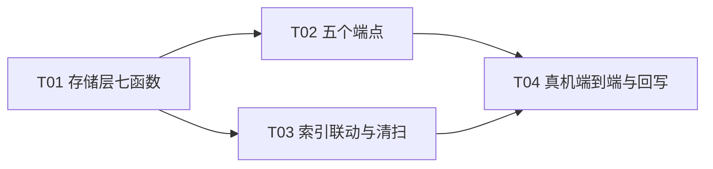

# 个人知识库 · M4-03 软删除 + 回收站设计（deleted_at + 五个端点 + 每日清扫）

| 项 | 内容 |
|---|---|
| 版本 | v1.0 |
| 日期 | 2026-11-28 |
| 范围 | PRD M4-03「软删除 + 回收站，可恢复」（P0）；技术方案 §8.1 的 8 / 9 / 12 号端点；新增 2 个清理端点 |
| 前置 | `docs/tech/2026-11-26-技术方案.md` §6.2（`items.deleted_at`）、§8.1（端点表）、§8.2（详情契约）；`docs/tech/2026-11-28-R6检索设计.md` §3.7 / §7.1（索引陈旧与幽灵卡片）；`docs/tech/2026-11-28-R8媒体下载设计.md` §6.4（物理删除只能一条 `delete from items`） |
| 图文件 | 类图 `docs/tech/2026-11-28-M4-03软删除-类图.mermaid`；时序图 `docs/tech/2026-11-28-M4-03软删除-时序图.mermaid` |
| 明确不做 | 回收站界面（归 E-34 设置页或前端阶段）、批量多选删除（M5-07）、撤销 toast、磁盘孤儿文件回收（R9）、`PATCH /api/items/{id}` 的完整编辑（M5-07） |

---

## 0. 结论先行

| # | 问题 | 结论 |
|---|---|---|
| 1 | 「删除」的语义分层 | **用户点删除 = 软删（进回收站），不物理删。** 物理删只作为两个显式动作（回收站里单条「彻底删除」、清空回收站）与一个自动动作（30 天到期清扫）。依据三条：PRD §7 第 2 条原文已定「30 天后才物理清除」；误删代价高（那是存了很久的东西，而 URL 抓不回来）；平板磁盘 161 GB 可用，空间不是约束——5000 条内容各存一张 200 KB 封面是 1 GB，即最坏口径（每条 20 张、每张 200 KB）也只有 20 GB |
| 2 | 保留期与自动清理 | **30 天，由 worker 内的一个每日节拍线程执行**（`kb/worker/purge.py`），不引入 APScheduler。三条护栏：① 只删 `deleted_at < now() - 30 天` 的行，口径用 DB 的 `now()` 算；② 跳过有 `running` 任务的条目；③ 每次删完写一行日志（条数 + 被删 id 的前 10 个），并顺手清掉这些 id 的索引文档 |
| 2b | 软删后同 URL 可以重存，要不要特殊处理 | **不特殊处理。** `items_url_norm_uniq` 的谓词是 `where url_norm is not null and deleted_at is null`，软删那一刻就释放占用——这是 0001 迁移里已经写好的行为，改它要动一条不可逆的部分唯一索引。用户重存同一链接的意图就是「我确实还要这个」，拒绝会让他困惑。代价由「回收站列表标出 `conflictsWithActive`」兜住：冲突在列表页就可见，不用点恢复才知道 |
| 3 | 恢复时的冲突 | **拒绝恢复，返回 409 + 冲突条目 id。** 「合并」会静默丢掉一条内容（两条的标签、摘要、正文可能都不同，谁覆盖谁都是数据丢失）；「强行恢复」在本轮 schema 下**做不到**——`deleted_at` 置空会立刻撞 `items_url_norm_uniq` 抛 `23505`，要允许两条同 URL 就必须放弃 URL 去重（M1-01 的重复提交语义随之作废）。409 让用户看到「库里已有一条同链接」并拿到 id，前端可以引导「打开新的那条」或「先删掉新的再恢复」，是唯一不丢数据的选择 |
| 4 | 软删后检索会不会出幽灵卡片 | **不会。** `/api/search` 在 `items.summaries_by_ids` 查不到命中 id 时 `continue` 跳过（`kb/api/search.py:361`），兜底 SQL 也带 `i.deleted_at is null`。**但有真实代价**：Meili 的 `estimatedTotalHits` 把已删条目算进去，用户会看到「共 42 条」而翻到第 3 页就空了，单页条数也会少于 `limit`。处置：软删时入队 `index`，`run_index` 见到 `index_source_row` 返回 `None` 就 `delete_ids([item_id])`——**不靠 rebuild，不新增依赖，复用已实现的三类失败分级** |
| 5 | 本轮交付什么 | **后端能力 + 5 个端点 + 1 个每日清扫线程 + 2 个索引联动点。** 不交付界面、不交付批量、不交付撤销。端点：`DELETE /api/items/{id}`（软删）、`POST /api/items/{id}/restore`（恢复）、`GET /api/trash`（列表）、`DELETE /api/items/{id}/purge`（彻底删一条）、`DELETE /api/trash`（清空） |

### 0.1 术语表（首次出现处的人话解释）

| 术语 | 一句话解释 |
|---|---|
| 软删除 | 不真删数据，只在一行上盖一个「已删除」的时间戳（`deleted_at`）。查东西时带一句「没盖戳的才算」，于是它在界面上消失了，但字节还在库里 |
| 回收站 | 盖了时间戳那些行的列表。恢复 = 把时间戳抹掉；清空 = 真把行删掉 |
| 物理删除 | `delete from items`，行从表里消失。之后只能靠备份找回 |
| `deleted_at` | `items` 表上已有的那列，`timestamptz`，为空表示这条内容还活着。本轮之前**全项目没有任何一行代码写它** |
| 部分唯一索引 | 只在「满足某个条件的行」上生效的唯一约束。本项目的 `items_url_norm_uniq` 只在 `deleted_at is null` 的行上保证 URL 不重复 |
| 级联删除（cascade） | 父行删掉时子行自动跟着删。`attachments` / `item_tags` / `jobs` 三张表都用 `on delete cascade` 指向 `items`，所以物理删条目只要一条 `delete from items` |
| 幂等 | 同一个操作做一次和做十次，结果一样。重复点「删除」不会报错，也不会让保留期重新计时 |
| 游标分页 | 翻页时不用「第几页」（offset），而用「上一页最后一条的排序键」。新内容插入时不会导致漏条与重条 |
| 23505 | PostgreSQL 的「唯一约束冲突」错误码。恢复时同 URL 已有活条目，就会撞它 |
| 幽灵卡片 | 搜索结果里出现一条、点进去 404。成因是索引里的那条内容在库里已经没了 |

---

## 1. 实现方案与框架选型

### 1.1 三个技术难点与对策

| 难点 | 现象 | 对策 |
|---|---|---|
| 重复删除会把保留期无限续期 | 用户连点两次删除，`deleted_at` 被写成 `now()`，30 天永远不到，回收站里堆着永不清理的东西 | `update items set deleted_at = now() where id = :i **and deleted_at is null**`。第一次写入之后，后续删除命中 0 行，时间戳不变（§3.3） |
| 恢复撞唯一索引 | `deleted_at` 置空的瞬间与一条活条目同 `url_norm` → `23505`，端点 500 | 两层：写语句里带 `not exists (活条目同 url_norm)` 守卫；外层再捕 `23505` 转 409（单条语句的快照挡不住并发插入，两层都要） |
| 索引里的条目删不掉 | 软删后 Meili 里那条还在，`estimatedTotal` 高估、单页变少 | `run_index` 在 `index_source_row` 返回 `None` 时改为 `indexer.delete_ids([item_id])`，不再「标 done 什么都不做」（§3.9） |

架构模式：与项目既有做法一致——**分层 + 注入装配件**。全部 SQL 在 `kb/store/items.py`（唯一允许写库的层），HTTP 解析与序列化在新建的 `kb/api/trash.py`，定时清扫在 `kb/worker/purge.py`（只有它能同时拿到 `Pool` 与 `Indexer`）。

### 1.2 为什么回收站的东西放进 `kb/store/items.py` 而不新建 `kb/store/trash.py`

`kb/store/` 现在的文件划分是按**表**（`items` / `tags` / `jobs` / `attachments` / `search` / `usage` / `settings` / `domain_rules` / `accounts`）。回收站不是一张新表，它是 `items` 的一个状态（`deleted_at` 非空）。两个方案对比：

| 方案 | 收益 | 代价 | 判定 |
|---|---|---|---|
| 放 `kb/store/items.py` | 「谁能写 `items` 行」这个问题只需读一个文件。落地后 `grep -rn "delete from items" kb/store/` 命中 1 处（`items.py` 的 `purge_*`），`update items set deleted_at` 也命中 1 处——两条最危险的语句都能一 grep 定位 | 文件从 771 行长到约 1020 行 | **采用** |
| 新建 `kb/store/trash.py` | 文件短 | `items` 表的写路径被切成两处。将来有人问「删条目会不会忘记级联」要翻两个文件；而「同一张表的读写集中一处」是本项目 `items.py` 从第一版就守的边界 | 淘汰：切分换来的是文件短，失去的是可 grep 的单一写入口 |

`kb/api/` 相反，回收站单独一个 `trash.py`：那里已经有 `items.py`（336 行 / 4 条路由：存+列表、详情、改类型），再塞 5 个端点会变成「一个 handler 文件管两件事」。API 层按**资源**分文件，store 层按**表**分文件——两层各自的切分口径不同，这是刻意的。

### 1.3 为什么不用 APScheduler 做每日清扫

| 方案 | 代价 | 判定 |
|---|---|---|
| worker 内一个节拍线程（`kb/worker/purge.py`） | 约 40 行代码，零新增依赖；缺点是「固定间隔」表达不了 cron 表达式 | **采用** |
| `agronholm/apscheduler` | 新增一个依赖 + 一个 jobstore 的配置面。它的价值是「多条 cron 表达式 + 错过补偿」，而这里只有一条「每小时看一眼」 | 淘汰：本轮没有第二/第三条调度项。技术方案 §6.5 的 22:30 备份（M9-06）才是它的使用场景，那时一并引入，不拆两次 |
| `citusdata/pg_cron` | 要装 PG 扩展，而 `postgresql.conf` 的 `shared_preload_libraries` 在平板 proot 里改一次要重启并重新验证 G0' 全套 | 淘汰：运行环境代价远大于收益 |
| `python -m kb.worker.purge` 手工跑 | 零代码 | 淘汰：`AGENTS.md` 的立场是「能机器执行的不靠自觉」。R1、R2 共 50 个提交积压未推送就是这一类的教训 |

清扫的触发时机：**worker 启动后立刻跑一次，之后每 3600 秒一次**。启动时先跑一次的理由：worker 停机多天再起来，若只靠节拍，要等一小时才开始清理，而那一刻的日志会让排障者以为清扫没生效。

### 1.4 保留期常量放哪

`TRASH_RETENTION_DAYS = 30` 定义在 `kb/store/items.py`，`kb/worker/purge.py` 从那里 import。只有一处字面量。

不做成 `settings` 表里的可配置项：30 天是 PRD §7 第 2 条写死的产品决定，不是运维参数。放进 `settings` 会让「改了没生效」（worker 已读到旧值、api 读到新值）成为一类新的不一致，而收益是「用户可以改保留期」——本轮没有界面，改了也只能改库。

---

## 2. 文件清单

**本轮可改**（新增 10 个：7 个 `.py` + 本文档 + 2 个图；修改 7 个）

**Create**

| 文件 | 作用 |
|---|---|
| `kb/api/trash.py` | 5 个 handler 工厂：软删 / 恢复 / 列表 / 彻底删一条 / 清空。全部 camelCase 序列化，与 `/api/items` 逐字一致 |
| `kb/worker/purge.py` | `purge_once(pool, indexer, ...)` + `_purge_loop(...)`。30 天清扫的唯一实现处 |
| `tests/test_store_trash_pg.py` | store 层 7 个函数在真库的行为（`pg` 标记）：重复删不续期、恢复冲突语义、`daysLeft` 三档、游标翻页不重不漏、清扫只删过期行 |
| `tests/test_api_trash.py` | 5 个端点的契约（假 pool，不连库）：状态码、字段名、401、幂等、冲突时的 `conflictItemId` |
| `tests/test_worker_purge.py` | 清扫的纯逻辑：只删过期、跳过 running、索引删除用同一批 id、Meili 挂时不阻塞清扫 |
| `tests/test_trash_e2e_pg.py` | 真机端到端（`pg` + `external` 双标记）：删 → 回收站 → 恢复 → 搜得到；冲突重存；31 天后清扫级联删子行 |
| `scripts/probe_trash.py` | 平板内手工探测脚本，与 `scripts/probe_search.py` 同构：逐条打印 `PASS/FAIL`，把「真机能不能删/恢复/搜到」变成可复跑的清单 |
| `docs/tech/2026-11-28-M4-03软删除设计.md` | 本文档 |
| `docs/tech/2026-11-28-M4-03软删除-类图.mermaid` | 类图 |
| `docs/tech/2026-11-28-M4-03软删除-时序图.mermaid` | 时序图（三图：软删 / 恢复 / 清扫） |

**Modify**

| 文件 | 改动 |
|---|---|
| `kb/store/items.py` | 新增 `TRASH_RETENTION_DAYS`、2 个枚举 / 3 个 dataclass、7 个函数（§3.1 / §3.2）。**既有 6 处 `deleted_at is null` 一行不改** |
| `kb/api/app.py` | 新增 5 行 `Route`（`GET /api/trash`、`DELETE /api/trash`、`DELETE /api/items/{id}`、`POST /api/items/{id}/restore`、`DELETE /api/items/{id}/purge`），写法与顺序见 §3.7。全部**不加进 `PUBLIC_PATHS`** |
| `kb/worker/steps.py` | `run_index`：`doc is None` 分支从「标 done 什么都不写」改为「`indexer.delete_ids([item_id])` 后标 done」（§3.9） |
| `kb/worker/__main__.py` | 装配清扫线程（启动先跑一次，之后每 3600 秒），与 `_heartbeat_loop` 同构 |
| `tests/test_worker_index_step.py` | 追加三条：`doc is None` 时调 `delete_ids([item_id])`；`mark_done` 仍被调；删除时 Meili 挂走 `defer` 而不是 `mark_failed` |
| `tests/test_store_pg.py` | 追加一条回归守卫：软删一条后 `list_items` / `get_item` / `summaries_by_ids` 都查不到它（§5 的三个陷阱） |
| `docs/tech/2026-11-26-技术方案.md` | §8.1 端点表补两行（清理端点），§8.2 补软删与恢复的契约 |

## 1.1 两个端点已获批新增（原表只有 3 个）

技术方案 §8.1 原本只定义 3 个端点：`DELETE /api/items/{id}`（8 号软删）、
`POST /api/items/{id}/restore`（9 号恢复）、`GET /api/trash`（12 号列表）。
**没有「彻底删除单条」与「清空回收站」。**

主理人核实后批准新增这两个，理由不是「顺便做」而是**前置依赖**：

> 没有单条彻底删除时，「清空」是唯一的永久删除按钮，而它会连带删掉
> 用户想留的条目（回收站里有一条标题尴尬的、几条想留的，只有全清可选）。
> 这不是范围膨胀，是让「清空」能安全存在的前提。

若将来判定不要这两个端点，删掉 §3.6 的 ④⑤ 与 T02 的四条判据即可——
30 天自动清扫**不依赖**它们。

## 1.2 Meili 删不存在的 id 已实测（原待明确项关闭）

原设计把这个列为 ⚠️ 待验证（本机无 Meili），因为它决定 T03 那 4 行代码的形态。
**主理人已用平板真机验证：**

```
POST /indexes/kb_items/documents/delete-batch  -d '[999999999]'
→ {"taskUid":222,"status":"enqueued"}

GET /tasks/222
→ {"status":"succeeded",
   "details":{"providedIds":1,"deletedDocuments":0},
   "error":null}
```

**结论：返回 `succeeded` 不是 `failed`。** 所以 `delete_ids` 前**不需要**
加 `index_document_ids` 存在性检查——那 4 行可以省掉，直接调即可。
`deletedDocuments: 0` 说明它静默跳过不存在的 id，不报错。

<!-- 本轮只读（需要参考但不许改） -->

- `kb/api/items.py` 的既有 handler（`_error` / `_json_item` 不复用，理由见 §3.8）
- `kb/search/indexer.py`（`delete_ids` 已实现且有测试，不改一行）
- `kb/worker/rebuild.py`（对账兜底，不改）

**本轮禁止碰**

- `kb/extract/`、`kb/media/`、`kb/vision/`、`kb/asr/`、`kb/ai/`
- `kb/store/migrations/*.sql`（本轮**无 schema 变更**：无新表、无新列、无新索引，理由见 §7.1）
- `任务总表-2026-11-28.csv`（由 team-lead 记账）

---

## 3. 数据结构与接口

### 3.1 store 层的三个结果类型（`kb/store/items.py`）

```python
TRASH_RETENTION_DAYS: int = 30

class DeleteStatus(str, Enum):
    DELETED = "deleted"                  # 这次真的盖了戳
    ALREADY_DELETED = "already_deleted"  # 之前就删了，这次什么都没改
    NOT_FOUND = "not_found"              # 没有这条

class RestoreStatus(str, Enum):
    RESTORED = "restored"                # 这次真的恢复了
    ALREADY_ACTIVE = "already_active"    # 本来就没删，无需恢复
    CONFLICT = "conflict"                # 库里已有同 url_norm 的活条目
    NOT_FOUND = "not_found"

@dataclass(frozen=True)
class DeleteResult:
    status: DeleteStatus
    item_id: int
    deleted_at: datetime | None      # ALREADY_DELETED 时是**原来那次**的时刻
    purge_at: datetime | None        # deleted_at + 30 天，给界面说「还有几天」

@dataclass(frozen=True)
class RestoreResult:
    status: RestoreStatus
    item_id: int
    conflict_item_id: int | None     # CONFLICT 时非空

@dataclass(frozen=True)
class TrashEntry:
    id: int
    kind: str
    url: str | None
    title: str
    source_domain: str
    saved_at: datetime
    deleted_at: datetime
    purge_at: datetime
    days_left: int                   # 向上取整，0 表示今天就到期
    read_status: str                 # items.status
    summary: str | None
    conflicts_with_active: bool      # 库里已有一条同 URL 的活条目
```

**为什么用枚举 + 冻结 dataclass，而不是「抛异常」**：三个路径（删成功 / 早删过 / 没有这条）都是**正常业务结果**，不是异常。异常只承载「不该发生」。与 `items.set_kind` 返回 `bool` 同一个口径（那里只有两态，这里三态以上，所以收起成一个枚举而不是 `bool | None`）。

### 3.2 七个函数签名

```python
def soft_delete(conn, item_id: int) -> DeleteResult: ...
def restore_item(conn, item_id: int) -> RestoreResult: ...
def list_trash(conn, *, limit: int, before_deleted_at: datetime | None,
               before_id: int | None) -> list[TrashEntry]: ...
def count_trash(conn) -> int: ...
def purge_item(conn, item_id: int) -> bool: ...
def purge_all(conn) -> list[int]: ...
def purge_expired(conn, *, older_than_days: int, limit: int) -> list[int]: ...
```

`purge_item` / `purge_all` / `purge_expired` 返回 **被删掉的 id 列表**，不是条数：`kb/worker/purge.py` 要用这批 id 去删索引文档。返回条数就得再查一次「刚删了谁」，而那时行已经不存在了。

### 3.3 `soft_delete` 的两条硬细节

```sql
with upd as (
  update items
     set deleted_at = now()
   where id = :i and deleted_at is null
  returning id, deleted_at
), queued as (
  insert into jobs (item_id, step)
  select id, 'index' from upd
  on conflict (item_id, step) where state in ('pending','running') do nothing
  returning item_id
)
select id, deleted_at from upd
```

**① `and deleted_at is null` 不能省。** 没有它，用户连点两次删除（或前端重发一次请求）就把 `deleted_at` 写成新的 `now()`，保留期重新计时。现象是「回收站里有一条三个月前删的东西一直不清」——而它为什么不清，从任何日志里都看不出来。有了它，第二次命中 0 行，返回 `ALREADY_DELETED` 并透出**原来那个**时间戳。

**② 入队 `index` 与盖戳在同一条 CTE 里。** 与 `create_item` 同一手法：单条语句天然原子，不会出现「条目删了、索引没清」的半截状态。分开两条语句时，若第二条失败，那条内容在界面上已经消失、在搜索里还在，且没有任何机制会补。

**③ 这里不需要 `attachments.py` 那个「求值依赖锚点」，也不许照抄它。** `kb/store/attachments.py` 的 `_REPLACE_SQL` 里有一行 `where (select count(*) from gone) >= 0`，作用是让 `ins` 引用 `gone`，逼 PG 先执行 DELETE（`gone` 与 `ins` 是**兄弟** data-modifying CTE，谁先跑由计划器定）。本节的 `upd` 与 `queued` **不是兄弟**：`queued` 的 `select id, 'index' from upd` 显式读了 `upd`，依赖关系已经建立，顺序天然正确。多加一行「恒真条件」不会让它更安全，只会让下一个读者以为这里有 bug。

`queued` 未被外层 `select` 引用仍是安全的：data-modifying CTE **恒被执行恰好一次**，被不被外层读不影响它执行（PG 文档 §7.8.2）。与 `create_item` 的 `_CREATE_SQL` 是同一个结构，那里已经在真库上跑通了。

`step='index'` 而不是新步骤：`jobs.step` 的 CHECK 只允许五个值，加第六个要一次迁移；而「把索引里某条删掉」与「把某条写进索引」是同一个步骤的两面（都是「让索引与库对齐」），交给 `run_index` 按 `index_source_row` 的返回分派最省（§3.9）。

### 3.4 `restore_item` 的判定顺序

```
1. select deleted_at from items where id = :i
   ├─ 无行           → NOT_FOUND
   ├─ deleted_at 为空 → ALREADY_ACTIVE（幂等：它已经可用）
   └─ 非空 → 继续
2. select id from items
    where url_norm = (select url_norm from items where id = :i)
      and url_norm is not null and deleted_at is null and id <> :i
   ├─ 有行 → CONFLICT（带上那个 id）
   └─ 无行 → 继续
3. 执行恢复 CTE（见下）；捕 23505 → CONFLICT（conflict_item_id=None）
```

第 3 步的 CTE：

```sql
with upd as (
  update items t
     set deleted_at = null
   where t.id = :i
     and t.deleted_at is not null
     and not exists (
       select 1 from items o
        where o.url_norm = t.url_norm and o.url_norm is not null
          and o.deleted_at is null and o.id <> t.id)
  returning t.id
), queued as (
  insert into jobs (item_id, step)
  select id, 'index' from upd
  on conflict (item_id, step) where state in ('pending','running') do nothing
  returning item_id
)
select id from upd
```

**为什么第 2 步查过一次，第 3 步还带 `not exists`**：第 2 步是给用户看的原因（要那个冲突 id），第 3 步是给数据库看的守卫。两者之间的空隙里若有人存了同一个 URL（第二次点击、另一个标签页），只靠第 2 步就会 500。

**为什么还要捕 `23505`**：单条语句的快照挡不住「守卫求值时那行还不存在、写入时已经提交」的并发。捕到就转 `CONFLICT`，`conflict_item_id` 给 `None`（这一瞬间查不到是谁，而为了填这个字段多开一次连接不值得）。pg8000 的形态：抛 `pg8000.exceptions.DatabaseError`，`exc.args[0]` 是 `dict`，唯一冲突时 `exc.args[0]["C"] == "23505"`（`pg8000/core.py` 的 `handle_ERROR_RESPONSE` 把整个 ErrorResponse 装进 `args[0]`）。**只能靠 `args[0]["C"]` 判**，不能靠异常类名——pg8000 把所有服务端错误都抛成同一个 `DatabaseError`。

**恢复也要入队 `index`。** 软删时那条文档被 `run_index` 从 Meili 删掉了（§3.9），不重新写回就等于「恢复了但搜不到」——数据对、搜索结果错、不报错，正是检索设计 §7.1 第 1 行记的那类故障。

### 3.5 回收站列表的 SQL 与游标

```sql
select i.id, i.kind, i.url, i.title, i.source_domain, i.saved_at,
       i.status, i.summary, i.deleted_at,
       i.deleted_at + make_interval(days => cast(:days as int)) as purge_at,
       greatest(0, ceil(extract(epoch from
         (i.deleted_at + make_interval(days => cast(:days as int)) - now()))
         / 86400))::int as days_left,
       (i.url_norm is not null and exists (
          select 1 from items o
           where o.url_norm = i.url_norm and o.deleted_at is null and o.id <> i.id
        )) as conflicts
  from items i
 where i.deleted_at is not null
 order by i.deleted_at desc, i.id desc
 limit :limit
```

带游标时在 `where` 尾部追加
`and (i.deleted_at, i.id) < (cast(:before_ts as timestamptz), cast(:before_id as bigint))`
（两处 `cast` 都不能省，理由同下一张表的最后一行）。

四条要点：

| 决定 | 理由 |
|---|---|
| 排序 `deleted_at desc, id desc` | 回收站的第一诉求是「撤销我刚才那次删除」，所以按删除时间倒序。按 `id desc` 会把「刚删掉的一条三个月前存的内容」压到列表底部，而它恰恰是用户要找的那条 |
| 游标 = `(deleted_at, id)` 复合键，而不是 `id` | 排序主键不是 id，用 id 当游标会漏条。`where (i.deleted_at, i.id) < (cast(:before_ts as timestamptz), :before_id)` |
| 不用 `offset` | 翻页期间有人新删一条，offset 的含义整体漂移——用户会看到同一条出现两次、另一条永远看不到 |
| 判空**不写进 SQL** | `:before is null` 会让 pg8000 把参数当 `unknown` 类型发过去，PG 推断不出类型并报 `could not determine data type of parameter`。`items.list_items` 的 docstring 已记录这条踩过的坑，这里照抄它的做法：按有无游标拼两段 SQL |

`days_left` 在 SQL 里算而不是在 Python 算：分子是 `purge_at - now()`，那个 `now()` 必须来自数据库（`kb/worker/loop.py::_db_now` 记录了容器时区 UTC 与 PG 时区 PRC 相差 8 小时的实测），在 Python 里用 `datetime.now()` 会让「还有 0 天」与「还有 1 天」在每天 00:00–08:00 之间判错。

### 3.6 五个端点的契约

全部要求登录（**不加进 `PUBLIC_PATHS`**：回收站里有已删内容的标题，未登录不该看到）。全部与 `/api/items` 一样用 camelCase。

| # | 方法 | 路径 | 作用 | 成功 | 失败 |
|---|---|---|---|---|---|
| 1 | DELETE | `/api/items/{id}` | 软删 | 200 | 404 没有这条 |
| 2 | POST | `/api/items/{id}/restore` | 恢复 | 200 | 404 没有这条；409 冲突 |
| 3 | GET | `/api/trash` | 回收站列表 | 200 | — |
| 4 | DELETE | `/api/items/{id}/purge` | 彻底删一条 | 200 | 404 回收站里没有这条 |
| 5 | DELETE | `/api/trash` | 清空回收站 | 200 | — |

**① `DELETE /api/items/{id}`**

```json
// 200，第一次删
{"id": 12, "deletedAt": "2026-11-28T15:20:31+08:00",
 "purgeAt": "2026-12-28T15:20:31+08:00"}
// 200，之前就删了（重复点）
{"id": 12, "deletedAt": "2026-11-01T09:00:00+08:00",
 "purgeAt": "2026-12-01T09:00:00+08:00", "alreadyDeleted": true}
// 404
{"error": "没有这条"}
```

`alreadyDeleted: true` 只在重复删时出现（与 `POST /api/items` 的 `duplicate: true` 同一手法：正常路径不带这个键，前端判 `undefined`）。**`deletedAt` 在重复删时是原来那次的值**，不是这次的时间——这与 §3.3 的「不续期」是同一件事的两个可见面。

**② `POST /api/items/{id}/restore`**

```json
// 200 恢复成功
{"id": 12, "deletedAt": null, "restored": true}
// 200 本来就没删（幂等）
{"id": 12, "deletedAt": null, "alreadyActive": true}
// 409 冲突
{"error": "库里已有一条同链接的内容（id=31），先删掉它再恢复这条",
 "conflictItemId": 31}
// 404
{"error": "没有这条"}
```

409 的文案必须带**下一步该做什么**（`AGENTS.md` 的文案口径），并且把冲突条目的 id 单列成字段——前端要能直接链到 `/api/items/31`，从错误字符串里正则抠 id 是不可接受的。

**③ `GET /api/trash`**

参数：`limit`（默认 30，1–100，超范围夹边界；非整数 400）、`beforeDeletedAt`（ISO 8601 字符串）、`before`（整数 id）。后两个要么都给要么都不给，只给一个 → 400。

```json
{"items": [{"id": 12, "kind": "link", "url": "https://v.douyin.com/x/",
            "title": "…", "sourceDomain": "v.douyin.com",
            "savedAt": "2026-11-20T10:00:00+08:00",
            "deletedAt": "2026-11-28T15:20:31+08:00",
            "purgeAt": "2026-12-28T15:20:31+08:00",
            "daysLeft": 30, "readStatus": "unread", "summary": null,
            "conflictsWithActive": false}],
 "total": 3,
 "nextBefore": {"deletedAt": "2026-11-28T15:20:31+08:00", "id": 12}}
```

`nextBefore` = 本次条数等于 `limit` 时最后一条的 `(deletedAt, id)`，否则 `null`——与 `/api/items` 的 `nextBefore` 同一个语义（没有下一页给 `null`），只是键从标量变成复合。返回标量 `id` 会让调用方自己去查 `deleted_at`，多一次往返且可能查不到（那条被清空了）。

`total` 是回收站总数（`count_trash`），不是本页条数：前端要显示「回收站 3 条」，而本页可能只有 1 条。

**④ `DELETE /api/items/{id}/purge`** → `{"id": 12, "purged": true}`
**⑤ `DELETE /api/trash`** → `{"purged": 3}`

**这两个端点在技术方案 §8.1 之外，是本轮新增。** 理由：`清空` 若只能「一次全清」，用户看到回收站里有一条不想留的（标题尴尬、或含敏感内容）时，唯一的操作是把另外 29 条想留的一起永久删掉。单条彻底删除不是范围膨胀，它是让「清空」这个按钮可以安全存在的前提。已列入 §9 待明确，需 team-lead 决定并回写 §8.1。

### 3.7 路由怎么注册（`kb/api/app.py`）

**5 个端点、4 条不同路径、5 行 `Route`**（`/api/trash` 有 GET 与 DELETE 两条）。顺序与写法都不是随意的：

```python
Route("/api/trash", trash_api.list_trash(pool), methods=["GET"]),
Route("/api/trash", trash_api.purge_all(pool), methods=["DELETE"]),
Route("/api/items/{item_id:int}", trash_api.soft_delete(pool), methods=["DELETE"]),
Route("/api/items/{item_id:int}/restore", trash_api.restore(pool), methods=["POST"]),
Route("/api/items/{item_id:int}/purge", trash_api.purge_one(pool), methods=["DELETE"]),
```

| 决定 | 理由 |
|---|---|
| 同一路径的 GET 与 DELETE 各写一条 `Route`，不写成 `methods=["GET","DELETE"]` | 与 `app.py` 现有 `PATCH` 那条同一个理由（注释原话：「让 GET 与 PATCH 的行为差异藏在一个 handler 的两个分支里」）。`list_trash` 与 `purge_all` 是两个完全不同的动作，塞进一个 handler 会让「一次误发的 DELETE 走了读分支」这种事故无法从代码结构上看出来 |
| `/api/items/{item_id:int}` 与既有的 `detail` / `edit` 三条 `Route` 并存 | Starlette 的 `{item_id:int}` 正则只匹配 `[0-9]+`，`/api/items/12/restore` 不会被它吃掉。三条同路径不同方法的 `Route` 由 Starlette 自己合成 405（`routing.py` 的 `Match.PARTIAL` 分支）——`GET /api/items/12` 命中 `detail`，`PATCH` 命中 `edit`，`DELETE` 命中本轮这条，其余方法 405 |
| `/restore` 与 `/purge` 用 `POST` / `DELETE` 而不是都 `POST` | `restore` 是「让这条不再是删状态」，`purge` 是「让它彻底消失」。HTTP 语义上后者是删除资源本身，与 `DELETE /api/items/{id}`（软删）只差一个「是否可逆」。⚠️ 两条都是不可逆操作，别指望前端靠方法名区分——`purge` 的路径里带 `purge` 字样 |
| 五条都不进 `PUBLIC_PATHS` | 见 §9 |

### 3.8 为什么不复用 `kb/api/items.py` 的 `_error` / `_json_item`

- `_json_item(item: ItemSummary)` 的字段集是「活条目」的十个键（含 `status` 处理状态、不含 `deletedAt`）。回收站要 `deletedAt` / `purgeAt` / `daysLeft` / `conflictsWithActive` 四个它没有的键，且不要 `status`（处理状态对已删条目没有意义）。硬复用得给它加四个 `None` 默认参数——那时它就不再是「一个 `ItemSummary` 的序列化」了。
- `_error(message, status)` 只有两个字段，409 分支要带 `conflictItemId`。在 `trash.py` 里写一个 `_error(message, status=400, **extra)`（10 行），比给 items.py 的那个加 `**kwargs` 好——后者会让「谁在往错误响应里塞字段」变成全库搜索。

### 3.9 `run_index` 的改动（`kb/worker/steps.py`）

改动只有一处：把 `doc is None` 从「标 done 什么都不写」改成「先从索引删掉，再标 done」，并把它移进那个 `try`（复用三类失败分级）。

```python
    try:
        if doc is None:
            indexer.delete_ids([item_id])
            jobs_store.mark_done(conn, job_id)
            log.info("条目不存在或已删，已从索引移除 item=%s job=%s", item_id, job_id)
            return
        indexer.upsert([doc])
    except MeiliUnauthorized as exc:
        ...   # 原样保留：defer 600 秒 + 提示检查 KB_MEILI_KEY
    except MeiliUnavailable as exc:
        ...   # 原样保留：defer 60 秒
    except MeiliRejected as exc:
        ...   # 原样保留：mark_failed（请求写错属编程错误）
    jobs_store.mark_done(conn, job_id)
```

三条必须写清：

1. **`delete_ids` 不等任务**（`Indexer.delete_ids` 只发请求拿 `taskUid`），与 `upsert` 同一口径。代价是「标 done 后 1–2 秒索引才真的删掉」，对单人使用无影响。
2. **对不存在的 id 调删除是安全空操作**：Meili 对「删一批里有一半不存在」返回成功任务，不报错。⚠️ 这一条**未在真机验证**（本机没有 Meili 服务）。若实际会 400，`MeiliRejected` 分支会让 `mark_failed`——后果是「彻底删过的那条留在索引里」并触发三次重试。验证方法：`curl -X POST '127.0.0.1:7700/indexes/kb_items/documents/delete-batch' -H "Authorization: Bearer $KB_MEILI_KEY" -H 'Content-Type: application/json' -d '[999999999]'` 后 `curl '127.0.0.1:7700/tasks?indexUids=kb_items&limit=1'` 看 `status` 是否为 `succeeded`。是则本条成立；若为 `failed`，在 `run_index` 的 `delete_ids` 前后加「先 `index_document_ids` 判存在」（多一次往返，仅在验证不成立时才加）。
3. **失败分级原样适用**：Meili 挂时 `MeiliUnavailable` → `defer 60 秒`，任务留在队列里下次再删；401 时 `defer 600 秒`。**不用 `mark_failed`**——「索引服务挂了」不是这条内容的错，三次判死之后回收站里的内容会永远留在索引里。

---

## 4. 程序调用流程

### 4.1 删除 → 索引清理

完整时序见 `docs/tech/2026-11-28-M4-03软删除-时序图.mermaid` 图一。主干：

1. `DELETE /api/items/12` → 中间件校验会话 → `trash.py::_soft_delete`
2. `items_store.soft_delete(conn, 12)`：
   - `update items set deleted_at = now() where id=12 and deleted_at is null` → 1 行
   - 同一 CTE 内 `insert into jobs (item_id, step) values (12, 'index') on conflict do nothing`
   - 返回 `DeleteResult(DELETED, 12, deleted_at, purge_at)`
3. 端点返回 200 `{id, deletedAt, purgeAt}`
4. worker 主循环（最长 2 秒后）`jobs.claim_one` 领到 `(12, 'index')`
5. `steps.run_index`：`blocking_upstream` → 若 `fetch`/`summarize`/`tag` 有 running 的，`defer 30 秒`（下一轮再来）
6. `search_store.index_source_row(conn, 12)` → `None`（`where i.deleted_at is null` 不命中）
7. `indexer.delete_ids([12])` → Meili 接任务
8. `jobs.mark_done`

**第 4 步为什么要等 worker**：删除是用户在界面上的动作，索引清理是后台对账。让删除端点同步打 Meili 会把「删掉一条内容」的成功率绑到「Meili 此刻活着」——Meili 挂的时候用户连删都删不了，而他真正想做的事（这条内容别出现在列表里）其实只需要一条 update。代价是最多 2 秒的窗口里搜索结果仍计入这条（`estimatedTotal` 差 1）。

### 4.2 「索引里那条还在」的三种收尾路径

| 路径 | 谁执行 | 覆盖情形 |
|---|---|---|
| `run_index` 的 `delete_ids` | worker，软删后 0–2 秒 | 软删（正常路径，覆盖 99%） |
| `purge_expired` 后顺手 `delete_ids(ids)` | worker，每日清扫 | 软删时索引删除永久失败（`mark_failed` 三次）的残留。清理那一刻 worker 手里有 `Indexer`，顺手做掉 |
| `python -m kb.worker.rebuild` 的差集 | 人，手工 | 前两者都失效时（Meili 数据目录损坏、换设备） |

**为什么物理删（`purge` / 清空）不自己删索引**：`jobs.item_id` 是 `on delete cascade`，条目行一没，它名下的 `index` job 跟着消失——让「删行」入队一个「清索引」的任务在结构上做不到。而这两条路径的输入只可能是**已经在回收站里的行**，它们的索引文档在软删那一刻就已经被第 1 条路径清掉了。所以不需要。若那条清索引的 job 曾永久失败，由第 2 或第 3 条路径兜。

### 4.3 恢复 → 索引重写

完整时序见 `docs/tech/2026-11-28-M4-03软删除-时序图.mermaid` 图二。主干：

1. `POST /api/items/12/restore` → `trash.py::_restore`
2. `items_store.restore_item(conn, 12)`：读 `deleted_at` → 无行 404 / 空 200 `alreadyActive` / 非空继续
3. 查冲突活条目 → 有则 409 + `conflictItemId`
4. 恢复 CTE（`not exists` 守卫 + 入队 `index`），捕 `23505` → 409
5. 200 `{id, deletedAt: null, restored: true}`
6. worker 领到 `(12, 'index')` → `index_source_row` 这次返回 `IndexDoc` → `indexer.upsert([doc])` → `mark_done`

### 4.4 每日清扫

```
worker 启动
  └─ purge.purge_once(pool, indexer, older_than_days=30, limit=200)
       循环：
         with pool.connection() as conn:
             ids = items.purge_expired(conn, older_than_days=30, limit=200)
         if not ids: break
         log.info("回收站自动清理 %d 条：id 前 10 个 %s", len(ids), ids[:10])
         if indexer is not None:
             try: indexer.delete_ids(ids)
             except MeiliDown: log.warning(...)   # 不重试，rebuild 兜底
         if len(ids) < limit: break
  └─ 每 3600 秒重复一次（_purge_loop 里的 stop.wait）
```

清扫 SQL：

```sql
with doomed as (
  select id from items
   where deleted_at is not null
     and deleted_at < now() - make_interval(days => cast(:days as int))
     and not exists (
       select 1 from jobs j where j.item_id = items.id and j.state = 'running')
   order by deleted_at, id
   limit :limit
)
delete from items where id in (select id from doomed) returning id
```

`order by deleted_at, id` 两个键：只按 `deleted_at` 排序时同一毫秒删的两条顺序不定，两次跑之间「先删谁」会变——而这条语句的唯一用途就是「按最老的先删」，顺序不定等于分批策略随机。`id` 做兜底键让结果确定。

`doomed` 是**纯 SELECT**（不是 data-modifying CTE）且被外层 `delete` 引用，所以它必然先求值——与 `kb/store/attachments.py` 里那种「两个 data-modifying CTE 互为兄弟、顺序不可预测」的情形不同，这里不需要「求值依赖锚点」那个技巧。

三条护栏各自的理由：

| 护栏 | 没有它会怎样 |
|---|---|
| `deleted_at < now() - 30 天` | 什么都不看就按 `deleted_at is not null` 删，会把用户昨天刚删的东西永久删掉 |
| `not exists (... state='running')` | 正在抓取的条目被删行，worker 拿着一个已不存在的 `item_id` 继续写——`update ... where id=:` 命中 0 行、`mark_done` 命中 0 行，全程不报错，而那条内容的 `fetch` 结果是空的 |
| `limit 200` + 循环 | 一次删几千行会把 worker 占住几十秒，心跳线程之外的整条队列停摆 |

`now() - make_interval(days => cast(:days as int))` 而不是在 Python 里算「30 天前的时刻」：容器时区 UTC、PG 时区 PRC，两侧算「30 天前」会差 8 小时（`_db_now` 的实测记录）。30 天口径差 8 小时不致命，但同一件事有两处算法就有第二处漂移的机会，而这次是「东西被多留/早删半天」这种没人会去核对的现象。

---

## 5. 与既有九处 `deleted_at is null` 的关系

`grep -c "deleted_at is null" kb/store/items.py` → **6**（2026-11-28 实测），逐处是：

| 行 | 位置 | 作用 |
|---|---|---|
| 183 | `create_item` 的 `on conflict (url_norm) where …` | 让唯一冲突仲裁索引对上那一条部分索引。**软删靠它释放 URL 占用** |
| 235 | `create_item` 重查已有条目 | 重复提交时返回活条目 |
| 264 | `_LIST_SQL` 的 `where` | 列表页不显示已删 |
| 273 | `_DETAIL_SQL` 的 `where` | 详情页回 404 |
| 323 / 324 | `list_items` 的 before 分支（`.replace` 的两个参数） | 游标翻页同样过滤 |

`summaries_by_ids` 没有自己的一份——它把 `_LIST_SQL` 掏空 `order by` / `limit` 之后套一层 `select * from (…) sub`，谓词跟着带过来。`kb/store/search.py` 另有 3 处（`index_source_row:142`、`index_source_page:165`、`fallback_search:257`）。

**本轮这 9 处一行都不改**，它们正是「软删之后界面与搜索里立刻消失」这件事的全部实现。

新增的查询方向相反：`deleted_at is not null`。这条反过来之后有三处容易写错：

| 陷阱 | 后果 | 本轮怎么防 |
|---|---|---|
| 回收站列表漏了 `is not null` | 列表返回全部内容，用户在「回收站」里看到自己没删的东西，点恢复得到 `alreadyActive` | `tests/test_store_trash_pg.py` 里建 2 活 1 删，断言 `len(list_trash(...)) == 1` |
| `count_trash` 漏了 `is not null` | 「回收站 500 条」而里面只有 3 条 | 同上用例断言 `count_trash(conn) == 1` |
| 恢复后忘了入队 `index` | 数据恢复、搜索里没有。不报错 | `test_restore后入队index`：断言 `jobs` 里有 `(id,'index')` 的 pending 行 |

---

## 6. 依赖包列表

| 包 | 状态 | 理由 |
|---|---|---|
| `pg8000>=1.31` | **已有，不动** | `23505` 的判定靠 `DatabaseError.args[0]["C"]`，1.31.6 的 `handle_ERROR_RESPONSE` 就是这个形态（本机读源码确认） |
| `starlette>=1.0` | **已有，不动** | 五条路由用 `Route(..., methods=[...])`，不需要新中间件 |
| `apscheduler` | **不引入** | 见 §1.3 |
| 任何「软删 ORM 辅助」 | **不引入** | 见 §复用调研第 1 行：那些是 ORM 插件，本项目没有 ORM 层 |

**零新增依赖。** 本轮的全部需求是「几条 SQL + 五个 handler + 一个 40 行的节拍线程」，`pg8000` 与 `starlette` 已覆盖。

`pyproject.toml` **不改**：`kb.api` 与 `kb.worker` 本来就没登记在 `packages` 里（检索设计 §11 第 8 条记的既有缺陷）。本轮往这两个目录加文件不改变这个状态——补齐它们属于独立任务，本轮顺手补会把一次改动混进两个主题。

---

## 7. 为什么不加迁移

### 7.1 不加 `create index on items (deleted_at)`

| 方案 | 收益 | 代价 | 判定 |
|---|---|---|---|
| 不加索引 | 零迁移 | 回收站列表与每日清扫走 Seq Scan | **采用** |
| 加部分索引 `(deleted_at) where deleted_at is not null` | 列表与清扫变索引扫 | 一次不可逆的 DDL + 一个迁移文件 + 平板重跑一遍迁移验证 | 淘汰（本轮） |

量化口径：`items` 现在的量级是**数百行**（平板实测库里有 6 条探测数据 + 用户自己存的几十条）。Seq Scan 在 5000 行以内是毫秒级（检索设计 §6.2 第 1 点已就同一个 `ILIKE` 全表扫给过这个口径）。而「加索引」的收益要在 5 万行以上才可测。

**触发条件（机器可验）**：`psql -c "select count(*) from items"` 超过 50000 时补这个索引。在那之前不加。

### 7.2 不加 `deleted_by` / `trash_reason` 等列

单用户（`AGENTS.md` §3 明确不做多用户权限体系），「谁删的」只有一个答案。加一列等于加一份永远填同一个值的数据。

---

## 8. 任务列表

| 任务 | 名称 | 源文件 | 依赖 | 优先级 |
|---|---|---|---|---|
| **T01** | 存储层：七个函数、三个结果类型、30 天常量 | `kb/store/items.py`、`tests/test_store_trash_pg.py`、`tests/test_store_pg.py` | — | P0 |
| **T02** | 五个端点与路由注册 | `kb/api/trash.py`、`kb/api/app.py`、`tests/test_api_trash.py` | T01 | P0 |
| **T03** | 索引联动与每日清扫 | `kb/worker/steps.py`、`kb/worker/__main__.py`、`kb/worker/purge.py`、`tests/test_worker_index_step.py`、`tests/test_worker_purge.py` | T01 | P0 |
| **T04** | 真机端到端与文档回写 | `scripts/probe_trash.py`、`tests/test_trash_e2e_pg.py`、`docs/tech/2026-11-26-技术方案.md` | T02、T03 | P0 |

**第一个任务不是「项目基础设施」**：本项目已有基础设施（`pyproject.toml`、连接池、路由框架、测试夹具），本轮是往既有骨架里加一个功能域，没有基础设施要建。T01 是「全部其它任务都要 import 的那一层」，等价于新建项目时的 T01。

### 每个任务的完成判据（全部可命令验证）

**T01 — 存储层**

| 判据 | 验证 |
|---|---|
| 七个函数存在且签名与 §3.2 逐字一致 | `python -c "import inspect,kb.store.items as m;print(sorted(n for n in dir(m) if n in {'soft_delete','restore_item','list_trash','count_trash','purge_item','purge_all','purge_expired'}))"` → 输出含全部七个名字 |
| 软删后 `deleted_at` 非空、列表里查不到 | `psql -c "select deleted_at from items where id=1"` 非空；`curl -s '/api/items' \| grep -c '"id":1'` → 0（T02 完成后才能跑全链，T01 阶段验 SQL 层：`python -m pytest tests/test_store_trash_pg.py -q`） |
| **重复删不续期** | 用例：`soft_delete` 两次，断言第二次 `status == ALREADY_DELETED` 且 `deleted_at` 与第一次**逐字相等** → `python -m pytest tests/test_store_trash_pg.py -k 重复删 -q` 绿 |
| 软删入队 index | `psql -c "select count(*) from jobs where item_id=1 and step='index' and state='pending'"` → 1 |
| 恢复成功后 `deleted_at` 为空且入队 index | 用例断言 `restore_item(...).status == RESTORED`、`select deleted_at from items where id=1` 为空、`jobs` 里新增一条 `(1,'index')` |
| 同 URL 冲突时返回 `CONFLICT` 且带冲突 id | 用例：造 A（已删）与 B（活，同 `url_norm`），恢复 A → `status == CONFLICT`、`conflict_item_id == B.id` |
| 恢复一个未删的条目 → `ALREADY_ACTIVE`，不改任何行 | 用例断言 `updated_at` 前后一致（连 `items_touch` 触发器都没被触发） |
| 列表游标不重不漏 | 用例：删 3 条，`limit=2` 取两页，断言两页 id 集合无交集且并集等于 3 条 |
| 列表只含已删条目 | 用例：2 活 1 删 → `len(list_trash(...)) == 1`、`count_trash(conn) == 1` |
| `daysLeft` 三档取整与 §10 第 10 条逐字一致 | 用例：`deleted_at = now()-29天12小时` → `1`；`now()-30天` → `0`；`now()` → `30` |
| `purge_expired` 只删过期行 | 用例：造 `deleted_at = now() - 31 天` 与 `now() - 29 天` 各一条，`older_than_days=30` → 只删前者 |
| `purge_expired` 跳过有 running 任务的条目 | 用例：过期条目上挂一条 `state='running'` 的 job → 不被删 |
| `purge_item` 对活条目返回 False | 用例：活条目调 `purge_item` → `False`，行还在 |
| `purge_all` 只删回收站里的行 | 用例：2 活 1 删 → 返回 `[已删 id]`，活的两条还在 |
| **既有 9 处过滤一行未改** | `git diff kb/store/items.py kb/store/search.py` 的**删除行**里不含 `deleted_at is null`（即一条既有过滤都没被删）；`git diff --stat kb/store/search.py kb/search/` 为空（未动）；`python -m pytest tests/test_items_pg.py tests/test_items_core.py tests/test_store_search_pg.py -q` 全绿。⚠️ **不要用 `grep -c` 核**：新增的 docstring 与源码守卫用例里大量引用这句话，实测 `items.py` 13 处、`search.py` 5 处，其中既有 SQL 是 6+3、其余是注释（2026-11-28 实测） |
| **活条目查询仍然过滤软删**（回归守卫，追加在 `tests/test_store_pg.py`） | 用例：软删一条后断言 `list_items` / `get_item` / `summaries_by_ids` 都查不到它 |

**T02 — 五个端点**

| 判据 | 验证 |
|---|---|
| `curl -X DELETE /api/items/1 -b cookie.txt -w '%{http_code}'` → `200`；`psql -c "select deleted_at from items where id=1"` 非空 | 真机 |
| 再删一次 → `200` 且响应含 `"alreadyDeleted":true`；`deleted_at` 与第一次**逐字相同** | `curl` 两次后 `psql -c "select deleted_at from items where id=1"` 与第一次输出一致 |
| 删不存在的 id → `404`，body `{"error":"没有这条"}` | `curl -X DELETE /api/items/999999 -w '%{http_code}'` → `404` |
| `curl -X POST /api/items/1/restore` → `200` 且 `deletedAt` 为 `null` | 真机 |
| 恢复一个未删条目 → `200` 且含 `"alreadyActive":true` | `curl` |
| 造同 URL 冲突：删 A → 存同 URL 得 B → 恢复 A → `409`，body 含 `conflictItemId` 等于 B 的 id | `curl -X POST /api/items/<A>/restore -w '%{http_code}'` → `409`；`python -c "import json,sys;print(json.load(sys.stdin)['conflictItemId'])"` |
| `curl '/api/trash'` → `200`，`items` 只含已删条目，`total` 等于回收站行数 | `curl -s '/api/trash' \| python -c "import json,sys;d=json.load(sys.stdin);print(len(d['items']),d['total'])"` 与 `psql -c "select count(*) from items where deleted_at is not null"` 一致 |
| `limit=1` 两页游标不重不漏 | 删 3 条 → 第一页拿 `nextBefore` → 第二页 id 集合与第一页无交集 |
| 只给 `before` 不给 `beforeDeletedAt` → `400` 且消息说明两个都要 | `curl '/api/trash?before=3'` → 400 |
| `limit=200` 夹到 100，`limit=abc` → 400 | `curl` 两条 |
| `DELETE /api/trash` → `200` 且 `purged` 等于清空前行数；之后 `select count(*) from items where deleted_at is not null` → 0；活条目一条不少 | `curl` + `psql` 两条 |
| `DELETE /api/items/1/purge` 对回收站条目 → `200`；对活条目 → `404` | `curl` 两条 |
| 五个端点未登录全部 `401` | `curl -X DELETE /api/items/1`（无 cookie）→ `401`；五个各一条 |
| **不新增 `PUBLIC_PATHS` 条目** | `grep -c 'trash\|restore' kb/api/app.py` 的命中行全部是 `Route(...)`，`PUBLIC_PATHS` 那一行未变（`git diff kb/api/app.py` 里 `PUBLIC_PATHS` 无改动） |
| 响应字段名与 `/api/items` 一致（camelCase） | `curl -s /api/trash \| python -c "import json,sys;print(sorted(json.load(sys.stdin)['items'][0]))"` 与 §3.6 的键集合逐字一致 |
| 假 pool 的单测覆盖全部状态码 | `python -m pytest tests/test_api_trash.py -q` 绿；`python -m pytest tests/test_api_trash.py --cov=kb.api.trash --cov-report=term-missing -q` 的未覆盖行只在 `main` 之外的防御分支 |

**T03 — 索引联动与每日清扫**

| 判据 | 验证 |
|---|---|
| `index_source_row` 返回 `None` 时调 `delete_ids([item_id])` | `python -m pytest tests/test_worker_index_step.py -k delete_ids -q` 绿 |
| 同一路径仍调 `mark_done`（不是 `mark_failed`） | 同上用例断言 |
| 删除时 Meili 挂 → `defer`（`attempts` 不变），不 `mark_failed` | 用例：假 indexer 的 `delete_ids` 抛 `MeiliUnavailable` → 断言 `defer` 语句里无 `attempts` |
| 删除时 401 → `defer 600 秒` 且 error 含 `KB_MEILI_KEY` | 同上 |
| 删除时 4xx → `mark_failed` | 同上 |
| `upsert` 路径一行未改 | `python -m pytest tests/test_worker_index_step.py -q` 全绿（原有 9 条不动） |
| `purge_once` 只删过期行且返回这些 id | `python -m pytest tests/test_worker_purge.py -q` 绿 |
| `purge_once` 把同一批 id 交给 `indexer.delete_ids` | 用例：假 indexer 记录收到的 ids，断言等于 `purge_expired` 返回的 ids |
| `purge_once` 在 `indexer is None` 时仍删行、不抛 | 用例：传 `indexer=None` → 行被删，无异常 |
| Meili 挂时清扫不中断（后续批次照删） | 用例：假 indexer 抛 `MeiliUnavailable`，造 3 批过期行 → 三批都被删 |
| **真机**：软删后 5 秒内 Meili 里那条消失 | `curl -X DELETE /api/items/<id>` → 等 5 秒 → `curl -s '127.0.0.1:7700/indexes/kb_items/documents/<id>' -H "Authorization: Bearer $KB_MEILI_KEY" -w '%{http_code}'` → `404` |
| **真机**：软删后 `q=<标题词>` 搜不到它，且 `estimatedTotal` 不含它 | `curl -s '/api/search?q=<词>' \| python -c "…estimatedTotal…"` |
| **真机**：恢复后 5 秒内又能搜到 | 恢复 → 等 5 秒 → 同一查询命中 id |
| **真机**：`python -m kb.worker.purge --once` 手工跑一次输出「清理 0 条」 | 库里没有过期行时不许有动作 |

**T04 — 真机端到端与文档回写**

| 判据 | 验证 |
|---|---|
| `python scripts/probe_trash.py` 在平板内跑完全部用例并打印 `PASS/FAIL` 逐条 | 输出贴进交付记录 |
| E2E：存一条 → 删 → 列表里消失、回收站里有 → 恢复 → 列表里回来、搜得到 | `python -m pytest tests/test_trash_e2e_pg.py -q`（`pg` + `external` 双标记） |
| E2E：删 A → 存同 URL 得 B → 恢复 A 得 409 → 删 B → 恢复 A 成功 | 同上，一条用例 |
| E2E：把一条的 `deleted_at` 改到 31 天前 → 跑 `purge_once` → 行消失、`attachments` / `item_tags` / `jobs` 子行一起消失 | 用例断言四张表的 count 变化 |
| **索引对账**：跑完 T04 全部用例后 `python -m kb.worker.rebuild` 输出 `删 M 条孤儿` 且 `M == 0` | 真机命令；`M != 0` 说明软删的索引清理有漏，回头查 T03 |
| 技术方案 §8.1 端点表补两行（12a / 12b），并在 §8.2 补软删与恢复的契约 | `git diff docs/tech/2026-11-26-技术方案.md` 含这两处 |
| 文档检查通过 | `python -m tools.doc_checks --all` → `[doc-checks] 全量 N 个文档：通过` |
| 全量测试与架构检查 | `python -m pytest -q` 全绿；`python -m tools.eng_checks --arch` 不报新增违规 |

### 依赖图



T02 与 T03 之间没有依赖：端点在 API 层、清扫在 worker 层，两侧只共用 T01 的 `items_store` 函数。可以并行施工，交汇点在 T04 的端到端用例（要端点 + 清扫 + 索引三者一起跑）。

---

## 9. 共享知识（跨文件约定）

| 项 | 约定 |
|---|---|
| 保留期 | `TRASH_RETENTION_DAYS = 30` **只在 `kb/store/items.py` 定义一次**，其它文件 import。SQL 里一律写 `make_interval(days => cast(:days as int))`：不写 `interval '30 days'` 字面量（第二处常量），`cast` 不能省（pg8000 把 Python int 当 `unknown` 发过去时 PG 在某些上下文推断不出类型，`kb/store/search.py` 的 `cast(:ids as bigint[])` 记的是同一个坑） |
| `deleted_at` 的写入 | **只写一次**：`update items set deleted_at = now() where id = :i and deleted_at is null`。**任何**代码路径都不许在 `deleted_at` 已有值时覆盖它——那会让保留期重新计时，回收站里出现永不清理的条目 |
| 时间口径 | 凡是与「现在」比较（是否过期、还有几天），一律用 SQL 里的 `now()`，**不在 Python 里算**（容器时区 UTC 与 PG 时区 PRC 差 8 小时，`kb/worker/loop.py::_db_now` 有实测记录） |
| 物理删除 | 只有一条语句：`delete from items where id in (...)`。`attachments` / `item_tags` / `jobs` 三张表自带 `on delete cascade`，**不许手写删子行**（R8 设计 §6.4 已把这条定死） |
| 索引一致性 | 任何让条目从「活」变「死」或反过来的代码路径，必须在同一事务点之后 `jobs.enqueue(item_id,"index")`。`soft_delete` 与 `restore_item` 各自的那条 CTE 已经包含它，**新增路径也必须带** |
| 索引清理 | `run_index` 见到 `index_source_row` 返回 `None` 即 `indexer.delete_ids([item_id])`。这个判断对「已软删」与「行不存在」都成立，两者都该从索引里消失 |
| 23505 的判定 | `except pg8000.exceptions.DatabaseError as exc: exc.args[0]["C"] == "23505"`。pg8000 把所有服务端错误抛成同一个类，只能看 `args[0]["C"]`，**不能靠异常类名或消息文本** |
| 端点鉴权 | 五个端点全部**不进 `PUBLIC_PATHS`**。回收站里有已删内容的标题 |
| 字段命名 | API 出 camelCase（`deletedAt` / `purgeAt` / `daysLeft` / `conflictsWithActive` / `conflictItemId`），store 层出 snake_case。转换只在 `kb/api/trash.py` 一处发生 |
| 幂等 | 重复删 → `200 + alreadyDeleted`，时间戳不变；重复恢复 → `200 + alreadyActive`，不改任何行；清空已空的回收站 → `200 + {"purged": 0}` |
| 错误文案 | 一律人话 + 下一步。例：「库里已有一条同链接的内容（id=31），先删掉它再恢复这条」「回收站里没有这条」。不把 `RestoreStatus.CONFLICT` 这种枚举名抛给用户 |
| 游标分页 | 回收站按 `(deleted_at, id)` 复合游标翻页，**不用 offset**；判空不写进 SQL（pg8000 的 `unknown` 类型推断陷阱，`items.list_items` 的 docstring 已记录） |

---

## 10. 待明确事项

| # | 事项 | 现状 | 处置与验证方法 |
|---|---|---|---|
| 1 | 回收站的磁盘文件不会随 `purge` 消失 | 物理删只删行，`attachments` 行级联消失，**磁盘上的 `storage_key` 文件还在**。`media_root` 下会留下无人引用的孤儿文件 | 本轮不处理：删文件要在 `kb/store/` 里碰磁盘（破坏「store 只管 Postgres」的边界），或者给 `jobs` 加第六个步骤（要迁移）。孤儿文件的正确回收方式是「全盘扫 `media_root` 与 `select storage_key from attachments` 求差集」，那是 R9 的事，且这个算法**不需要附件行存在**——行删了它照样能算出差集。**债务口径**：只有真正被物理删（`purge` / 清空 / 30 天到期）的条目才留下孤儿文件，软删不产生。每条内容最多 20 张 × 200 KB = 4 MB；按「每天删 5 条、每条平均 2 张图」估是 2 MB/天 ≈ 60 MB/月（上界 20 MB/天 ≈ 600 MB/月）。**触发条件**：`du -sb "$KB_MEDIA_ROOT"` 与 `psql -c "select coalesce(sum(size_bytes),0) from attachments"` 的差值超过 `1073741824`（1 GB）时，必须补 `python -m kb.media.gc`。⚠️ 按上界估算最坏 2 个月触及 1 GB（每条 20 张、每天删 5 条），按常见口径约 17 个月 |
| 2 | `DELETE /api/items/{id}/purge` 与 `DELETE /api/trash` 是技术方案 §8.1 之外的新端点 | §8.1 的 28 个端点里只有 8（软删）/ 9（恢复）/ 12（回收站列表），没有清理端点 | 需 team-lead 决定后回写 §8.1。理由见 §3.6 末段：没有单条彻底删除时，「清空」是唯一能永久删除的按钮，而它会连带删掉用户想留的条目。⚠️ 若不留这两个端点，§3.6 的 ④⑤ 与 T02 的四条判据一并去掉，30 天自动清扫保留（它不依赖端点） |
| 3 | 30 天从「删除时刻」算还是从「删除所在的自然日结束」算 | 取**删除时刻**（`deleted_at + make_interval(days => 30)`），不是自然日 | 时刻口径的误差是 0，自然日口径会引入「23:59 删的比 00:01 删的早一天到期」这种反直觉。验证：`psql -c "select now() - make_interval(days => 30)"` 与 Python 侧 `DeleteResult.purge_at` 一致（`test_store_trash_pg.py` 一条用例比对，容差 1 秒） |
| 4 | worker 停机期间不清理，最长滞后多久 | 清扫是 worker 内的线程，worker 不在就不跑。平板重启后 worker 约 20 秒起来（G0' 实测），起来后立刻跑一次 | 滞后上界 = worker 停机时长。验证：`psql -c "select count(*) from items where deleted_at < now() - make_interval(days => 30)"` 归零的时机。⚠️ 若某次重启后 1 小时内这个数不归零，说明清扫线程没起（查 `kb-worker.log` 里有没有「回收站自动清理」那一行） |
| 5 | 删除到索引清理之间有 0–2 秒窗口 | worker 的 `IDLE_SECONDS = 2.0`，最坏 2 秒 | 该窗口内 `/api/search` 的 `estimatedTotal` 会多算这条 1 次，但**结果列表里不会出现它**（`summaries_by_ids` 查不到就跳过）。所以用户看到的只是「总数比实际多 1」。验证：删一条后立刻搜，`items` 数组里不含它、`estimatedTotal` 可能多 1；等 5 秒再搜，两者都对 |
| 6 | 软删时未完成的 job 不被取消 | `fetch` / `summarize` / `tag` 的 pending job 在软删后仍会被 worker 领走执行，白跑一次抓取（10–20 秒 + 一次对上游站点的请求） | **有意为之，不取消**。对比：① 删 job 行 → 出现「任务凭空消失」的不可见状态，且 purge 时 `jobs` 本来就级联消失，两套生命周期并存更乱；② 标 `failed` → `derive_status` 看到 failed 就把条目显示成「处理失败」，而条目已删，这个状态没人看，且用户恢复后会看到一条「处理失败」；③ 不动 → 代价是一次抓取，收益是「恢复后那次抓取的结果正好可用」。验证：软删一条刚入库的链接，等 1 分钟，`psql -c "select step,state from jobs where item_id=<id>"` 里 `fetch` 变 `done`（不是被删） |
| 7 | 索引清理永久失败后的残留 | `run_index` 的 `delete_ids` 若三次都 `MeiliRejected` 会 `mark_failed`，那条文档留在 Meili 里 | 由每日清扫的第 2 条路径兜（`purge_expired` 后顺手 `delete_ids(ids)`），再兜不住由 rebuild 的差集清。验证：`python -m kb.worker.rebuild` 的 `orphans` 数应为 0 |
| 8 | `items` 行数一直在涨 | 30 天自动清扫是唯一的减法。若清扫线程从未成功跑过，库只增不减 | 验证：`psql -c "select count(*) from items"` 与 `psql -c "select count(*) from items where deleted_at is not null"` 的比值——后者长期大于总行数的一半，说明清扫没生效。⚠️ 触发阈值见 §7.1（超过 50000 行补 `deleted_at` 索引） |
| 9 | Meili 对「删不存在的 id」是成功还是 400 | ⚠️ **未在真机验证**（本机没有 Meili 服务）。若为 400，会落 `MeiliRejected` → `mark_failed`，后果是彻底删过的条目留在索引里并白重试 3 次 | 验证命令见 §3.9 第 2 点：`delete-batch [999999999]` 后查 `GET /tasks?indexUids=kb_items&limit=1` 的 `status`。判据：`succeeded` 则当前设计成立（T03 的一条真机判据）；`failed` 则在 `delete_ids` 前加一次 `index_document_ids` 判存在。**T03 开工前必须先跑这条**，它决定 `run_index` 那 4 行代码的形态 |
| 10 | `daysLeft` 的取整方向 | 取 `ceil` 再 `greatest(0, …)`：剩余 0.5 天显示「1 天」，剩余 ≤ 0 显示「0 天」 | 向上取整的理由：用户看到「还有 1 天」而实际 12 小时后消失，比看到「0 天」合理——后者会让人以为「马上就没了」而去做无效的挽救。**判据（照用例执行，不许凭直觉改）**：`deleted_at = now() - interval '29 days 12 hours'` → `days_left == 1`；`deleted_at = now() - interval '30 days'` → `days_left == 0`；`deleted_at = now()` → `days_left == 30`。三条都写进 `tests/test_store_trash_pg.py` |

---

## 复用调研

| 组件 | 候选 | 星数 | 许可 | 结论 | 运行环境 | 理由 |
|---|---|---|---|---|---|---|
| 软删 + 唯一索引的交互模式 | makinacorpus/django-safedelete | 706 | BSD-3-Clause | 不采用 | - | 检索过它的 README 与 `safedelete/models.py`：整套机制挂在 Django 的 `Manager` / `QuerySet` 上，本项目是 `pg8000` 手写 SQL，没有 ORM 层可挂。但它有一处设计被借鉴：软删行的唯一键必须「释放占用」，否则删了就再也存不进同一条链接。本项目的做法是部分唯一索引 `where url_norm is not null and deleted_at is null`（0001 迁移已落地），与它的 `unique_with_soft_delete` 同一思路，不需要引它的代码 |
| 回收站的产品语义 | karakeep-app/karakeep | 30896 | AGPL-3.0 | 参考 | - | 取其「归档与删除分离」这一条边界：归档改的是阅读状态（不消失），删除才进回收站。它的回收站是「永久保留 + 手动清空」，没有自动过期——本项目 PRD §7 已定 30 天，所以在它的基础上加一条到期清扫。AGPL-3.0 在个人自用、不分发、不对外提供服务的场景下不触发其义务（`AGENTS.md` §8.1 的口径）。弃其 Next.js + Prisma 的技术栈：本项目是 Python + 手写 SQL，那一层没法搬 |
| 删除与归档的边界 | sissbruecker/linkding | 11480 | MIT | 参考 | - | 取其「归档是长期保存、删除是硬删」的对照：它的 `is_archived` 与删除是两条完全独立的路，没有回收站。它证明「成熟同类产品也可以不做回收站」，反过来说明本项目的回收站是 PRD 的显式要求（误删代价高），不是抄竞品。弃其删除实现：它是真删，与本轮要的能力相反 |
| 进程内定时调度 | agronholm/apscheduler | 7725 | MIT | 不采用 | - | 检索过它的 `triggers` 模块：价值在「多条 cron 表达式 + 错过补偿 + jobstore 持久化」。本轮只有一条「每 3600 秒看一眼」的固定间隔，用 `threading.Event.wait(3600)` 20 行写完。技术方案 §6.5 的 22:30 备份（M9-06）才是它真正的使用场景，那时一并引入，不拆两次。个人自用，无付费 |
| 库内定时清扫 | citusdata/pg_cron | 3928 | PostgreSQL | 不采用 | - | 检索过它的安装要求：需要在 `postgresql.conf` 的 `shared_preload_libraries` 里加载，改完要重启 PG。平板 proot 里改一次 PG 配置就要重跑 G0' 全套验证（备份、重启自恢复、连接数），代价远超「一个 40 行线程」。且单用户场景不需要库内调度（PG 只服务一个 worker 进程） |
| 文件系统回收站规范 | andreafrancia/trash-cli | 4644 | GPL-2.0 | 不采用 | - | 检索过它的实现：遵循 XDG Trash 规范（`~/.local/share/Trash/files` + `.trashinfo`），管的是**文件**，语义是「把路径挪到另一个目录」。本项目的删除对象是数据库行 + 附件的 `storage_key` 指针，没有「挪走再挪回」这一步。个人自用不分发，GPL-2.0 不触发义务；淘汰理由是运行环境与语义不匹配，不是许可 |
| 索引条目的删除 | meilisearch/meilisearch | 60029 | MIT AND BUSL-1.1 | 复用 | proot Debian 13 aarch64 静态二进制，Meili 1.58.0 已随 R6 装好并在跑 | 检索过它的 documents 删除端点：`DELETE /indexes/{uid}/documents/delete-batch` 接受 id 数组，对不存在的 id 返回成功任务（空操作不报错），正是「软删的条目从索引里消失」需要的语义。改动成本为零——`Indexer.delete_ids` 已实现且有测试（`tests/test_search_indexer.py`），本轮只改调用点。许可为复合 `MIT AND BUSL-1.1`（GitHub API 返回 `NOASSERTION`，读 LICENSE 原文确认）；BUSL-1.1 只限制「把本服务作为托管产品转售」，个人自用不分发、不对外提供服务，不触发其义务。无付费 |
| 回收站的分页游标 | 自写 | 0 | - | 自写 | - | 检索过 keyset pagination 的通用实现（`sqlakeyset`、`python-keyset`）与 PG 的行比较语法：通用库要为一个复合排序键引入依赖与它自己的「书签」编码格式，而本项目的 `items.list_items` 已经有同一手法的游标翻页（`id < :before` 两段 SQL），照抄扩展成 `(deleted_at, id) < (:ts, :id)` 即可。没有可复用的库是结论，不是省略调研 |

**检索关键词**：`soft delete unique index postgres partial index where deleted_at is null`、`django-safedelete unique_with_soft_delete`、`karakeep trash restore bookmarks`、`linkding archive vs delete`、`apscheduler interval trigger vs threading timer`、`pg_cron shared_preload_libraries requirement`、`trash-cli xdg trash spec`、`meilisearch delete documents batch nonexistent id`、`keyset pagination composite cursor python`。

**核对记录**：star 数与许可取自 GitHub API（2026-11-28 本地查询）：`makinacorpus/django-safedelete` 706 / BSD-3-Clause、`karakeep-app/karakeep` 30896 / AGPL-3.0、`sissbruecker/linkding` 11480 / MIT、`agronholm/apscheduler` 7725 / MIT、`citusdata/pg_cron` 3928 / PostgreSQL、`andreafrancia/trash-cli` 4644 / GPL-2.0、`meilisearch/meilisearch` 60029 / SPDX `NOASSERTION`（读 LICENSE 原文为 `MIT AND BUSL-1.1`）。`tests/test_reuse_remote_slow.py` 会对以上数值做联网复核。