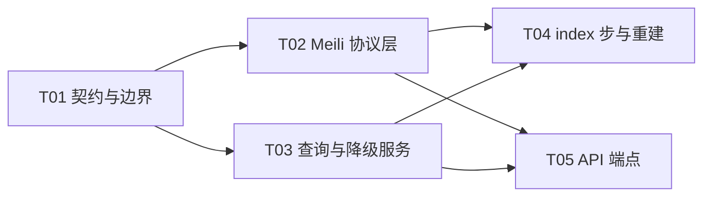

# 个人知识库 · R6 检索设计（Meilisearch 读写 + index 步 + /api/search）

| 项 | 内容 |
|---|---|
| 版本 | v1.0 |
| 日期 | 2026-11-28 |
| 范围 | E-18 检索层 / E-19 中文分词与二字词兜底 / E-20 `GET /api/search` / M6-01、M6-02、M6-03、M6-05 |
| 前置 | `docs/tech/2026-11-26-技术方案.md` §6.4、§6.7、§8.1 #14、§8.3；`scripts/probe_search.py` 真机探测结果 |
| 图文件 | 类图 `docs/tech/2026-11-28-R6检索-类图.mermaid`；时序图 `docs/tech/2026-11-28-R6检索-时序图.mermaid` |
| 明确不做 | M6-04 分类内搜索（P1，本轮不实现）、M6-06 语义搜索、M6-07 高亮跳转、M6-08 搜索历史、M6-09/M6-10（P3，AGENTS.md §3 明确不做） |

---

## 0. 结论先行

| # | 问题 | 结论 |
|---|---|---|
| 1 | `kb/search/` 放哪、能不能 import `kb.store` | **新建 `kb/search/` 且登记为「不得 import `kb.store`」**。Meili 协议与会话逻辑在 `kb/search/`；兜底检索的只读 SQL 在 `kb/store/search.py`；装配（读 items+tags 组文档）在 `kb/worker/steps.py`。**偏离技术方案 §7.5 的 `kb/store/index.py`**，理由见 §1.4，需同步回写方案 |
| 2 | Meili 客户端选型 | **自己写薄客户端，基于已有的 `httpx`**（不新增依赖）。不用 `meilisearch` 官方 SDK（0.43.0 会拉 `requests` + `camel-converter` + `pydantic` 三个包，见 §1.2） |
| 3 | index 步怎么等上游 | 阻塞判据只认「正在跑」或「90 秒内就要到期」的上游（§4.2）。被 `defer` 到 30 分钟后的 `summarize` **不阻塞索引**，否则 AI 未配置时新内容半小时搜不到 |
| 4 | 上游步骤集合怎么定 | `INDEX_UPSTREAM = ("fetch","ocr","summarize","tag")` 与 `SUPPORTED_STEPS` 求交。`ocr` 未实现 → 交集里没有它 → 不会永远等待；`ocr` 上线后交集自动生效。**但分派是另一处**：`run_once` 的分支必须显式穷举，不许 `else` 兜底（原写法会把 `ocr` 当 `index` 做掉，见 §4.3 的警告） |
| 5 | 推迟用什么函数 | `jobs.defer(conn, job_id, 30.0, reason)`。它的 SQL 里不出现 `attempts`，这是「推迟不计次」在代码层可一眼确认的证据 |
| 6 | 「Meili 挂」怎么判 | 搜索请求本身失败（连接错/超时 3 秒/非 2xx/响应体不是合法 JSON 或缺 `hits`）即判挂，**不额外打 `/health`**（多一次往返＝多一次可能超时）。判挂后熔断 30 秒，期间直接走兜底，不再等 3 秒 |
| 7 | 两者都挂返回什么 | **503**，body 带 `searchMode: "unavailable"`。不用「200 + 空列表」：`0 条结果` 与 `搜不了` 对用户意义完全不同（§8.3.1 明写不许假装无损降级） |
| 8 | 分数下限 | `rankingScoreThreshold = 0.30`（**已由 A5 真机实测标定，不是初始值**），服务端截断 + `rankingScore` 原样透出到 API。四个数：垃圾分 0.285 / 标签分 0.833 / 正文分 0.991 / 阈值 0.30，判据 `0.285 < 0.30 < min(0.833, 0.991)` 成立（§5.4） |
| 9 | 中文分词与二字词 | **不引入任何 Python 分词库**。索引侧用 Meili 内置 Charabia（jieba 词典分词，实测二字词命中 0.98–1.0），查询侧做「规范化 + 0 结果时放宽阈值重查一次」（§5.3） |
| 10 | 筛选器在哪执行 | 在 Meili（保证分页与计数正确）。代价是筛选字段有陈旧窗口，用「可检索字段变了必须重新入队 index」这条硬规则 + `rebuild` 命令兜住 |
| 11 | `from`/`to` 日期的时区 | **一律按 `Asia/Shanghai`**（常量 `DISPLAY_TZ`，放 `kb/search/config.py`；`to` 取次日零点 + `<` 半开区间）。依据：PG 实测时区 PRC、技术方案 §11.2 T19 已定「存 UTC，按上海切今天」。用 UTC 会让北京时间 00:00–08:00 入库的内容整体漏掉（§3.9） |
| 12 | 三条既有验收项 | T12（「矩阵」进前 5）、T13（主链路含 index 步，搜得到自动成立）、R1（不存在的词 0 条）已各自落到 §5.5 与 §9 的判据，三条都不是本轮新加的需求，是技术方案 §11 已定项 |

---

### 0.1 术语表（首次出现处的人话解释）

| 术语 | 一句话解释 |
|---|---|
| Meilisearch | 一个自带中文分词的独立搜索服务（单独一个进程，跑在平板容器里，听 `127.0.0.1:7700`）。本项目把「哪条内容该被哪个词搜到」这件事交给它算，Postgres 只管存原文 |
| 索引（index） | 搜索服务内部的一张「词 → 内容 id」对照表。内容改了必须同步更新它，否则搜出来的是旧值 |
| Charabia | Meilisearch 内部负责「把一句话切成词」的组件（Rust 写的）。中文它用 jieba 词典切 |
| jieba 词典分词 | 用一份中文词表去猜「哪几个字连起来是一个词」。例如「矩阵营销」会被切成「矩阵」「营销」而不是六个单字 |
| `rankingScore` | Meilisearch 给每条命中的相关度打分，0 到 1，越大越相关。本项目把它透出给前端，用户能自己判断「这条是不是碰巧撞上的」 |
| 熔断 | 一旦确认搜索服务挂了，接下来 30 秒内不再尝试连它，直接走兜底。避免每次搜索都白等 3 秒超时 |
| 兜底（fallback） | 主路径不可用时的次优方案。这里的兜底是用 Postgres 的 `ILIKE '%词%'` 逐条做字面子串匹配 |
| `ILIKE` | Postgres 的不区分大小写的「包含」匹配。`ILIKE '%营销%'` 意思是「字段里含『营销』这两个字」 |
| Seq Scan | Postgres 的「逐行扫全表」。`ILIKE '%x%'` 用不上索引，只能全表扫，500 条以内毫秒级，5000 条时到秒级 |
| `defer` | 把一条后台任务推迟一段时间再试，**不算一次失败**（`attempts` 不变）。与之相对的是 `mark_failed`，那是「试过了，失败了」 |
| 上游 / 下游任务 | 同一条内容的处理步骤是有先后的：抓取 → 摘要 → 打标签 → 建索引。前一个叫上游，后一个叫下游 |
| upsert | 「有就更新、没有就新增」。索引写入用 upsert，同一条内容重复写不会产生两条记录 |
| epoch 秒 | 从 1970-01-01 00:00:00 UTC 起算的整数秒数。用来做时间范围筛选与排序，比字符串比较可靠 |

---

## 1. 实现方案与框架选型

### 1.1 三个技术难点与对策

| 难点 | 现象 | 对策 |
|---|---|---|
| 中文无空格 | PG 的 `simple` 分词把整句当一个 token，`pg_trgm` 对 `三体` 相似度为 0（§8.3.1 实测） | 检索主路径用 Meilisearch（内置 Charabia 中文分词） |
| 二字词被切碎 | 「三体」被切成 `三` + `体`，`三` 命中「三个误区」的低分召回 | ① 索引侧保留原字段不预切；② `rankingScoreThreshold=0.30` 截断；③ `rankingScore` 透出到 API 让用户判断 |
| 检索服务会挂 | 平板只有一个 proot 容器，Meili 与 api/worker 共享内存 | 三级降级 + 显式 `searchMode` 字段 + 熔断，用户看得见降级 |

架构模式：**分层 + 注入装配件**，与 `kb/media/`、`kb/vision/` 同构——纯逻辑层不碰网络与数据库，装配件由 `worker/__main__.py` 与 `api/app.py` 注入。没有引入 DI 框架（单用户项目，构造参数注入足够）。

### 1.2 Meili 客户端选型：官方 SDK 对比自写薄客户端

| 维度 | 官方 `meilisearch` 0.43.0 | 自写薄客户端（`httpx`） |
|---|---|---|
| 新增依赖 | `requests`、`camel-converter[pydantic]`（实测 `requires_dist`），连带 `pydantic` | **零新增**：`httpx>=0.28` 已在 `pyproject.toml` |
| 本项目要用的端点 | 5 个（search / documents 增删 / settings / tasks / indexes 列表） | 同 |
| 类型模型 | 自带 `models` 层，但字段是 camelCase，与项目 snake_case 口径要来回翻译 | 直接吃 dict，`kb/search/models.py` 一处定 schema |
| 超时控制 | 透传 `requests` 的 timeout，语义是「连接/单次读」 | 与 `kb/ai/transport.py` 同口径（显式 `httpx.Timeout`，总时长由调用侧计时） |
| 代理环境变量 | `requests` 默认读 `HTTP_PROXY`，会把 `127.0.0.1:7700` 的请求发进代理 | `trust_env=False`（`kb/ai/transport.py` 的 `B21` 已有同一个教训） |
| 任务等待 | 有 `wait_for_task` 辅助 | 自己写 12 行轮询（`scripts/probe_search.py` 已跑通同一逻辑） |

**选择自写薄客户端。** 淘汰 SDK 的理由不是「SDK 不好」，是「为 5 个端点引入 3 个传递依赖，且其中 `requests` 的代理默认行为在本项目已被证实会咬人」。

`kb/api/health.py` 的 `urllib` 探针**不改**：它只要一个 1.5 秒的 `/health` 判定，不该为了统一风格去建一个带连接池的客户端；而且健康检查是 API 层的独立探针，与检索路径耦合会让「Meili 挂了」这件事只有一个观测点。

### 1.3 分层与调用方向

```
kb/api/search.py  ──┐                         （HTTP 层：解析参数、序列化）
                     ├─→ kb/search/service.py  （三级降级编排 + 熔断）
kb/worker/steps.py ──┘        │
   │                          ├─→ kb/search/query.py    （纯函数：规范化、filter 串）
   │                          ├─→ kb/search/indexer.py  （编排：设置、批量 upsert、重建）
   │                          └─→ kb/search/client.py   （唯一发 HTTP 处）
   └─→ kb/store/search.py  （只读 SQL：兜底 ILIKE、索引用数据分页读）
        └─→ kb/store/items.py / tags.py / jobs.py
```

箭头方向是单向的：`kb/search/` 不知道 `kb.store` 存在。`kb/store/search.py` 不知道 Meili 存在。两边只在「一条文档的字段」这个朴素契约上耦合。

### 1.4 偏离技术方案 §7.5 的记录（施工计划 S3）

§7.5 目录图写的是 `kb/store/index.py # Meilisearch 读写 + rebuild`。本设计改为 `kb/search/` + `kb/store/search.py`。**这是偏离，需要回写方案 §7.5 并升版**。

理由三条：

1. **`kb/store/` 的判据是「Postgres 的唯一落点」，不是「一切外设」。** `layer_rules.toml` 现有两条规则把它钉在数据库上：`write_sql_allowed_prefixes = ["kb/store/"]`、`driver_deny` 只放行 `kb/store/`。把 HTTP 搜索引擎客户端放进去之后，将来问「store 能不能调外部 HTTP」，从这两条规则里读不出答案——边界文件失去语义。
2. **放进 store 会让索引写入无法脱离数据库测试。** `kb/search/` 不 import `kb.store` 之后，`Indexer` 的用例只需要一个假的 HTTP 实现和一个 dict 列表（`tests/test_search_indexer.py` 不连库、不联网）。放进 store，每次验证「upsert 的请求体长什么样」都要么连库、要么把 store 一起打桩。
3. **装配只能在能读库的层做。** index 步需要「items 行 + 该条的标签名数组」，这是一次跨两张表的读。若 Meili 客户端在 store 里，装配就会变成 store 里一个函数既读 Postgres 又发 HTTP，边界比现在更糊。

---

## 2. 文件清单（施工计划 §2.3 格式）

**本轮可改**（新增 20 个，修改 11 个）

**Create**

| 文件 | 作用 |
|---|---|
| `kb/search/__init__.py` | 包入口，惰性导出（沿用 `kb/ai/__init__.py` 的写法，纯逻辑单测不触发 HTTP 依赖） |
| `kb/search/config.py` | 全部数值常量与环境变量名，一处定义 |
| `kb/search/models.py` | `IndexDoc` / `SearchFilter` / `SearchQuery` / `SearchHit` / `SearchResult` / `SearchMode` / `MeiliDown` |
| `kb/search/client.py` | 唯一发 HTTP 处：`search` / `add_documents` / `delete_documents` / `patch_settings` / `index_document_ids` |
| `kb/search/query.py` | 纯函数：`normalize_query` / `build_filter` / `_quote` |
| `kb/search/indexer.py` | 编排：`ensure_index` / `upsert` / `delete_ids` / `rebuild`；`python -m kb.search.indexer --create` 建索引 |
| `kb/search/service.py` | 三级降级 + 熔断：`SearchService.run(query)` |
| `kb/store/search.py` | 只读 SQL：`fallback_search`（ILIKE 五路）、`index_source_row`（单条装配读）、`index_source_page`（重建用分页读）、`READ_STATUSES` |
| `kb/api/search.py` | `GET /api/search` handler 工厂 |
| `kb/worker/rebuild.py` | `python -m kb.worker.rebuild` 全量重建（装配在 worker 层，因它要读库） |
| `tests/test_search_arch.py` | 断言 `kb/search/` 里没有 `import kb.store`（不依赖 pg，本地必跑） |
| `tests/test_search_query.py` | `normalize_query` / `build_filter` / 枚举一致性的纯单测 |
| `tests/test_search_client.py` | 假 `httpx` 传输：超时、非 2xx、坏 JSON、401 各自的异常类型 |
| `tests/test_search_indexer.py` | 请求体形状、批量切分、重建的删除顺序 |
| `tests/test_store_search_pg.py` | 兜底 SQL 在真库的行为（`pg` 标记） |
| `tests/test_worker_index_step.py` | index 步：等上游、推迟不计次、Meili 挂时 defer、401 时 defer |
| `tests/test_api_search.py` | 端点契约：三种 `searchMode`、参数校验、503 分支 |
| `docs/tech/2026-11-28-R6检索设计.md` | 本文档 |
| `docs/tech/2026-11-28-R6检索-类图.mermaid` | 类图 |
| `docs/tech/2026-11-28-R6检索-时序图.mermaid` | 时序图 |

**Modify**

| 文件 | 改动 |
|---|---|
| `layer_rules.toml` | 追加 `[[import_deny]] path_prefix = "kb/search/"`，`layer = "检索层"`，`modules = ["kb.store"]` |
| `pyproject.toml` | `[tool.setuptools] packages` 加 `"kb.search"` |
| `kb/worker/loop.py` | `SUPPORTED_STEPS` 加 `"index"`；`run_once` / `run_forever` 末尾追加 `indexer: Any = None`；分派 `run_index` |
| `kb/worker/steps.py` | 新增 `run_index`；在 `run_summarize`（成功与跳过两路）与 `run_tag` 成功后 `enqueue(item_id, "index")` |
| `kb/worker/__main__.py` | 装配 `Indexer`，以关键字传给 `run_forever` |
| `kb/store/jobs.py` | 新增只读 `blocking_upstream(conn, item_id, job_id, steps, soon_seconds)` |
| `kb/store/items.py` | 新增 `summaries_by_ids(conn, ids)`（一次批量补权威状态）与 `known_kinds(conn)`（类型枚举的真源） |
| `kb/api/app.py` | 注册 `Route("/api/search", search_api.search(pool))`；`AppConfig` 加 `meili_key` |
| `scripts/probe_search.py` | 索引设置改为本轮最终设置；加 A5（`rankingScoreThreshold` 截断）、A6（数值型时间过滤）两例；记录 `processingTimeMs` |
| `tests/test_worker_ai_steps.py` | `SUPPORTED_STEPS` 断言由三步骤改为四步骤；`index` 从「未实现」用例挪走，`ocr` 保留 |
| `docs/tech/2026-11-26-技术方案.md` | §7.5 目录图补 `search/`；§8.3 补降级响应字段（施工计划 S3 要求偏离回写） |

**本轮只读**（需要参考但不许改）

- `docs/tech/2026-11-26-技术方案.md` §6.4 / §6.7 / §8.3
- `kb/store/migrations/*.sql`（本轮无 schema 变更）
- `kb/api/health.py`（`meili_ok` 保持不动，见 §1.2）

**本轮禁止碰**

- `kb/extract/`、`kb/media/`、`kb/vision/`、`kb/asr/`（各自轮次已封闭）
- `kb/store/migrations/`（检索不需要新表：索引是外部服务状态，不进 PG）
- `kb/api/items.py` 的既有 handler（`_json_item` 不被 `/api/search` 复用，见 §3.7）

---

## 3. 数据结构与接口

### 3.1 索引文档 schema（`IndexDoc`）

索引 uid 固定 **`kb_items`**（常量 `config.INDEX_UID`）。主键 `id` = `items.id`。

| 字段 | 类型 | 可搜权重序位 | 可筛选 | 可排序 | 来源 |
|---|---|---|---|---|---|
| `id` | int | — | — | — | `items.id` |
| `title` | str | 1（最高） | — | — | `items.title` |
| `summary` | str | 2 | — | — | `items.summary`（空为 `""`） |
| `tags` | list[str] | 3 | ✅ 数组等值 | — | `item_tags` join `tags` 的**名字** |
| `ocr_text` | str | 4 | — | — | `items.ocr_text`（本轮恒为空串） |
| `content_text` | str | 5 | — | — | `items.content_text` |
| `author` | str | 6（最低） | — | — | `items.author` |
| `kind` | str | — | ✅ 等值 | — | `items.kind` |
| `read_status` | str | — | ✅ 等值 | — | `items.status` |
| `saved_at` | str（ISO 8601） | — | — | — | `items.saved_at`，仅供展示 |
| `saved_at_ts` | int（epoch 秒） | — | ✅ 范围 | ✅ | `items.saved_at` 换算 |
| `source_domain` | str | — | — | — | `items.source_domain` |

**为什么额外存 `saved_at_ts` 整数**：Meili 的字符串比较是字典序（官方文档明写 lexicographic）。`items.saved_at` 是 `timestamptz`，pg8000 取回来的 `datetime` 带 `+08:00`。只要有一天某条记录以 `+00:00` 写进索引，`"2026-11-22T02:00:00+00:00" >= "2026-11-22"` 与 `"2026-11-22T10:00:00+08:00" >= "2026-11-22"` 在同一时刻给出不同答案——范围筛选会静默错。整数 epoch 秒没有这个问题，且是可排序类型。

**为什么不索引处理状态 `status`**：它由 `jobs` 聚合现算（`items.derive_status`）。每一条 job 状态变迁都会让它变，若索引它，就要求每次 job 流转都重写索引——这正是「索引与真值不同步」的制造机。处理状态由 API 层**一次批量 SQL 补全**（§3.7），不放进检索服务。

**字段名 snake_case、API 出 camelCase**：索引字段与 DB 列一一对应，对账（rebuild 时逐条比对）不用做名字映射；API 侧与现有 `/api/items` 一致用 camelCase。这条是硬约定，写进 §10。

### 3.2 索引设置（`indexer.ensure_index` 一次 PATCH）

```json
{
  "searchableAttributes": ["title", "summary", "tags", "ocr_text", "content_text", "author"],
  "filterableAttributes": ["kind", "tags", "read_status", "saved_at_ts"],
  "sortableAttributes": ["saved_at_ts"],
  "displayedAttributes": ["id", "title", "summary", "tags", "kind", "read_status",
                          "saved_at", "saved_at_ts", "source_domain"],
  "pagination": {"maxTotalHits": 1000}
}
```

| 决定 | 依据 |
|---|---|
| `searchableAttributes` 顺序 = §6.7 权重序 | Meili 的 `attributeRank`（旧名 `attribute`）按数组位置排权重，顺序就是权重 |
| **不设 `rankingRules`** | 显式写在文档里的规则名会随版本改名（1.58 的默认列表已经出现 `attributeRank`/`wordPosition` 这两个新名）。用默认值 + `scripts/probe_search.py` 守住排序行为，比锁死名字更抗升级 |
| **不设 `localizedAttributes`** | 真机探测已证明自动识别把中文交给 jieba 词典分词（二字词命中 0.98–1.0）。强制 `locales: ["cmn"]` 会把该字段的英文内容也按中文切，中英混排反而更差。⚠️ 若复跑出现中英混排召回下降，验证方法见 §11 第 3 条 |
| **不设 `typoTolerance.disableOnAttributes`** | 中文没有拼写容错的意义，但关掉它对中文查询无收益；抖音标题里混着数字与英文，容错对那部分有用 |
| `displayedAttributes` 不含 `content_text`/`ocr_text` | 列表页不需要正文全文；不含它们可以让每条命中少传几 KB（正文动辄上千字） |

### 3.3 `SearchFilter` / `SearchQuery`（`kb/search/models.py`）

```python
@dataclass(frozen=True)
class SearchFilter:
    kinds: tuple[str, ...] = ()          # 维度内 OR
    tags: tuple[str, ...] = ()           # 维度内 AND
    read_statuses: tuple[str, ...] = ()  # 维度内 OR
    saved_from_ts: int | None = None     # 含
    saved_to_ts: int | None = None       # 不含（半开区间）

@dataclass(frozen=True)
class SearchQuery:
    text: str = ""
    limit: int = 20
    offset: int = 0
    filter: SearchFilter = field(default_factory=SearchFilter)
    min_score: float = MIN_SCORE        # 0.0 表示不截断
```

**为什么 `tags` 维度内是 AND、`kinds` 是 OR**：用户在筛选器里勾两个类型，语义是「视频或文章都看」；勾两个标签，语义是「同时打了这两个标签的内容」。后者改成 OR 会让「营销 + 抖音」筛出全库一半内容，与「筛」的字面意思相违。

### 3.4 `MeiliDown` 异常族（`kb/search/models.py`）

| 异常 | 触发条件 | 调用方处置 |
|---|---|---|
| `MeiliUnavailable` | 连接失败 / 超时 / 5xx / 响应体非 JSON / 缺 `hits` | 搜索：降级到 PG；索引：`defer 60 秒`（不计 attempts） |
| `MeiliRejected` | 400 / 404 / 422（请求或索引设置写错） | 索引：`mark_failed`（编程错误，重试 3 次也照样错） |
| `MeiliUnauthorized` | 401 / 403（key 错或没授权） | 索引：`defer 600 秒` + error 写「检查 KB_MEILI_KEY」，不判死（§4.4） |

三者都继承 `MeiliDown`，调用方 `except` 顺序按子类优先。**不合并成一个异常**：三者的处置完全不同，合并后每个调用点都要自己判状态码，判错一次就是「配置错误被判死」或「Meili 挂了被判死」这类需要手工改库才能恢复的故障。

### 3.5 `kb/search/client.py` 精确签名

```python
class MeiliClient:
    def __init__(self, base_url: str, api_key: str = "", *,
                 timeout_sec: float = SEARCH_TIMEOUT_SEC,
                 transport: Any = None) -> None: ...
    def search(self, index_uid: str, payload: dict[str, object]) -> dict[str, object]: ...
    def add_documents(self, index_uid: str, docs: Sequence[dict[str, object]]) -> int: ...
    def delete_documents(self, index_uid: str, ids: Sequence[int]) -> int: ...
    def patch_settings(self, index_uid: str, settings: dict[str, object]) -> int: ...
    def index_document_ids(self, index_uid: str) -> list[int]: ...
    def wait_task(self, task_uid: int, *, timeout_sec: float = TASK_WAIT_SEC) -> None: ...
```

约定：

- 每个写操作返回 `taskUid`，由调用方决定要不要 `wait_task`。**写文档不等任务**（Meili 的写是异步队列，等它会把一次 200 条的批量变成秒级阻塞）；**改设置与建索引要等**（后续的第一次写入依赖设置生效，不等会写进默认设置下）。
- `transport` 是注入点：默认 `None` 表示真发请求；测试注入一个只记录 `(method, path, body)` 并返回剧本的假实现。与 `kb/ai/transport.py` 的 `client_factory` 同一个手法，不做 monkeypatch。
- `trust_env=False` 写死在客户端里，不放参数：平板与 Windows 都可能配了系统代理，`127.0.0.1` 被代理转发会表现为「Meili 挂了」，而 `/health` 探针（`urllib` 也读代理环境）可能同时报挂，两个信号一起错。

### 3.6 `kb/search/service.py` 精确签名

```python
@dataclass
class SearchResult:
    mode: SearchMode
    hits: tuple[SearchHit, ...]
    relaxed: bool = False
    notice: str | None = None
    estimated_total: int | None = None

class SearchService:
    def __init__(self, client: MeiliClient, fallback: FallbackFn, *,
                 clock: Callable[[], float] = time.monotonic,
                 min_score: float = MIN_SCORE,
                 circuit_ttl_sec: float = CIRCUIT_TTL_SEC) -> None: ...
    def run(self, query: SearchQuery) -> SearchResult: ...
```

`FallbackFn = Callable[[SearchQuery], Sequence[SearchHit]]`——**兜底是注入的，不是 import 的**。`kb/search/` 因此能守住「不 import `kb.store`」；测试里注入一个返回固定列表的 lambda 就能验完三级降级全部分支，不用数据库。

`run()` 的决策顺序（这是本轮的核心逻辑，与 §8.3 三级表一一对应）：

```
1. 熔断还在冷却（clock() < _down_until）→ 直接走第 3 步（兜底）
2. 调 client.search(... showRankingScore=True, rankingScoreThreshold=min_score ...)
   ├─ 成功 → mode=meili
   │   └─ 命中 0 条 且 min_score > 0 且查询非空 → 用 min_score=0 重查一次
   │       └─ 有结果 → mode=meili, relaxed=True
   └─ MeiliUnavailable → _down_until = clock() + 30，走第 3 步
3. 兜底：fallback(query)
   ├─ 成功（含 0 条）→ mode=fallback, notice="搜索服务未运行，结果按字面匹配…"
   └─ 抛异常 → mode=unavailable（API 层 503）
```

`estimated_total` 只在 `mode=meili` 时非空（Meili 给 `estimatedTotalHits`）；兜底路径没有可信总数，给 `None` 而不是给命中条数——把「返回了几条」当成「一共有几条」是谎报。

### 3.7 `GET /api/search` 契约

请求参数（全部可选）：

| 参数 | 类型 | 默认 | 约束 |
|---|---|---|---|
| `q` | str | 空 | 规范化后 ≤ 64 字符；空 = 浏览器模式（按 `saved_at` 倒序） |
| `limit` | int | 20 | 1–50，超出夹边界 |
| `offset` | int | 0 | 0–999 |
| `kind` | str，可重复或逗号分隔 | 空 | 值必须存在于 `item_kinds`（`known_kinds()` 校验，不在则 400） |
| `tags` | str，可重复或逗号分隔 | 空 | 维度内 AND |
| `status` | str，可重复或逗号分隔 | 空 | 值必须在 `READ_STATUSES` 内 |
| `from` / `to` | 日期或日期时间 | 空 | `from` 含、`to` 为日期时按**该日在 `Asia/Shanghai` 的结束**（半开区间 `< to`）。时区口径见 §3.9 |

响应 200（`mode` 为 `meili` 或 `fallback`）：

```json
{
  "items": [
    {"id": 3, "kind": "video", "title": "抖音短视频剪辑技巧",
     "summary": "手机端剪映的三个卡点办法", "sourceDomain": "v.douyin.com",
     "savedAt": "2026-11-22T10:00:00+08:00", "readStatus": "unread",
     "status": "done", "tags": ["视频", "工具"], "rankingScore": 0.9763}
  ],
  "searchMode": "meili",
  "degraded": false,
  "relaxed": false,
  "notice": null,
  "limit": 20,
  "offset": 0,
  "estimatedTotal": 1
}
```

响应 503（`mode=unavailable`）：

```json
{"error": "搜索暂不可用：检索服务与数据库都不可达，请稍后重试",
 "searchMode": "unavailable", "degraded": true}
```

四个字段的语义分工（**这是「降级必须让用户看得见」的落地**）：

| 字段 | 取值 | 用户能看到什么 |
|---|---|---|
| `searchMode` | `meili` / `fallback` / `unavailable` | 结果是在哪种质量下得到的 |
| `degraded` | 布尔 | 前端据此把提示条点亮，不用自己判 `searchMode != "meili"` |
| `notice` | 人话一句或 `null` | 降级时直接显示这句，不给用户看「fallback」这种词 |
| `rankingScore` | 0–1 浮点 | 排序可信度；`fallback` 模式下它是「命中字段比例」，`searchMode` 已经在旁边说明 |

`status` 与 `readStatus` 的补全走 `items.summaries_by_ids(conn, ids)` **一次查询**（`where id = any(...)`），不做 N+1。查回来的条数少于命中条数（说明索引里有、库里已删）时，**跳过这些条目**——索引陈旧时宁可少一条，也不给一个点进去 404 的卡片。

### 3.8 `kb/store/search.py` 精确签名

```python
READ_STATUSES: tuple[str, ...] = ("unread", "reading", "read", "archived")

def fallback_search(conn, *, terms: Sequence[str], limit: int, offset: int,
                    filter: SearchFilter) -> list[SearchHit]: ...
def index_source_row(conn, item_id: int) -> IndexDoc | None: ...
def index_source_page(conn, *, after_id: int, limit: int) -> list[IndexDoc]: ...
```

`terms` 由 `query.build_terms()` 在**纯函数层**切好（按空白切、去重、上限 5 个、空串丢弃），store 只负责按 `terms` 的数量拼 SQL 参数名 `t0..t4`。切词规则放纯函数层是为了能单测「输入带全角空格 / 带引号 / 超长」时切成什么。

`READ_STATUSES` 是 DB `items_status_check` 的镜像常量。`tests/test_search_query.py` 里有一条用例从 `kb/store/migrations/0001_schema.sql` 正则抠出 CHECK 里的四个值与该常量比对——两处不一致就红。这是本项目对「镜像枚举」的既有做法（枚举只有一个真源，镜像必须被守住）。

### 3.9 `from` / `to` 的日期→epoch 时区（**开工前定死，不许实现时自行选**）

**结论：`from` / `to` 的日期部分一律按 `Asia/Shanghai` 解释为当地一天的开头与结尾。**

| 项 | 定值 |
|---|---|
| 常量 | `DISPLAY_TZ = "Asia/Shanghai"`，放 `kb/search/config.py`，与其它常量一处 |
| 实现 | `zoneinfo.ZoneInfo(DISPLAY_TZ)`（标准库，Python 3.9+ 自带，不新增依赖） |
| `from=2026-11-22` | 北京时间 2026-11-22 00:00:00 的 epoch 秒，筛选条件 `saved_at_ts >= from_ts` |
| `to=2026-11-22` | **次日**（11-23）北京时间 00:00:00 的 epoch 秒，筛选条件 `saved_at_ts < to_ts` |
| 参数带时间（`2026-11-22T10:30`） | 按 `Asia/Shanghai` 解释该时刻，不再取日界 |
| 半开区间 | `to` 一律 `<`，不是 `<=`。「筛 11-22」由此包含当天 23:59:59，且不把 11-23 00:00:00 那条装进来 |

**为什么是 `Asia/Shanghai` 而不是 UTC**：三条依据都是项目既有事实。

1. 用户在中国，日常按北京时间理解「今天」「昨天」「这周」。
2. 平板 PG 的 `TimeZone` 实测是 `PRC`。`kb/worker/loop.py` 的 `_db_now` docstring 留着原始输出：`DB TimeZone = PRC`、`DB now() = 2026-11-27 20:30:45+08:00`。索引侧的日界若用 UTC，就与库里 `saved_at` 的日界差 8 小时——同一个「11 月 22 日」，索引认为从 11-22 08:00 才开始，库认为从 11-22 00:00 开始。
3. `docs/tech/2026-11-26-技术方案.md` §11.2 的 T19 已定口径：**存 UTC，按 `Asia/Shanghai` 切「今天」**。检索是「切今天」的第二个使用点，必须与第一处同口径。

**若用 UTC 会看到什么现象**（这是否掉 UTC 的具体理由，不是理论担忧）：北京时间的 11-22 00:00–08:00 这 8 小时里存进来的内容，`saved_at_ts` 落在 UTC 的 11-21；用户点「今天（11 月 22 日）」时，索引把 `from_ts` 算成 UTC 11-22 00:00（= 北京 11-22 08:00），**这 8 小时的内容整体漏掉**。这是「按日期筛」最典型的一类静默错：不报错、结果看起来合理、只是少了几条。

**索引侧的 `saved_at_ts` 不用改**：它由 `items.saved_at`（带时区的 `datetime`）`.timestamp()` 得出，`.timestamp()` 给的是绝对时刻，与时区无关。要按上海时区解释的**只有 `from`/`to` 这两个用户输入**。

**守卫用例**（写进 T05 判据，不依赖真机，`tests/test_api_search.py` 里用假 client 断言传给 Meili 的 filter 串）：

```
构造一条 saved_at = 2026-11-21T20:30:00Z（= 北京时间 2026-11-22 04:30）
断言 from=2026-11-22 → 命中
断言 from=2026-11-23 → 不命中
断言 to=2026-11-22   → 命中（11-22 当天 23:59:59 之前，且半开区间不含 11-23 00:00）
断言 to=2026-11-21   → 不命中
```

⚠️ 这四条断言若在实现后不成立，是 epoch 换算或 `<`/`<=` 写反了，属实现 bug，不是设计问题——按用例改代码，不改用例。

---

## 4. 程序调用流程

### 4.1 index 步：从入队到写索引

完整时序见 `docs/tech/2026-11-28-R6检索-时序图.mermaid` 图一。主干六步：

1. `run_fetch` 成功 / `run_summarize` 成功或跳过 / `run_tag` 成功 → `jobs.enqueue(item_id, "index")`。
   `enqueue` 的 `on conflict (item_id, step) where state in ('pending','running') do nothing` 让四处重复入队塌成一条——这是「取最后一个完成的」在不需要额外表的情况下成立的机制。
2. worker 主循环 `jobs.claim_one` 领到 `index`，`loop.run_once` 分派到 `steps.run_index`。
3. `jobs.blocking_upstream(conn, item_id, job_id, steps=index_upstream(), soon_seconds=90)`：
   - 返回非空 → `jobs.defer(conn, job_id, 30.0, f"已推迟：等待 {step} 完成")` 并 `return`。
   - 返回 `None` → 继续。
4. 读数据：`store.search.index_source_row(conn, item_id)`（一条 items 行 + 标签名数组）。
5. `indexer.upsert([doc])` → `client.add_documents("kb_items", [...])` → Meili 返回 `taskUid`。
6. `jobs.mark_done`。

**`mark_done` 在写索引之后，且不等 task 完成**：`add_documents` 返回 `taskUid` 就代表 Meili 已接收。不等它，是因为 Meili 的任务队列在平板上有索引重建时可能排队数秒，等它会让一条内容占住 worker 数秒；不等它的代价是「标 done 后 1–2 秒索引才可搜」，对单人使用无影响。

**为什么第 3 步之后才读数据，而不是先读**：上一步若推迟，读出来的数据就是过期快照；先判后读能保证写进索引的字段是最新的。

### 4.2 「还有未完成的上游」判定（难题二的核心）

`jobs.blocking_upstream` 的 SQL（只读，不进 `write_sql` 检查的范围）：

```sql
select step from jobs
 where item_id = :i
   and id <> :j
   and step = any(cast(:steps as text[]))
   and ( state = 'running'
         or (state = 'pending' and run_after <= now() + interval '1 second' * :soon) )
 order by id
 limit 1
```

三条判据各自的理由：

| 判据 | 没有它会怎样 |
|---|---|
| `id <> :j` | 自己当前是 `running`，会把自己判成阻塞上游，无限推迟 |
| `state = 'running'` 也算阻塞 | 上游正在跑（抓取 10–20 秒、AI 调用 3–10 秒），此时索引会写出半成品；推迟 30 秒后上游的典型状态是已完成，没完成的下一轮再推一次 |
| `run_after <= now() + 90 秒` | **这是本设计对 §6.4 的实质修正**，见下 |

**为什么不是「任何 pending 上游都等」**：`summarize` 在 AI 未配置时会 `defer 1800 秒`（`ai_runtime.DEFER_SECONDS_NOT_CONFIGURED`），状态仍是 `pending`。字面执行 §6.4 的话，索引要等它 30 分钟——**新存进来的内容半小时内搜不到**，而这半小时里标题和正文其实已经在库里了。用户对这一现象的唯一解释是「搜索坏了」。

改成「只等 90 秒内要到期的上游」之后：

- 正常流：`summarize` 与 `tag` 都是秒级到分钟级，落在 90 秒窗口内 → 索引等它们 → 索引写出的文档字段是齐的（§6.4 的原意保住）。
- AI 未配置：`summarize` 的下次执行在 30 分钟后 → 索引立刻写出 title/content_text/kind/saved_at → 新内容秒级可搜；等 AI 配好、`summarize` 与 `tag` 完成后再入队一次 `index`，upsert 补上 summary 与 tags。

代价是多一次写入（upsert 幂等，无正确性影响）。收益是「新内容能不能立刻搜到」这一条用户可感知的性质不被配置状态绑架。

### 4.3 上游步骤集合怎么算（不硬编码枚举）

```python
#: index 的潜在上游。顺序即依赖顺序，仅供排障阅读。
INDEX_UPSTREAM = ("fetch", "ocr", "summarize", "tag")

def index_upstream(supported: Sequence[str]) -> tuple[str, ...]:
    """取交集：只有「本包真能执行」的步骤才可能永远不完成，才值得等。"""
    return tuple(step for step in INDEX_UPSTREAM if step in supported)
```

`loop.run_once` 调用时传 `index_upstream(SUPPORTED_STEPS)`。本轮 `SUPPORTED_STEPS = ("fetch","summarize","tag","index")`，交集是 `("fetch","summarize","tag")`——`fetch` 此时已是 `done`（index 由 fetch 的下游入队），实际起作用的只有 `summarize` 与 `tag`。

`ocr` 上线时只需把它加进 `SUPPORTED_STEPS`，交集自动包含它。`tests/test_worker_index_step.py` 有一条用例喂一个含 `"ocr"` 的假 `SUPPORTED_STEPS`，断言 `index_upstream` 会把它算进来——这条守的是「将来加 ocr 不用记得改这里」。

> ⚠️ **但「不用改第二处」这个说法只在「上游集合」这一层成立，分派是另一处，必须改。**
>
> `SUPPORTED_STEPS` 只回答「worker 能领哪些步骤」，`run_once` 的 `if/elif` 回答「领到之后怎么执行」。原实现的分派是 `if fetch / elif summarize / elif tag / else: run_index`——那个 `else` 兜住一切非前三者，所以 `ocr` 一旦进 `SUPPORTED_STEPS`，它的 job 会被当 `index` 执行：读 items 行写进索引并 `mark_done`。OCR 从没跑过，但 job 显示成功，而且它作为上游从此不再阻塞 index（已 `done`），正文/OCR 文本**永远**不进索引。全程不报错。
>
> 已改成显式穷举（`elif step == "index"` + 兜底分支退回队列并写明「已登记为支持但没有分派实现」）。由 QA 的 `tests/test_qa_search_probe.py::test_ocr进上游集合后run_once应分派到ocr而不是run_index` 守住。
>
> **加新步骤时两处都要改**：`SUPPORTED_STEPS`（能领）+ `run_once` 的分派分支（怎么执行）。这条规则对 `ocr` 以及之后任何新步骤都成立。

**为什么 `fetch` 留在集合里**：纯文字条目（`url` 为空）的 `fetch` 会立即 `mark_done` 且不入队 `summarize`；带链接的条目 `fetch` 失败时也不入队 `summarize`。这两种情况下 index 由谁入队见 §4.4。

### 4.4 四个入队点的取舍

| 位置 | 入队 | 理由 |
|---|---|---|
| `run_fetch` 成功 | **不入队** | 后续 `summarize` 一定会入队 `index`（成功或跳过都入），不重复 |
| `run_fetch` 失败 / 无链接可抓 | **不入队** | 内容没抓到，索引里放一条只有分享文案的文档会让它凭文案被搜到、点进去没内容。等重试成功再入队 |
| `run_summarize` 成功（`SummarizeOk`） | 入队 | §6.4 表的「summarize 完成时」 |
| `run_summarize` 跳过（`SummarizeSkipped`：`no_text` / `title_only`） | **入队** | 跳过也是终态：这条内容的摘要不会再有。不入队的话纯文字空内容永远不进索引 |
| `run_tag` 成功 | 入队 | 标签这一步才把 `item_tags` 写进去；索引里的 `tags` 字段依赖它。与 `summarize` 那次入队由唯一索引塌成一条 |

### 4.5 搜索请求：从 API 到 Meili（以及降级）

完整时序见 `docs/tech/2026-11-28-R6检索-时序图.mermaid` 图二。主干：

1. 路由 → `api/search.py` handler：解析参数、校验 `kind`（查 `known_kinds`）、校验 `status`（查 `READ_STATUSES`）、`from`/`to` **按 `Asia/Shanghai`（`config.DISPLAY_TZ`）转 epoch 秒**——时区口径与守卫用例见 §3.9，`to` 取次日零点且用 `<`（半开区间）。
2. `query.normalize_query(q)`：去首尾空白、压连续空白、全角转半角、去掉 `【】·` 这类分享文案残留标点、截 64 字符。
3. `query.build_filter(...)`：拼 Meili filter 表达式字符串。
4. `service.run(query)`：
   - 熔断冷却中 → 直接兜底；
   - 否则 `client.search`；
   - `MeiliUnavailable` → 记熔断 → 兜底；
   - 兜底也抛 → `mode=unavailable`。
5. `mode=meili/fallback` 时：`items.summaries_by_ids` 补 `status`/`readStatus`，丢掉查不到的 id。
6. 序列化返回。

**搜索路径不打 `/health`**：`health.meili_ok` 是给 `/api/health` 与首页用的短探针（1.5 秒），复用它会变成「每次搜索先花最多 1.5 秒确认服务在不在，再花时间搜索」。搜索请求本身就是最好的探针——它失败，就是挂了。熔断器承担「不要每次都白等 3 秒」的职责。

---

## 5. 中文分词与二字词兜底（E-19 / M6-02 / M6-03）

### 5.1 结论：不引入 Python 分词库

真机探测已把三条前提钉死（`scripts/probe_search.py`，平板 `127.0.0.1:7700`，Meili 1.58.0）：

| 用例 | 命中 | 分数 | 说明 |
|---|---|---|---|
| 「营销」 | 1 | 0.997 | 二字词可命中 |
| 「三体」 | 2 | 1.0 / 0.285 | 正确命中 1.0；「三个误区」低分误召回 |
| 「剪辑」 | 1 | 0.98 | 二字词可命中 |
| 「抖音 剪辑」（多词） | 1 | 0.976 | 多词按覆盖度 |
| 「矩阵 营销」 | 1 | 1.0 | 多词按覆盖度 |
| 「私域流量」（只在 summary） | 1 | 0.998 | summary 路可达 |
| 「剪映卡点」（只在 ocr_text） | 1 | 0.999 | OCR 路可达 |
| 「科普」（只在 tags） | 1 | 0.667 → 0.833 | 标签路可达；0.667 是 `tags` 第 5 位时的旧值，提到第 3 位后实测 0.833 |
| 「王五」（只在 author） | 1 | 0.962 | author 路可达 |
| 「量子纠缠」（不存在） | 0 | — | 0 命中 |

所以「二字中文词兜底」的落地是三件事，**不是加一个分词器**：

1. 索引侧不预切、不改写文本，交给 Charabia 的 jieba 词典分词（官方 Language 文档明写 Chinese (CMN) 用 jieba-based dictionary segmentation）。
2. 分数下限截掉低分噪音（0.285 那条）。
3. 0 命中时放宽阈值重查一次（见 §5.3）。

### 5.2 M6-02「多词按覆盖度排序」靠什么成立

| 机制 | 作用 |
|---|---|
| `searchableAttributes` 顺序 | 标题命中排在正文命中之前（`attributeRank`） |
| `words` 排序规则（默认首位） | 命中词数多的排前面——这就是「覆盖度」 |
| `matchingStrategy` 默认 `last` | 命中多的先用；不足 `limit` 时从末尾逐词放宽，保证「凭印象少一个字」也有结果 |
| **不显式设置 `matchingStrategy`** | 改成 `all` 会让「抖音 剪辑 卡点」这种多一个词的查询直接 0 结果，与 M6-02 的意图相反 |

### 5.3 查询处理链（`query.normalize_query` + `service.run` 的放宽）

| 情形 | 处理 | 依据 |
|---|---|---|
| 规范化后为空 | 浏览器模式：`q=""`，按 `saved_at_ts` 倒序，`mode=meili` | Meili 的空 `q` 是 placeholder search，返回全部文档 |
| 纯中文 1 字 | 正常搜，阈值不变，响应带 `notice="单字查询结果比较杂，多打一个字会准很多"`，`degraded` 仍为 `false` | 单字会命中所有含该字的文档，但截断由阈值兜住；不把提示塞进 `degraded`（服务没坏） |
| 纯中文 2 字 | 正常搜；0 命中且 `min_score > 0` 时用 `min_score=0` 重查一次，`relaxed=true` | 实测可命中（0.98–1.0），0 命中说明是被阈值截了 |
| 含空格多词 / 英文 / 中英混排 | 同上一行 | 同 |
| 超 64 字符 | 截断到 64 并 `notice` 说明 | Meili 只看前 10 个词，超长部分是噪音 |

**放宽只发生在 0 命中时**：先严格后放宽，垃圾召回不会因为放宽而变多；而「本来能搜到却被阈值截掉」这一类事故被兜住。放宽后必须 `relaxed=true`，让用户知道「这些是靠放宽才出来的」。

### 5.4 分数下限为什么是 0.30（含两个必须同时满足的边界）

样本只有 4 条文档（探测用假数据）。**下面是真机（平板 Meili 1.58.0）在最终字段顺序下的实测值**，`probe_search.py` 的 A5 输出：

```
三体 正确命中（title，第 1 位）        1.000
三体 垃圾召回（正文里的「三个误区」）  0.285   ← 必须截掉
科普（tags，第 3 位）                 0.833   ← 必须保留（旧顺序第 5 位时是 0.667）
挂耳咖啡（content_text，第 5 位）      0.991   ← 必须保留
王五（author，第 6 位）               0.962
营销（title）                         0.997
```

**阈值必须同时满足两个不等式，只满足一个就是错的**：

```
垃圾分  <  阈值  <  min(标签单独命中分, 正文单独命中分)
0.285   <  0.30  <  min(0.833, 0.991) = 0.833   ✅ 实测已验
```

**正文单独命中的分数也必须记录，而且它是更危险的一侧。** 三个已知数里有两个是 `tags` 在第 5 位时测的。§3.2 把 `tags` 提到第 3 位、`content_text` 相应后移，于是：

| 命中来源 | 字段顺序变化后 | 风险 |
|---|---|---|
| `tags` | 提权（第 5 → 第 3）→ 分数**升高** | 不会被阈值误截，安全 |
| `content_text` | 降权（第 3 → 第 5）→ 分数**降低** | **可能跌破 0.30 被静默截掉** |
| `title` | 不动（始终第 1 位）→ 分数接近 1.0 | 安全，T12「矩阵」这条就靠它 |

只在 `content_text` 里命中的文档掉到 0.30 以下时，用户搜正文里的词就搜不到——那是功能级故障（M6-01 要求正文这一路可用），不是调参问题。

✅ **正文单独命中分已实测 = 0.991**（2026-11-28，平板 Meili 1.58.0，`probe_search.py` A5）。取数方法与结果：

| 步 | 动作 | 结果 |
|---|---|---|
| 1 | 探测数据里加一条文档：`title` = 「随手记一条」，`summary` = `""`，`tags` = `[]`，`content_text` = 「今天试了下**挂耳咖啡**的冲泡比例」——关键词只出现在正文 | 已加 |
| 2 | 用最终 `searchableAttributes` 顺序（`tags` 第 3、`content_text` 第 5）搜「挂耳咖啡」，记录 `_rankingScore` | **0.991** |
| 3 | A5 输出并列四个数：垃圾分 / 标签单独命中分 / 正文单独命中分 / 阈值 | 0.285 / 0.833 / 0.991 / 0.300 |
| 4 | 判据 `垃圾分 < 阈值 < min(标签分, 正文分)` | **成立**：`0.285 < 0.30 < 0.833` |

四个数已写进 `kb/search/config.py` 的 `MIN_SCORE` 注释，标明「由 A5 实测标定」。

**结论：`MIN_SCORE` 保持 0.30，不需要下调。** 原担心的「正文降权跌破阈值」没有发生——该文档只有正文命中时仍是 0.991，说明 `attributeRank` 对单一字段命中的惩罚远小于预期。

以下是**假设**正文分跌破 0.30 时的处置规则，本轮未触发，留作将来调整字段顺序时的依据：

**若正文分 < 0.30**：把 `MIN_SCORE` 降到「正文分 − 0.02」，**不取消截断**。取消截断（`MIN_SCORE = 0`）会把 0.285 那条垃圾召回放回结果里，等于用「多几条噪音」换「不漏正文」，方向反了。

**若实测拿不到正文分**（例如 Charabia 把这四个字切碎导致该条 0 命中，或 Meili 对纯正文命中给出 `null` 分）：`MIN_SCORE` 保守设为 **0.05**（只截接近 0 的噪音，把 0.285 那种误召回放回来），**同时在 §11 记一条 ⚠️**（第 9 条），写明「正文命中可能被截，待有真实数据后重标」。这是降级取舍，不是「已经验证没问题」。

**三种取值路线的对比**（为什么只有第一条是对的）：

| 做法 | 后果 | 判定 |
|---|---|---|
| 降到「正文分 − 0.02」 | 正文不漏，标签与标题也不漏，代价是噪音略增（垃圾分 0.285 仍被截，只要新阈值 > 0.285） | **采用** |
| 取消截断（`MIN_SCORE = 0`） | 「三体」永远返回 2 条，其中 1 条完全无关。用户的判断成本从「看一眼」变成「逐条核对」 | 淘汰：把已知缺陷固化进产品 |
| 保持 0.30 不动、只靠 `rankingScore` 让用户自己看 | 正文命中的条目根本不出现在结果里，用户看不到分数，也看不到「被截了」这件事 | 淘汰：静默失败，最坏的一种 |

✅ **标定已完成**（2026-11-28，平板 Meili 1.58.0）：探测时那三个数（`tags` 第 5 位、`content_text` 第 3 位）在 §3.2 定稿的字段顺序下已重新测过，四个数一并记在 `kb/search/config.py` 的 `MIN_SCORE` 注释里。`0.30` 这个值**不需要再改**，它同时满足 `0.285 < 0.30 < min(0.833, 0.991)`。

**什么时候需要重标**：任何一次改动 `searchableAttributes` 的顺序或增删字段——那时标签分与正文分会同时移动，`0.30` 可能不再成立。重标方法见 §5.4 的取数四步，`probe_search.py` 的 A5 用例会直接打印四个数并断言判据。

### 5.5 三条验收用例（技术方案 §11 测试清单，原文口径）

这三条不是「顺手加的用例」，是技术方案 §11 已定的验收项。本轮必须让它们从「设计里没有对应实现」变成「有固定用例、有明确断言」。

#### T12 中文两字词检索（对应 M6-03）

| 项 | 内容 |
|---|---|
| 断言原文 | 「『矩阵』能命中且进前 5」 |
| 落点 | `tests/test_api_search.py`（走端点，端到端才说明「用户能搜到」）+ `scripts/probe_search.py` 的 A1 组（引擎层先证） |
| 判定 | 探测数据里 id=1 的标题是「矩阵营销的三个误区」，搜 `q=矩阵` 后它在 `items` 数组里的下标 `< 5` |
| 依据 | 真机探测「矩阵 营销」多词命中 1.0；单词「矩阵」属 A1 组二字词，与「营销」「剪辑」同类（0.98–0.997）。**前提是 `MIN_SCORE` 不把二字词的标题命中截掉**——标题是第 1 位字段，分数接近 1.0，与 §5.4 的正文边界不同 |
| 反例保护 | 同一条用例加一句：`q=矩阵` 的结果里不得出现「红烧肉的家常做法」——防「返回全部」 |

#### T13 主链路端到端（把 index 步串进来）

| 项 | 内容 |
|---|---|
| 断言原文 | 存抖音 → fetch 成功 → summarize 成功 → `1 <= count(item_tags) <= 3` → `len(summary) <= 100` → 搜得到（含 index 步） |
| 落点 | `tests/test_ai_e2e_pg.py` 已有的端到端用例末尾追加「搜得到」这一段，或新开 `tests/test_search_e2e_pg.py`（`pg` + `external` 双标记，需平板真库 + 真 Meili） |
| 关键含义 | **「搜得到」这一环自动成立，不能靠手工触发**。它反过来约束了 §4.4 的四个入队点：`run_summarize` 成功 → `enqueue index` → `run_tag` 成功 → 再 `enqueue index`（由唯一索引塌成一条）→ worker 领到 index → 写索引。少任何一环，「搜得到」这条断言就永远红 |
| 等待方式 | 用例必须**轮询**到 index job 变 `done`（`where item_id=:i and step='index' and state='done'`），不能 `sleep` 固定秒数——平板冷启动 Meili 的首次索引可能几秒，固定 sleep 会让这条用例偶发红 |
| 为什么这条必须真机 | 单测里 `indexer` 是假实现，「索引写进去了」只是断言了调用参数；只有真 Meili 才能验「写进去之后真的能被 `q=` 搜到」 |

#### R1 反向测试（防「永远返回全部」）

| 项 | 内容 |
|---|---|
| 断言原文 | 「用不存在的中文词搜，断言 0 条」 |
| 落点 | `tests/test_api_search.py` + `scripts/probe_search.py` A4 组 |
| 判定 | `q=量子纠缠` → `items` 为空数组，`estimatedTotal == 0`，HTTP 200（不是 404 也不是 503——「搜了，确实没有」是正常结果） |
| 已验证 | 真机探测 A4：`量子纠缠` → 0 命中。这一条的前提已经跑通，不是待验假设 |
| 为什么单列 | 它是唯一能抓住「`q` 参数被丢掉、退化成列表接口」这类 bug 的用例。`q` 被丢时其它用例大多还是绿的（列表里也有那些条目），只有「不存在的词返回 0 条」会红 |
| 三个模式都要覆盖 | `meili` 模式下 0 条；`fallback` 模式下也 0 条（`ILIKE '%量子纠缠%'` 无匹配）；`unavailable` 模式返回 503 **不是** 0 条——这三种情形混成一种，就分不清「没有」与「搜不了」 |

---

## 6. 三级降级的具体边界（难题三）

### 6.1 判定「Meili 挂」的判据

| 现象 | 判定 | 兜底后 |
|---|---|---|
| 连接被拒 / DNS 错 | `MeiliUnavailable` | 熔断 30 秒 |
| 超时（连接 1 秒 / 读 3 秒） | `MeiliUnavailable` | 熔断 30 秒 |
| 5xx | `MeiliUnavailable` | 熔断 30 秒 |
| 200 但响应体不是 JSON / 缺 `hits` | `MeiliUnavailable` | 熔断 30 秒 |
| 401 / 403 | 搜索路径也判 `MeiliUnavailable`（用户只关心结果拿不到） | 熔断 30 秒 |
| 400 / 422（filter 语法错） | **不降级**，向上抛成 500 并在日志里留 filter 串 | — |

最后一行是刻意的：filter 语法错是**我们的 bug**，降级到 PG 会把一个应当立刻修的错误伪装成「搜索服务挂了」，日志里只剩「降级」，排查方向直接走偏。

超时取 3 秒的口径：探测中 Meili 的 `processingTimeMs` 未记录（⚠️ T02 要补记），所以这个数不是实测值，是「用户等搜索结果的可接受上限」。校准方法写进 T02 验收：`probe_search.py` 输出 `processingTimeMs`，取 1000 条的实测 P95，若 P95 超过 1 秒则把 `SEARCH_TIMEOUT_SEC` 提到 `P95 × 3`。当前 4 条文档下这个数无法标定。

### 6.2 PG ILIKE 兜底的 SQL

```sql
select i.id, i.kind, i.title, i.summary, i.source_domain, i.saved_at, i.status,
       coalesce(t.names, '{}') as tag_names,
       ( (case when i.title ilike :t0 then 1 else 0 end)
       + (case when coalesce(i.summary,'') ilike :t0 then 1 else 0 end)
       + (case when coalesce(i.content_text,'') ilike :t0 then 1 else 0 end)
       + (case when coalesce(i.ocr_text,'') ilike :t0 then 1 else 0 end)
       + (case when exists (
             select 1 from item_tags it join tags g on g.id = it.tag_id
              where it.item_id = i.id and g.name ilike :t0) then 1 else 0 end)
       ) as field_hits
  from items i
  left join lateral (
    select array_agg(g.name order by g.name) as names
      from item_tags it join tags g on g.id = it.tag_id
     where it.item_id = i.id
  ) t on true
 where i.deleted_at is null
   and (i.title ilike :t0 or coalesce(i.summary,'') ilike :t0
        or coalesce(i.content_text,'') ilike :t0 or coalesce(i.ocr_text,'') ilike :t0
        or exists (select 1 from item_tags it2 join tags g2 on g2.id = it2.tag_id
                    where it2.item_id = i.id and g2.name ilike :t0))
 order by field_hits desc, i.saved_at desc
 limit :limit offset :offset
```

（多词时把 `:t0` 一列扩成 `:t0..:t4` 并按 AND 连接，块数上限 5；每个词的五个字段用 OR 连起来。）

四点必须写清：

1. **`ILIKE '%q%'` 走 Seq Scan**（§8.3.1 实测）。500 条以内毫秒级，5000 条时秒级。这是兜底路径「慢但能用」的量化口径，也是「必须让用户看见降级」的理由。
2. **索引侧用不上任何索引**——包括 `title` 上的 trigram 索引（`pg_trgm` 对中文相似度为 0，改阈值也救不了）。这条不在本轮引入任何 PG 扩展。
3. **`field_hits` 是「命中字段数」，不是相关度**。它是兜底路径能给出的最诚实的排序信号：命中 4 个字段的比命中 1 个的更可能是目标。API 里换算成 `rankingScore = field_hits / 5`，取值范围与 Meili 一致（0–1），语义差异由 `searchMode` 标明。
4. **参数化拼块**：`terms` 在纯函数层已切成 ≤5 个，SQL 只按 `len(terms)` 拼 `:t{i}` 占位符，值全部走参数。不做字符串拼接 → 无注入面。

### 6.3 两者都挂返回 503

决策：`mode=unavailable` → **HTTP 503** + `{"error", "searchMode", "degraded"}`。

| 备选 | 代价 | 为什么淘汰 |
|---|---|---|
| 200 + 空列表 + `notice` | 前端与用户都以为「库里没有这条」，而真实原因是「搜不了」 | §8.3.1 明写不许假装无损降级。用户会反复重试同一个词，越试越确信内容丢了 |
| 200 + 空列表 + `searchMode` | 语义上仍把「故障」编成「成功」；HTTP 缓存、监控、前端错误边界全部看不出来 | 状态码是唯一机器可读的成败信号，有故障就用 5xx |
| 500 | 与「代码抛异常」混为一谈，日志里分不出是「环境挂了」还是「有 bug」 | 503 的语义是「暂时不可用」，与「重试可能成功」一致 |

### 6.4 一个必须记录的相关事实：库挂时用户看到的是「未登录」

`kb/api/app.py` 的 `SessionMiddleware` 在查会话时 `except Exception: pass`，然后按未登录处理。所以**数据库挂掉时 `/api/search` 返回的是 401「未登录」，不是 503**。

本轮不改（改动落在认证中间件，属认证范围），但必须记录，因为它会让用户按「重新登录」去排查一个数据库故障。处置与验证方法见 §11 第 4 条。

---

## 7. 索引的一致性与重建

### 7.1 索引与库不同步的三个来源

| 来源 | 现象 | 本轮对策 |
|---|---|---|
| 写路径漏入队 index | 改了标题/标签后搜不到新值 | §10 的硬规则：任何改 `title`/`summary`/`content_text`/`ocr_text`/`tags`/`kind`/`read_status` 的写路径必须 `enqueue(item_id,"index")`。本轮 `PATCH /api/items/{id}` 未实现，所以暂时没有违反者；实现它的人必须遵守这条（写在 `kb/store/search.py` 的模块 docstring 里，因为那是他会打开的文件） |
| Meili 数据目录损坏 / 换设备 | 搜索结果缺失或全空 | `python -m kb.worker.rebuild` 全量重灌（§7.2） |
| 索引里留下已删条目 | 卡片点进去 404 | §3.7 的「查回来少了就跳过」+ rebuild 清孤儿 |

### 7.2 rebuild 不制造「搜索空窗」

重建步骤（`python -m kb.worker.rebuild`）：

1. `indexer.ensure_index()`（幂等 PATCH 设置）。
2. 分页读 `store.search.index_source_page(conn, after_id, 200)`，每页 `indexer.upsert(page)`，直到空页。
3. `client.index_document_ids("kb_items")` 取索引里现存全部 id，与步骤 2 收集到的 id 集合求差，`indexer.delete_ids(差集)` 分批删。

**为什么不是「先删索引再灌」**：删与灌之间有一段时间搜索结果为空。这个窗口在对账任务里可能长达几十秒，而用户不会知道「正在重建」，只会认为搜索坏了。先写后删孤儿全程可搜，代价是要多拿一次全索引 id 列表（几千条以内一次请求可完成，分页逻辑已由 `pagination.maxTotalHits=1000` 决定批次）。

### 7.3 创建索引的命令

`python -m kb.search.indexer --create` 建 `kb_items` 并等设置任务完成。首装时 `ensure_index` 会被 worker 在第一次 `run_index` 时自动调用，这条命令是给「不想等第一条内容入库」的场景用的，以及给 `tests` 之外的手工排障用。

---

## 8. 依赖包列表

| 包 | 状态 | 理由 |
|---|---|---|
| `httpx>=0.28` | **已有，不动** | Meili 客户端与 `kb/ai/transport.py` 共用同一份依赖；`trust_env=False` 与显式 `Timeout` 的用法在该版本实测过 |
| `meilisearch` | **不引入** | 见 §1.2 |
| `jieba` / `pkuseg` / `hanlp` / `thulac` | **不引入** | 分词在 Meili 服务内部（Charabia + jieba 词典），Python 侧再切一遍只会让索引与查询两侧的切法不一致 |

**零新增依赖**。这是本设计的一个明确取舍：Meili 客户端的全部需求是「发 5 个 JSON 请求 + 解码 JSON + 判超时」，`httpx` 已经覆盖，`urllib` 也能覆盖。新增任何一个包都要在平板上重跑一次 `pip install` 与 import 验证，收益为零。

`pyproject.toml` 的唯一改动是 `packages` 加 `"kb.search"`——不登记时 `pip install -e .` 装出来的包缺这个目录，测试靠 `pythonpath=["."]` 照跑得通，只有部署到平板后 `import kb.search` 才失败（`kb.vision` 踩过同一个坑，注释已留在 `pyproject.toml`）。

---

## 9. 任务列表

| 任务 | 名称 | 源文件 | 依赖 | 优先级 |
|---|---|---|---|---|
| **T01** | 基础设施、契约与架构边界 | `kb/search/__init__.py`、`kb/search/config.py`、`kb/search/models.py`、`layer_rules.toml`、`pyproject.toml`、`tests/test_search_arch.py` | — | P0 |
| **T02** | Meili 协议层与真机复核 | `kb/search/client.py`、`kb/search/indexer.py`、`scripts/probe_search.py`、`tests/test_search_client.py`、`tests/test_search_indexer.py` | T01 | P0 |
| **T03** | 查询构造与三级降级服务 | `kb/search/query.py`、`kb/search/service.py`、`kb/store/search.py`、`tests/test_search_query.py`、`tests/test_store_search_pg.py` | T01 | P0 |
| **T04** | index 步接入 worker 与重建命令 | `kb/worker/loop.py`、`kb/worker/steps.py`、`kb/worker/__main__.py`、`kb/worker/rebuild.py`、`kb/store/jobs.py`、`kb/store/items.py`、`tests/test_worker_index_step.py`、`tests/test_worker_ai_steps.py` | T02、T03 | P0 |
| **T05** | `GET /api/search` 端点与集成 | `kb/api/search.py`、`kb/api/app.py`、`tests/test_api_search.py` | T02、T03 | P0 |

### 每个任务的完成判据

**T01 — 基础设施、契约与架构边界**

| 判据 | 验证 |
|---|---|
| `kb/search/` 里不出现 `import kb.store`（含 `from kb.store`、`from kb import store`） | `python -m pytest tests/test_search_arch.py -q` 绿；同时 `python -m tools.eng_checks --arch` 不报新增违规 |
| 索引 uid 与全部阈值常量只在 `config.py` 出现一次（其余文件 import） | `grep -c "kb_items" kb/search/*.py` 只有 `config.py` 命中 |
| `IndexDoc` 字段集合与 §3.1 表逐字一致 | `tests/test_search_arch.py` 里断言 `dataclasses.fields(IndexDoc)` 的字段名有序元组 |
| M6-01 的五路字段都在 `IndexDoc` 里 | 同上用例断言 `{"title","summary","content_text","ocr_text","tags"} <= 字段名集合` |
| `pyproject.toml` 的 `packages` 含 `kb.search` | `grep kb.search pyproject.toml` |
| `config.py` 含 `DISPLAY_TZ = "Asia/Shanghai"`，且全仓库只有这一处给「按天切」用时区 | `grep -rn "Asia/Shanghai" kb/` 只有 `kb/search/config.py` 命中 |

**T02 — Meili 协议层与真机复核**

| 判据 | 验证 |
|---|---|
| 假传输下：超时→`MeiliUnavailable`；500→`MeiliUnavailable`；401→`MeiliUnauthorized`；400→`MeiliRejected`；坏 JSON→`MeiliUnavailable` | `python -m pytest tests/test_search_client.py -q` 绿 |
| 200 条文档按 `INDEX_BATCH=200` 切成 1 次请求、201 条切成 2 次 | `tests/test_search_indexer.py` 断言调用次数 |
| 重建的删除集合 = 索引里有、库里没有 | `tests/test_search_indexer.py` 用一个固定的 id 集合验差集 |
| **真机**：`python scripts/probe_search.py`（平板内跑）原有 A1–A4 全绿，且新增 A5（`rankingScoreThreshold` 截断 + 四分数）、A6（数值型时间过滤）、A7（正文单独命中）三例通过 | 输出贴进交接包；A5 断言加 `rankingScoreThreshold=0.30` 后「三体」只剩 1 条命中（0.285 那条被截）；A6 断言 `saved_at_ts >= <epoch>` 与 §6.2 的条目集合一致 |
| **真机**：`0.30` 阈值在最终 `searchableAttributes` 顺序下仍落在 `0.285` 与 `min(标签分, 正文分)` 之间 | A5 的输出里记录四个数：垃圾召回分、标签单独命中分、正文单独命中分、阈值 |
| **真机**：正文单独命中分取到数（探测数据加一条「只在 `content_text` 含『挂耳咖啡』、title/summary/tags 都不含」的文档） | ✅ 已过：实测 **0.991**，A5-③ 打印该值；判据 `0.285 < 0.30 < min(0.833, 0.991)` 成立 |
| **真机**：记录 `processingTimeMs` 的 P95，据此校正 `SEARCH_TIMEOUT_SEC`（若 P95×3 > 3 秒则上调） | A5/A6 输出里带上 `processingTimeMs`；把实测值写进 `config.py` 的注释 |

**T03 — 查询构造与三级降级服务**

| 判据 | 验证 |
|---|---|
| `normalize_query` 对空串、全角空格、`【】·`、超 64 字符、首尾空白给出确定输出 | `tests/test_search_query.py` 逐条断言 |
| `build_filter` 生成的串在本轮全部维度组合下正确（0/1/多值 × 5 个维度） | 同上，用表驱动 |
| 标签名里含双引号时 filter 串被正确转义（`tags = "he said \"hi\""`） | 同上，一条用例 |
| `READ_STATUSES` 与 `0001_schema.sql` 的 CHECK 枚举一致 | 同上，一条读文件比对的用例 |
| 三条降级路径（meili / fallback / unavailable）各有用例，且熔断生效（第二次调用不再碰 client） | `tests/test_search_query.py` 或 `test_search_client.py` 里的 `SearchService` 段，注入假 client + 假 fallback + 假时钟 |
| 0 命中时用 `min_score=0` 重查一次且 `relaxed=True`；有命中时不重查 | 同上 |
| 兜底 SQL 在真库返回正确条目与 `field_hits` | `python -m pytest tests/test_store_search_pg.py -q`（需 `KB_PG_*`） |
| `index_source_row` 对不存在的 id 返回 `None`；对软删条目返回 `None`（`deleted_at` 非空不进索引） | 同上 |
| `index_source_page` 按 `id > after_id order by id limit N` 分页，两次调用不重叠不遗漏 | 同上，用 3 条数据取 `limit=2` 验两页 |

**T04 — index 步接入 worker 与重建命令**

| 判据 | 验证 |
|---|---|
| `SUPPORTED_STEPS` 含 `index`，不含 `ocr` | `tests/test_worker_ai_steps.py` 改后的断言 |
| 上游有 `running` 任务时不写索引，走 `defer` 且 SQL 里不出现 `attempts` | `tests/test_worker_index_step.py` 断言 `defer` 的语句文本无 `attempts` |
| 上游被 defer 到 30 分钟后时**不阻塞**，索引照写 | 同上，剧本里给一条 `run_after = now()+1800s` 的上游 |
| `index_upstream(("fetch","summarize","tag","index","ocr"))` 含 `ocr` | 同上，一条纯函数用例 |
| Meili 挂时 `defer`（不计 attempts），不 `mark_failed` | 同上，假 indexer 抛 `MeiliUnavailable` |
| 401 时 `defer 600 秒` 且 error 含 `KB_MEILI_KEY` | 同上 |
| 4xx 时 `mark_failed` | 同上 |
| 现有 11 处 `run_once(pool, extractor)` 调用一行未改 | `python -m pytest -q` 全绿（`test_worker_ai_steps.py` 的签名用例仍在守前三个位置参数） |
| `python -m kb.worker.rebuild` 可跑通（平板内，真库 + 真 Meili） | 输出「灌 N 条，删 M 条孤儿」；跑两遍第二遍 M=0 |

**T05 — `GET /api/search` 端点与集成**

| 判据 | 验证 |
|---|---|
| 三种 `searchMode` 各有用例；`unavailable` 返回 503 | `tests/test_api_search.py` |
| `kind` 给未知值 → 400 且错误消息含该值；`status` 给未知值 → 400 | 同上 |
| `limit` 超 50 夹到 50、`offset` 超 999 夹到 999，不报错 | 同上（与 `/api/items` 的既有口径一致） |
| 命中里查不到对应 item 的 id 被跳过，不出现空卡片 | 同上 |
| 响应字段名与 `/api/items` 完全一致（`sourceDomain`/`savedAt`/`readStatus` 等 camelCase） | 同上 |
| 未登录 401 | 同上（不打进 `PUBLIC_PATHS`） |
| **T12**：`q=矩阵` 命中 id=1 且下标 < 5；结果里不含「红烧肉的家常做法」 | `tests/test_api_search.py`（假 client）+ 真机 `curl '/api/search?q=矩阵'` |
| **R1**：`q=量子纠缠` → `items == []`、`estimatedTotal == 0`、HTTP 200；`fallback` 模式同样 0 条；`unavailable` 模式返回 503 而非 0 条 | 同上，三个模式各一条 |
| **时区守卫（§3.9）**：`saved_at = 2026-11-21T20:30:00Z` 的条目，`from=2026-11-22` 命中、`from=2026-11-23` 不命中、`to=2026-11-22` 命中、`to=2026-11-21` 不命中 | `tests/test_api_search.py`，断言传给假 client 的 filter 串里 `saved_at_ts` 的上下界数值（不依赖真机） |
| **真机**：`curl '/api/search?q=三体'` 与 `?kind=video`、`?tags=营销`、`?q=抖音 剪辑` 四组返回符合 §5.1 的用例表 | 输出贴进交接包 |
| **真机**：停掉 Meili 后同一请求返回 200 + `searchMode=fallback` + `degraded=true` + `notice` 非空 | 同上 |
| **真机（T13 尾段）**：存一条抖音 → 等 index job 变 `done` → `q=<标题里的词>` 能搜到它 | 与 T13 一并跑；轮询 index job 状态，不固定 sleep |

**依赖图**



**为什么 T02 与 T03 之间没有依赖**：`query.py` 与 `service.py` 的输入全是纯数据与注入的可调用对象，不 import `client.py` 里的任何类型——`SearchService` 只需要「有个东西能 `search()` 或者抛 `MeiliDown`」，用假实现就能写完全部用例。两者可以并行施工，交汇点在 T04（要 `Indexer` + `index_source_row`）与 T05（要 `MeiliClient` + `SearchService`）。

---

## 10. 共享知识（跨文件约定）

| 项 | 约定 |
|---|---|
| 索引 uid | 固定字符串 `kb_items`，只在 `kb/search/config.py` 出现一次 |
| 字段命名 | **索引内 snake_case**（与 DB 列同名，便于对账）；**API 出 camelCase**（与现有 `/api/items` 一致）。两边转换只在 `kb/api/search.py` 一处发生 |
| 分数口径 | `rankingScore` 恒为 0–1 浮点。`meili` 模式是 Meili 的 `_rankingScore`；`fallback` 模式是 `field_hits / 5`。**语义不同，靠 `searchMode` 区分**，任何展示分数的界面必须同时展示模式 |
| 分数下限 | `MIN_SCORE = 0.30`（标定值，见 §5.4），只在 `config.py` 定义，注释里必须写下 A5 实测的三个分数（垃圾分 / 标签分 / 正文分）。查询参数 `minScore` 可覆盖，`0` 表示不截断 |
| 时间 | 索引里同时存 `saved_at`（ISO 8601 带时区，展示用）与 `saved_at_ts`（epoch 秒，筛选排序用）。**筛选与排序一律用 `saved_at_ts`** |
| 时区 | **`DISPLAY_TZ = "Asia/Shanghai"`，只在 `kb/search/config.py` 定义一次。** `from`/`to` 的日期按它解释为当地日界（`to` 取次日零点 + `<` 半开区间）；索引侧的 `saved_at_ts` 用 `datetime.timestamp()` 得绝对时刻，与时区无关。任何「按天切」的代码都必须 import 这个常量，不得自己写 `timezone.utc` 或 `ZoneInfo("UTC")`。口径来源：技术方案 §11.2 T19「存 UTC，按 `Asia/Shanghai` 切今天」+ `kb/worker/loop.py` 的 `_db_now`（PG 实测时区为 PRC） |
| 索引等待 | 只等「`running`」或「90 秒内到期」的上游；推迟动作一律 `jobs.defer`（`attempts` 不变），**绝不用 `mark_failed`**——Meili 挂不是这条内容的错 |
| 失败分级 | `MeiliUnavailable`→defer 60s；`MeiliUnauthorized`→defer 600s 且 error 含 `KB_MEILI_KEY`；`MeiliRejected`→`mark_failed`（编程错误） |
| 写路径硬规则 | 任何改动 `title`/`summary`/`content_text`/`ocr_text`/`tags`/`kind`/`read_status` 的代码路径，必须在同一事务点之后 `jobs.enqueue(item_id,"index")`。这条写在 `kb/store/search.py` 的模块 docstring 里 |
| 环境变量 | `KB_MEILI_URL`（默认 `http://127.0.0.1:7700`）、`KB_MEILI_KEY`（默认空串）。与 `kb/api/app.py` 现有 `KB_MEILI_URL` 同名同默认，worker 与 api 读同一套 |
| 批量与超时 | `INDEX_BATCH = 200`、`SEARCH_TIMEOUT_SEC = 3.0`、`TASK_WAIT_SEC = 10.0`、`CIRCUIT_TTL_SEC = 30.0`、`UPSTREAM_WAIT_SEC = 30.0`、`UPSTREAM_SOON_SEC = 90.0`、`DISPLAY_TZ = "Asia/Shanghai"`，全部在 `config.py` |
| 错误文案 | 一律人话，含「下一步该做什么」。例：「搜索服务未运行，结果按字面匹配，可能漏掉结果」「索引服务拒绝访问，检查 KB_MEILI_KEY」。不把 `MeiliUnavailable` 这类类名抛给用户 |
| 不提代理 | `httpx.Client(trust_env=False)` 写死在 `client.py`，不做参数 |

---

## 11. 待明确事项

| # | 事项 | 现状 | 处置与验证方法 |
|---|---|---|---|
| 1 | `rankingScoreThreshold` 在 Meili 1.58.0 的行为 | ✅ **已验：生效**。`q=三体` + 阈值 0.30 时从 2 条截到 1 条，0.285 那条被排除 | 无需客户端过滤，直接用 Meili 原生参数 |
| 2 | `0.30` 阈值在最终字段顺序下是否仍合适 | ✅ **已验：合适**。实测 0.285 / 0.833 / 0.991 / 0.300，`0.285 < 0.30 < min(0.833, 0.991)` 成立 | `MIN_SCORE` 保持 0.30。将来再调 `searchableAttributes` 顺序时，按 §5.4 重新记录四个数 |
| 3 | `localizedAttributes` 要不要设 `locales: ["cmn"]` | 未设。依据是真机探测里中文二字词已能命中，说明自动识别把中文交给了 jieba 分词 | 若真机出现「中英混排标题里的英文词搜不到」，用 A7 用例验：一条标题为「Figma 插件推荐」的文档，搜 `figma` 与 `插件`；前者 0 命中则设 `localizedAttributes: [{"locales":["cmn"],"attributePatterns":["title","summary"]}]` 后重跑。⚠️ 该设置会把这两个字段的英文也按中文切，所以只在 A7 真的红时才开 |
| 4 | 数据库挂掉时用户看到「未登录」而不是 503 | `kb/api/app.py` 的 `SessionMiddleware` 查会话失败后按未登录处理（401），这是既有行为 | 本轮不改（改动在认证中间件，属认证范围）。验证方法：停 PG 后 `curl /api/search` 观察返回 401。要修的话，条件是「连接异常」与「无会话」分开处理——这需要区分 `PgUnreachable` 与「查无此 session」，属独立任务 |
| 5 | `SEARCH_TIMEOUT_SEC = 3.0` 缺少实测依据 | ⚠️ **仍未标定**：6 条文档下 `processingTimeMs` P95 = 2ms（18 样本，max=2ms），这个量级标不出有意义的 P95 | 保持 3.0 秒。等库里有 1000 条量级内容后复跑取 P95，`P95 × 3 > 3 秒` 才上调（改 `config.py` 一行） |
| 6 | `INDEX_BATCH = 200` 缺少实测依据 | ✅ **已验**：2000 条三档实测，200 档写完 241ms 最快（500 档 324ms、1000 档 273ms）。少发请求没换来更快——Meili 内部按任务队列串行处理 | 取 200。实测表已写进 `config.py` 注释 |
| 7 | 平板内 `127.0.0.1:7700` 从 api/worker 进程可达，从 Windows 不可达 | 已确认（E-18 前置）；`100.124.156.47:8022` 是 Tailscale 侧的转发口 | 部署时 api 与 worker 都在同一个 proot 容器里，`KB_MEILI_URL` 用默认值即可。任何「在笔记本上连平板 Meili 调试」的做法都不在支持范围 |
| 8 | `pyproject.toml` 的 `packages` 缺 `kb.api` / `kb.worker` / `kb.extract` | 既有缺陷：这三个目录未登记，`pip install -e .` 后远程 `import kb.worker` 会失败 | 本轮只加 `kb.search`（不扩范围）。验证方法：`python -c "import kb.worker"` 在 repo 根能过（因为 `pythonpath=["."]`），在 `pip install .` 出的干净环境里失败即为复现。补齐这三个属于独立任务 |
| 9 | ~~正文单独命中分若取不到~~ | ✅ **已关闭**：实测拿到 **0.991**，远高于阈值，`MIN_SCORE` 不需要降到 0.05 | 无遗留。将来库有 100 条以上真实内容时，可用真数据复跑一次 A5 复核（当前结论基于 6 条探测数据） |

---

## 复用调研

| 组件 | 候选 | 星数 | 许可 | 结论 | 运行环境 | 理由 |
|---|---|---|---|---|---|---|
| 检索引擎服务 | meilisearch/meilisearch | 60029 | MIT AND BUSL-1.1 | 复用 | proot Debian 13 aarch64 动态二进制（glibc 解释器 `/lib/ld-linux-aarch64.so.1`），与 kb-api/kb-worker 同一个 supervisor 管 | 检索过 SQLite FTS5、PG `pg_trgm`、PG `simple` 分词、Typesense、ZincSearch：前三条在真机 PG 18.7 上对中文全部 0 行（§8.3.1 实测，`similarity('看完这篇你就懂了三体问题','三体')=0.000`）；Typesense 与 ZincSearch 都要额外常驻进程，而 ZincSearch 的中文分词需外挂。Meili 是唯一在 8 GB 平板的内存预算内自带中文词典分词的。许可一项在 GitHub API 上返回 SPDX `NOASSERTION`，读 LICENSE 原文确认为复合许可 `MIT AND BUSL-1.1`。BUSL-1.1 只对「把本服务作为托管产品转售」设限，个人自用不分发、不对外提供服务，不触发其义务 |
| Meilisearch Python 客户端 | meilisearch/meilisearch-python | 608 | MIT | 不采用 | - | 检索过 PyPI 元数据：0.43.0 的 `requires_dist` 是 `["requests", "camel-converter[pydantic]"]`，装进来要多带 `requests` 与 `pydantic` 两条链，而本轮只用到 5 个端点。更关键的是 `requests` 默认读 `HTTP_PROXY`，会把 `127.0.0.1:7700` 的请求塞进代理——`kb/ai/transport.py` 已因同类问题写下 `trust_env=False` 的教训。自写薄客户端复用项目已有的 `httpx`，零新增依赖，且超时口径与 AI 层一致 |
| 中文分词（索引与查询两侧） | meilisearch/charabia | 359 | MIT | 复用 | 随 proot 内的 Meili 二进制内置（Rust 编译，不在 Python 侧运行，无额外内存） | 检索过 `jieba`、`pkuseg`、`HanLP`、`THULAC-Python` 四个 Python 方案：它们的输出要与 Meili 内部的 Charabia 切法保持一致，否则「索引时按 A 切、查询时按 B 切」直接导致召回丢失；而在 Python 侧再切一遍等于把同一件事做两遍。官方 Language 文档明写 Chinese (CMN) 用 jieba 词典分词，真机探测中二字词命中 0.98–1.0 已证明够用 |
| 中文分词（Python 侧备选一） | fxsjy/jieba | 35260 | MIT | 不采用 | 纯 Python，aarch64 无需编译 | 检索过它与 Charabia 的关系：两者都基于 jieba 词典，切法几乎相同，那就不该在两侧各切一次。它最后一次发布是 2024-08，维护活跃度低于 Charabia（2026-08 仍在更新）。自用不触发许可义务，此处不是许可问题而是「同一个判定做两遍必然不同步」 |
| 中文分词（Python 侧备选二） | hankcs/HanLP | 36543 | Apache-2.0 | 不采用 | 纯 Python 但默认要下模型；完整功能拉 torch + transformers | 检索过 `hanlp` 2.1.7 的 `requires_dist`：核心依赖含 `torch>=1.6.0`、`transformers>=4.1.1`。为分词在 8 GB 平板上装一个深度学习栈，内存直接吃掉几 GB，而收益是「切得略准」。淘汰理由是运行环境，不是许可 |
| 中文分词（Python 侧备选三） | lancopku/pkuseg-python | 6708 | MIT | 不采用 | 需编译（Cython + numpy 头文件），aarch64 无预编译轮子 | 检索过它的发布记录：PyPI 最新 0.0.25，仓库最后提交 2022-11，已停更四年；且 Cython 扩展在 proot 里编译要装 gcc 与 numpy 头文件，失败面远大于收益 |
| HTTP 客户端（调用 Meili） | encode/httpx | 15864 | BSD-3-Clause | 复用 | 纯 Python，aarch64 有轮子，已是项目依赖 | 检索过 `requests` 与 `urllib`：`requests` 会把代理环境变量带进来（见上）；`urllib` 能用但与 `kb/ai/transport.py` 的超时/错误分类口径要再写一遍。httpx 已在 `pyproject.toml` 显式声明，`trust_env=False` 与显式 `Timeout` 在该版本已实测。无付费 |
| 检索结果的高亮与命中位置 | meilisearch/meilisearch | 60029 | MIT AND BUSL-1.1 | 不采用 | - | 该功能由 Meili 内置的 `attributesToHighlight` 与 `showMatchesPosition` 提供，无需额外组件；但中文高亮的可用性未验证，而 M6-07（高亮跳转）是 P1、本轮明说不做。开这两个参数会给每条命中多传一份带 `<em>` 的副本，列表页体积翻倍。留到 M6-07 时再评估，个人自用不触发许可义务 |

**检索关键词**：`meilisearch chinese tokenization jieba`、`meilisearch-python requires_dist`、`meilisearch rankingScoreThreshold`、`meilisearch filter string comparison lexicographic`、`python chinese segmentation jieba vs pkuseg`、`hanlp requires torch`、`meilisearch aarch64 proot glibc`。

**核对记录**：star 数与许可取自 GitHub API（2026-11-28 本地查询）：`meilisearch/meilisearch` 60029 / SPDX `NOASSERTION`（读 LICENSE 原文为 `MIT AND BUSL-1.1`）、`meilisearch/meilisearch-python` 608 / MIT、`meilisearch/charabia` 359 / MIT、`fxsjy/jieba` 35260 / MIT、`hankcs/HanLP` 36543 / Apache-2.0、`lancopku/pkuseg-python` 6708 / MIT、`encode/httpx` 15864 / BSD-3-Clause。`tests/test_reuse_remote_slow.py` 会对以上数值做联网复核。