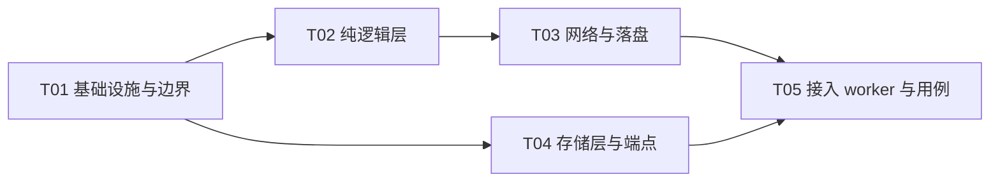

# 个人知识库 · R8 媒体下载设计（封面/图片落盘 → attachments → /api/media）

| 项 | 内容 |
|---|---|
| 版本 | v1.0 |
| 日期 | 2026-11-28 |
| 需求来源 | `docs/prd/2026-11-25-PRD-v0.2.md` 的 M2-03 / M4-02（P0）、M4-07（P2）；`docs/tech/2026-11-26-技术方案.md` §4.6、§4.8、§8.2 |
| 工程基线 | 759 passed / 90 skipped；`attachments` 表已建、零行数据；`/api/media/{key}` 未实现 |
| 本轮边界 | 下载封面与图文图片、写 `attachments`、实现 `GET /api/media/{key}`。不改表结构，不下视频原文件 |
| 图文件 | 类图 `docs/tech/2026-11-28-R8媒体下载-类图.mermaid`；时序图 `docs/tech/2026-11-28-R8媒体下载-时序图.mermaid` |

---

## 0. 范围结论（先回答被要求独立判断的那件事）

### 0.1 判断：范围「只下封面与图文图片、不下视频原文件」是对的，但理由要换一个，并且必须补三处缺口

**结论：取舍正确，维持。** 但交接说明里给的理由（「抽帧/ASR 都还没接进 worker，现在下了也用不上」）是一句**会过期**的理由——一旦抽帧接进去它就失效了，而且它无法回答「那接进去之后怎么办」。正确的理由与它无关：

> PRD M4-07 把视频原文件定为 **P2「按需」**，PRD §5.5 成本控制表写「视频 | 默认不存原文件，只存封面 + 字幕 + 摘要」。这是**产品层面已经做掉的决策**，不是技术实现细节。技术方案 §4.6 的「抓到时立即下载，不留外链」约束的是「我们**存**什么」，不是「我们**不存**什么」——不存的东西没有外链可留。

按这个口径重新检查派生的三个问题：

**（一）只下封面不下视频，会不会让抽帧永远无法工作？不会，但有一个必须写下来的前提。**

抽帧的入口是 `extract_frames(video_path: str, ...)`，它要的是**本地文件路径**，没有文件就跑不了。但这不构成「永远无法工作」，因为 P2「按需下载」的语义就是**在那个时刻才下载**：

```
用户对某条视频点「生成章节」
  → 用 items.url 重新走一次 ParseHub（拿新的签名 URL）
  → 下载到临时文件
  → extract_frames(临时文件) → 帧落盘为 attachments(role='snapshot')
  → 删除临时视频文件
```

这条路比「抓取时就存」**更好**：避免为一千条只看过标题的视频存下几十 GB。代价是一条必须写进文档的事实：**抽帧需要联网重抓一次，不能离线跑**。这笔代价是 PRD M4-07 定 P2 时就已经买了的单，不是本轮引入的。

顺带一个免费的优化：`props.mediaUrls` 里保留着抓取那一刻的视频签名 URL。按需下载时**先试它**（没过期就省一次重抓），403 再回落到重抓。这不改变任何架构，只是让按需路径快一点。

**（二）抖音封面 URL 与视频 URL 的过期特性：现在是实测事实，而且两者机制不同。**

2026-11-28 平板真机抓一条抖音视频（第 12 集 网络协议）实测：

| 媒体 | 过期信息在哪 | 实测值 | 可读性 |
|---|---|---|---|
| 封面（`thumb_url`） | query 明文 `x-expires` + `x-signature` | `x-expires=1797048000` → **2026-12-12T04:00:00Z**，距抓取时刻约 **14 天** | 明文可读 |
| 视频（`url`） | query 里**没有** `x-expires`，过期信息在加密的 `rc` 参数里 | `rc=ZTRoOWk7Nzc8OzU2ODo5M0BpM2d5Oms5cjxuZTMzNGkzM0A0NT` | 不可读 |

所以「两者过期特性是否相同」的答案是 **不同**：封面是明文签名、约两周；视频的过期信息加密在 `rc` 里，看不出来。原来的结论（不依赖两者相同）仍然成立，但现在有了更硬的依据——**封面确实会过期，且有明确的 14 天窗口**。

**这个 14 天窗口影响「下载失败能不能重试」的设计**，见 §5.2：

- 重试窗口是存在的，所以「下载失败静默丢弃」完全没必要——14 天内重试都还来得及。
- 但也**不能因此新增自动重试**。查证：`POST /api/items/{id}/retry` 在技术方案 §8.2 的端点表里有（M2-10），但 `kb/api/app.py:191-203` 的路由表里**没有它**，本轮也不做。所以「重试」在本轮只有一条物理路径：等用户手动重新保存同一条链接——而那条路径被 `items_url_norm_uniq` 挡住（返回 `duplicate=True`）、并且 `create_item` 的注释明确写了「重复时不重新入队」。**结论：本轮没有重试手段。** 这恰好支持 §5.2 的口径——媒体失败绝不能污染 `jobs` 状态，否则一条封面 403 会让条目永久停在「处理失败」而用户无路可走。

> 注：这一点与 team-lead 的判断有分歧。他给的证据（14 天窗口）本身正确，但「重试窗口是有的」只对**外部的 URL 有效期**成立，对**我们自己的重试机制**不成立——`retry` 端点不存在。这两件事不能混。

足够性方面：P0 里封面承担全部展示职责（M7-01 卡片网格「封面为主视觉」、M7-03 详情页「封面/播放器」）。视频的时长走 `items.props.duration_sec`（已落地），简介走 `content_text`/`summary`，都不需要视频字节。所以**对 P0 而言只下封面是完备的**。

**（三）`role='video'` 空着是否留下结构缺陷？不是缺陷，但 `items.primary_media` 的语义要钉死。**

`attachments_role_allowed` 的 `CHECK (role in (...))` 是**白名单**，不是「每个值都必须被写满」的承诺。今天 `doc`（M1-04 P1 未做）、`snapshot`（M2-08 P1 未做）、`audio`（ASR 未接）同样一行都没有——`video` 只是第四个。把它当成缺陷，等于要求一次性实现四个 P1/P2 需求。

真正需要钉死的是别处：`items.primary_media` 的语义必须是「**这条内容用来做展示图的那张附件**」，而不是「视频附件」。视频条目的 `primary_media` 指向**封面**（`role='cover'`）。语义写错，M7-01 的卡片会拿不到图。

### 0.2 必须补的三处缺口（不改，本轮做出来的东西是错的）

**缺口一（最严重）：封面的 URL 根本不在 `MediaItem.url` 里，而在 `thumb_url` 里。按「下载每个 media 的 url」写，封面一张都下不到，反而会把 mp4 全下下来。**

证据链（前两条是代码事实，第三条是 2026-11-28 平板真机实测）：

| 位置 | 事实 |
|---|---|
| `kb/extract/normalize.py:222` | `default_role = "video" if post_type == "video" else "image"` —— **role 永远只会是 `video` 或 `image`，不会是 `cover`** |
| `kb/extract/normalize.py:59-70` | `MediaItem(role, url, ext, thumb_url, ...)`：视频的 `url` 是 mp4，`thumb_url` 是封面 |
| 真机实测（第 12 集 网络协议） | `media count: 1`，唯一一条是 `role='video' ext='mp4' 768x576`；`url` 指向 `v95-aw-cold.douyinvod.com/...`（mp4），`thumb` 指向 `p95-zjwztc-sign.douyinpic.com/....jpeg?x-expires=...&x-signature=...`（jpeg） |

也就是说：**`role='cover'` 今天没有任何生产者。** 封面必须以 `thumb_url` 为源**合成**一条 `role='cover'`，而这条规则不存在于任何现有代码里。写成「遍历 media 下载 url」，结果是把我们决定不下的 mp4 全下了，而封面是零。

**同时必须处理 `thumb_url` 为空的两类情形**（真机只验了视频，图文与文章没有样本）：

| 情形 | `thumb_url` | 本设计的处理 |
|---|---|---|
| 视频有封面 | 有值（实测） | `role='cover'`，取 `thumb_url` |
| 图文 | 无 `thumb_url`（技术方案字段表里图文列没有该字段） | 取 `media[0].url` 当卡片封面——但**不额外产一条 `role='cover'`**。那张图已作为 `role='image'` 下载，`items.primary_media` 直接指向那条 image 行。机制见 §6.3 |
| 文章 / 抓不到封面 | 无 | 不产 `role='cover'`，`primary_media` 留 `null`。前端按无封面渲染占位（M7-01 的「不裁切」要求下，占位比拉伸一张错图好） |

这三行的判定落在 `plan.py` 里，是一个纯函数，用例覆盖成本低；漏掉第二行会让图文条目的卡片全部没有封面——而图文是小红书/微博这类内容的主形态。

⚠️ **第二行的第一版设计有错，已修正**：原文写「天然去重成一份文件、两条 `attachments` 行」，这与 `attachments_key_uniq`（`storage_key` 全局唯一）直接矛盾——两行 same key 必然撞索引。正确的做法见 §6.3。

**缺口二：封面在 worker 边界上就已经被丢掉了。** `kb/worker/steps.py:66-73` 的 `_outcome_to_kwargs`：

```python
"media": [
    {"url": media.url, "ext": media.ext, "durationSec": media.duration_sec}
    for media in data.media
],
```

`thumb_url`、`width`、`height` **三个字段都没有被传下去**。所以即便下游写对了，`thumb_url` 也到不了。这一行必须改。

**缺口三：图文图片必须有数量与体积上限。** 抖音图文可达 35 张。按 PRD §5.5「单张 ≤ 200KB」是 7 MB/条，但 PRD 只限了单张、没限条数。不设上限，一条 35 图的内容会让单次 fetch 的耗时从 20 秒涨到分钟级。本设计给硬上限（见 §5.4）。

### 0.3 一处需要反过来说的：`storage_key` 不能用纯内容 sha256

交接问题里问「用内容 sha256 还是随机」。**两个都不能直接用**，因为 `attachments_key_uniq` 是 `(storage_key)` 上的**全局**唯一索引：

- **纯内容 sha256**：两个不同 item 引用同一份字节（同一张占位图、同一张转载图）时，第二条插入撞唯一索引。补救只有「`on conflict do nothing`」——于是第二个 item 永远没有封面，而字节明明在磁盘上。更隐蔽的是删除：`items` 删除级联删 `attachments` 行，若共用一个 `storage_key`，删 A 的行之后 B 的行还在、文件被谁删、什么时候删就说不清了。
- **纯随机**：不撞索引，但重试同一个 item 会生成新 key、新文件，旧行还在 → 重试一次多一份封面、多一个孤儿文件。

取两者的交集：**`storage_key` 由内容哈希派生，但把 `item_id` 一起哈希进去**。既保留「同 item 同内容 → 同 key → 重试天然幂等」，又保证「不同 item 永不撞索引」。磁盘上可能存两份同样的字节——在 163 GB 的设备上，为 200 KB 的封面付这点代价，换掉一整个「跨 item 删除竞态」的问题类别，是划算的。详见 §4。

---

## 1. 术语表

| 术语 | 一句人话 |
|---|---|
| 封面（cover） | 视频或文章在列表/详情里当主视觉的那张图。视频的封面来自 `thumb_url` |
| 图文图片（image） | 图文类内容的每一张图，本身就是内容的一部分 |
| storage_key | 文件在磁盘上的相对路径，也是 `attachments` 表的唯一键。长成 `ab/cdef...0123.jpg` |
| 内容寻址 | key 由文件内容的哈希算出来，所以同一份内容算出的 key 相同 |
| SSRF | 服务端被诱导去请求「内部」地址（本机接口、内网、云元数据）。本轮下载的 URL 来自第三方响应，天然有这风险 |
| 钉扎（pinning） | 先自己解析域名并校验 IP，然后**连那个 IP**，而不是让库再解析一次（否则两次解析结果可能不同，校验白做） |
| 归一化压缩 | 把过大的图统一缩到长边上限并重编码，满足 PRD「单张 ≤ 200KB」 |
| 幂等 | 同一件事做两遍，结果与做一遍相同（不产生第二份文件、第二条记录） |

---

## 2. 实现方案与模块划分

### 2.1 为什么新开 `kb/media/` 一层

三条理由，每条都对应一个已有的架构决定：

1. **`kb/extract/` 出的是「URL 列表」，`kb/media/` 出的是「磁盘上的字节」。** 混在一起会让「抓取失败」与「下载失败」共用一套降级口径，而两者该分开：抓取失败要标 `fetchError` 让用户重试，封面下载失败不该。这与 `kb/vision/` 与 `kb/asr/` 分开的理由同构。
2. **`kb/media/` 必须能脱离数据库单测。** 按 `layer_rules.toml` 已有的三层禁令（`kb/extract/`、`kb/ai/`、`kb/vision/` 都禁 `import kb.store`），`kb/media/` 也登记进去。落库由 worker 经 `kb.store.attachments` 做。**这条必须显式登记**——`layer_rules.toml` 自己的注释里就记着「不登记时 `kb/vision/` 只剩两条规则生效，`import kb.store` 这条会静默漏检」。
3. **写库 SQL 只能在 `kb/store/`。** 所以下载与落库必然分属两层，不存在「合成一个文件更简单」的选项。

### 2.2 文件清单

| 文件 | 新增/改 | 职责 | 依赖外部库 | 可纯单测 |
|---|---|---|---|---|
| `kb/media/__init__.py` | 新增 | 包入口，只做惰性导出 | 否 | — |
| `kb/media/config.py` | 新增 | 全部数值常量（超时、上限、长边、质量） | 否 | — |
| `kb/media/models.py` | 新增 | frozen dataclass：`MediaSpec` / `DownloadedBlob` / `StoredBlob` / `Skip` | 否 | — |
| `kb/media/layout.py` | 新增 | `storage_key` 派生与校验、mime→扩展名映射 | 否 | 是 |
| `kb/media/sniff.py` | 新增 | 从字节头判 mime；mime 白名单判定 | 否 | 是 |
| `kb/media/plan.py` | 新增 | `plan_attachments(media, kind)` → 按 role/上限裁出待下载清单 | 否 | 是 |
| `kb/media/guard.py` | 新增 | SSRF 判定：URL 合法性、IP 段拒绝表、钉扎目标构造 | 否（`socket` 注入） | 是（注入解析器） |
| `kb/media/fetch.py` | 新增 | `Downloader` Protocol + `HttpxDownloader`（唯一发网络请求处） | 是（`httpx`） | 假实现可测 |
| `kb/media/encode.py` | 新增 | `ImageEncoder` Protocol + `PillowEncoder`（方法内 import） | 是（`PIL`，方法内） | 假实现可测 |
| `kb/media/persist.py` | 新增 | 编排：下载 → 校验 → 压缩 → 写盘 → 产出待落库记录 | 否 | 是（两个假实现） |
| `kb/store/attachments.py` | 新增 | 全部 SQL：替换某 item 的附件、按 key 查 mime、统计 | 是（`pg8000`） | 真库 pg 用例 |
| `kb/api/media.py` | 新增 | `GET /api/media/{key}` handler 工厂 | 否 | 是（假 pool） |
| `kb/api/app.py` | 改 | 注册路由；把 `media_root` 注入 handler | — | — |
| `kb/worker/steps.py` | 改 | `_outcome_to_kwargs` 补 `thumbUrl`/`width`/`height`；`run_fetch` 里接媒体阶段 | — | — |
| `layer_rules.toml` | 改 | 加 `kb/media/` 禁 `import kb.store` | — | — |
| `pyproject.toml` | 改 | `packages` 加 `kb.media`；依赖声明加 `pillow` | — | — |
| `tests/test_media_layout.py` | 新增 | key 派生、格式校验、扩展名映射 | — | — |
| `tests/test_media_guard.py` | 新增 | SSRF 拒绝表、钉扎构造、重定向不改判 | — | — |
| `tests/test_media_sniff.py` | 新增 | 字节头判 mime、伪造 Content-Type、SVG 拒绝 | — | — |
| `tests/test_media_plan.py` | 新增 | 封面合成、数量/体积上限、图文与视频分支 | — | — |
| `tests/test_media_persist.py` | 新增 | 幂等、压缩触发、失败降级（两个假实现） | — | — |
| `tests/test_api_media.py` | 新增 | 200/404/路径穿越/Cache-Control/鉴权 | — | — |
| `tests/test_store_attachments_pg.py` | 新增 | 替换语义、唯一索引、角色与 mime 约束 | — | 真库 |

### 2.3 分层与调用方向

```
kb/api/media.py ─────────┐
                         ├─> kb/store/attachments.py ──> pg8000
kb/worker/steps.py ──────┘                │
        │                                 │  （只有这里能出现写库 SQL）
        ├─> kb/media/persist.py ──> fetch.py / encode.py / layout.py / sniff.py / guard.py
        └─> kb/store/items.py（已有）
```

`kb/media/` 不认识 `kb.store`，也不认识 `kb.extract`：输入是 `list[dict]`（与 `store.items.apply_extract` 收 `media: list[dict]` 的口径一致），输出是 `list[StoredBlob]`。换抓取实现时 `kb/media/` 一行都不用改。

---

## 3. 精确接口签名

### 3.1 `kb/media/models.py`

```python
@dataclass(frozen=True)
class MediaSpec:
    """一条待下载的媒体。由 plan.py 产出，不含任何 URL 之外的信息。"""
    role: str           # 'cover' | 'image'（'video' 本轮不产出）
    url: str
    sort_order: int


@dataclass(frozen=True)
class DownloadedBlob:
    """下载完成、尚未写盘的字节。mime 是**判定后**的值，不是响应头原值。"""
    role: str
    url: str
    sort_order: int
    data: bytes
    mime: str           # 已过白名单、已与 role 对齐
    ext: str            # 由 mime 决定，不由上游 ext 或 URL 路径决定


@dataclass(frozen=True)
class StoredBlob:
    """写盘完成、等待落库的最终形态。字段与 attachments 列一一对应。"""
    role: str
    storage_key: str
    mime: str
    size_bytes: int
    width: int | None
    height: int | None
    duration_sec: int | None
    sha256: str
    sort_order: int


@dataclass(frozen=True)
class SkippedMedia:
    """一条媒体没存成。reason 是给人看的短句，写进 props.mediaError。"""
    role: str
    url: str
    reason: str


@dataclass(frozen=True)
class MediaResult:
    stored: tuple[StoredBlob, ...]
    skipped: tuple[SkippedMedia, ...]
```

### 3.2 `kb/media/layout.py`（纯函数）

```python
KEY_RE: Final[re.Pattern[str]]          # ^[0-9a-f]{2}/[0-9a-f]{32}\.[a-z0-9]{1,5}$
MIME_EXT: Final[Mapping[str, str]]      # image/jpeg→jpg, image/png→png, ...

def storage_key(item_id: int, content_sha256: str, ext: str) -> str:
    """由 (item_id, 内容 sha256, ext) 派生 storage_key，形如 'ab/cdef…0123.jpg'。

    为什么把 item_id 哈希进去：attachments_key_uniq 是全局唯一索引，
    纯内容哈希会让两个 item 的同一张图撞索引。见 §4。
    """

def is_valid_key(key: str) -> bool:
    """只做格式判定，不碰数据库也不碰文件系统。正则命中即 True。"""

def ext_for_mime(mime: str) -> str | None:
    """mime → 扩展名。未登记返回 None（调用方据此拒绝该 blob）。"""
```

### 3.3 `kb/media/sniff.py`（纯函数）

```python
ALLOWED_PREFIXES: Final[tuple[str, ...]]   # 与 attachments_mime_allowed 对齐
FORBIDDEN_MIMES: Final[frozenset[str]]     # {'image/svg+xml'}，见 §7.3

def sniff_mime(data: bytes, header_value: str) -> tuple[str, str] | None:
    """判定 mime。返回 (mime, 判定依据: 'header'|'magic')，判定不出返回 None。

    顺序：① 剥响应头的 ';charset=...' ② 命中白名单且不被禁 → 用它
         ③ 是 octet-stream / 空 / 不在白名单 → 用字节头判
         ④ 字节头也判不出 → None（调用方拒绝，不存来历不明的 blob）
    """

def mime_matches_role(mime: str, role: str) -> bool:
    """cover/image 只接受 image/*；video 只接受 video/*。"""
```

### 3.4 `kb/media/plan.py`（纯函数）

```python
MAX_IMAGES_PER_ITEM: Final[int] = 20      # 见 §5.4
MAX_SOURCE_BYTES: Final[int] = 8 * 1024 * 1024

def plan_attachments(
    media: list[dict[str, object]], *, kind: str,
    max_images: int = MAX_IMAGES_PER_ITEM,
) -> list[MediaSpec]:
    """把抓取层的 media 列表裁成待下载清单。

    四条规则，顺序有意义（前三条产封面，是**互斥的回落链**）：
    1. 有 media 的 `thumbUrl` → 一条 role='cover'（sort_order=0）。
       视频的封面只可能来自这里——media 的 `url` 是 mp4（真机实测）。
    2. 没有 thumbUrl、但有 role='image' 的 media → 取**第一条的 url** 当封面
       （sort_order=0）。图文类内容没有 thumb_url，不回落就整类没有卡片封面。
       ⚠️ 这一条**不额外产 MediaSpec**：那张图已经在第 4 条里以 role='image'
       下载了。这里只记下「用它的 url 作为封面来源」，由 persist 层在落库后
       把 primary_media 指向那条 image 行。**同一份字节只产一条 MediaSpec。**
    3. 两者都没有 → 不产 role='cover'，items.primary_media 留 null。
    4. role='image' 的每一条 `url` → role='image'，sort_order 从 1 递增。
       role='video' 的 `url` **本轮不下**（PRD M4-07 P2）。

    超过 max_images 张时截断，并把真实总数带回去写 props.mediaTruncated。

    **去重不靠 storage_key 撞索引，靠这里不产出重复项。** 详见 §6.3。
    """
```

**为什么这条回落链必须写死在纯函数里，而不是留给调用方**：图文是小红书/微博的主形态，而技术方案的字段表里图文项**没有** `thumb_url`。漏了第 2 条，一类内容的卡片会全部空白；漏了第 3 条，`primary_media` 会指向一个不存在的附件 id。三条都在 `plan.py` 里，用一个 `list[dict]` 就能断言，不需要起服务也不用联网。

**第 2 条为什么要写成「不额外产 MediaSpec」，而不能产两条再靠 key 去重**（这是第一版设计的错误，见 §6.3）：

`attachments_key_uniq` 是 `storage_key` **单列**全局唯一。若 cover 与 image 指向同一张图，而 `storage_key = sha256(item_id + 内容)` **不含 role**，两行必然算出同一个 key → 第二条插入必然 `UniqueViolation`。加 `on conflict do nothing` 只会让第二个 role 静默消失，看起来像「正常去重」，实际是数据丢失。所以冲突必须在**产出清单这一步**就消灭，不能留到写库层。

那 `role='cover'` 这个值还有用吗？有，但只用于**视频**（第 1 条，`thumb_url` 与 mp4 是两个不同的字节，key 天然不同）。图文场景不需要 cover 行——`items.primary_media` 直接指向 image 行即可。

### 3.5 `kb/media/guard.py`（纯逻辑 + 注入解析器）

```python
class Resolver(Protocol):
    def __call__(self, host: str, port: int) -> list[str]: ...   # 返回 IP 字面量


def is_public_ip(ip: str) -> bool:
    """这个 IP 能不能连。三步叠加，见 §7.1 的实测依据。

    顺序固定，三步都不许省、也不许合并：
    ① 内嵌 v4 的过渡形式一律拒绝（::ffff:0:0/96、64:ff9b::/96、
       64:ff9b:1::/48、2002::/16、2001::/32）。**不解析内嵌地址，直接拒。**
       这一步不依赖任何 is_* 属性，所以 is_global 未来改行为时它仍成立。
    ② 硬编码拒绝段（11 个 v4 + 8 个 v6）。必须比 addr.version == net.version，
       否则 v4 地址 in v6 网络恒 False——这是「只列 v4 段 → IPv6 全放行」的根因。
    ③ 白名单语义：is_global 为真且 private/loopback/link_local/multicast/
       reserved/unspecified 全为假。
    ①②③ 是并联的，任一拒绝即拒绝。
    """


def check_url(url: str, *, resolver: Resolver) -> PinnedTarget | str:
    """校验 URL 并给出「钉扎」后的连接目标。返回 str 表示拒绝原因。

    顺序固定：
    ① scheme ∈ {http, https}、port ∈ {None, 80, 443}、无 username
    ② hostname 若是 IP 字面量，直接走 is_public_ip（不经 DNS）
       否则 resolver 解析出 **全部** IP，**每一个** is_public_ip 都必须为 True
       （任一不合格即整条拒绝——实测 localhost 返回 [127.0.0.1, ::1] 两条）
    ③ 取第一个合格 IP 构造 PinnedTarget

    返回 str 而不是抛异常：拒绝是正常业务结果（第三方给的 URL 不可信是常态），
    调用方要把它记成 SkippedMedia 继续下一条。
    """
```

`Resolver` 返回 `list[str]` 而不是单个 IP：`getaddrinfo` 天然返回多条，只取第一条会漏掉「第二条是 `127.0.0.1`」这种情形。**判定作用于整个列表，连接才取其中一条。**

IP 字面量 URL（`http://1.2.3.4/a.jpg`）放行：`is_public_ip` 收的是 IP 字符串，所以「URL 里写 IP」与「域名解析出 IP」走同一条判定，不需要分支。十进制/十六进制变形（`http://2130706433/a.jpg` = `127.0.0.1`）也因此自然被兜住，不依赖 libc 的解析行为。

### 3.6 `kb/media/fetch.py`（唯一发网络请求处）

```python
class Downloader(Protocol):
    def get(self, target: PinnedTarget, *, max_bytes: int,
            deadline: float) -> tuple[int, dict[str, str], bytes]: ...

class HttpxDownloader:
    """httpx 装配。trust_env=False、follow_redirects=False，按块读并守两个上限。"""

    def __init__(self, *, client_factory: object | None = None,
                 clock: Callable[[], float] | None = None) -> None: ...
```

### 3.7 `kb/media/encode.py`

```python
class ImageEncoder(Protocol):
    def normalize(self, data: bytes, *, long_side: int, max_bytes: int
                 ) -> tuple[bytes, int | None, int | None]: ...
    """返回 (可能被重编码的字节, 宽, 高)。不需要处理时原样返回入参。"""

class PillowEncoder:
    """Pillow 装配。`PIL` 在方法内 import，纯逻辑单测不需要装它。"""
```

### 3.8 `kb/media/persist.py`

```python
def store_media(
    specs: list[MediaSpec], *, item_id: int, media_root: Path,
    downloader: Downloader, encoder: ImageEncoder,
    resolver: Resolver, clock: Callable[[], float] | None = None,
    stage_budget_sec: float = STAGE_BUDGET_SEC,
) -> MediaResult:
    """下载 → 校验 → 压缩 → 写盘。**不碰数据库**，返回待落库的 StoredBlob。

    单条失败记进 skipped 并继续下一条，不抛异常——一张图 404 不该让另外 19 张
    一起丢。整段超过 stage_budget_sec 时停止并给剩余条目记 skipped。
    """
```

### 3.9 `kb/store/attachments.py`

```python
def replace_for_item(
    conn, item_id: int, blobs: list[StoredBlob], *, primary_role: str | None = None,
) -> int:
    """整体替换某 item 的附件（仅限 cover/image 两个 role），返回写入行数。

    先 delete 后 insert。**两条独立语句**，不是一条 CTE —— 理由见 §6.2。

    顺带把 `items.primary_media` 指向 `primary_role` 那一行的 id（同一条 SQL 里
    见 §6.3）。

    `blobs` 必须已按 storage_key 去过重（`persist` 保证）。这里**不做**
    `on conflict do nothing`：撞唯一索引说明上游去重漏了，是编程错误，
    静默跳过会让第二个 role 无声消失。
    """

def mime_for_key(conn, key: str) -> str | None:
    """按 storage_key 取 mime。查不到返回 None（端点据此给 404，不是 400）。"""

def stats(conn, item_id: int) -> dict[str, int]:
    """按 role 分组的条数与总字节。供健康检查与将来的清理逻辑用。"""
```

### 3.10 `kb/api/media.py`

```python
def file_response(pool: Pool, media_root: Path) -> Handler:
    """GET /api/media/{key}。

    顺序（与技术方案 §8.2 一致，一条不许挪）：
    ① is_valid_key(key) 不通过 → 404（不是 400，避免成为存在性探针）
    ② mime_for_key 查不到 → 404
    ③ 拼路径并校验仍在 media_root 之内 → 不在则 404
    ④ FileResponse(path, media_type=mime) + Cache-Control
    """
```

### 3.11 注入点汇总

| 注入点 | 生产实现 | 测试实现 | 为什么必须可注入 |
|---|---|---|---|
| `Downloader` | `HttpxDownloader` | 按脚本返回的假下载器 | 单测不许联网，也不许依赖 CDN 今天是否可用 |
| `ImageEncoder` | `PillowEncoder` | 原样返回的 `NullEncoder` | 纯逻辑单测不该被迫装 Pillow |
| `Resolver` | `socket.getaddrinfo` | 固定 IP 表的假解析器 | SSRF 用例要能构造「域名解析到 127.0.0.1」 |
| `clock` | `time.monotonic` | 受控时钟 | 阶段总预算的用例要毫秒级跑完 |

全部是**构造参数**，不用 monkeypatch：构造参数写在签名里，读代码就能看见用了什么；patch 让「这个函数依赖什么」变成运行时才知道。这与 `kb/vision/frames.py`、`kb/ai/transport.py` 的既定做法一致。

---

## 4. 存储布局与 `storage_key`

### 4.1 派生算法

```python
def storage_key(item_id: int, content_sha256: str, ext: str) -> str:
    seed = f"{item_id}:{content_sha256}".encode()          # 内容 + 归属
    h = hashlib.sha256(seed).hexdigest()[:34]              # 34 个 hex 字符
    return f"{h[:2]}/{h[2:34]}.{ext}"                      # 2 位目录 / 32 位名
```

得到 `ab/cdef0123...9f.jpg`：2 位十六进制做一级目录，避免单目录堆积十几万文件（ext4/xfs 单目录文件数超过约 10 万时 `readdir` 明显变慢）；32 位十六进制做文件名，与 `attachments_key_uniq` 的唯一性要求匹配（sha256 截断到 128 bit，碰撞概率与 md5 同量级，而在单用户、几千条内容、每条最多 20 个附件的规模下，实际碰撞概率可忽略）。

### 4.2 三个被问到的问题，各自的答案

**问题一：hex 是内容 hash 还是随机？答：内容 hash，但混入 `item_id` 再哈希。**

| 方案 | 撞唯一索引 | 重试幂等 | 跨 item 删除 | 结论 |
|---|---|---|---|---|
| 纯内容 sha256 | **会**（两个 item 同一张图） | 是 | 共用文件 → 删谁的说不清 | 否 |
| 纯随机 | 不会 | **不会**（重试多一份文件） | 各自独立 | 否 |
| `sha256(item_id + 内容)` | 不会 | 是 | 各自独立 | **采用** |

**问题二：同一张封面重复下载怎么处理？答：同 item 同内容 → 同一个 key → 文件层与数据库层都天然幂等。**

- 文件层：写之前判 `path.exists()`，存在就跳过写入（内容相同，key 相同，文件必然一致）。
- 数据库层：`replace_for_item` 是「整体替换」，重跑的结果与跑一次相同。
- 内容变了（上游换了封面）：`sha256` 变 → key 变 → 新的行替换旧的行，旧文件变孤儿，由将来的清理逻辑回收。**本轮不实现清理**，但 `storage_key` 的目录分片设计让「扫全盘找孤儿」是可行的（`stats()` 已给出每条的字节数）。

**问题三：`storage_key` 唯一索引冲突怎么办？答：不该发生，若发生按编程错误处理。**

冲突只有两种来源：① 同 item 同内容重复插——被 `replace_for_item` 的「先删后插」消掉；② 128 bit 哈希碰撞——概率可忽略。所以 SQL 里**不写 `on conflict do nothing`**：写了等于把一次真实的数据完整性异常伪装成正常运行，而「第二个 item 悄悄没有封面」这种故障排查起来极慢。

### 4.3 磁盘目录

```
<KB_MEDIA_ROOT>/                       默认 Path.home() / "media"
├── ab/cdef0123...9f.jpg               正式文件，storage_key 原样拼
└── .incoming/                         下载中的临时目录，同分区，写完整再 rename
    └── <uuid4>.part
```

**临时文件必须与正式文件同分区**：`os.replace` 跨文件系统会退化成「复制 + 删除」，既慢又不是原子的。写到 `.incoming/` 再 `os.replace` 到正式路径，保证「正式路径上出现的文件必然是完整的」——否则 worker 被 kill 会留下半张图，而 `/api/media` 会把它当正常图返回（浏览器显示为截断的灰块，比 404 更难查）。

`.incoming/` 里的残留由进程启动时清空（与 `api/app.py` 的 lifespan 里清过期会话同一个思路）。

---

## 5. 下载流程

### 5.1 什么时候下

在 `run_fetch` 内部，**元数据已落库之后**（技术方案 §6.4 的 `fetch` 行：抓取元数据 + 下载媒体）。

```
run_fetch(conn, item_id, job_id, *, extractor)
  ├─ 1. extractor(url) → ExtractOutcome
  ├─ 2. apply_extract(...)              ← 元数据落库（已有）
  ├─ 3. 若 not outcome.ok → mark_failed，返回（不下载）
  ├─ 4. plan_attachments(...) → specs
  ├─ 5. store_media(specs, ...) → MediaResult        ← 新增，不碰数据库
  ├─ 6. 若有 stored → attachments.replace_for_item(...)
  ├─ 7. 写 props.mediaError（仅当有 skipped）与 props.primaryMedia
  ├─ 8. mark_done(fetch); enqueue(summarize)
  └─ 9. 无论 5/6 成败都走到 8
```

**不新增 `jobs.step` 的值。** `jobs.step` 的 `CHECK` 只有 `('fetch','ocr','summarize','tag','index')`，加一个 `media` 要改迁移 + 改 `SUPPORTED_STEPS` + 改已有断言 `jobs` 枚举的用例。收益只是「排障时能分开看」，代价是一处 schema 变更和三处测试改动。本轮不做。

### 5.2 失败怎么办（这是被点名的问题）

**封面下不来，fetch 步骤仍算成功。** 分三层落地：

| 层 | 失败写哪 | 影响 |
|---|---|---|
| 单条媒体（这一张图 404/超时/超体积/mime 不可判） | `props.mediaError`（一条短的汇总串） | 该条内容**不标红**，卡片显示占位图 |
| 全部媒体都失败 | 同上 | 同上 |
| 整个媒体阶段抛未预期异常 | 同上，且 `log.exception` | 同上 |

理由：`derive_status` 只要看到任意一个 job 是 `failed` 就把条目显示成「处理失败」。而封面下载失败与「正文没抓到」是完全不同量级的事——前者不影响这条内容可用，后者影响。为了把前者也标红，用户会对一堆本来能读的条目点重试，每次重试都重新走一遍 ParseHub（10–20 秒 + 上游风控风险）。

**静默忽略也不接受**，所以 `props.mediaError` 是必须写的——它让详情页能显示「封面未能下载」而不必再看日志。

**「能不能自动重试」这件事要单独说清楚，因为它直接影响上面这条口径的强度。**

实测得出封面签名 URL 有约 14 天有效期（`x-expires=1797048000` → 2026-12-12T04:00:00Z）。这个窗口**不构成**「可以稍后再下载」的理由，因为：

1. **签名 URL 只存在内存里，抓取结束就没了。** `props.mediaUrls` 存的是视频 URL（`media[].url`），封面 URL 从来没被持久化——`_outcome_to_kwargs` 连 `thumb_url` 都没传（缺口二）。就算存了，`props.mediaUrls` 按 §10 的约定是「仅作溯源，禁止当 ``」。**下一个进程拿不到那个 URL，14 天窗口对它毫无意义。**
2. **本轮没有重试机制。** 技术方案 §8.2 的端点表列了 `POST /api/items/{id}/retry`（M2-10），但 `kb/api/app.py:191-203` 的路由表里**没有它**，本轮也不实现。唯一的重入路径是「用户重新保存同一条链接」，而那条路径被 `items_url_norm_uniq` 挡成 `duplicate=True`，且 `create_item` 的注释写明「重复时不重新入队」。

所以结论是：**媒体下载失败在本轮等于永久缺失，没有第二次机会。** 这恰好让上面「不污染 `jobs`」的口径更强，而不是更弱——如果因为封面 403 就把 job 标 `failed`，条目会永久停在「处理失败」，而用户点重试也没有端点可用。宁可留一条能读的内容 + 一句「封面未能下载」。

补一条设计上的取舍：既然只有一次机会，是否该把「下载失败」也算进 `jobs.attempts` 让 worker 自动重来？**不。** 理由是同一条 `jobs` 行同时承载 fetch 与媒体两个阶段，`attempts + 1` 会连带把**整个 ParseHub 抓取**重跑一遍（10–20 秒 + 上游风控风险），只为补一张图。代价与收益完全不成比例。

### 5.3 超时与体积上限

| 项 | 值 | 依据 |
|---|---|---|
| 单次连接 | 5 秒 | 与 `kb/ai/config.TIMEOUT_CONNECT` 同值，同一台设备实测可用 |
| 单次读 | 10 秒 | 同上（`TIMEOUT_READ`） |
| 单条总时长 | 20 秒 | 与 `TIMEOUT_TOTAL` 同值。由 `fetch.py` 的读循环自己计时（`httpx.Timeout` 没有 `total` 字段，这条已在 `kb/ai/transport.py` 踩过） |
| 整个媒体阶段 | 90 秒 | 20 张图串行，每张 ≤20 秒的上界是 400 秒，必须另设阶段闸门。超出时剩余条目记 `skipped` 并继续 |
| 单文件字节 | 8 MiB（原始） | 一张正经的封面/配图到不了 8 MiB。超过只可能是「下错东西了」（比如签名的 URL 失效后 CDN 返回一个 HTML 错误页被当成图） |
| 单 item 总字节 | 16 MiB | 20 张 × 压缩后 ≤200 KB 是 4 MiB，留 4 倍余量 |

体积上限靠**边读边累计**判定，不靠 `Content-Length`：服务端可以撒一个 100 字节的 `Content-Length` 然后吐 1 GB。这与 `kb/ai/transport.py` 的 `max_response_bytes` 是同一个教训。

### 5.4 数量上限

| 项 | 值 | 依据 |
|---|---|---|
| 每条内容最多图片 | 20 张 | 抖音图文上限约 35 张。20 张足够覆盖「多图」语义，又不让单次 fetch 超时。超出部分截断并在 `props.mediaTruncated` 记真实总数 |
| 封面 | 1 张 | 视频只有一个 `thumb_url` |

### 5.5 归一化压缩参数

PRD §5.5 要求「封面存储｜统一压缩，单张 ≤ 200KB」。这是**产品要求**，不是优化，所以参数要能算出结论而不是靠手感：

| 项 | 值 | 依据 |
|---|---|---|
| 长边上限 | 1600 px | M7-01 卡片网格「按原始比例排列、不裁切」。卡片实际显示宽度在平板竖屏约 340–400 CSS px，按 2.5–3 倍 DPR 算是 850–1200 物理像素；1600 留出「点开看大图」的余量 |
| 目标字节 | 200 KiB（硬上限 220 KiB） | PRD §5.5。`max_bytes` 先按质量 82 编码一次，超了按质量 70 再编一次，仍超则按 0.75 比例缩长边再来一轮（最多 3 轮） |
| 输出格式 | JPEG | 唯一能在「≤200 KiB + 照片类内容」两者间同时成立的格式。PNG 无损存照片会到 2–5 MB |
| **不做的事：放大** | — | 640×360 的封面不放到 1600。只缩不放（`kb/vision/grab.py` 的 `encode` 已定同一口径：`long_side` 是上限不是目标） |
| **不做的事：裁剪** | — | 裁剪会破坏 M7-01 的「不裁切」要求 |
| 透明通道 | 有 alpha 且含非透明像素时铺白底 | JPEG 不支持 alpha，直接转会把透明区变黑。铺白比保留黑更符合「卡片白底」的场景 |
| 动图 | 只取第一帧 | 卡片只需要一张静图；保留 GIF 会让单文件体积失控 |
| 已经是 JPEG 且 ≤ 200 KiB 且长边 ≤ 1600 | **原样通过，不重编码** | 重编码是无中生有的质量损失。这条也让「重跑 fetch」的字节完全稳定，`storage_key` 才真的幂等 |

最后一行的意义值得单独说：如果每次下载都无条件重编码，同一张图两次跑出的字节可能因编码器版本差异而不同，`sha256` 就变了、`storage_key` 也变了，「重试幂等」这条性质立刻失效。**「不需要处理就原样返回」是幂等的前提，不是省事。**

### 5.6 同步还是异步

**同步、串行，不加线程。** 三条理由：

1. **心跳已与干活解耦。** `kb/worker/__main__.py` 的心跳跑在独立线程（`_heartbeat_loop`），主循环被占住 60 秒也不会误报 worker 死亡。这是「同步下载会拖垮队列」这个担心的真正解法，而它已经存在。
2. **并发会引入跨条目的资源竞争，而收益有限。** 20 张 200 KB 的图从同一 CDN 串行取，按每次 200–500 ms 估是 4–10 秒。开 4 个线程能压到 2 秒左右——省下几秒，换来「多个连接同时占内存」的风险，而 8 GB 平板刚因为并发解码崩过一次（`kb/vision/grab.py` 的 docstring 记着这件事）。
3. **队列是单进程轮询**，本来就不并发。在这里开线程，只是把一个「串行但确定」的系统变成一个「局部并发」的系统。

代价如实记录：一条 20 图的图文内容会让 fetch 任务耗时 10–30 秒，期间队列里其他条目等待。单用户场景可接受。

---

## 6. 幂等与去重

### 6.1 三种「重复」要分清

| 场景 | 现象 | 处理 |
|---|---|---|
| 同一 item 的 fetch 重跑 | 请求同一批媒体 | 文件层 `exists()` 跳过写；数据库层整体替换。结果与跑一次相同 |
| 同一 URL 存两次 | `items_url_norm_uniq` 已拦住，不会产生第二个 item | 无需在媒体层处理 |
| 两个不同 item 的内容字节相同 | 两个独立 key、两份文件 | **有意接受**。见 §0.3：宁可多占 200 KB，不要跨 item 删除竞态 |

### 6.2 `replace_for_item` 为什么是两条语句，不是一条 CTE

第一版设计写的是一条 `WITH gone AS (DELETE ...) INSERT ... SELECT FROM unnest(...)`，并声称「单条语句 → 单事务 → 无中间窗口」。**这个说法有两处错，都改正：**

**错误一：`kb/store/` 根本没有事务。** `kb/store/usage.py` 的模块 docstring 记着这件事：pg8000 的 native 路径 `begin`/`commit`/`rollback`/`autocommit` 一次都没出现，「每条语句执行后立即生效，**没有任何事务能罩住两步**」。所以「单条语句天然原子」这个前提对**单条**语句成立（PG 单语句自身是原子的），但「跨两条语句原子」不成立——而这正是本设计需要的。

**错误二（我第一版的反驳也说错了，一并纠正）：`INSERT ... SELECT FROM unnest(...)` 其实是可行的。**

我最初写「多数组并列 `unnest` 会做笛卡尔积而不是 zip」。**这句错了。** PG 9.4+ 的 `unnest(anyarray, anyarray [, ...])` 是**并行展开（zip）**：`FROM unnest(a, b) AS u(x, y)` 按位配对，行数取最长数组、短的补 null。要笛卡尔积得写成两个独立 `unnest` 放在 `SELECT` 列表里（9.3 及更早的写法）。`kb/store/tags.py:76` 就是用的 `unnest(cast(:ids as bigint[]))`，单数组那一路。所以批量插入在技术上写得出来。

**那为什么仍然选两条语句 + 逐条 insert？** 换了一个理由，与可行性无关：

| 方案 | 行数 | 代码复杂度 | 失败时状态 |
|---|---|---|---|
| 多数组 `unnest` 一条 insert | ≤21 | 十个数组要逐一 `cast`，`pg8000` 命名参数要传 10 个 list，且 `width`/`height` 可为 null 时要构造 `list[int \| None]`（pg8000 对含 None 的 list 需要显式类型） | 整条失败，全部不插入 |
| 逐条 insert 循环 | ≤21 | 一个 `conn.run` 在 for 里，参数直接是 scalar | 前 k 条已插入 |

看起来「一条 insert」更好，但**逐条的真实成本可以忽略**：本地 PG 每次往返约 0.1–0.3 ms，21 条约 2–6 ms。为省 5 ms 引入「10 个数组 + 可为 null 的列 + pg8000 的 list 类型推断」，是拿最容易出错的一处换最不值钱的一处。

而且逐条循环让 §6.3 的 `primary_media` 取值变简单：`insert ... returning id` 逐条拿，边插边记，不需要事后再 `select ... order by sort_order limit 1`。

**定案：两条语句，顺序固定，中间状态可接受。**

```python
# ① 删掉这条 item 的旧媒体行。role 限定，不动将来的 snapshot/video。
conn.run(
    "delete from attachments "
    "where item_id = :i and role in ('cover', 'image')",
    i=item_id,
)
# ② 逐条插入（条数 ≤ 21，一次一条往返在毫秒级，不值得为批量引入 unnest 复杂度）
for blob in blobs:
    conn.run(
        "insert into attachments "
        "(item_id, role, storage_key, mime, size_bytes, width, height, "
        " duration_sec, sha256, sort_order) "
        "values (:i, :role, :key, :mime, :size, :w, :h, :dur, :sha, :ord)",
        i=item_id, role=blob.role, key=blob.storage_key, mime=blob.mime,
        size=blob.size_bytes, w=blob.width, h=blob.height,
        dur=blob.duration_sec, sha=blob.sha256, ord=blob.sort_order,
    )
```

**为什么可以接受「删了旧的、新的还没进」的窗口**（这是 team-lead 会问的下一个问题）：

| 事实 | 后果 |
|---|---|
| 读路径 `/api/media` 查不到 key → **404**，不是 500 | 窗口内用户看到封面消失，刷新即恢复 |
| 窗口时长 = 21 条 `insert` 的本地往返，毫秒级 | 用户不可能在窗口内刷新并截图 |
| 旧文件**不删**（§6.4 不实现清理） | 窗口过后同一 key 重新插入，文件已在磁盘，`exists()` 跳过写 → 秒级恢复 |
| 只有 fetch 重跑才会进入这个函数 | 正常浏览路径根本不碰写 |

**「两条语句不是事务」这条必须让工程师知道，因为它意味着：`insert` 中途抛异常时，表里会只剩前半部分行。** 这不是新问题——`tags.replace_ai_tags` 早就是这个形态（`delete` 一条、`insert` 一条，中间没有事务），本设计只是与既有做法保持一致。恢复手段也一致：重跑一次 fetch。

**若要真正原子，只有两条路，都不选：**
- 在 `kb/store/` 引 `begin`/`commit`：会破坏「pg8000 native 无事务」这个全项目假设（`usage.py` 的累加正确性依赖「一条 SQL 内完成」，引入事务后有人会开始写多语句事务，而 `Pool.connection()` 在异常路径上是**直接关连接**而非回滚，行为会变得难预测）。
- 用 `ROWS FROM (unnest(...), unnest(...))`：见上面错误二。

### 6.3 同一张图既是封面又是内容图：两行不能共存

**这是 team-lead 指出的矛盾，成立，第一版设计错了。** 原文写「靠 `sha256(item_id+内容)` 天然去重成一份文件、两条 `attachments` 行」，但：

```
attachments_key_uniq 是 storage_key 单列全局唯一
storage_key = sha256(item_id + 内容)  ← 不含 role
cover 与 image 指向同一张图 → 同一个 sha256 → 同一个 key
→ 第二条 insert 必撞 UniqueViolation
```

`on conflict do nothing` 不是解法：它会让第二个 role **静默消失**，看起来像「正常去重」，实际是数据丢失，而且没有任何日志能看出发生过。

**定案：冲突在 `plan.py` 就消灭，不进入写库层。**

| 场景 | `plan.py` 产出 | `attachments` 行 | `items.primary_media` |
|---|---|---|---|
| 视频（有 `thumb_url`） | 1 条 `role='cover'` + N 条 `role='image'`（抖音实测 N=0） | cover 行 + image 行，**key 不同**（封面 jpeg ≠ mp4，且 mp4 本轮不下） | 指向 **cover 行** |
| 图文（无 `thumb_url`） | **只有** N 条 `role='image'`，**不额外产 cover** | 只有 image 行 | 指向 **image[0] 那一行** |
| 文章（无媒体） | 空 | 无行 | `null` |

即：**「用哪张图当卡片封面」是 `primary_media` 的指针问题，不是「必须存在一条 `role='cover'` 行」的结构问题。** 第一版把这两件事混成一件，才产生了「两条行同 key」的矛盾。

`role='cover'` 这个枚举值仍然有用——但只服务于**视频**（`thumb_url` 与视频是两个不同字节，天然不同 key）。图文场景不需要它。

**`primary_media` 怎么拿到 id（落库后才知道）：**

`primary_media` 是 `bigint` 且**没有外键约束**（`0001_schema.sql:28` 是裸 `bigint`，技术方案 §6.2 注释写「指向 attachments.id」）。所以顺序是：

```
① replace_for_item 插入所有行
② 从插入结果里取目标行的 id
   —— 视频：role='cover' 那一行
   —— 图文：role='image' 且 sort_order 最小那一行
③ update items set primary_media = :id where id = :item
```

第 ② 步不靠「记下 insert 顺序」：`insert ... returning id` 逐条返回，`replace_for_item` 内部按 `role`/`sort_order` 挑出目标 id 一并在返回值里给出，避免调用方去猜。签名相应调整：

```python
def replace_for_item(
    conn, item_id: int, blobs: list[StoredBlob], *,
    primary_role: str,          # 'cover'（视频）或 'image'（图文）
) -> int:
    """整体替换 + 回填 items.primary_media，返回写入行数。

    ① delete where item_id=:i and role in ('cover','image')
    ② 逐条 insert ... returning id，同时记住 primary_role 里 sort_order 最小的 id
    ③ update items set primary_media = :pid（无匹配行时置 null）
    """
```

**三条空值路径必须显式处理**（不写就是「指针指向不存在的行」或「指向上一轮的旧行」）：

| 情形 | `primary_media` | 理由 |
|---|---|---|
| 视频，封面下载成功 | cover 行 id | 正常路径 |
| **视频，封面下载失败**（403 / 超时 / mime 不可判） | **置 `null`（显式 update）** | `blobs` 里没有 cover 行。若不 update，会残留**上一轮**的 `primary_media`——指向一个已被 ① 删掉的行，前端 `` 请求它 → 404 |
| 图文，所有图都失败 | `null` | 同上 |
| 文章（无媒体） | 不调 `replace_for_item` 或置 `null` | 由 `run_fetch` 决定不进入媒体阶段 |

**第二条是最容易漏的**：`primary_media` 是裸 `bigint`、没有外键，**删掉 attachments 行不会级联清空它**。所以「本轮没产出 cover」时必须显式写 `null`，而不是「不更新」。这与 `items.apply_extract` 里「成功时显式删 `fetchError`」是同一类教训——`||` 合并与「不写」都不会清除旧值。

**`primary_media` 无外键这件事要在 §10 共享约定里写明**：它意味着删除附件行之后指针会悬空，读的时候必须 `left join` 并容忍 `null`——这与 `items` 现有风格一致（`read_status`、`author` 都允许 `null`）。

### 6.4 删除路径：本轮不需要改 `items.py`，因为删除还没实现

`primary_media` 无外键、`kb/store/` 无事务，这两条事实叠加会让人推断出「删条目时必须先删附件行，顺序有讲究」。**这个推断在本轮不成立，理由不是设计选择，而是事实：`kb/store/` 里没有任何 `delete from items`。**

实测 `grep -rn "delete from" kb/store/*.py` 的全部结果：

```
kb/store/accounts.py:95   delete from sessions ...
kb/store/accounts.py:100  delete from sessions ...
kb/store/tags.py:69       delete from item_tags ...
```

三处都是会话与标签，**没有一处动 `items` 或 `attachments`**。`items.py` 里一个删除函数都没有——只有 `where deleted_at is null` 这类读侧过滤。

所以 team-lead 给的两个选项（a）手写两条 DELETE、（b）补外键迁移，**都不该在本轮做**：

| 选项 | 为什么本轮不做 |
|---|---|
| (a) 改 `items.py` 删除路径 | **没有删除路径可改**。要改就得先实现一个删除函数，而删除属于 M4-03（软删 + 回收站，P0，未实现）与 M2-10（`POST /api/items/{id}/retry` 同轮）。凭空造一个删除函数装进本轮，等于把 M4-03 的实现切成两半——一半在 R8、一半在将来，比完全不写更糟 |
| (b) 加迁移补外键 | 技术上可行（见下），但它要求外键必须是 `on delete set null`，否则 §6.3 的「先 delete 旧附件行」会立即撞约束；而本轮「显式写 `null`」已达成同样效果。为一条本轮不存在的删除路径引入一次不可逆的 schema 变更，代价与收益不匹配 |

**关于 (b) 的补充：`primary_media → attachments(id)` 会不会形成循环引用、导致删除顺序不可控？——不会，这一条我最初写错了，纠正。**

`attachments.item_id → items(id) on delete cascade`，若再给 `items.primary_media → attachments(id)` 加外键，确实构成循环。但 PG 的外键用 **RI 触发器**实现，触发器以**新快照**执行，因此「同一个行不会被删第二次」，循环被自然打断。PG 源码 `src/backend/utils/adt/ri_triggers.c` 的注释写明：

> The query runs is a new database snapshot, so it cannot see rows deleted by previous RI triggers... This makes sure that no RI trigger will try to delete the same row a second time, **and thus circularity is broken**.

所以「循环导致顺序不可控」不是阻碍。**真正的阻碍是另一件事**：

`replace_for_item` 的第一步是 `delete from attachments where item_id=:i and role in ('cover','image')`。此时 `items.primary_media` 还指着即将被删的行。若外键是默认的 `NO ACTION`，这条 DELETE 立即报错——**每次 fetch 重跑都会失败**。要让它不报错，外键必须声明 `on delete set null`。

而一旦依赖 `SET NULL`，`primary_media` 的维护就变成「PG 自动替我清」与「我自己显式写」两套机制并存。`kb/store/` 无事务（`usage.py` 已记录），两套机制在没有事务的路径上并存，就是不一致的来源。**选一套：本轮用显式写 `null`，不加外键。** 将来若真的要加，`on delete set null` 那一条要在迁移里写清，并且要把 `replace_for_item` 里的显式 `null` 去掉——不能两套同时留着。

**那软删时附件行会怎样？** 软删是 `update items set deleted_at = now()`（PRD §7 第 2 条 + 技术方案 §8.1 第 8 号端点「软删除」），**不删任何行**。附件行、磁盘文件、`primary_media` 指针全部保持原样。这是正确的：回收站恢复（`POST /api/items/{id}/restore`）要能恢复出完整内容，包括封面。

**真正的顺序问题只在「30 天后物理清除」那一步出现**（PRD §7「30 天后才物理清除」），那是 M4-03 的回收站清理逻辑，不属于本轮。届时正确做法**不是**手写两条 DELETE，而是依赖 `attachments.item_id` 已有的 `on delete cascade`——`delete from items where id = :i` 一条就够，PG 自动删子行。`primary_media` 会因为「行本身被删了」一起消失，悬空指针不存在了。

**因此给工程师的指令是：本轮不动 `kb/store/items.py`。** 这条要写进任务书，避免他去实现一个没人调用的删除函数。

**但「不加外键」这个决定建立在一个假设上，假设必须被机器守住**，否则半年后有人加物理删除，`primary_media` 会静默悬空。落地两件事：

**① `kb/store/attachments.py` 的模块 docstring 必须写一条告诫**（不能只写在设计文档里——设计文档不在写删除代码那个人的屏幕上）：

```
## 将来若加物理删除，顺序不能错

items.primary_media 是裸 bigint，**没有**外键指向 attachments(id)。
所以「先删 attachments 行、再删 items 行」这个顺序只在有外键时才自动成立，
这里没有。现状是安全的，因为删 item 只走软删除（update items set deleted_at），
一条行都不会消失。

若将来实现物理清除（PRD §7「30 天后才物理清除」，M4-03）：
  ✅ 正确：delete from items where id = :i
           —— attachments.item_id 的 on delete cascade 会自动删子行，
              行本身没了，primary_media 的悬空指针也就不存在
  ❌ 错误：先 delete from attachments 再 delete from items
           —— 中间那一刻 items.primary_media 指向已删的 id，
              任何并发读到这条 item 都会拿到悬空引用
  更不要手动 update items set primary_media = null 再删：
  那是把 PG 的级联手动重做一遍，多一次失败点。
```

**② 一条断言假设的用例**（`tests/test_store_attachments_pg.py`）：

```python
def test_items_没有物理删除路径(conn):
    """本条用例守的不是功能，是一个「不该出现的东西」。

    primary_media 无外键的安全性完全依赖「items 只软删」这个事实。
    若将来有人在 kb/store/ 里写入 delete from items，这条会红，
    强制他先回来看设计 §6.4 的顺序约定。
    """
    import pathlib, re
    src = "\n".join(
        p.read_text(encoding="utf-8")
        for p in pathlib.Path("kb/store").glob("*.py")
    )
    assert not re.search(r"delete\s+from\s+items\b", src, re.IGNORECASE), (
        "kb/store/ 里出现了 delete from items。primary_media 无外键，"
        "物理删除必须依赖 attachments.item_id 的 on delete cascade，"
        "且不得先删附件行——见设计 §6.4"
    )
```

这条用例不需要数据库，**放进不需要 `pg` 标记的文件**（`tests/test_media_arch.py`），否则本地无 PG 时它会被 skip——而「假设被破坏」这件事必须在每次 `pytest` 都检查。**宁可它跑在一个无库环境里，也不要它跟着 pg 用例一起 skip。**

### 6.5 `props` 里不挂 `coverAttachmentId`——用 `primary_media` 列

team-lead 提到「`props` 里挂 `coverAttachmentId`」。**我的设计没有这个东西，也不该有。** 重申口径：

| 存哪 | 存什么 |
|---|---|
| `items.primary_media`（`bigint` 列） | 展示图那一行的 `attachments.id`。**唯一指针** |
| `items.props` | 只放长尾属性：`platform` / `mediaCount` / `mediaUrls` / `mediaError` / `mediaTruncated`。**不放任何 attachments.id** |

理由：`props` 是 jsonb 长尾桶，放主键进去有两个坏处——① 读的时候必须 `(props->>'x')::bigint` 显式 cast 才能 join（`->>` 返回 text，PG 不会自动转），容易漏；② 两处存同一个指针就会有不一致的那天（`primary_media` 更新了、props 没更新）。指针只能有一个权威位置，这个位置是列。

**那 props 里的 `mediaUrls` 会不会悬空？** 会，而且**接受**——它存的是**第三方 URL 字符串**，从来就不是指向我们自己行的引用。按 §10 约定它「只作溯源与调试，禁止当 ``」。第三方 URL 过期（14 天）本来就会失效，这是已知且已记录的。**它不是悬空指针，是一个会过期的历史快照。**

**`primary_media` 悬空怎么办（回答「读时查不到就当没有」）——是的，就这么处理，且必须有测试。**

| 情形 | 读侧行为 |
|---|---|
| `primary_media` 为 `null`（本轮常见：文章 / 封面下载失败） | 渲染占位图 |
| `primary_media` 非空但 join 不到行（本轮不会产生：`replace_for_item` 每次要么写新 id 要么显式写 `null`；将来物理清除或手动删附件会产生） | 渲染占位图，**不报错、不 500** |
| 行在但磁盘文件没了（手工删了 `media_root`） | `/api/media/{key}` 返回 404，前端 `` 显示 broken → 占位兜底 |

第二种情况本轮不会产生（§6.3 已规定「无匹配行时显式写 `null`」），但读侧仍要容忍——因为将来的物理清除（M4-03）或用户手动删附件都会产生它。**`left join` + 容忍 `null` 是唯一写法**，不能写 `inner join`（会让「没封面」的条目整条查不出来）。

```sql
-- 详情/列表读展示图：必须 left join，且必须 cast
select i.id, i.title, a.storage_key, a.mime
  from items i
  left join attachments a
         on a.id = i.primary_media          -- 列是 bigint，同类型直接 join，无需 cast
 where i.id = :i and i.deleted_at is null
```

注意这里**因为用列而不是 `props->>` 所以不需要 cast**——这也是选列的又一个理由。

### 6.6 孤儿文件

内容变了会留一份旧文件。本轮**不实现清理**，理由：清理需要判断「这个 key 是否还被任何行引用」，而误删的后果是「附件记录在、文件没了 → `/api/media` 500」，比多占几百 KB 严重得多。留给 R9 运维轮，按 `stats()` 与磁盘扫描做，并有独立用例覆盖。

---

## 7. 安全

### 7.1 SSRF（本轮最高风险，因为下载的 URL 来自第三方响应）

攻击面：`thumb_url` 与图文 `url` 完全由第三方 CDN 响应决定。若被改成 `http://127.0.0.1:8000/api/items`（打自己）或 `http://100.x.x.x:5432`（打 Tailscale 内网的 PG），worker 会照做，而且这是**服务端**发起的请求，跨过了所有的同源与鉴权。

四层防御，缺一层都不成立：

**第一层：URL 只认 `http`/`https`、只认 80/443、不许带账号密码。**

```python
parts = urlsplit(url)
parts.scheme in {"http", "https"} and parts.port in {None, 80, 443} and not parts.username
```

限制端口的实际意义：PG 在内网 5432、Redis 6379、SSH 22，这些服务对「任意字节流」的响应足以被探测是否存在。CDN 图片 URL 从不使用非标准端口。

**第二层：域名解析出的每一个 IP 都必须是公网单播地址。判据 = 拒绝内嵌 v4 形式 + 白名单全真 + 黑名单并集，三者叠加。**

先纠正两条被实测推翻的说法，包括我上一轮自己写的那条。

**（一）「`is_global` 对 6to4/Teredo 给 True，所以要抠出内嵌 v4 再判」——这个前提在 Python 3.13 上不成立。**

实测（本机 Python 3.13.14）：

| 地址 | 内嵌的真实 IPv4 | `is_global` | `is_private` |
|---|---|---|---|
| `2002:7f00:0001::` | 127.0.0.1 | **False** | True |
| `2002:6440:9c2f::` | 100.64.156.47 | **False** | True |
| `2002:a9fe:a9fe::` | 169.254.169.254 | **False** | True |
| `2001:0:4136:e378:...`（Teredo） | — | **False** | True |

三条 6to4 的 `is_global` 都是 `False` 而非 `True`，所以白名单**本来就拦住了它们**。原因在 CPython 源码里写得很直白：

```python
# ipaddress.py · IPv6Address._private_networks
IPv6Network('2001::/23'),      # 含 Teredo
IPv6Network('2001:db8::/32'),
# IANA says N/A, let's consider it not globally reachable to be safe
IPv6Network('2002::/16'),      # ← 6to4，注释说明这是「拿不准，宁可当不可达」的策略
```

**但这不代表能省掉「拒绝内嵌形式」这一步**——理由与 team-lead 提的不同，而且更硬：

`is_global` 的实现是 `self not in _public_network and not self.is_private`，而 `is_private` 是 `any(self in net for net in _private_networks)`。**两张表都是硬编码枚举**。也就是说 `is_global` 与黑名单**是同一类东西**——都靠「有人把段列进去」。`2002::/16` 那行的注释自己承认「IANA 说 N/A，我们拿不准，保险起见算不可达」，这是**策略选择，不是规范结论**。CPython 完全可能在某个版本把它移出表（毕竟 IANA 立场是 N/A），届时 `2002:6440:9c2f::` 的 `is_global` 会变成 `True`，白名单直接失守。

所以我上一轮说「`is_global` 是语义判断、不随新保留段失效、比黑名单更站得住」——**这句话是错的，我撤回**。`is_global` 与黑名单是同源的枚举，不是两个独立判据。

**（二）真正唯一能穿透白名单的内嵌形式是 NAT64，而它靠一个不相干的属性挡着。**

逐一实测五种内嵌形式，看白名单前两项（`is_global and not is_private`）谁能让过：

| 形式 | 能否过白名单前两项 | 实际被什么拦住 |
|---|---|---|
| `::ffff:0:0/96`（IPv4-mapped） | 否（`is_global=False`） | 白名单 |
| `2002::/16`（6to4） | 否（`is_global=False`） | 白名单 |
| `2001::/32`（Teredo） | 否（`is_global=False`） | 白名单 |
| `64:ff9b:1::/48`（NAT64 本地前缀） | 否（`is_private=True`） | 白名单 |
| **`64:ff9b::/96`（NAT64 知名前缀）** | **是（`is_global=True`、`is_private=False`）** | **`is_reserved=True`**（不相干的属性顺手挡了） |

`64:ff9b::6440:9c2f` 内嵌的正是 `100.64.156.47`（Tailscale 段），它过了白名单前两项，最后是被 `not is_reserved` 挡住的。**这是巧合，不是设计**——白名单里那一项是为别的目的加的。把安全性押在一个凑巧生效的属性上，是不能接受的。

**（三）定案：内嵌 v4 的形式一律拒绝，不解析。**

```python
#: 内嵌 IPv4 的 IPv6 过渡形式。**一律拒绝，不尝试解析出内嵌地址。**
#: 理由：本项目下载的是普通 CDN 直链，正常绝不出现这五种。
#: 拒绝比解析安全（解析要为每种形式写对偏移，写错就是漏），也比解析短。
_EMBEDDED_V4: Final[tuple[str, ...]] = (
    "::ffff:0:0/96",     # IPv4-mapped
    "64:ff9b::/96",      # NAT64 知名前缀（实测能过 is_global/is_private）
    "64:ff9b:1::/48",    # NAT64 本地前缀
    "2002::/16",         # 6to4（内嵌地址在第 2-5 字节）
    "2001::/32",         # Teredo
)

#: 硬编码拒绝段。与 _EMBEDDED_V4 并列，不互相替代。
_DENY_V4: Final[tuple[str, ...]] = (
    "0.0.0.0/8", "10.0.0.0/8", "100.64.0.0/10", "127.0.0.0/8",
    "169.254.0.0/16", "172.16.0.0/12", "192.0.0.0/24", "192.168.0.0/16",
    "198.18.0.0/15", "224.0.0.0/4", "240.0.0.0/4",
)
_DENY_V6: Final[tuple[str, ...]] = (
    "::/128", "::1/128", "100::/64", "2001:db8::/32",
    "3fff::/20", "fc00::/7", "fe80::/10", "ff00::/8",
)

_EMBEDDED: Final = tuple(ipaddress.ip_network(n) for n in _EMBEDDED_V4)
_DENY: Final = tuple(ipaddress.ip_network(n) for n in _DENY_V4 + _DENY_V6)


def is_public_ip(ip: str) -> bool:
    addr = ipaddress.ip_address(ip)
    # ① 内嵌 v4 的过渡形式一律拒绝。放在最前：这一步不依赖任何 is_* 属性。
    if addr.version == 6 and any(addr in net for net in _EMBEDDED):
        return False
    # ② 硬编码拒绝段。**必须比版本**：v4 地址 `in` v6 网络恒为 False，
    #    反过来也一样（这是「只列 v4 段 → 整个 IPv6 空间静默放行」的根因）。
    if any(addr.version == net.version and addr in net for net in _DENY):
        return False
    # ③ 白名单语义。与 ② 并列而非替代：② 是人写下来的意图，③ 接住 ② 没想到的段。
    return (
        addr.is_global and not addr.is_private and not addr.is_loopback
        and not addr.is_link_local and not addr.is_multicast
        and not addr.is_reserved and not addr.is_unspecified
    )
```

**为什么 ① 与 ② 不能合并**：`_EMBEDDED_V4` 的五个段里，`2002::/16`、`2001::/32`、`::ffff:0:0/96` 目前也被 ③ 的白名单挡住，看起来重复。但 ③ 挡它们靠的是 `is_global`/`is_private` 那两张**会随 CPython 版本变**的表（前面已引源码注释证明 6to4 是「拿不准就当不可达」的策略选择）。① 是**无条件**拒绝，不依赖任何 `is_*` 属性。这一层拆开写，就是为了在 `is_global` 未来改变行为时仍然成立。

**为什么 ② 与 ③ 不能只留一个**（这里我要同时修正自己上一轮的说法）：

- 只留 ② → 见下面的绕过表，黑名单只能拦「想到的」。
- 只留 ③ → `64:ff9b::/96` 这条实测能过前两项，仅靠 `is_reserved` 这个不相干属性挡住；而 `is_reserved` 同样是硬编码表。
- ②③ 并列 → 两者都靠枚举，但**枚举的内容和目的不同**（② 是本项目的安全意图，③ 是 IANA 注册表语义），一张表改了另一张还在。

这是「双保险」，不是「两个独立判据」——我把上一轮把它说成「两条独立判据」也一并纠正，措辞上不该夸大。

**黑名单单独使用时确实有绕过点（这是 team-lead 那版方案的问题，实测复现）：**

| 构造 | 内嵌的真实地址 | 只查纯 IPv4 黑名单 | 本方案 |
|---|---|---|---|
| `2002:7f00:0001::` | **127.0.0.1** | **放行 ✗** | 拦截 ✓（①） |
| `2002:6440:9c2f::` | **100.64.156.47**（Tailscale 段） | **放行 ✗** | 拦截 ✓（①） |
| `2002:a9fe:a9fe::` | **169.254.169.254**（云元数据） | **放行 ✗** | 拦截 ✓（①） |
| `64:ff9b::6440:9c2f` | **100.64.156.47** | **放行 ✗** | 拦截 ✓（①） |

**这一层必须拦住的本项目具体事实：**

| 地址 | 为什么危险 | 被哪一步拦 |
|---|---|---|
| `100.124.156.47` | **本项目平板自己的 Tailscale IP**。打 `http://100.124.156.47:8000/api/items` 就是打自己的 API | ② `100.64.0.0/10`（`is_private` 拦不住）＋ ③ `is_global=False` |
| `169.254.169.254` | 云元数据 | ②③ |
| `::1` / `fd00::1` | IPv6 回环与私有 | ②（**只列 v4 段会全放行**）＋ ③ |
| `::ffff:100.124.156.47` | IPv4-mapped 绕过 | ① |
| `2002:6440:9c2f::` | 6to4 内嵌 Tailscale 段 | ①（③ 现在也拦，但不保证未来） |
| `64:ff9b::6440:9c2f` | NAT64 内嵌 Tailscale 段 | ①（③ 只靠 `is_reserved` 凑巧挡住） |

**判定单元必须对「解析出的每一个 IP」全部成立，不是任意一个。** 实测 `localhost` 解析出 `['127.0.0.1', '::1']` 两个——只判第一个就会漏掉第二个。攻击者控制 DNS 时可以让连接落到坏的那个上（选哪个由连接的 happy-eyeballs 决定），所以是「全部的 IP 都合格才允许」，不是「存在一个合格就允许」。

**白名单不会误拦真实 CDN（实测两个真机域名）：**

```
p95-zjwztc-sign.douyinpic.com → 106.60.66.40 111.123.57.13 116.207.139.26
                                116.207.139.27 118.123.20.64 125.66.115.64 125.66.115.65
                                → 7/7 全部放行
v95-aw-cold.douyinvod.com    → 113.250.84.26 118.123.208.15 119.0.79.9 219.152.87.111
                                → 4/4 全部放行
```

这一条必须验，因为判据写太严的现象是「所有封面都下不下来」，而日志里只有一句「IP 不可用」。

**上述判据已跑过 43 条用例，全绿（2026-11-28 本机实测）：拦截 35 条、放行 8 条。**`tests/test_media_guard.py` 照这张表写：

| 类别 | 用例 | 期望 |
|---|---|---|
| v4 内网 | `127.0.0.1` `10.0.0.1` `172.16.0.1` `192.168.1.1` `0.0.0.0` `255.255.255.255` `198.18.0.1` `192.0.2.1` `198.51.100.1` `203.0.113.1` | 拦 |
| **Tailscale / CGNAT** | `100.124.156.47`（本机）`100.64.0.1` | 拦 |
| 云元数据 | `169.254.169.254` | 拦 |
| v4 组播 | `224.0.0.1` `239.255.255.250` | 拦 |
| v6 内网 | `::1` `::` `fd00::1` `fe80::1` `100::1` `2001:db8::1` `3fff::1` | 拦 |
| v6 组播 | `ff02::1` | 拦 |
| **内嵌 v4 形式** | `::ffff:127.0.0.1` `::ffff:100.124.156.47` `::ffff:8.8.8.8` `64:ff9b::7f00:1` `64:ff9b::6440:9c2f` `64:ff9b::0808:0808` `64:ff9b:1::1` `2002:7f00:0001::` `2002:6440:9c2f::` `2002:a9fe:a9fe::` `2002:0808:0808::` `2001:0:4136:...` | 拦 |
| 真实公网 | `8.8.8.8` `1.1.1.1` `104.16.123.96` `151.101.1.140` `93.184.216.34` `2001:4860:4860::8888` `2606:4700::1111` `2400:3200::1` | **放** |

注意 `::ffff:8.8.8.8` 与 `64:ff9b::0808:0808` 这两条：它们内嵌的是**合法公网地址**，本方案**仍然拒绝**。这是有意的——内嵌形式的正常用途是过渡/翻译机制，CDN 直链不会用；一律拒绝比「解析后判断内嵌地址是否公网」少一半代码、少一半出错面。用例里必须包含它们，否则「一律拒绝」这条会被后来的人改成「解析后判断」。

**IP 字面量 URL 是否放行（回答「覆盖问题」）：放行，但校验对象是解析结果而非字面量。**

```
http://1.2.3.4/a.jpg                     → hostname='1.2.3.4'      → IP 校验 → 公网则放行
http://[2001:4860:4860::8888]/a.jpg      → hostname='2001:4860:...' → IP 校验 → 公网则放行
http://127.0.0.1:8000/api/items          → 被第一层端口/协议拦（8000 不在 {80,443}）
http://[::ffff:100.124.156.47]/x.jpg     → 解析成 v6 内嵌 → ① 拒绝
```

`is_public_ip` 收的是 IP 字符串，所以「URL 里写 IP」与「域名解析出 IP」走**同一条判定**，不需要分支。这样做的额外好处：十进制/十六进制/八进制的变形（`http://2130706433/a.jpg` 就是 `127.0.0.1`）不需要单独处理——本机 Windows 的 `getaddrinfo` 对它报 `gaierror`，而 Linux/glibc 会解析成 `127.0.0.1`；无论哪种，判定都落在 `is_public_ip` 上，不依赖 libc 的具体行为。

**镜像站 / 自建站的实际影响：** 只影响「URL 里写的是内网或 Tailscale 地址」的情形（如 `http://100.124.156.47:8080/img.jpg`），这类会被拦——这是设计意图，不是缺陷。公网 IP 直连（`http://1.2.3.4/a.jpg`）与非标准端口会被第一层的端口限制拦住，若将来确有需要，放开端口比放开 IP 判定安全得多（IP 判定是最后一道防线，不能松）。
**第三层：钉扎——校验的那个 IP，就是连接的那个 IP。**

只做「解析 → 校验 → 交给 httpx」是不够的：httpx 会**自己再解析一次**，两次解析之间域名可以变（DNS rebinding）。所以校验完成后把 URL 重写成 IP 字面量，同时补 `Host` 头与 SNI：

```python
target = PinnedTarget(
    connect_url=f"https://{ip}{path_with_query}",
    host_header=original_host,
    sni_hostname=original_host,
)
```

`httpx` 的 `extensions={"sni_hostname": ...}` 会透传到 `httpcore` 的 TLS 握手参数。**这条已在本机用真实 HTTPS 请求验证过**（`www.cloudflare.com` → 取 IPv4 字面量 `104.16.123.96` → URL 换成 IP + `Host` 头 + `sni_hostname`，返回 `200`、`image/vnd.microsoft.icon`、908 字节）。即「连 IP、验证真域名证书」两者可以同时成立，不需要关掉证书校验。

**第四层：不跟随重定向。**

`follow_redirects=False`，收到 3xx 一律记 skipped。理由：一个 `302 → http://127.0.0.1:8000/` 能绕过前面三层全部（前三层只校验了第一个 URL）。跟随并重新校验每一跳也能做对，但代码量与用例数都会翻倍，而 CDN 的图片地址是直链、不需要跳转。这与 `kb/ai/transport.py` 已有的 `follow_redirects=False` 口径一致。

### 7.2 路径穿越（`/api/media/{key}`）

**双层，不是一层：**

1. **格式白名单**：`^[0-9a-f]{2}/[0-9a-f]{32}\.[a-z0-9]{1,5}$`。注意只允许小写十六进制——`..` 里的点是 `.`，不含 `a-f`，无法通过；`/` 只能出现在第 3 个字符位。这个正则本身就是路径穿越的充分防线。
2. **文件系统兜底**：`(media_root / key).resolve().is_relative_to(media_root.resolve())`，不成立就 404。即使将来有人放宽了正则，文件系统这一层仍然拦得住。

一个必须提醒的实现细节：**路由必须写 `{key:path}`，不能写 `{key}`。** 实测 Starlette 1.10.0：

```
Route("/api/media/{key}")       → ^/api/media/(?P<key>[^/]+)$     # key 里有 / ，永远匹配不上
Route("/api/media/{key:path}")  → ^/api/media/(?P<key>.*)$
```

而 `storage_key` 按定义带一个 `/`。写成 `{key}` 的现象是「所有媒体都 404」，排查时容易误判成数据库没数据。

### 7.3 mime 伪造

`Content-Type` 由 CDN 给，不可信；`attachments_mime_allowed` 的 `CHECK` 只做前缀白名单，挡不住「`image/svg+xml` 里塞脚本」。

| 情况 | 处理 |
|---|---|
| 响应头是白名单内的 `image/*` 且不在禁用集 | 采信，`mime=header` |
| 响应头是 `application/octet-stream` / 空 / 非白名单 | 用字节头判（PNG `\x89PNG`、JPEG `\xFF\xD8\xFF`、GIF `GIF8`、WEBP `RIFF….WEBP`、MP4 偏移 4 处 `ftyp`） |
| 判不出来 | **拒绝**，记 skipped。不存来历不明的 blob |
| 与 role 不符（`image/*` 的 role='cover' 拿到 `video/*`） | 拒绝 |

**`image/svg+xml` 必须拒。** 它满足 `image/` 前缀，能过 `CHECK`，而 SVG 可以内联 `<script>`。以我们的源站身份 `inline` 返回它，等于在同源下开了一个 XSS 入口——而这个知识库里没有任何封面需要是矢量图。拒绝发生在下载阶段（早于入库），所以 `CHECK` 永远不会见到它。

另外：**扩展名只由 mime 决定，不取上游 `ext`，也不取 URL 路径的后缀。** 上游 `ext` 是第三方响应里给的字符串，曾经出现过的形态包括空串与不可信值；`/api/media` 的 `Content-Type` 来自数据库 `mime` 列而非文件后缀，所以扩展名只是「给人看」的——但仍然要控住，否则 `evil.html` 这类名字在静态托管后面会变成真漏洞。

### 7.4 `/api/media/{key}` 的鉴权

**确认用 Cookie 会话，可行且已具备。** 依据：

- `` 发不出自定义请求头，但**同源的 `` 会带 Cookie**。
- `kb/api/auth.py` 的 `build_set_cookie` 是 `HttpOnly; SameSite=Lax; Path=/`。`SameSite=Lax` 对同源 GET 图片请求正常发送，不受影响。
- `PUBLIC_PATHS` 里没有 `/api/media`，所以请求会进入 `SessionMiddleware`，未登录时走到 `startswith("/api/")` 分支返回 401。**不需要写任何新代码**，只要不把这条路径加进白名单。

### 7.5 磁盘空间

下载前检查 `<media_root>` 所在分区的剩余空间（`shutil.disk_usage`，与 `kb/api/health.py` 的 `disk_free_gb` 同一做法）。低于 1 GiB 时整个媒体阶段跳过，写 `props.mediaError = "磁盘剩余不足，未保存图片"`，fetch 仍算成功。

不设「按条数清理」。依据：163 GB 设备，一条内容媒体上限 16 MiB，就算 5000 条全满也只有 80 GB；真到紧张的时候要清的是视频原文件（将来），不是 200 KB 的封面。

---

## 8. 复用调研

| 组件 | 候选 | 星数 | 许可 | 结论 | 运行环境 | 理由 |
|---|---|---|---|---|---|---|
| HTTP 下载客户端 | encode/httpx | 15864 | BSD-3-Clause | 复用 | 纯Python，aarch64 有轮子 | 检索过 aiohttp 与 requests：aiohttp 要另建事件循环而 worker 是同步轮询，requests 没有 `extensions` 参数就无法透传 `sni_hostname`（钉扎方案的关键）。httpx 在 0.29 实测支持 `extensions`，且 `trust_env` 与按块读已在 `kb/ai/transport.py` 里跑通，无付费 |
| 图片解码与归一化压缩 | python-pillow/Pillow | 14026 | MIT-CMU | 复用 | 纯Python，aarch64 有预编译轮子 | 检索过 wand 与 raw 字节处理：wand 要系统装 ImageMagick，raw 处理做不了重编码。PRD §5.5 要求「统一压缩，单张 ≤ 200KB」，必须真解码再编码；Pillow 同时给出宽高，省掉手写 5 种格式的头部解析。它当前是 parsehub 的传递依赖（本地 13.0.0），本轮改为**显式声明**——与 `pyproject.toml` 里 httpx 记录的是同一个教训。无付费 |
| 对象存储服务（S3 兼容） | minio/minio | 61250 | AGPL-3.0 | 不采用 | Docker | 检索过 MinIO 与 Garage：两者都要常驻服务进程与独立端口，而目标是一台 8 GB 平板的 proot 容器，多一个常驻服务就多一份内存与运维。技术方案 §5.3 明确要求「不引入需要长期运维的自建服务」。本地文件系统 + 目录分片在单机场景已足够，恢复靠 restic 备份 `/data/media` |
| SSRF 防护（IP 段判据） | 无现成可复用项 | 0 | MIT | 自写 | - | 检索过 ssrf-protect 与 urlchecker 等 PyPI 包：它们多数只查 `is_private`，而实测 `224.0.0.1` 与 `ff02::1` 的 `is_global` 为 True、`is_private` 为 False，会被放过。本项目的判据与钉扎要耦合（校验的 IP 必须就是连接的 IP），拆成外部包反而多一层不透明的解析。逻辑不足 40 行 |
| MIME 判定 | 无现成可复用项 | 0 | MIT | 自写 | - | 检索过 python-magic 与 filetype：python-magic 要系统装 libmagic（proot 容器多一个系统依赖），filetype 只按魔数判、不处理「响应头可采信但不完整」的优先级。本轮只需要 5 种图片格式与 mp4 的头部判定，且必须与 `attachments.mime_allowed` 的前缀逐一对齐，自写 60 行更可控 |

**检索关键词**：`python http client sni extension`、`httpx sni_hostname`、`pillow aarch64 wheel`、`ssrf protection python private ip`、`python filetype magic bytes`、`minio vs garage self hosted arm`。

---

## 9. 任务列表

| 任务 | 名称 | 源文件 | 依赖 | 优先级 |
|---|---|---|---|---|
| **T01** | 基础设施与架构边界 | `kb/media/__init__.py`、`kb/media/config.py`、`kb/media/models.py`、`layer_rules.toml`、`pyproject.toml` | — | P0 |
| **T02** | 纯逻辑层（无网络、无 IO、无数据库） | `kb/media/layout.py`、`kb/media/sniff.py`、`kb/media/plan.py`、`kb/media/guard.py` | T01 | P0 |
| **T03** | 网络、编码与落盘编排 | `kb/media/fetch.py`、`kb/media/encode.py`、`kb/media/persist.py` | T02 | P0 |
| **T04** | 存储层与读取端点 | `kb/store/attachments.py`、`kb/api/media.py`、`kb/api/app.py` | T01 | P0 |
| **T05** | 接入 worker 与全部用例 | `kb/worker/steps.py`、`tests/test_media_layout.py`、`tests/test_media_guard.py`、`tests/test_media_sniff.py`、`tests/test_media_plan.py`、`tests/test_media_persist.py`、`tests/test_api_media.py`、`tests/test_store_attachments_pg.py` | T03、T04 | P0 |

**T05 必须交付的三条「防线」（不是功能，是防止将来被破坏）：**

| # | 交付物 | 守的是什么 |
|---|---|---|
| F1 | `kb/store/attachments.py` 模块 docstring 里的「将来若加物理删除，顺序不能错」告诫（原文见 §6.4 ①） | `primary_media` 无外键，物理删除顺序写错会留悬空指针。告诫要写在**写删除代码那个人会打开的文件**里，不能只在设计文档 |
| F2 | 断言 `kb/store/` 里不存在 `delete from items` 的用例（原文见 §6.4 ②） | 「只软删」这个假设是本轮不加外键的唯一依据。假设被破坏时用例必须红 |
| **F2 落点** | **放在不需要 `pg` 标记的文件里**（`tests/test_media_arch.py`） | 放 `test_store_attachments_pg.py` 会跟着 pg 用例一起 skip，本地无库时假设无人守 |
| F3 | `replace_for_item` 的**连续两次同 key 替换**用例 | CTE 里 `ins` 若不依赖 `gone`，DELETE 会被推迟到 INSERT 之后 → 撞 `attachments_key_uniq`。单跑一次永远绿，只有连跑两次能暴露 |

**T05 明确不动的文件（写进任务书，避免多写代码）：**

| 文件 | 为什么不动 |
|---|---|
| `kb/store/items.py` 的既有函数 | 里面**没有任何删除函数**（`grep "delete from" kb/store/*.py` 只有 sessions 与 item_tags）。删除属 M4-03，见 §6.4。新增 `set_media_props` 这类写 `primary_media` / `props` 的小函数是**追加**，不改既有函数 |
| `kb/store/migrations/*.sql` | 本轮无需任何 schema 变更。`primary_media` 保持裸 `bigint`，见 §6.4 |
| `kb/extract/*.py` | `MediaItem` 已含 `thumb_url`/`width`/`height`，只是上层没传。改 `steps.py` 即可 |
| `kb/api/app.py` 的其余路由 | 只**追加**一条 `/api/media/{key:path}`，不动 `PUBLIC_PATHS`（§7.4） |

**依赖图**



**为什么 T04 只依赖 T01，不依赖 T02**：`kb/store/attachments.py` 收的是 `StoredBlob`（字符串与整数），它不需要知道 key 怎么算出来；`kb/api/media.py` 的格式校验调 `layout.is_valid_key`，但那个函数是纯字符串判定，接口在 T01 的 `models.py` 定型后就能写用例。让 T04 与 T02 并行，避免五个任务串成一条链。

---

## 10. 共享约定

| 项 | 约定 |
|---|---|
| 单位 | 时间一律秒（`float`），字段名以 `_sec` 结尾；字节一律 `*_bytes`。与 `kb/vision/models.py` 口径一致 |
| 命名 | 函数 `snake_case`；dataclass 全部 `frozen=True`（值会在 3 处以上传递，中途被改过就说不清） |
| 错误口径 | **下载失败不抛异常**，返回 `SkippedMedia`。只有「编程错误」（`replace_for_item` 撞唯一索引、`media_root` 不存在且建不出来）才抛 |
| 媒体错误串 | 统一写 `items.props.mediaError`（一个短的汇总串，形如 `封面下载失败（HTTP 403）`），**不写 `jobs.error`**——`jobs.error` 会让条目显示成处理失败 |
| `props.mediaUrls` 的用法 | **只作溯源与调试，禁止当作 ``。** 渲染只能用 `attachments` + `/api/media/{key}`。这条是「不留外链」（M2-03）在代码层面的落地口径 |
| `items.primary_media` | 指向「这条内容用来做展示图的那张附件」。视频条目指向 `role='cover'` 行，图文条目指向 `sort_order` 最小的 `role='image'` 行，**不存在 `role='cover'` 的图文条目不要为了它多插一行**（会撞 `attachments_key_uniq`）。**该列无外键**：删附件行不会级联清空，所以「本轮没产出」时必须显式写 `null`；读侧必须 `left join` 并容忍 `null` |
| 时间字段 | 一律 ISO 8601 带时区 |
| 扩展名 | 只由 mime 映射得出，不取上游 `ext` 与 URL 后缀 |
| 新模块登记 | `kb.media` 必须同时出现在 `pyproject.toml` 的 `packages` 与 `layer_rules.toml` 的 `import_deny` 里。少一处都不算完成 |
| 中文路径 | 写文件一律 `open(path, "wb")`，**不用会静默失败的外部库写盘**（`kb/vision/grab.py` 记录了 `cv2.imwrite` 对中文路径返回 False 且不抛异常的实测） |

---

## 11. 待明确事项

第 1、2 条已由 2026-11-28 平板真机实测关闭，保留在此以便追溯。

| # | 事项 | 现状 | 本设计的处理 |
|---|---|---|---|
| 1 | ~~抖音封面 URL 的 `x-expires` 实际时长~~ | **已实测关闭**：`x-expires=1797048000` → 2026-12-12T04:00:00Z，约 14 天。视频 URL 的过期信息加密在 `rc` 参数里，不可读 | 设计只依赖「封面会过期」，不依赖具体时长。§5.2 已补：14 天窗口不构成「稍后下载」的理由，因为签名 URL 抓完就丢、本轮也没有重试端点 |
| 2 | ~~抖音图文的 `media` 项是否带 `thumb_url`~~ | **已实测关闭**（视频侧）：视频的 `media` 只有 1 条，`thumb_url` 有值。图文仍未采样，按缺省处理 | §0.2 缺口一的三种情形已覆盖：视频取 `thumbUrl` 产 `role='cover'`、图文**不额外产 cover** 而由 `primary_media` 指向 image 行、无封面则不产 cover 且指针为 `null`。见 §6.3 |
| 3 | M7-03 详情页的「播放器」在没有视频原文件时播什么 | M7-03 是 P0，M4-07 是 P2，两者字面上冲突 | 本设计的取舍按 PRD §5.5（默认不存原文件）执行；播放器在 R7 前端轮决定形态（播签名 URL / 嵌原页面 / 只显示「打开原文」）。**这一条要在前端轮开工前确认，不要默认前端能拿到本地视频** |
| 4 | 孤儿文件的清理时机 | 本轮不实现 | 留给 R9 运维轮，依据 `stats()` 与实际磁盘扫描；误删后果重于多占空间，故不做自动清理 |
| 5 | `Pillow` 大版本上限 | 本轮声明星 `pillow>=13`，不锁上界 | Pillow 13 的 `Image.open` / `save` / `thumbnail` 接口已在本机实测；若未来 14 改了 `Image.Resampling` 之外的接口，`encode.py` 的假实现隔离让影响面只有一处 |
| 6 | `POST /api/items/{id}/retry`（M2-10）何时实现 | 技术方案 §8.2 端点表里有，`kb/api/app.py` 路由表里没有；本轮不做 | 本轮媒体失败一律不污染 `jobs`（§5.2）。该端点落地后，可考虑在重试路径里顺带补下载缺失的封面——但那要先解决「封面 URL 未持久化」的问题（缺口二只传 `thumbUrl` 给下载阶段，未存进库），故不在本轮预设 |
| 7 | `is_global` / `is_private` / `is_reserved` 的取值随 Python 版本变化 | **已查证根因**：这三个属性都读 `ipaddress` 里硬编码的 `_private_networks` / `_public_network` 表。源码注释对 `2002::/16` 写着「IANA says N/A, let's consider it not globally reachable to be safe」——是策略选择，不是规范结论，CPython 可能改 | 判据里 ①「内嵌 v4 形式一律拒绝」**不依赖任何 `is_*` 属性**，所以表变了它仍成立。`tests/test_media_guard.py` 按 §7.1 的 43 条用例表写；升级 Python 后用例会直接暴露行为变化 |
| 8 | 非标准端口的媒体 URL（如自建站 `http://1.2.3.4:8080/img.jpg`） | 第一层只允许 80/443 | 有意限制。将来若确有需要，**放开端口比放开 IP 判定安全**——IP 判定是最后一道防线，不能松。当前无此需求，抖音/B站 CDN 均为 443 |